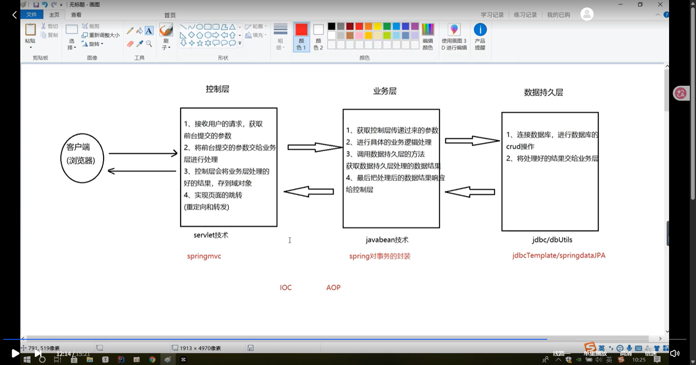
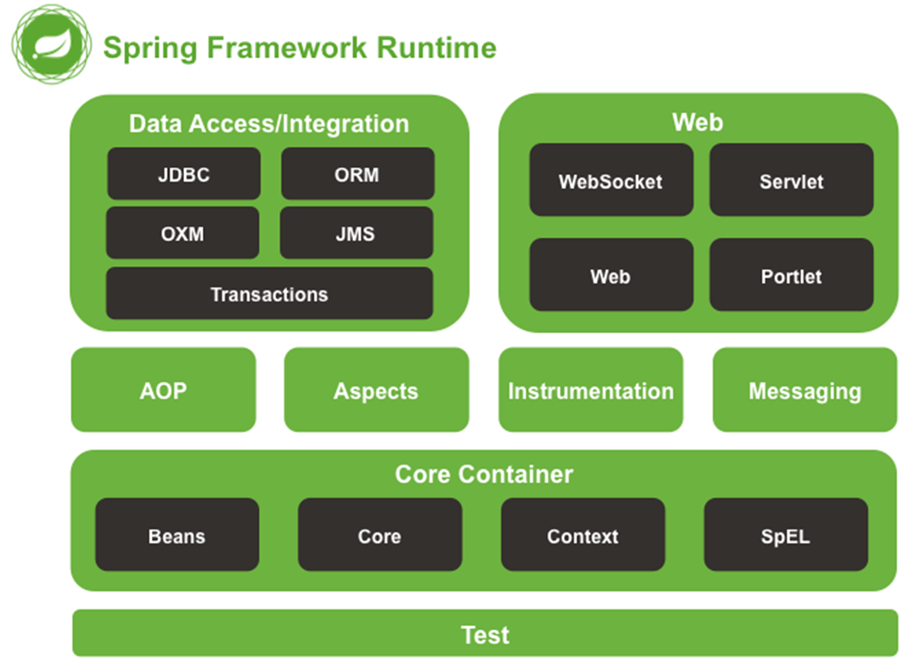
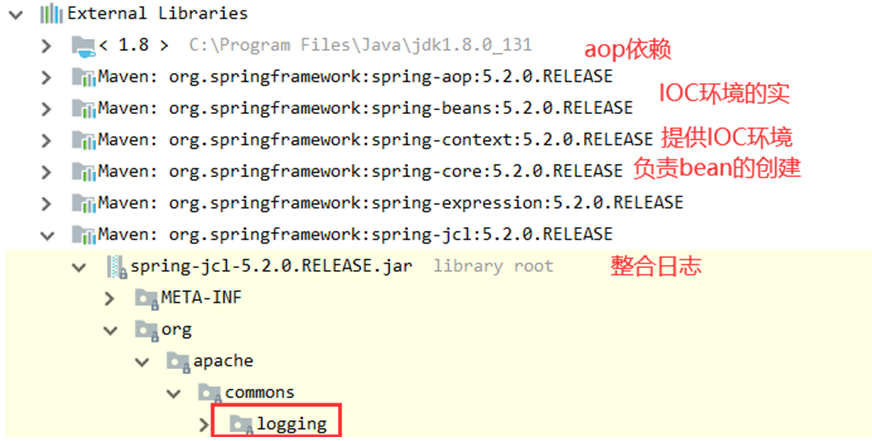
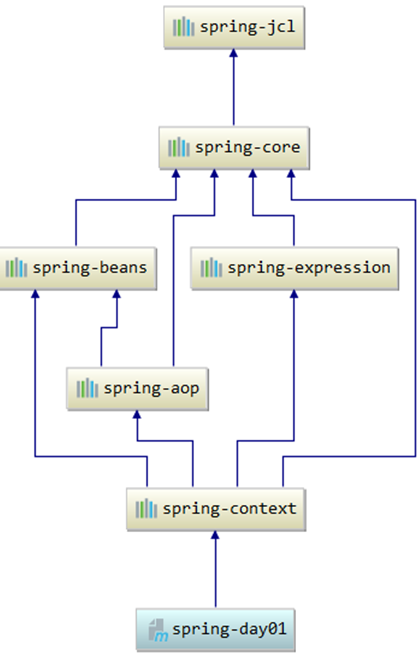
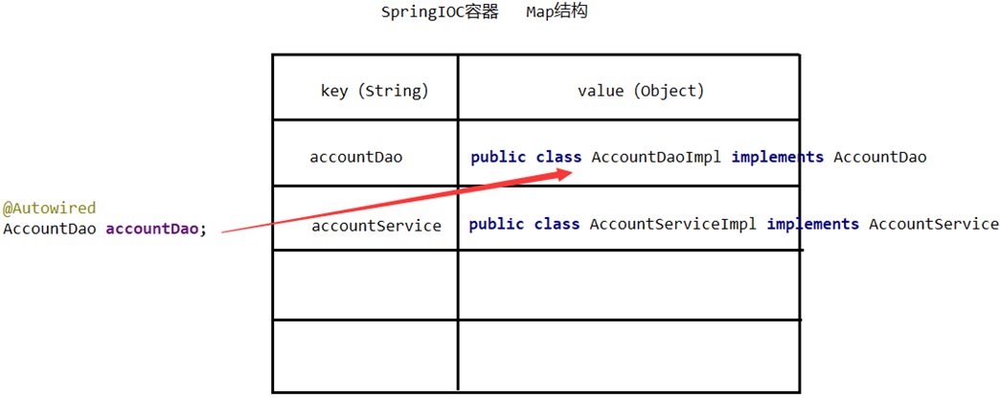

# 02_Spring

## 1. Spring框架的概述以及Spring基于XMl 的 IOC  配置

### 1.1 Spring 概述

#### 1.1.1 什么是 Spring

Spring 是分层的 Java SE/EE 应用 full-stack轻量级开源框架，以 IoC(Inverse Of Control：控制反转)和 AOP(Aspect Oriented Programming：面向切面编程)为内核提供了展现层 SpringMVC 和持久层 Spring JDBC 以及业务层事务管理等众多的企业级应用技术，还能整合众多著名的第三方框架和类库，逐渐成为使用最多的 Java EE 企业应用开源框架。



#### 1.1.2 Spring 优势

*   方便解耦，简化开发

    通过 Spring 提供的 IoC 容器，可以将对象间的依赖关系交由 Spring 进行控制，避免硬编码所造成的过度程序耦合。用户也不必再为单例模式类、属性文件解析等这些很底层的需求编写代码，可以更专注于上层的应用。

*   AOP 编程的支持

    通过 Spring 的 AOP 功能，方便进行面向切面的编程，许多不容易用传统 OOP 实现的功能可以通过 AOP 轻松应付。

*   声明式事务的支持

    可以将我们从单调烦闷的事务管理代码中解脱出来，通过声明式方式灵活的进行事务的管理，提高开发效率和质量。

*   方便程序的测试

    可以用非容器依赖的编程方式进行几乎所有的测试工作，测试不再是昂贵的操作，而是随手可做的事情。

*   方便集成各种优秀的框架

    Spring 可以降低各种框架的使用难度，提供了对各种优秀框架（ Struts、 Hibernate、 Hessian、Quartz等）的直接支持。

*   降低 JavaEE API 的使用难度

    Spring 对 JavaEE API（如 JDBC、 JavaMail、远程调用等）进行了薄薄的封装层，使这些 API 的使用难度大为降低。

*   Java 源码是经典学习范例

    Spring 的源代码设计精妙、结构清晰、匠心独用，处处体现着大师对 Java 设计模式灵活运用以及对 Java 技术的高深造诣。它的源代码无意是 Java 技术的最佳实践的范例。

#### 1.1.3 Spring 的体系



### 1.2 程序中的耦合

#### 1.2.1 使用反射解耦

`pom.xml`

```xml
<?xml version="1.0" encoding="UTF-8"?>
<project xmlns="http://maven.apache.org/POM/4.0.0"
         xmlns:xsi="http://www.w3.org/2001/XMLSchema-instance"
         xsi:schemaLocation="http://maven.apache.org/POM/4.0.0 http://maven.apache.org/xsd/maven-4.0.0.xsd">
    <modelVersion>4.0.0</modelVersion>
    <parent>
        <groupId>com.sonnet.parent</groupId>
        <artifactId>spring-study</artifactId>
        <version>1.0-SNAPSHOT</version>
    </parent>

    <groupId>com.sonnet.jdbc</groupId>
    <artifactId>spring-study-jdbc</artifactId>

    <properties>
        <maven.compiler.source>17</maven.compiler.source>
        <maven.compiler.target>17</maven.compiler.target>
        <project.build.sourceEncoding>UTF-8</project.build.sourceEncoding>
    </properties>

    <dependencies>
        <dependency>
            <groupId>com.mysql</groupId>
            <artifactId>mysql-connector-j</artifactId>
            <version>8.4.0</version>
        </dependency>
    </dependencies>
</project>
```

`Account`

```java
package com.sonnet.jdbc.pojo;

/**
 * 描述账户信息
 */
public class Account {

    private Integer id;

    private String name;

    private Double money;

    @Override
    public String toString() {
        return "Account{" +
                "id=" + id +
                ", name='" + name + '\'' +
                ", money=" + money +
                '}';
    }

    public Integer getId() {
        return id;
    }

    public void setId(Integer id) {
        this.id = id;
    }

    public String getName() {
        return name;
    }

    public void setName(String name) {
        this.name = name;
    }

    public Double getMoney() {
        return money;
    }

    public void setMoney(Double money) {
        this.money = money;
    }
}
```

`TestJdbc`

```java
package com.sonnet.jdbc;

import com.mysql.cj.jdbc.Driver;
import com.sonnet.jdbc.pojo.Account;

import java.sql.*;

public class TestJdbc {

    public static void main(String[] args) throws SQLException, ClassNotFoundException {

        // 注册驱动
        //DriverManager.registerDriver(new Driver());
        Class.forName("com.mysql.cj.jdbc.Driver");
        // 准备连接数据库用到的用户名，密码，url
        String username = "root";
        String password = "root";
        String url = "jdbc:mysql://localhost:3306/spring_lesson?useSSL=false&serverTimezone=Asia/Shanghai";
        // 获取连接对象
        Connection connection = DriverManager.getConnection(url, username, password);
        String sql = "select * from account";
        // 创建PreparedStatement对象， 预编译sql语句
        PreparedStatement preparedStatement = connection.prepareStatement(sql);
        // 执行sql语句
        ResultSet resultSet = preparedStatement.executeQuery();
        while (resultSet.next()) {
            Integer id = resultSet.getInt("id");
            String name = resultSet.getString("name");
            Double money = resultSet.getDouble("money");
            Account account = new Account();
            account.setId(id);
            account.setName(name);
            account.setMoney(money);
            System.out.println(account);
        }
        // 关闭资源
        resultSet.close();
        preparedStatement.close();
        connection.close();
    }
}
```

#### 1.2.2 使用工厂解耦

##### 1.2.2.1 示例代码

*   dao 部分

    ```java
    public interface AccountDao {
        //模拟新增account的方法
        public void addAccount();
    }
    ```

    ```java
    public class AccountDaoImpl implements AccountDao{
        //模拟新增账户的dao
        public void addAccount() {
            System.out.println("新增账户的方法实现了.....");
        }
    }
    ```

*   service 部分

    ```java
    public interface AccountService {
        //模拟新增账户的业务
        public void addAccount();
    }
    ```

    ```java
    public class AccountServiceImpl implements AccountService {
        //新增用户的方法
        public void addAccount() {
            AccountDao dao = new AccountDaoImpl();
            dao.addAccount();
        }
    }
    ```

##### 1.2.2.2 耦合分析及解决方案

此时我们也会发现问题：

在业务层里面(service层)会去调用dao层。这就是刚刚提到的耦合性问题。

如果此时删除掉接口的实现类，必然编译报错。

**在解决问题之前，我们先明确几个概念：**

1.   Bean: 在计算机英语中，有可重用组件（如持久层和业务层的接口和重用）的含义。

2.   JavaBean: 其实JavaBean并不完全等于实体类，因为实体类只是可重用组件的一部分，也就是JavaBean的范围大于实体类的范围。

     JavaBean的含义：用Java语言编写的可重用组件。

3.   工厂就是创建我们的service和dao对象的(JavaBean)。

**解决步骤：**

1.   需要一个配置文件来配置我们的service和dao。

     配置的内容：唯一标志=全限定类名（key=value）。

2.   通过读取配置文件中配置的内容，反射创建对象。

**配置文件的选取：**

1.   xml（当然后期spring框架用的肯定是xml）

2.   properties（读取更简单，我们这个例程先选用这种）

*   定义配置文件
*   定义一个工厂类，通过工程来获取bean

`bean.properties`

```properties
# k=v k javabean的名称 v 类的全限定名
accountDao=com.sonnet.dao.impl.AccountDaoImpl
mybatisAccountDao=com.sonnet.dao.impl.MybatisAccountDaoImpl
accountService=com.sonnet.service.impl.AccountServiceImpl
```

`BeanFactory`

```java
package com.sonnet.factory;

import java.io.IOException;
import java.io.InputStream;
import java.util.Enumeration;
import java.util.HashMap;
import java.util.Map;
import java.util.Properties;

/**
 * 工厂类 专门帮助我们创建对象
 */
public class BeanFactory {

     static Properties properties;

     static Map<String, Object> beans;

    // 读取properties里面的配置信息
    static {
        // 通过类加载器加载路径下面的配置文件
        InputStream resourceAsStream = BeanFactory.class.getClassLoader().getResourceAsStream("bean.properties");
        properties = new Properties();
        try {
            properties.load(resourceAsStream);
            beans = new HashMap<>();
            Enumeration<Object> keys = properties.keys();
            while(keys.hasMoreElements()) {
                String key = keys.nextElement().toString();
                // 通过key获取value
                String value = properties.getProperty(key);
                Object o = Class.forName(value).newInstance();
                beans.put(key, o);
            }
        } catch (Exception e) {
            throw new RuntimeException(e);
        }
    }

/*
    // 获取bean的方法
    public static Object getBean(String name) {
        // 根据key获取value的值
        String value = properties.getProperty(name);
        try {
            // 基于反射创建对象，
            // 目前创建的对象不是单例的而是多例的，
            // 原因是基于反射创建的对象不存盘，每次创建用完之后，都会被垃圾回收机制回收
            // 问题：每次调用的时候都需要重新创建对象，比较耗时，浪费性能
            Object o = Class.forName(value).newInstance();
            return o;
        } catch (Exception e) {
            throw new RuntimeException(e);
        }
    }
*/

    // 获取bean
    public static Object getBean(String name) {
        return beans.get(name);
    }
}

```

`AccountServiceImpl`

```java
package com.sonnet.service.impl;

import com.sonnet.dao.AccountDao;
import com.sonnet.dao.impl.AccountDaoImpl;
import com.sonnet.dao.impl.MybatisAccountDaoImpl;
import com.sonnet.factory.BeanFactory;
import com.sonnet.pojo.Account;
import com.sonnet.service.AccountService;

/**
 * 目前代码存在的问题：
 * 如果出现新的需求，程序中需要修改源代码才能实现
 * 明确概念：
 * 1. Bean：组件 在Java中指的是dao层，业务层的接口或者接口的实现
 * 2. JavaBean： 实体类，JavaBean并不完全等同于实体类，因为实体类只是组件的一部分
 * 3. 工厂： 创建JavaBean（创建dao 业务层 实现类的对象）
 * 解决方案：
 * 1. 通过一个配置文件来管理我们的dao接口实现类和业务类
 *      properties配置文件来管理 k=v 唯一标识=权限定名（包名+类名）
 * 2. 通过读取配置文件中的内容，获取v，基于反射的技术创建对象
 */
public class AccountServiceImpl implements AccountService {

    @Override
    public void addAccount() {
        //AccountDao accountDao = new AccountDaoImpl();
        //AccountDao accountDao = new MybatisAccountDaoImpl();
        AccountDao accountDao = (AccountDao) BeanFactory.getBean("mybatisAccountDao");
        accountDao.addAccount();
    }
}
```

### 1.3 IOC 的概念及其作用

创建对象的方式有2种

1.   `AccountDao dao = new AccountDaoImpl();`
2.   `AccountDao dao = (AccountDao) BeanFactory.getBean("accountDao");`

第一种创建对象的方式是我们主动创建的，控制权在我们手里。但是程序的耦合性高

第二种创建对象的方式是交给工厂帮我们创建的，控制权交给工厂了。这样降低了程序的耦合性。

但是我们每次都自己通过工厂+配置的方式创建对象的过程过于繁琐，那我们看看Spring是如何帮我们做的。

#### 1.3.1 基于XML的IOC环境搭建和入门

spring 入门环境的搭建

1.   导入 spring 依赖 spring-context

2.   定义 dao servic 的接口以及实现类

3.   创建一个 xml 的配置文件，通过bean标签来管理bean

     `<bean id="" class=""><bean>`

     4.   获取bean

          首先要初始化bean工厂（IOC）

          调用工厂提供的getBean方法获取bean

          ```java
          // 读取spring的配置文件来初始化一个ioc容器
          ApplicationContext context = new ClassPathXmlApplicationContext("applicationContext.xml");
          // 获取bean
          AccountDao accountDao = (AccountDao) context.getBean("accountDao");
          accountDao.addAccount();
          AccountService accountService = (AccountService) context.getBean("accountService");
          accountService.addAccount();
          ```


##### 1.3.1.1 创建一个maven工程，导入spring的依赖

```xml
<project xmlns="http://maven.apache.org/POM/4.0.0" xmlns:xsi="http://www.w3.org/2001/XMLSchema-instance"
         xsi:schemaLocation="http://maven.apache.org/POM/4.0.0 http://maven.apache.org/xsd/maven-4.0.0.xsd">
    <modelVersion>4.0.0</modelVersion>
    <parent>
        <groupId>com.sonnet.parent</groupId>
        <artifactId>spring-study</artifactId>
        <version>1.0-SNAPSHOT</version>
    </parent>

    <groupId>com.sonnet</groupId>
    <artifactId>spring-study-ioc-demo1</artifactId>
    <packaging>jar</packaging>

    <name>spring-study-ioc-demo1</name>
    <url>http://maven.apache.org</url>

    <properties>
        <project.build.sourceEncoding>UTF-8</project.build.sourceEncoding>
    </properties>

    <dependencyManagement>
        <dependencies>
            <dependency>
                <groupId>org.springframework</groupId>
                <artifactId>spring-framework-bom</artifactId>
                <version>5.3.29</version>
                <type>pom</type>
                <scope>import</scope>
            </dependency>
        </dependencies>
    </dependencyManagement>

    <dependencies>
        <dependency>
            <groupId>junit</groupId>
            <artifactId>junit</artifactId>
            <version>3.8.1</version>
            <scope>test</scope>
        </dependency>
        <dependency>
            <groupId>org.springframework</groupId>
            <artifactId>spring-context</artifactId>
        </dependency>
    </dependencies>
</project>

```





##### 1.3.1.2 定义 dao servic 的接口以及实现类

```java
package com.sonnet.dao.impl;

import com.sonnet.dao.AccountDao;

public class AccountDaoImpl implements AccountDao {
    @Override
    public void addAccount() {
        System.out.println("新增账户的方法被实现了");
    }
}
```

```java
package com.sonnet.dao;

public interface AccountDao {

    public void addAccount();
}
```

```java
package com.sonnet.service;

public interface AccountService {

    public void addAccount();
}
```

```java
package com.sonnet.service.impl;

import com.sonnet.service.AccountService;

public class AccountServiceImpl implements AccountService {
    @Override
    public void addAccount() {
        System.out.println("accountService方法被实现");
    }
}
```

##### 1.3.1.3 创建一个 xml 的配置文件，通过bean标签来管理bean

```xml
<?xml version="1.0" encoding="UTF-8"?>
<beans xmlns="http://www.springframework.org/schema/beans"
       xmlns:xsi="http://www.w3.org/2001/XMLSchema-instance"
       xsi:schemaLocation="http://www.springframework.org/schema/beans http://www.springframework.org/schema/beans/spring-beans.xsd">

    <!--
        在spring环境中管理bean
        bean标签就是帮助我们管理bean的标签，将bean放在spring的ioc容器中
            id：bean的名称，在定义的时候可以任意取值，但必须要唯一
            class：bean所属的权限定名
    -->
    <bean id="accountDao" class="com.sonnet.dao.impl.AccountDaoImpl"></bean>
    <bean id="accountService" class="com.sonnet.service.impl.AccountServiceImpl"></bean>
</beans>
```

`测试类1`

```java
package com.sonnet.test;

import com.sonnet.dao.AccountDao;
import com.sonnet.service.AccountService;
import org.springframework.context.ApplicationContext;
import org.springframework.context.support.ClassPathXmlApplicationContext;

public class TestAccount {

    public static void main(String[] args) {
        // 读取spring的配置文件来初始化一个ioc容器
        ApplicationContext context = new ClassPathXmlApplicationContext("applicationContext.xml");
        // 获取bean
        AccountDao accountDao = (AccountDao) context.getBean("accountDao");
        accountDao.addAccount();
        AccountService accountService = (AccountService) context.getBean("accountService");
        accountService.addAccount();
    }
}
```

`测试类2`

```java
package com.sonnet.test;

import com.sonnet.dao.AccountDao;
import com.sonnet.service.AccountService;
import org.springframework.beans.factory.BeanFactory;
import org.springframework.beans.factory.xml.XmlBeanFactory;
import org.springframework.context.ApplicationContext;
import org.springframework.context.support.ClassPathXmlApplicationContext;
import org.springframework.core.io.ClassPathResource;
import org.springframework.core.io.Resource;

public class TestAccount {

    public static void main(String[] args) {
/*
        //// 读取spring的配置文件来初始化一个ioc容器
        //ApplicationContext context = new ClassPathXmlApplicationContext("applicationContext.xml");
        //// 获取bean
        //AccountDao accountDao = (AccountDao) context.getBean("accountDao");
        //accountDao.addAccount();
        //AccountService accountService = (AccountService) context.getBean("accountService");
        //accountService.addAccount();
*/

        // 通过BeanFactory的方式来创建对象
        Resource resource = new ClassPathResource("applicationContext.xml");
        BeanFactory beanFactory = new XmlBeanFactory(resource);
        AccountDao accountDao = (AccountDao) beanFactory.getBean("accountDao");
        AccountService accountService = (AccountService) beanFactory.getBean("accountService");
        accountDao.addAccount();
        accountService.addAccount();
    }
}
```

#### 1.3.2 详解 `ApplicationContext`

1.   `BeanFactory`和`ApplicationContext`之间的区别

     `BeanFactory`：Bean工厂（IOC）容器的顶级接口，里面定义了Bean工厂的约束和规范，`getBean()`是从容器中获取bean的方法

     `ApplicationContext`：间接继承了`BeanFactory`。对`BeanFactory`的方法进行了扩展

     区别：bean的加载时机不一样，当bean工厂一旦初始化完成，`ApplicationContext`是立即加载所有需要管理的bean；而`BeanFactory`是懒加载所有需要的bean，bean不会随着工厂的创建而创建，而是调用bean的时候，才会初始化bean

2.   关于`ApplicationContext`的实现类：

     *   `ClassPathXmlApplicationContext`：加载类路径下面的spring配置文件

     *   `FileSystemXmlApplicationContext`：加载磁盘绝对路径下的配置文件(很少用)
         *   `ApplicationContext context = new FileSystemXmlApplicationContext("D\\applicationContext.xml")`

     *   `AnnotationConfigApplicationContext`：用于注解环境，创建的容器

### 1.4 Spring对bean的管理方式

#### 1.4.1 无参数构造函数的实例化方式

无参数构造函数实例化方式是Spring默认的bean的实例化方式

*   创建接口及实现类

    ```java
    public interface UserDao {
        public void addUser();
    }
    ```

    ```java
    public class UserDaoImpl implements UserDao {
        public UserDaoImpl(){
            System.out.println("构造函数执行了.....");
        }
        public void addUser() {
            System.out.println("新增用户实现了....");
        }
    }
    ```

*   定义配置文件

    ```xml
    <?xml version="1.0" encoding="UTF-8"?>
    <beans xmlns="http://www.springframework.org/schema/beans"
           xmlns:xsi="http://www.w3.org/2001/XMLSchema-instance"
           xsi:schemaLocation="http://www.springframework.org/schema/beans
                               http://www.springframework.org/schema/beans/spring-beans.xsd">
        <bean id="userDao" class="com.xq.dao.impl.UserDaoImpl"></bean>
    </beans>
    ```

*   测试

    ```java
    public class TestUserDao {
        public static void main(String[] args) {
            ApplicationContext context = new
                ClassPathXmlApplicationContext("bean.xml");
            UserDao userDao = (UserDao) context.getBean("userDao");
            userDao.addUser();
        }
    }
    ```

#### 1.4.2 使用工厂中的普通方法实例化对象

设想一个场景：我们要使用别人写好的代码，别人写好的代码通常是封装在一个jar包中的，要怎么创建jar包中字节码文件的对象呢？（我们无法通过修改源码的方式来提供默认构造方法）

接下来模拟一个工厂类（它可能是存在于jar包中的），通常jar包都会暴露一个工厂类，给调用者创建对象。

*   创建接口以及其实现类

    ```java
    public interface PersonDao {
        public void addPerson();
    }
    ```

    ```java
    public class PersonDaoImpl implements PersonDao {
        public void addPerson() {
            System.out.println("新增person执行了....");
        }
    }
    ```

*   创建工厂类

    ```java
    public class PersonFactory {
        //方法的返回值就是需要管理的bean的类型
        public PersonDao getPerson(){
            return new PersonDaoImpl();
        }
    }
    ```

*   定义配置文件

    ```xml
    <bean id="personFactory" class="com.xq.factory.PersonFactory"></bean>
    <bean id="personDao" class="com.xq.dao.impl.PersonDaoImpl" factory-bean="personFactory" factory-method="getPerson"></bean>
    ```

#### 1.4.3 使用工厂中的静态方法实例化对象

*   创建接口以及其实现类

    ```java
    public interface OrderDao {
        public void addOrder();
    }
    ```

    ```java
    public class OrderDaoImpl implements OrderDao {
        public void addOrder() {
            System.out.println("addOrder方法执行了.....");
        }
    }
    ```

*   创建工厂类

    ```java
    public class OrderFactory {
        public static OrderDao getOrder(){
            return new OrderDaoImpl();
        }
    }
    ```

*   定义配置文件

    ```java
    <bean id="orderFactory" class="com.xq.factory.OrderFactory" factory-method="getOrder"></bean>
    ```

### 1.5 Bean的细节

1.   bean的管理方法

     无参数的构造函数管理（默认）

     静态实例化工厂管理bean

     实例化工厂管理bean

2.   bean的作用域

     scope属性是描述bean的作用域，singleton 单例bean， prototype 多例bean

3.   bean的生命周期

     `init-method`：描述初始化bean的是时候需要执行的方法

     `destroy-method`：描述bean销毁的时候需要执行的方法

### 1.6 DI的概念和作用

依赖注入：Dependency Injection

IOC的作用：降低程序间的耦合（依赖关系）

DI的作用：依赖关系的管理，依赖都交给spring来维护。在当前类需要用到其他类的对象，由spring为我们提供，我们只需要在配置文件中说明

依赖关系的维护：就称之为依赖注入

能注入的数据：有三类

​	基本类型和String

​	其他bean类型（在配置文件中或者注解配置过的bean）

​	复杂类型/集合类型

注入的方式：

​	第一种：使用构造函数提供

​	第二种：使用set方法提供

​	第三种：使用注解提供（后面再介绍）

#### 1.6.1 set方法注入（默认）

涉及的标签：property

出现的位置：bean标签的内部

标签的属性：

*   name：用于指定注入时所调用的set方法名称（如：setName --> name）

*   value：用于提供基本类型和String类型的数据

*   ref：用于指定其他的bean类型数据。它指的就是在spring的ioc核心容器中出现过的bean对象

`user`

```java
package com.sonnet.pojo;

public class User {

    private String username;
    private Integer age;
    private String address;

    private Car car;

    @Override
    public String toString() {
        return "User{" +
                "username='" + username + '\'' +
                ", age=" + age +
                ", address='" + address + '\'' +
                ", car=" + car +
                '}';
    }

    public Car getCar() {
        return car;
    }

    public void setCar(Car car) {
        this.car = car;
    }

    public String getUsername() {
        return username;
    }

    public void setUsername(String username) {
        this.username = username;
    }

    public Integer getAge() {
        return age;
    }

    public void setAge(Integer age) {
        this.age = age;
    }

    public String getAddress() {
        return address;
    }

    public void setAddress(String address) {
        this.address = address;
    }
}
```

`car`

```java
package com.sonnet.pojo;

public class Car {

    private String brand;
    private String type;

    @Override
    public String toString() {
        return "Car{" +
                "brand='" + brand + '\'' +
                ", type='" + type + '\'' +
                '}';
    }

    public String getBrand() {
        return brand;
    }

    public void setBrand(String brand) {
        this.brand = brand;
    }

    public String getType() {
        return type;
    }

    public void setType(String type) {
        this.type = type;
    }
}
```

`applicationContext`

```xml
<?xml version="1.0" encoding="UTF-8"?>
<beans xmlns="http://www.springframework.org/schema/beans"
       xmlns:xsi="http://www.w3.org/2001/XMLSchema-instance"
       xsi:schemaLocation="http://www.springframework.org/schema/beans http://www.springframework.org/schema/beans/spring-beans.xsd">

    <!--
        第一种：使用set方法进行注入，使用set方法注入的前提是，被管理的bean必须提供set方法
            property标签：完成bean的属性的注入
                name：描述bean的属性名称
                value：描述bean的属性值（基本数据类型，字符串数据类型）
                ref：注入的是引用数据类型的值，引用的是另外一个bean的id
    -->
    <bean id="car" class="com.sonnet.pojo.Car">
        <property name="type" value="BMW540"></property>
        <property name="brand" value="宝马"></property>
    </bean>
    <bean id="user" class="com.sonnet.pojo.User">
        <property name="username" value="eric"></property>
        <property name="age" value="18"></property>
        <property name="address" value="USA"></property>
        <property name="car" ref="car"></property>
    </bean>
</beans>
```

`userTest`

```java
package com.sonnet.test;

import com.sonnet.pojo.User;
import org.springframework.context.ApplicationContext;
import org.springframework.context.support.ClassPathXmlApplicationContext;

public class TestUser {

    public static void main(String[] args) {
        ApplicationContext context = new ClassPathXmlApplicationContext("applicationContext.xml");
        User user = (User) context.getBean("user");
        System.out.println(user);
    }
}
```

#### 1.6.2 使用构造函数注入

使用的标签：constructor-arg

标签出现的位置：bean标签的内部

标签中的属性：

*   name（最常用）：用于指定给构造函数中指定名称的参数赋值

*   value：用于提供基本类型和String类型的数据

*   ref：用于指定其他的bean类型数据（它指的就是在spring的ioc核心容器中出现过的bean对象）

`department`

```java
package com.sonnet.pojo;

public class Department {

    private Integer id;
    private String name;
    private String location;

    public Department() {}

    @Override
    public String toString() {
        return "Department{" +
                "id=" + id +
                ", name='" + name + '\'' +
                ", location='" + location + '\'' +
                '}';
    }

    public Department(Integer id, String name, String location) {
        this.id = id;
        this.name = name;
        this.location = location;
    }
}
```

`emp`

```java
package com.sonnet.pojo;

public class Emp {
    private Integer id;
    private String name;
    private Integer age;
    private Department department;

    public Emp() {}

    @Override
    public String toString() {
        return "Emp{" +
                "id=" + id +
                ", name='" + name + '\'' +
                ", age=" + age +
                ", department=" + department +
                '}';
    }

    public Emp(Integer id, String name, Integer age, Department department) {
        this.id = id;
        this.name = name;
        this.age = age;
        this.department = department;
    }
}
```

`applicationContext.xml`

```xml
<?xml version="1.0" encoding="UTF-8"?>
<beans xmlns="http://www.springframework.org/schema/beans"
       xmlns:xsi="http://www.w3.org/2001/XMLSchema-instance"
       xsi:schemaLocation="http://www.springframework.org/schema/beans http://www.springframework.org/schema/beans/spring-beans.xsd">

    <!--
        第一种：使用set方法进行注入，使用set方法注入的前提是，被管理的bean必须提供set方法
            property标签：完成bean的属性的注入
                name：描述bean的属性名称
                value：描述bean的属性值（基本数据类型，字符串数据类型）
                ref：注入的是引用数据类型的值，引用的是另外一个bean的id
    -->
    <bean id="car" class="com.sonnet.pojo.Car">
        <property name="type" value="BMW540"></property>
        <property name="brand" value="宝马"></property>
    </bean>
    <bean id="user" class="com.sonnet.pojo.User">
        <property name="username" value="eric"></property>
        <property name="age" value="18"></property>
        <property name="address" value="USA"></property>
        <property name="car" ref="car"></property>
    </bean>

    <!--
        spring的依赖注入的第二种方式：使用构造函数注入
            constructor-arg：完成依赖注入 使用的是带参数的构造函数完成
                name：属性名称
                value：属性名称所属的值，必须是基本数据类型和字符串类型的值
                ref：引用数据类型的值
    -->
    <bean id="department" class="com.sonnet.pojo.Department">
        <constructor-arg name="id" value="1"></constructor-arg>
        <constructor-arg name="name" value="技术"></constructor-arg>
        <constructor-arg name="location" value="Beijing"></constructor-arg>
    </bean>
    <bean id="emp" class="com.sonnet.pojo.Emp">
        <constructor-arg name="id" value="1001"></constructor-arg>
        <constructor-arg name="name" value="eric"></constructor-arg>
        <constructor-arg name="age" value="18"></constructor-arg>
        <constructor-arg name="department" ref="department"></constructor-arg>
    </bean>
</beans>
```

`TestEmp`

```java
package com.sonnet.test;

import com.sonnet.pojo.Emp;
import org.springframework.context.ApplicationContext;
import org.springframework.context.support.ClassPathXmlApplicationContext;

public class TestEmp {

    public static void main(String[] args) {
        ApplicationContext context = new ClassPathXmlApplicationContext("applicationContext.xml");
        Emp emp = (Emp) context.getBean("emp");
        System.out.println(emp);
    }
}
```

#### 1.6.3 复杂类型数据的注入

`animal`

```java
package com.sonnet.pojo;

import java.util.*;

public class Animal {

    private String[] strs;
    private List<String> list;
    private Set<String> set;
    private Map<String,String> map;
    private Properties pros;

    @Override
    public String toString() {
        return "animal{" +
                "strs=" + Arrays.toString(strs) +
                ", list=" + list +
                ", set=" + set +
                ", map=" + map +
                ", pros=" + pros +
                '}';
    }

    public String[] getStrs() {
        return strs;
    }

    public void setStrs(String[] strs) {
        this.strs = strs;
    }

    public List<String> getList() {
        return list;
    }

    public void setList(List<String> list) {
        this.list = list;
    }

    public Set<String> getSet() {
        return set;
    }

    public void setSet(Set<String> set) {
        this.set = set;
    }

    public Map<String, String> getMap() {
        return map;
    }

    public void setMap(Map<String, String> map) {
        this.map = map;
    }

    public Properties getPros() {
        return pros;
    }

    public void setPros(Properties pros) {
        this.pros = pros;
    }
}
```

`applicationContext.xml`

```xml
<?xml version="1.0" encoding="UTF-8"?>
<beans xmlns="http://www.springframework.org/schema/beans"
       xmlns:xsi="http://www.w3.org/2001/XMLSchema-instance"
       xsi:schemaLocation="http://www.springframework.org/schema/beans http://www.springframework.org/schema/beans/spring-beans.xsd">

    <!--
        第一种：使用set方法进行注入，使用set方法注入的前提是，被管理的bean必须提供set方法
            property标签：完成bean的属性的注入
                name：描述bean的属性名称
                value：描述bean的属性值（基本数据类型，字符串数据类型）
                ref：注入的是引用数据类型的值，引用的是另外一个bean的id
    -->
    <bean id="car" class="com.sonnet.pojo.Car">
        <property name="type" value="BMW540"></property>
        <property name="brand" value="宝马"></property>
    </bean>
    <bean id="user" class="com.sonnet.pojo.User">
        <property name="username" value="eric"></property>
        <property name="age" value="18"></property>
        <property name="address" value="USA"></property>
        <property name="car" ref="car"></property>
    </bean>

    <!--
        spring的依赖注入的第二种方式：使用构造函数注入
            constructor-arg：完成依赖注入 使用的是带参数的构造函数完成
                name：属性名称
                value：属性名称所属的值，必须是基本数据类型和字符串类型的值
                ref：引用数据类型的值
    -->
    <bean id="department" class="com.sonnet.pojo.Department">
        <constructor-arg name="id" value="1"></constructor-arg>
        <constructor-arg name="name" value="技术"></constructor-arg>
        <constructor-arg name="location" value="Beijing"></constructor-arg>
    </bean>
    <bean id="emp" class="com.sonnet.pojo.Emp">
        <constructor-arg name="id" value="1001"></constructor-arg>
        <constructor-arg name="name" value="eric"></constructor-arg>
        <constructor-arg name="age" value="18"></constructor-arg>
        <constructor-arg name="department" ref="department"></constructor-arg>
    </bean>

    <!--
        进行复杂数据类型的注入
    -->
    <bean id="animal" class="com.sonnet.pojo.Animal">
        <!--注入数组类型的值-->
        <property name="strs">
            <array>
                <value>str1</value>
                <value>str2</value>
                <value>str3</value>
            </array>
        </property>
        <!--注入list类型的值-->
        <property name="list">
            <list>
                <value>list1</value>
                <value>list2</value>
                <value>list3</value>
            </list>
        </property>
        <!--注入set类型的值-->
        <property name="set">
            <set>
                <value>s1</value>
                <value>s2</value>
                <value>s3</value>
            </set>
        </property>
        <!--注入map类型的值-->
        <property name="map">
            <map>
                <entry key="k1" value="v1"></entry>
                <entry key="k2" value="v2"></entry>
                <entry key="k3" value="v3"></entry>
            </map>
        </property>
        <!--注入properties的值-->
        <property name="pros">
            <props>
                <prop key="p1">v1</prop>
                <prop key="p2">v2</prop>
                <prop key="p3">v3</prop>
            </props>
        </property>
    </bean>
</beans>
```

`TestAnimal`

```java
package com.sonnet.test;

import com.sonnet.pojo.Animal;
import org.springframework.context.ApplicationContext;
import org.springframework.context.support.ClassPathXmlApplicationContext;

public class TestAnimal {

    public static void main(String[] args) {
        ApplicationContext context = new ClassPathXmlApplicationContext("applicationContext.xml");
        Animal animal = (Animal) context.getBean("animal");
        System.out.println(animal);
    }
}
```

### 1.7 基于XML配置搭建IOC案例

#### 1.7.1 案例准备

*   创建数据表

    ```mysql
    create table account(
        id int primary key auto_increment,
        name varchar(40),
        money double
    )character set utf8 collate utf8_general_ci;
    insert into account(name,money) values(eric,1000);
    insert into account(name,money) values('james',1000);
    insert into account(name,money) values('curry',1000);
    ```

*   导入依赖

    ```xml
    <project xmlns="http://maven.apache.org/POM/4.0.0" xmlns:xsi="http://www.w3.org/2001/XMLSchema-instance"
             xsi:schemaLocation="http://maven.apache.org/POM/4.0.0 http://maven.apache.org/xsd/maven-4.0.0.xsd">
        <modelVersion>4.0.0</modelVersion>
        <parent>
            <groupId>com.sonnet.parent</groupId>
            <artifactId>spring-study</artifactId>
            <version>1.0-SNAPSHOT</version>
        </parent>
    
        <groupId>com.sonnet</groupId>
        <artifactId>spring-study-account</artifactId>
        <packaging>jar</packaging>
    
        <name>spring-study-account</name>
        <url>http://maven.apache.org</url>
    
        <properties>
            <project.build.sourceEncoding>UTF-8</project.build.sourceEncoding>
        </properties>
    
        <dependencies>
            <!--spring核心依赖-->
            <dependency>
                <groupId>org.springframework</groupId>
                <artifactId>spring-context</artifactId>
                <version>5.3.29</version>
            </dependency>
            <!--dbutils组件的依赖-->
            <dependency>
                <groupId>commons-dbutils</groupId>
                <artifactId>commons-dbutils</artifactId>
                <version>1.6</version>
            </dependency>
            <!--mysql的驱动-->
            <dependency>
                <groupId>com.mysql</groupId>
                <artifactId>mysql-connector-j</artifactId>
                <version>8.4.0</version>
            </dependency>
            <!--c3p0连接池-->
            <dependency>
                <groupId>c3p0</groupId>
                <artifactId>c3p0</artifactId>
                <version>0.9.1.2</version>
            </dependency>
            <!--junit单元测试依赖-->
            <dependency>
                <groupId>junit</groupId>
                <artifactId>junit</artifactId>
                <version>4.13.2</version>
                <scope>test</scope>
            </dependency>
        </dependencies>
    </project>
    ```

*   实体类

    ```java
    package com.sonnet.pojo;
    
    public class Account {
    
        private Integer id;
    
        private String name;
    
        private Double money;
    
        public Integer getId() {
            return id;
        }
    
        public void setId(Integer id) {
            this.id = id;
        }
    
        public String getName() {
            return name;
        }
    
        public void setName(String name) {
            this.name = name;
        }
    
        public Double getMoney() {
            return money;
        }
    
        public void setMoney(Double money) {
            this.money = money;
        }
    
        @Override
        public String toString() {
            return "Account{" +
                    "id=" + id +
                    ", name='" + name + '\'' +
                    ", money=" + money +
                    '}';
        }
    }
    ```

*   dao

    ```java
    package com.sonnet.dao;
    
    import com.sonnet.pojo.Account;
    
    import java.util.List;
    
    public interface AccountDao {
    
        /**
         * 查询所有账户信息
         *
         * @return 账户信息集合
         */
        List<Account> findAllAccount();
    
        /**
         * 查询指定的账户信息
         *
         * @param id 账户id
         * @return 账户
         */
        Account findAccountById(Integer id);
    
        /**
         * 保存账户信息
         *
         * @param account 账户
         */
        void saveAccount(Account account);
    
        /**
         * 更新账户信息
         *
         * @param account 账户
         */
        void updateAccount(Account account);
    
        /**
         * 删除账户信息
         *
         * @param id 账户id
         */
        void deleteAccount(Integer id);
    
    }
    ```

    ```java
    package com.sonnet.dao.impl;
    
    import com.sonnet.dao.AccountDao;
    import com.sonnet.pojo.Account;
    import org.apache.commons.dbutils.QueryRunner;
    import org.apache.commons.dbutils.handlers.BeanHandler;
    import org.apache.commons.dbutils.handlers.BeanListHandler;
    
    import java.sql.SQLException;
    import java.util.List;
    
    public class AccountDaoImpl implements AccountDao {
    
        // 操作数据库的核心类
        private QueryRunner runner;
    
        public void setRunner(QueryRunner runner) {
            this.runner = runner;
        }
    
        @Override
        public List<Account> findAllAccount() {
            String sql = "select * from account";
            try {
                return runner.query(sql, new BeanListHandler<Account>(Account.class));
            } catch (SQLException e) {
                throw new RuntimeException(e);
            }
        }
    
        @Override
        public Account findAccountById(Integer id) {
            String sql = "select * from account where id = ?";
            try {
                runner.query(sql, new BeanHandler<Account>(Account.class), id);
            } catch (SQLException e) {
                throw new RuntimeException(e);
            }
            return null;
        }
    
        @Override
        public void saveAccount(Account account) {
            String sql = "insert into account(name, money) value(?,?)";
            try {
                runner.update(sql, account.getName(), account.getMoney());
            } catch (SQLException e) {
                throw new RuntimeException(e);
            }
        }
    
        @Override
        public void updateAccount(Account account) {
            String sql = "update account set name=?, money=? where id=?";
            try {
                runner.update(sql, account.getName(), account.getMoney(), account.getId());
            } catch (SQLException e) {
                throw new RuntimeException(e);
            }
        }
    
        @Override
        public void deleteAccount(Integer id) {
            String sql = "delete from account where id=?";
            try {
                runner.update(sql, id);
            } catch (SQLException e) {
                throw new RuntimeException(e);
            }
        }
    }
    ```

*   service

    ```java
    package com.sonnet.service;
    
    import com.sonnet.pojo.Account;
    
    import java.util.List;
    
    public interface AccountService {
    
        /**
         * 查询所有账户信息
         *
         * @return 账户信息集合
         */
        List<Account> findAllAccount();
    
        /**
         * 查询指定的账户信息
         *
         * @param id 账户id
         * @return 账户
         */
        Account findAccountById(Integer id);
    
        /**
         * 保存账户信息
         *
         * @param account 账户
         */
        void saveAccount(Account account);
    
        /**
         * 更新账户信息
         *
         * @param account 账户
         */
        void updateAccount(Account account);
    
        /**
         * 删除账户信息
         *
         * @param id 账户id
         */
        void deleteAccount(Integer id);
    }
    ```

    ```java
    package com.sonnet.service.impl;
    
    import com.sonnet.dao.AccountDao;
    import com.sonnet.pojo.Account;
    import com.sonnet.service.AccountService;
    
    import java.util.List;
    
    public class AccountServiceImpl implements AccountService {
    
        AccountDao accountDao;
    
        public void setAccountDao(AccountDao accountDao) {
            this.accountDao = accountDao;
        }
    
        @Override
        public List<Account> findAllAccount() {
            return accountDao.findAllAccount();
        }
    
        @Override
        public Account findAccountById(Integer id) {
            return accountDao.findAccountById(id);
        }
    
        @Override
        public void saveAccount(Account account) {
            accountDao.saveAccount(account);
        }
    
        @Override
        public void updateAccount(Account account) {
            accountDao.updateAccount(account);
        }
    
        @Override
        public void deleteAccount(Integer id) {
            accountDao.deleteAccount(id);
        }
    }
    
    ```

#### 1.7.2 编写Spring的配置文件

`applicationContext.xml`

```xml
<?xml version="1.0" encoding="UTF-8"?>
<beans xmlns="http://www.springframework.org/schema/beans"
       xmlns:xsi="http://www.w3.org/2001/XMLSchema-instance"
       xsi:schemaLocation="http://www.springframework.org/schema/beans http://www.springframework.org/schema/beans/spring-beans.xsd">

    <!--
        配置数据源
        property：描述的是连接数据库所需要的用户名 密码 url 驱动类
    -->
    <bean id="dataSource" class="com.mchange.v2.c3p0.ComboPooledDataSource">
        <property name="driverClass" value="com.mysql.cj.jdbc.Driver"></property>
        <property name="jdbcUrl" value="jdbc:mysql://localhost:3306/spring_lesson?useSSL=false&amp;serverTimezone=Asia/Shanghai"></property>
        <property name="user" value="root"></property>
        <property name="password" value="root"></property>
    </bean>

    <!--
        管理QueryRunner核心对象
    -->
    <bean id="runner" class="org.apache.commons.dbutils.QueryRunner">
        <!--将数据源注入到QueryRunner中-->
        <constructor-arg name="ds" ref="dataSource"></constructor-arg>
    </bean>

    <!--
        管理dao
    -->
    <bean id="accountDao" class="com.sonnet.dao.impl.AccountDaoImpl">
        <property name="runner" ref="runner"></property>
    </bean>

    <!--
        管理service
    -->
    <bean id="accountService" class="com.sonnet.service.impl.AccountServiceImpl">
        <property name="accountDao" ref="accountDao"></property>
    </bean>
</beans>
```

#### 1.7.3 测试

`TestAccount`

```java
package com.sonnet;

import com.sonnet.pojo.Account;
import com.sonnet.service.AccountService;
import org.junit.Test;
import org.springframework.context.ApplicationContext;
import org.springframework.context.support.ClassPathXmlApplicationContext;

import java.util.List;

public class TestAccount {

    @Test
    public void test01() {
        ApplicationContext applicationContext = new ClassPathXmlApplicationContext("applicationContext.xml");
        AccountService accountService = (AccountService) applicationContext.getBean("accountService");
        List<Account> accountList = accountService.findAllAccount();
        accountList.forEach(System.out::println);
    }

    @Test
    public void test02() {
        ApplicationContext applicationContext = new ClassPathXmlApplicationContext("applicationContext.xml");
        AccountService accountService = (AccountService) applicationContext.getBean("accountService");
        Account account = accountService.findAccountById(1);
        System.out.println(account);
    }

    @Test
    public void test03() {
        ApplicationContext applicationContext = new ClassPathXmlApplicationContext("applicationContext.xml");
        AccountService accountService = (AccountService) applicationContext.getBean("accountService");
        Account account = new Account();
        account.setName("wangwu");
        account.setMoney(1000.0);
        accountService.saveAccount(account);
    }

    @Test
    public void test04() {
        ApplicationContext applicationContext = new ClassPathXmlApplicationContext("applicationContext.xml");
        AccountService accountService = (AccountService) applicationContext.getBean("accountService");
        Account account = new Account();
        account.setId(3);
        account.setMoney(10086.0);
        account.setName("laoliu");
        accountService.updateAccount(account);
    }

    @Test
    public void test05() {
        ApplicationContext applicationContext = new ClassPathXmlApplicationContext("applicationContext.xml");
        AccountService accountService = (AccountService) applicationContext.getBean("accountService");
        accountService.deleteAccount(3);
    }

}
```


## 2. Spring中基于注解的IOC

### 2.1 案例环境的搭建

#### 2.1.1 原生XML的配置

*   dao

    ```java
    package com.sonnet.dao;
    
    public interface AccountDao {
    
        void addAccount();
    }
    ```

    ```java
    package com.sonnet.dao.impl;
    
    import com.sonnet.dao.AccountDao;
    
    public class AccountDaoImpl implements AccountDao {
    
        @Override
        public void addAccount() {
            System.out.println("addAccount 被实现");
        }
    }
    ```

*   service

    ```java
    package com.sonnet.service;
    
    public interface AccountService {
    
        void addAccount();
    }
    ```

    ```java
    package com.sonnet.service.impl;
    
    import com.sonnet.dao.AccountDao;
    import com.sonnet.service.AccountService;
    
    public class AccountServiceImpl implements AccountService {
    
        public void setAccountDao(AccountDao accountDao) {
            this.accountDao = accountDao;
        }
    
        AccountDao accountDao;
    
        @Override
        public void addAccount() {
            accountDao.addAccount();
        }
    }
    ```

*   配置文件

    ```xml
    <?xml version="1.0" encoding="UTF-8"?>
    <beans xmlns="http://www.springframework.org/schema/beans"
           xmlns:xsi="http://www.w3.org/2001/XMLSchema-instance"
           xsi:schemaLocation="http://www.springframework.org/schema/beans http://www.springframework.org/schema/beans/spring-beans.xsd">
    
        <bean id="accountDao" class="com.sonnet.dao.impl.AccountDaoImpl"></bean>
    
        <bean id="accountService" class="com.sonnet.service.impl.AccountServiceImpl">
            <property name="accountDao" ref="accountDao"></property>
        </bean>
    </beans>
    ```

*   测试

    ```java
    package com.sonnet;
    
    import com.sonnet.service.AccountService;
    import org.junit.Test;
    import org.springframework.context.ApplicationContext;
    import org.springframework.context.support.ClassPathXmlApplicationContext;
    
    public class TestAccount {
    
        @Test
        public void test01() {
            ApplicationContext context = new ClassPathXmlApplicationContext("applicationContext.xml");
            AccountService accountService = (AccountService) context.getBean("accountService");
            accountService.addAccount();
        }
    
    }
    ```

#### 2.1.2 使用 IOC 注解来改造项目

在 spring 中我们可以通过注解的方式来管理bean。

##### 2.1.2.1 spring 中的注解

*   **用于创建对象的注解**

    *   作用：类似于xml中的`bean`标签`<bean id="" class=""></bean>`
    *   `@Component` 修饰类， 作用就是把当前的对象交给spring容器
        *   有一个value属性，用于指定bean的id。如果不写，bean的id默认就是当前类的类名小写
        *   如果要使用注解管理bean，前提一定要开启包扫描，如果不扫描包，会报错。
            *   通过`<context:component-scan base-package=""></context:component-scan>`标签开启包扫描
        *   `@Component` 还有其他衍生注解，这三个注解和`@Component`  的意思是一样的，但是为了明确三层开发，所以通常会使用下面三个注解描述bean
            *   `@Controller`：用于控制层
            *   `@Service`：用于业务层
            *   `@Repository`：用于持久层

*   **依赖注入的注解**

    *   作用：类似于xml中的`property`标签或者`constructor-arg`标签

    *   `@AutoWired` 修饰成员变量，它注入的原理是先按照类型进行注入，类型注入成功的前提是IOC容器中必须存在一个唯一的并且数据类型匹配的bean。

        如果然后再按照名称进行注入容器中存在多个数据类型匹配的bean。再按照名称进行注入。名称注入的前提是将`@AutoWired`注解修饰的变量的名称和容器中的bean的id进行匹配。如果匹配成功，说明按照名称注入成功，否则注入失败。

        

*   **其他注入数据的注解**

    *   `@Qualifier` 在按照注入的基础之上再按照名称注入。它给类成员注入的时候不能单独使用；但是在给方法参数注入时可以
        *   属性value：用于指定注入的bean的id
    *   `@Resource` 默认的情况下，可以直接按照bean的id注入，它可以独立使用
        *   属性name：用于指定bean的id
        *   属性type：按照类型进行注入
        *   如果既不指定name也不指定type属性，这时将通过反射机制使用`byName`自动注入策略
        *   总结：
            *   如果同时指定了name和type，则从Spring上下文中找到唯一匹配的bean进行装配，找不到则抛出异常
            *   如果指定了name，则从Spring上下文中查找名称（id）匹配的bean进行装配，找不到则抛出异常
            *   如果指定了type，则从Spring上下文中找到类型匹配的唯一bean进行装配，找不到或者找到多个，都抛出异常
            *   如果既没指定name也指定type，则自动按照`byName`方法进行装配
            *   `@Resource`的作用相当于`@AutoWired`，只不过`AutoWired`按照`byType`自动注入
    *   以上三个注入都只能注入其他bean类型的数据，而基本类型和String类型无法使用上述注入实现。另外集合类型的注入只能通过XML来实现
    *   `@Value` 用于注入基本类型和String类型的数据
        *   属性value：用于指定数据的值，它可以使用spring中的SpEL（也就是Spring的EL表达式）。
            *   `SpEL`的写法：`$(表达式)`

*   **改变作用域的注解**

    *   作用：类似于xml中bean标签中`scope`属性
    *   `@Scope` 用于指定bean的作用范围
        *   属性value：指定范围的取值，常用取值：Singleton（单例），prototype（多例）

*   **和生命周期相关的注解**

    *   作用：类型于bean标签中的`init-method`和`destroy-method`属性
    *   `@PostConstruct`
    *   `@preDestroy`

##### 2.1.2.2 示例

`Dao`

```java
package com.sonnet.dao;

public interface AccountDao {

    void addAccount();
}
```

```java
package com.sonnet.dao.impl;

import com.sonnet.dao.AccountDao;
import org.springframework.stereotype.Component;
import org.springframework.stereotype.Repository;

//@Component(value = "accountDao")
@Repository
public class AccountDaoImpl implements AccountDao {

    @Override
    public void addAccount() {
        System.out.println("addAccount 被实现");
    }
}
```

```java
package com.sonnet.dao.impl;

import com.sonnet.dao.AccountDao;
import org.springframework.stereotype.Repository;

//@Component(value = "accountService")
@Repository
public class AccountDaoImpl2 implements AccountDao {

    @Override
    public void addAccount() {
        System.out.println("新增账户的方法实现了2222");
    }
}
```

`Service`

```java
package com.sonnet.service;

public interface AccountService {

    void addAccount();
}
```

```java
package com.sonnet.service.impl;

import com.sonnet.dao.AccountDao;
import com.sonnet.service.AccountService;
import org.springframework.beans.factory.annotation.Autowired;
import org.springframework.beans.factory.annotation.Qualifier;
import org.springframework.context.annotation.Scope;
import org.springframework.stereotype.Repository;
import org.springframework.stereotype.Service;

import javax.annotation.Resource;

@Service
@Scope(value = "singleton") // 描述bean的作用域的注解 prototype多例bean singleton单例bean
public class AccountServiceImpl implements AccountService {

/*
    //@Autowired // 依赖注入的注解，可以完成bean的自动注入
    @Qualifier("accountDaoImpl")
    AccountDao accountDao;
*/

    //@Resource(name = "accountDaoImpl2") // 默认按照名称进行匹配
    //@Resource(type = AccountDao.class, name = "accountDaoImpl2") // 按照类型注入 容器中必须只能存在类型唯一的bean 否则抛异常
    @Resource(type = AccountDao.class)
    @Qualifier("accountDaoImpl2")
    private AccountDao accountDao;

    public void setAccountDao(AccountDao accountDao) {
        this.accountDao = accountDao;
    }

    @Override
    public void addAccount() {
        System.out.println("addAccount");
    }
}
```

`pojo`

```java
package com.sonnet.pojo;

import org.springframework.beans.factory.annotation.Value;
import org.springframework.stereotype.Component;

import javax.annotation.PostConstruct;
import javax.annotation.PreDestroy;

@Component
public class Animal {

    @Value("1001")
    private Integer id;

    @Value("芙蓉花")
    private String name;

    @Value("green")
    private String color;

    @Value("2")
    private Integer age;

    // bean初始化的方法
    @PostConstruct // 初始化方法执行的注解 init-method
    public void init() {
        System.out.println("init 执行了");
    }

    // bean销毁的方法
    @PreDestroy // bean销毁的时候执行的方法 destroy-method
    public void destroy() {
        System.out.println("destroy 执行了");
    }

    public String getName() {
        return name;
    }

    public void setName(String name) {
        this.name = name;
    }

    public String getColor() {
        return color;
    }

    public void setColor(String color) {
        this.color = color;
    }

    public Integer getAge() {
        return age;
    }

    public void setAge(Integer age) {
        this.age = age;
    }

    public Integer getId() {
        return id;
    }

    public void setId(Integer id) {
        this.id = id;
    }

    @Override
    public String toString() {
        return "Animal{" +
                "id=" + id +
                ", name='" + name + '\'' +
                ", color='" + color + '\'' +
                ", age=" + age +
                '}';
    }
}
```

`test`

```java
package com.sonnet;

import com.sonnet.dao.AccountDao;
import com.sonnet.service.AccountService;
import org.junit.Test;
import org.springframework.context.ApplicationContext;
import org.springframework.context.support.ClassPathXmlApplicationContext;

public class TestAccount {

    @Test
    public void test01() {
        ApplicationContext context = new ClassPathXmlApplicationContext("applicationContext.xml");
        //AccountService accountService = (AccountService) context.getBean("accountServiceImpl");
        //accountService.addAccount();
        //AccountDao accountDao = (AccountDao) context.getBean("accountDaoImpl");
        //accountDao.addAccount();

        AccountService accountService1 = (AccountService) context.getBean("accountServiceImpl");
        AccountService accountService2 = (AccountService) context.getBean("accountServiceImpl");
        System.out.println(accountService2 == accountService1);
    }
}
```

```java
package com.sonnet;

import com.sonnet.pojo.Animal;
import org.springframework.context.ApplicationContext;
import org.springframework.context.support.ClassPathXmlApplicationContext;

public class TestAnimal {

    public static void main(String[] args) {

        ApplicationContext context = new ClassPathXmlApplicationContext("applicationContext.xml");
        Animal animal = (Animal) context.getBean("animal");
        System.out.println(animal);
        ((ClassPathXmlApplicationContext) context).close();
    }
}
```

### 2.2 使用注解配置改造IOC案例

`pom.xml`

```java
<project xmlns="http://maven.apache.org/POM/4.0.0" xmlns:xsi="http://www.w3.org/2001/XMLSchema-instance"
         xsi:schemaLocation="http://maven.apache.org/POM/4.0.0 http://maven.apache.org/xsd/maven-4.0.0.xsd">
    <modelVersion>4.0.0</modelVersion>
    <parent>
        <groupId>com.sonnet.parent</groupId>
        <artifactId>spring-study</artifactId>
        <version>1.0-SNAPSHOT</version>
    </parent>

    <groupId>com.sonnet</groupId>
    <artifactId>spring-study-account-annotation</artifactId>
    <packaging>jar</packaging>

    <name>spring-study-account-annotation</name>
    <url>http://maven.apache.org</url>

    <properties>
        <project.build.sourceEncoding>UTF-8</project.build.sourceEncoding>
    </properties>

    <dependencies>
        <!--spring核心依赖-->
        <dependency>
            <groupId>org.springframework</groupId>
            <artifactId>spring-context</artifactId>
            <version>5.3.29</version>
        </dependency>
        <!--dbutils组件的依赖-->
        <dependency>
            <groupId>commons-dbutils</groupId>
            <artifactId>commons-dbutils</artifactId>
            <version>1.6</version>
        </dependency>
        <!--mysql的驱动-->
        <dependency>
            <groupId>com.mysql</groupId>
            <artifactId>mysql-connector-j</artifactId>
            <version>8.4.0</version>
        </dependency>
        <!--c3p0连接池-->
        <dependency>
            <groupId>c3p0</groupId>
            <artifactId>c3p0</artifactId>
            <version>0.9.1.2</version>
        </dependency>
        <!--junit单元测试依赖-->
        <dependency>
            <groupId>junit</groupId>
            <artifactId>junit</artifactId>
            <version>4.13.2</version>
            <scope>test</scope>
        </dependency>
    </dependencies>
</project>
```

`pojo`

```java
package com.sonnet.pojo;

public class Account {

    private Integer id;

    private String name;

    private Double money;

    public Integer getId() {
        return id;
    }

    public void setId(Integer id) {
        this.id = id;
    }

    public String getName() {
        return name;
    }

    public void setName(String name) {
        this.name = name;
    }

    public Double getMoney() {
        return money;
    }

    public void setMoney(Double money) {
        this.money = money;
    }

    @Override
    public String toString() {
        return "Account{" +
                "id=" + id +
                ", name='" + name + '\'' +
                ", money=" + money +
                '}';
    }
}
```

`dao`

```java
package com.sonnet.dao;

import com.sonnet.pojo.Account;

import java.util.List;

public interface AccountDao {

    /**
     * 查询所有账户信息
     *
     * @return 账户信息集合
     */
    List<Account> findAllAccount();

    /**
     * 查询指定的账户信息
     *
     * @param id 账户id
     * @return 账户
     */
    Account findAccountById(Integer id);

    /**
     * 保存账户信息
     *
     * @param account 账户
     */
    void saveAccount(Account account);

    /**
     * 更新账户信息
     *
     * @param account 账户
     */
    void updateAccount(Account account);

    /**
     * 删除账户信息
     *
     * @param id 账户id
     */
    void deleteAccount(Integer id);

}
```

```java
package com.sonnet.dao.impl;

import com.sonnet.dao.AccountDao;
import com.sonnet.pojo.Account;
import org.apache.commons.dbutils.QueryRunner;
import org.apache.commons.dbutils.handlers.BeanHandler;
import org.apache.commons.dbutils.handlers.BeanListHandler;
import org.springframework.beans.factory.annotation.Autowired;
import org.springframework.stereotype.Repository;

import java.sql.SQLException;
import java.util.List;

@Repository
public class AccountDaoImpl implements AccountDao {

    // 操作数据库的核心类
    @Autowired
    private QueryRunner runner;

    //public void setRunner(QueryRunner runner) {
    //    this.runner = runner;
    //}

    @Override
    public List<Account> findAllAccount() {
        String sql = "select * from account";
        try {
            return runner.query(sql, new BeanListHandler<Account>(Account.class));
        } catch (SQLException e) {
            throw new RuntimeException(e);
        }
    }

    @Override
    public Account findAccountById(Integer id) {
        String sql = "select * from account where id = ?";
        try {
            return runner.query(sql, new BeanHandler<Account>(Account.class), id);
        } catch (SQLException e) {
            throw new RuntimeException(e);
        }
    }

    @Override
    public void saveAccount(Account account) {
        String sql = "insert into account(name, money) value(?,?)";
        try {
            runner.update(sql, account.getName(), account.getMoney());
        } catch (SQLException e) {
            throw new RuntimeException(e);
        }
    }

    @Override
    public void updateAccount(Account account) {
        String sql = "update account set name=?, money=? where id=?";
        try {
            runner.update(sql, account.getName(), account.getMoney(), account.getId());
        } catch (SQLException e) {
            throw new RuntimeException(e);
        }
    }

    @Override
    public void deleteAccount(Integer id) {
        String sql = "delete from account where id=?";
        try {
            runner.update(sql, id);
        } catch (SQLException e) {
            throw new RuntimeException(e);
        }
    }
}
```

`service`

```java
package com.sonnet.service;

import com.sonnet.pojo.Account;

import java.util.List;

public interface AccountService {

    /**
     * 查询所有账户信息
     *
     * @return 账户信息集合
     */
    List<Account> findAllAccount();

    /**
     * 查询指定的账户信息
     *
     * @param id 账户id
     * @return 账户
     */
    Account findAccountById(Integer id);

    /**
     * 保存账户信息
     *
     * @param account 账户
     */
    void saveAccount(Account account);

    /**
     * 更新账户信息
     *
     * @param account 账户
     */
    void updateAccount(Account account);

    /**
     * 删除账户信息
     *
     * @param id 账户id
     */
    void deleteAccount(Integer id);
}
```

```java
package com.sonnet.service.impl;

import com.sonnet.dao.AccountDao;
import com.sonnet.pojo.Account;
import com.sonnet.service.AccountService;
import org.springframework.beans.factory.annotation.Autowired;
import org.springframework.stereotype.Service;

import java.util.List;

@Service("accountService")
public class AccountServiceImpl implements AccountService {

    @Autowired
    AccountDao accountDao;

    @Override
    public List<Account> findAllAccount() {
        return accountDao.findAllAccount();
    }

    @Override
    public Account findAccountById(Integer id) {
        return accountDao.findAccountById(id);
    }

    @Override
    public void saveAccount(Account account) {
        accountDao.saveAccount(account);
    }

    @Override
    public void updateAccount(Account account) {
        accountDao.updateAccount(account);
    }

    @Override
    public void deleteAccount(Integer id) {
        accountDao.deleteAccount(id);
    }
}
```

`applicationContext.xml`

```xml
<?xml version="1.0" encoding="UTF-8"?>
<beans xmlns="http://www.springframework.org/schema/beans"
       xmlns:xsi="http://www.w3.org/2001/XMLSchema-instance"
       xmlns:context="http://www.springframework.org/schema/context"
       xsi:schemaLocation="http://www.springframework.org/schema/beans http://www.springframework.org/schema/beans/spring-beans.xsd http://www.springframework.org/schema/context https://www.springframework.org/schema/context/spring-context.xsd">

    <!--开启包扫描-->
    <context:component-scan base-package="com.sonnet"></context:component-scan>

    <!--
        配置数据源
            property：描述的是连接数据库所需要的用户名 密码 url 驱动类
    -->
    <bean id="dataSource" class="com.mchange.v2.c3p0.ComboPooledDataSource">
        <property name="driverClass" value="com.mysql.cj.jdbc.Driver"></property>
        <property name="jdbcUrl" value="jdbc:mysql://localhost:3306/spring_lesson?useSSL=false&amp;serverTimezone=Asia/Shanghai"></property>
        <property name="user" value="root"></property>
        <property name="password" value="root"></property>
    </bean>

    <!--
        管理QueryRunner核心对象
    -->
    <bean id="runner" class="org.apache.commons.dbutils.QueryRunner">
        <!--将数据源注入到QueryRunner中-->
        <constructor-arg name="ds" ref="dataSource"></constructor-arg>
    </bean>

</beans>
```

`test`

```java
package com.sonnet;

import com.sonnet.pojo.Account;
import com.sonnet.service.AccountService;
import org.junit.Test;
import org.springframework.context.ApplicationContext;
import org.springframework.context.support.ClassPathXmlApplicationContext;

import java.util.List;

public class TestAccount {

    @Test
    public void test01() {
        ApplicationContext applicationContext = new ClassPathXmlApplicationContext("applicationContext.xml");
        AccountService accountService = (AccountService) applicationContext.getBean("accountService");
        List<Account> accountList = accountService.findAllAccount();
        accountList.forEach(System.out::println);
    }

    @Test
    public void test02() {
        ApplicationContext applicationContext = new ClassPathXmlApplicationContext("applicationContext.xml");
        AccountService accountService = (AccountService) applicationContext.getBean("accountService");
        Account account = accountService.findAccountById(1);
        System.out.println(account);
    }

    @Test
    public void test03() {
        ApplicationContext applicationContext = new ClassPathXmlApplicationContext("applicationContext.xml");
        AccountService accountService = (AccountService) applicationContext.getBean("accountService");
        Account account = new Account();
        account.setName("wangwu");
        account.setMoney(1000.0);
        accountService.saveAccount(account);
    }

    @Test
    public void test04() {
        ApplicationContext applicationContext = new ClassPathXmlApplicationContext("applicationContext.xml");
        AccountService accountService = (AccountService) applicationContext.getBean("accountService");
        Account account = new Account();
        account.setId(3);
        account.setMoney(10086.0);
        account.setName("laoliu");
        accountService.updateAccount(account);
    }

    @Test
    public void test05() {
        ApplicationContext applicationContext = new ClassPathXmlApplicationContext("applicationContext.xml");
        AccountService accountService = (AccountService) applicationContext.getBean("accountService");
        accountService.deleteAccount(3);
    }

}
```

### 2.3 使用配置类改造案例

#### 2.3.1 `Configuration`和`ComponentScan`

*   `Configuration`

    作用：指定当前类是一个配置类（配置类的作用和`bean.xml`一样）

    细节：当配置类作为`AnnotationConfigApplicationContext`对象创建的参数时，该注解可以不用写

*   `ComponentSacn`

    作用：用于通过注解指定spring在创建容器时要扫描的包

    属性value：它和`basePackages`的作用一样，都是指定创建容器时要扫描的包

*   示例

    ```java
    @Configuration // 修饰类 标识当前是一个配置类 功能类似于applicationContext.xml
    @ComponentScan(basePackages = "com.sonnet") // 开启包扫描 指定扫描com.sonnet包及其子包下面的类 功能类似于<context:component-scan>
    public class SpringConfiguration {
    
    }
    ```

#### 2.3.2 `Bean`注解

作用：用于把当前方法的返回值作为bean对象存入spring的IOC容器中

属性name：用于指定bean的id。当不写时，默认值是当前方法的名称

细节：当我们使用注解配置方法的时候，如果方法有参数，spring框架会去容器中查找有没有可用的bean对象，查找的方式和`AutoWired`注解是一样的

```java
package com.sonnet.config;

import com.mchange.v2.c3p0.ComboPooledDataSource;
import org.apache.commons.dbutils.QueryRunner;
import org.springframework.beans.factory.annotation.Qualifier;
import org.springframework.context.annotation.Bean;
import org.springframework.context.annotation.ComponentScan;
import org.springframework.context.annotation.Configuration;

import javax.sql.DataSource;
import java.beans.PropertyVetoException;

@Configuration // 修饰类 标识当前是一个配置类 功能类似于applicationContext.xml
@ComponentScan(basePackages = "com.sonnet") // 开启包扫描 指定扫描com.sonnet包及其子包下面的类 功能类似于<context:component-scan>
public class SpringConfiguration {

    /**
     * @Bean 注解 它的功能类似于bean标签，修饰一个方法，方法的返回值就是我们需要管理的bean的类型
     * 在默认的情况下，如果我们不指定bean的名称，bean的名称就是方法的名称
     * 我们可以通过
     * @return
     */
    @Bean(name = "dataSource")
    public DataSource dataSource() {
        ComboPooledDataSource dataSource = new ComboPooledDataSource();
        try {
            dataSource.setDriverClass("com.mysql.cj.jdbc.Driver");
            dataSource.setJdbcUrl("jdbc:mysql://localhost:3306/spring_lesson");
            dataSource.setUser("root");
            dataSource.setPassword("root");
            return dataSource ;
        } catch (PropertyVetoException e) {
            throw new RuntimeException(e);
        }
    }

    /**
     * @Qualifier 可以修饰方法形参 意味着可以从IOC容器中获取指定的bean
     * @param dataSource
     * @return
     */
    @Bean (name = "runner")
    public QueryRunner runner(@Qualifier("dataSource") DataSource dataSource) {
        return new QueryRunner(dataSource);
    }
}
```

#### 2.3.3 `AnnotationConfigApplicationContext`类

```java
package com.sonnet;

import com.sonnet.config.SpringConfiguration;
import com.sonnet.service.AccountService;
import org.junit.Test;
import org.springframework.context.ApplicationContext;
import org.springframework.context.annotation.AnnotationConfigApplicationContext;

public class TestAccount {

    @Test
    public void test01() {
        ApplicationContext context =  new AnnotationConfigApplicationContext(SpringConfiguration.class);
        AccountService accountService = (AccountService) context.getBean("accountService");
        accountService.findAllAccount().forEach(System.out::println);
    }
}
```

#### 2.3.4 `Import`注解

作用：导入其他的配置类

属性value：用于指定其他配置类的字节码

细节：当我们使用`Import`的注解之后，有`Ipmort`注解的类就是父配置类，而导入的都是子配置类。不再需要加`Configuration`注解，只需要在父配置类上添加`Import`注解

```java
package com.sonnet.config;

import com.mchange.v2.c3p0.ComboPooledDataSource;
import org.apache.commons.dbutils.QueryRunner;
import org.springframework.beans.factory.annotation.Qualifier;
import org.springframework.context.annotation.Bean;

import javax.sql.DataSource;
import java.beans.PropertyVetoException;

/**
 * 子配置类，专门描述数据库相关的配置信息
 */
public class DataSourceConfig {
    /**
     * @Bean 注解 它的功能类似于bean标签，修饰一个方法，方法的返回值就是我们需要管理的bean的类型
     * 在默认的情况下，如果我们不指定bean的名称，bean的名称就是方法的名称
     * 我们可以通过
     * @return
     */
    @Bean(name = "dataSource")
    public DataSource dataSource() {
        ComboPooledDataSource dataSource = new ComboPooledDataSource();
        try {
            dataSource.setDriverClass("com.mysql.cj.jdbc.Driver");
            dataSource.setJdbcUrl("jdbc:mysql://localhost:3306/spring_lesson");
            dataSource.setUser("root");
            dataSource.setPassword("root");
            return dataSource ;
        } catch (PropertyVetoException e) {
            throw new RuntimeException(e);
        }
    }

    /**
     * @Qualifier 可以修饰方法形参 意味着可以从IOC容器中获取指定的bean
     * @param dataSource
     * @return
     */
    @Bean (name = "runner")
    public QueryRunner runner(@Qualifier("dataSource") DataSource dataSource) {
        return new QueryRunner(dataSource);
    }
}
```

```java
package com.sonnet.config;

import org.springframework.context.annotation.ComponentScan;
import org.springframework.context.annotation.Import;

//@Configuration // 修饰类 标识当前是一个配置类 功能类似于applicationContext.xml
@ComponentScan(basePackages = "com.sonnet") // 开启包扫描 指定扫描com.sonnet包及其子包下面的类 功能类似于<context:component-scan>
@Import(value = {DataSourceConfig.class}) // 导入注解，可以导入子配置类
public class SpringConfiguration {
}
```

#### 2.3.5 `PropertySource`注解

作用：用于指定`properties`文件的位置

属性value：指定文件的名称和路径

```properties
jdbc.driver=com.mysql.cj.jdbc.Driver
jdbc.url=jdbc:mysql://localhost:3306/spring_lesson
jdbc.username=root
jdbc.password=root
```

```java
package com.sonnet.config;

import com.mchange.v2.c3p0.ComboPooledDataSource;
import org.apache.commons.dbutils.QueryRunner;
import org.springframework.beans.factory.annotation.Qualifier;
import org.springframework.beans.factory.annotation.Value;
import org.springframework.context.annotation.Bean;
import org.springframework.context.annotation.PropertySource;

import javax.sql.DataSource;
import java.beans.PropertyVetoException;

/**
 * 子配置类，专门描述数据库相关的配置信息
 */
@PropertySource("classpath:db.properties") // 加载类路径下的Properties配置文件
public class DataSourceConfig {
    @Value("${jdbc.driver}")
    private String driver;

    @Value("${jdbc.url}")
    private String url;

    @Value("${jdbc.username}")
    private String username;

    @Value("${jdbc.password}")
    private String password;

    /**
     * @Bean 注解 它的功能类似于bean标签，修饰一个方法，方法的返回值就是我们需要管理的bean的类型
     * 在默认的情况下，如果我们不指定bean的名称，bean的名称就是方法的名称
     * 我们可以通过
     * @return
     */
    @Bean(name = "dataSource")
    public DataSource dataSource() {
        ComboPooledDataSource dataSource = new ComboPooledDataSource();
        try {
            dataSource.setDriverClass(driver);
            dataSource.setJdbcUrl(url);
            dataSource.setUser(username);
            dataSource.setPassword(password);
            return dataSource ;
        } catch (PropertyVetoException e) {
            throw new RuntimeException(e);
        }
    }

    /**
     * @Qualifier 可以修饰方法形参 意味着可以从IOC容器中获取指定的bean
     * @param dataSource
     * @return
     */
    @Bean (name = "runner")
    public QueryRunner runner(@Qualifier("dataSource") DataSource dataSource) {
        return new QueryRunner(dataSource);
    }
}
```

#### 2.3.6 关于`@Configuration`注解的问题

`@Configuration`注解加不加都对程序的结果没有影响，不会因为`@Configuration`注解不加，造成bean注入失败。

`示例`

```java
package com.sonnet.pojo;

public class ADataSource {

    public ADataSource() {
        System.out.println("ADataSource create");
    }

}
```

```java
package com.sonnet.pojo;

public class BRunner {

    public BRunner(ADataSource aDataSource) {
        System.out.println("BRunner create");
    }
}
```

```java
package com.sonnet.config;

import com.sonnet.pojo.ADataSource;
import com.sonnet.pojo.BRunner;
import org.springframework.context.annotation.Bean;
import org.springframework.context.annotation.ComponentScan;

@Configuration
@ComponentScan(basePackages = {"com.sonnet"})
public class BeanConfig {

    @Bean
    public ADataSource aDataSource() {
        return new ADataSource();
    }

    @Bean
    public BRunner bRunner() {
        return new BRunner(aDataSource());
    }
}
```

```java
package com.sonnet;

import com.sonnet.config.BeanConfig;
import org.junit.Test;
import org.springframework.context.ApplicationContext;
import org.springframework.context.annotation.AnnotationConfigApplicationContext;

public class TestBean {

    @Test
    public void test01() {
        ApplicationContext context = new AnnotationConfigApplicationContext(BeanConfig.class);

    }
}
```

`输出结果`

```tex
ADataSource create
BRunner create
```

当我们使用`@Bean`注解修饰`aDATaSource`方法的时候，会将`ADataSource`这个bean交给容器管理（就会调用`ADataSource`的无参构造）。

我是使用`@Bean`注解修饰`bRunner`方法的时候，由于容器需要用到`ADataSource`，这个时候，不再重新的创建`ADataSource`的对象，而是直接从spring容器（spring的单例池中获取）。所以`ADataSource`只会创建一次。


将`@Configuration`注解后输出结果为：

```tex
ADataSource create
ADataSource create
BRunner create
```

第一次创建时使用`@Bean`注释`aDataSource`方法的时候创建的。第二次创建时`@Bean`注解修饰`bRunner`方法的时候，由于`BRunner`对象的创建需要依赖于`ADataSource`。此时`ADataSource`这个bean不是从单例池中获取，而是重新创建了一次。

### 2.4 Spring整合Junit

*   导入依赖

    ```xml
    <!--spring整合junit的依赖-->
    <dependency>
        <groupId>org.springframework</groupId>
        <artifactId>spring-test</artifactId>
        <version>5.3.29</version>
        <scope>test</scope>
    </dependency>
    ```

*   测试模板类

    ```java
    package com.sonnet;
    
    import com.sonnet.config.BeanConfig;
    import com.sonnet.config.SpringConfiguration;
    import com.sonnet.pojo.Account;
    import com.sonnet.service.AccountService;
    import org.junit.Test;
    import org.junit.runner.RunWith;
    import org.springframework.beans.factory.annotation.Autowired;
    import org.springframework.test.context.ContextConfiguration;
    import org.springframework.test.context.junit4.SpringJUnit4ClassRunner;
    
    @RunWith(SpringJUnit4ClassRunner.class) // 测试模板类需要用到一个测试启动器
    //@ContextConfiguration(locations = {"classpath:applicationContext.xml"}) // 将测试模板类中也引入IOC环境
    @ContextConfiguration(classes = {SpringConfiguration.class, BeanConfig.class}) // 将测试模板类中也引入IOC环境
    public class TestJunit {
        @Autowired
        AccountService accountService;
    
        @Test
        public void test01() {
            Account account = accountService.findAccountById(1);
            System.out.println(account);
        }
    
    }
    ```


## 3. Spring中的AOP

### 3.1 添加转账的案例

`依赖`

```java
<project xmlns="http://maven.apache.org/POM/4.0.0" xmlns:xsi="http://www.w3.org/2001/XMLSchema-instance"
         xsi:schemaLocation="http://maven.apache.org/POM/4.0.0 http://maven.apache.org/xsd/maven-4.0.0.xsd">
    <modelVersion>4.0.0</modelVersion>
    <parent>
        <groupId>com.sonnet.parent</groupId>
        <artifactId>spring-study</artifactId>
        <version>1.0-SNAPSHOT</version>
    </parent>

    <groupId>com.sonnet</groupId>
    <artifactId>spring-study-account-demo2</artifactId>
    <packaging>jar</packaging>

    <name>spring-study-account-demo2</name>
    <url>http://maven.apache.org</url>

    <properties>
        <project.build.sourceEncoding>UTF-8</project.build.sourceEncoding>
    </properties>

    <dependencies>
        <!--spring核心依赖-->
        <dependency>
            <groupId>org.springframework</groupId>
            <artifactId>spring-context</artifactId>
            <version>5.3.29</version>
        </dependency>
        <!--dbutils组件的依赖-->
        <dependency>
            <groupId>commons-dbutils</groupId>
            <artifactId>commons-dbutils</artifactId>
            <version>1.6</version>
        </dependency>
        <!--mysql的驱动-->
        <dependency>
            <groupId>com.mysql</groupId>
            <artifactId>mysql-connector-j</artifactId>
            <version>8.4.0</version>
        </dependency>
        <!--c3p0连接池-->
        <dependency>
            <groupId>c3p0</groupId>
            <artifactId>c3p0</artifactId>
            <version>0.9.1.2</version>
        </dependency>
        <!--junit单元测试依赖-->
        <dependency>
            <groupId>junit</groupId>
            <artifactId>junit</artifactId>
            <version>4.13.2</version>
            <scope>test</scope>
        </dependency>
        <dependency>
            <groupId>javax.annotation</groupId>
            <artifactId>javax.annotation-api</artifactId>
            <version>1.3.2</version>
            <scope>compile</scope>
        </dependency>
        <!--spring整合junit的依赖-->
        <dependency>
            <groupId>org.springframework</groupId>
            <artifactId>spring-test</artifactId>
            <version>5.3.29</version>
            <scope>test</scope>
        </dependency>
    </dependencies>
</project>
```

`配置文件`

```properties
jdbc.driver=com.mysql.cj.jdbc.Driver
jdbc.url=jdbc:mysql://localhost:3306/spring_lesson
jdbc.username=root
jdbc.password=root
```

```xml
<?xml version="1.0" encoding="UTF-8"?>
<beans xmlns="http://www.springframework.org/schema/beans"
       xmlns:xsi="http://www.w3.org/2001/XMLSchema-instance"
       xmlns:context="http://www.springframework.org/schema/context"
       xsi:schemaLocation="http://www.springframework.org/schema/beans http://www.springframework.org/schema/beans/spring-beans.xsd http://www.springframework.org/schema/context https://www.springframework.org/schema/context/spring-context.xsd">

    <!--开启包扫描-->
    <context:component-scan base-package="com.sonnet"></context:component-scan>

    <!--加载properties配置文件-->
    <context:property-placeholder location="db.properties"></context:property-placeholder>

    <!--配置数据源-->
    <bean id="dataSource" class="com.mchange.v2.c3p0.ComboPooledDataSource">
        <property name="driverClass" value="${jdbc.driver}"></property>
        <property name="jdbcUrl" value="${jdbc.url}"></property>
        <property name="User" value="${jdbc.username}"></property>
        <property name="password" value="${jdbc.password}"></property>
    </bean>

    <!--配置QueerRunner核心对象-->
    <bean id="runner" class="org.apache.commons.dbutils.QueryRunner" >
        <constructor-arg name="ds" ref="dataSource"></constructor-arg>
    </bean>
</beans>
```

`pojo`

```java
package com.sonnet.pojo;

public class Account {

    private Integer id;

    private String name;

    private Double money;

    public Integer getId() {
        return id;
    }

    public void setId(Integer id) {
        this.id = id;
    }

    public String getName() {
        return name;
    }

    public void setName(String name) {
        this.name = name;
    }

    public Double getMoney() {
        return money;
    }

    public void setMoney(Double money) {
        this.money = money;
    }

    @Override
    public String toString() {
        return "Account{" +
                "id=" + id +
                ", name='" + name + '\'' +
                ", money=" + money +
                '}';
    }
}
```

`dao`

```java
package com.sonnet.dao;

import com.sonnet.pojo.Account;

public interface AccountDao {

    // 根据用户名查询账户信息是否存在
    public Account findAccountByName(String name);

    // 修改账户信息
    public void updateAccount(Account account);
}
```

```java
package com.sonnet.dao.impl;

import com.sonnet.dao.AccountDao;
import com.sonnet.pojo.Account;
import org.apache.commons.dbutils.QueryRunner;
import org.apache.commons.dbutils.handlers.BeanHandler;
import org.springframework.beans.factory.annotation.Autowired;
import org.springframework.stereotype.Repository;

import java.sql.SQLException;

@Repository
public class AccountDaoImpl implements AccountDao {

    @Autowired
    QueryRunner queryRunner;

    // 根据用户名查询账户信息是否存在
    @Override
    public Account findAccountByName(String name) {
        String sql = "select * from account where name = ?";
        try {
            return queryRunner.query(sql, new BeanHandler<Account>(Account.class), name);
        } catch (SQLException e) {
            throw new RuntimeException(e);
        }
    }

    @Override
    public void updateAccount(Account account) {
        String sql = "update account set money=? where name=?";
        try {
            queryRunner.update(sql, account.getMoney(), account.getName());
        } catch (SQLException e) {
            throw new RuntimeException(e);
        }
    }
}
```

`service`

```java
package com.sonnet.service;

public interface AccountService {

    // 转账的方法（转出人的姓名 转入人的姓名 转账金额）
    public void transfer(String sourceName, String targetName, Double money);
}
```

```java
package com.sonnet.service.impl;

import com.sonnet.dao.AccountDao;
import com.sonnet.pojo.Account;
import com.sonnet.service.AccountService;
import org.springframework.beans.factory.annotation.Autowired;
import org.springframework.stereotype.Service;

/**
 * 什么是事务，事务指的是一组逻辑操作，这些操作是最小单位不可分割的，这些操作要么全部执行成功，要么全部执行失败
 * 事务的特性：ACID原则
 *      A：原子性 事务的逻辑操作必须是最小单位，不可分割的
 *      C：一致性 指的是事务提交前和事务提交后的数据必须保持一致
 *      I：隔离性 指的是多个事务之前必须互相独立不能影响
 *      D：持久性 指的是事务提交之后数据必须持久化的保存在数据表中
 * 事务的提交级别
 *      读未提交：一个事务读到了另一个事务没有提交的数据，容易造成脏读的数据
 *      读已提交：Oracle数据库默认的事务隔离级别，解决了脏读数据的出现，但是出现了不可重复读的现象
 *      可重复读：MySQL默认的事务级别，解决了不可重复读的问题，但出现了幻读的问题，
 *      可串行话：解决了所有事务的问题（脏读，重复读，幻读）
 */
@Service
public class AccountServiceImpl implements AccountService {

    @Autowired
    AccountDao accountDao;

    /**
     * 首先判断转出人账户和转入人账户是否存在，如果存在，继续判断转出人的账户金额是否足够。
     * 如果足够，再执行金额的扣账入账操作
     * @param sourceName 转出人的账户姓名
     * @param targetName 转入人的账户姓名
     * @param money 转账金额
     */
    @Override
    public void transfer(String sourceName, String targetName, Double money) {
        // 查询转出人的账户信息
        Account sourceAccount = accountDao.findAccountByName(sourceName);
        // 查询转入人的账户信息
        Account targetAccount = accountDao.findAccountByName(targetName);
        if (sourceAccount != null && targetAccount != null) {
            if (sourceAccount.getMoney() >= money) {
                // 设置转出人的转账金额
                sourceAccount.setMoney(sourceAccount.getMoney() - money);
                // 设置转入人的账户金额
                targetAccount.setMoney(targetAccount.getMoney() + money);
                // 更新账户
                accountDao.updateAccount(sourceAccount);
                accountDao.updateAccount(targetAccount);
            }
        }
    }
}
```

`test`

```java
package com.sonnet;

import com.sonnet.service.AccountService;
import org.junit.Test;
import org.junit.runner.RunWith;
import org.springframework.beans.factory.annotation.Autowired;
import org.springframework.test.context.ContextConfiguration;
import org.springframework.test.context.junit4.SpringJUnit4ClassRunner;

@RunWith(SpringJUnit4ClassRunner.class)
@ContextConfiguration(locations = {"classpath:applicationContext.xml"})
public class TestAccount {

    @Autowired
    AccountService accountService;

    @Test
    public void test01() {
        accountService.transfer("zhangsan", "lisi", 500.0);
    }
}
```

### 3.2 改造案例

#### 3.2.1 工具类的编写

