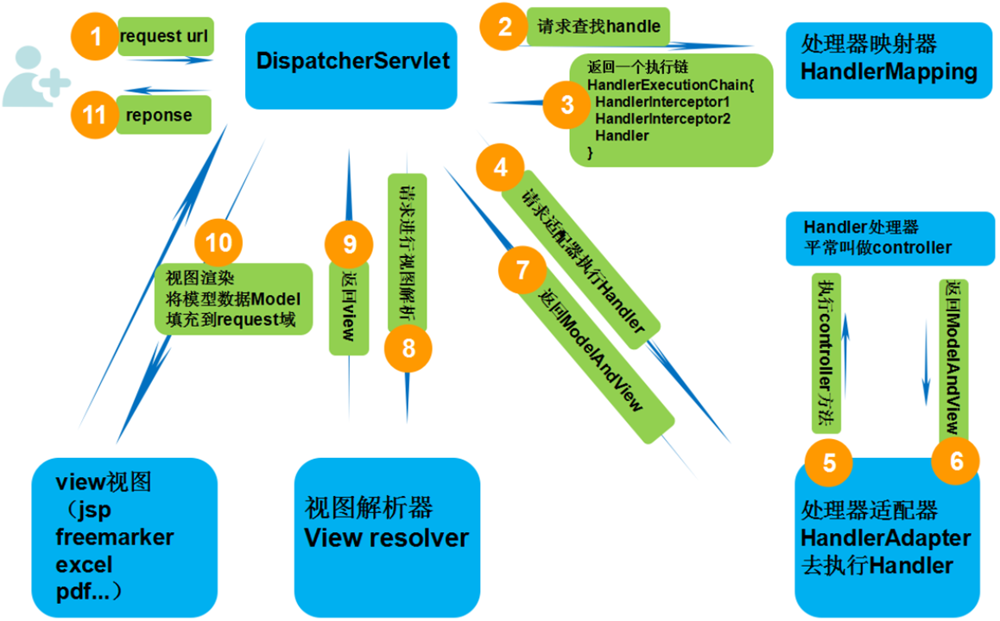
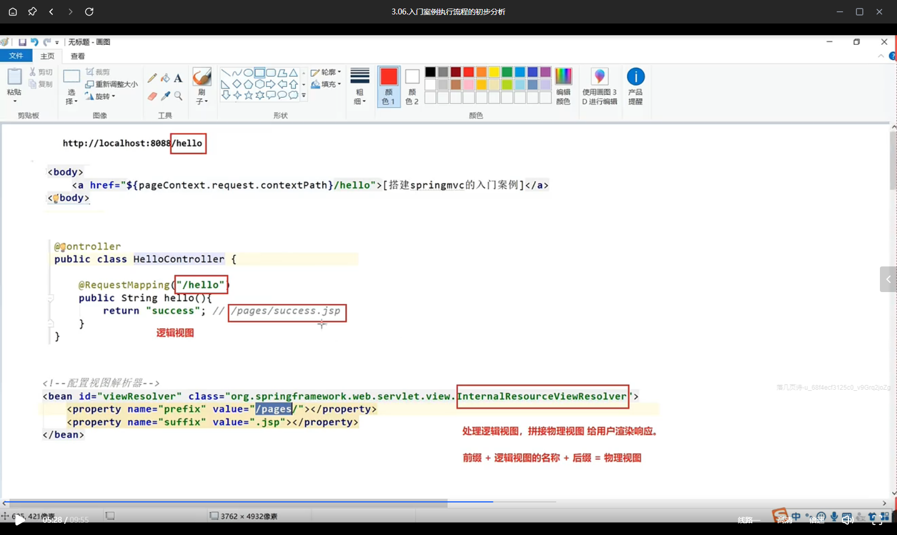
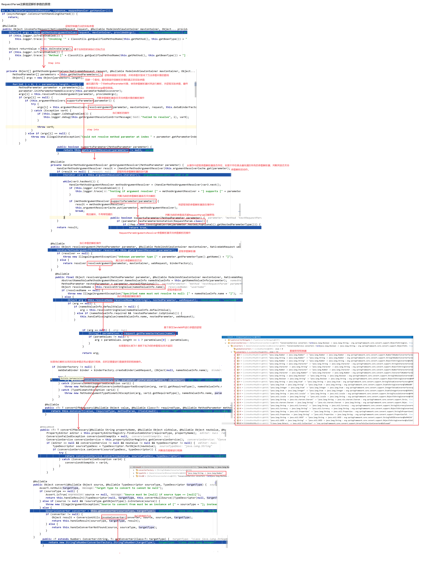
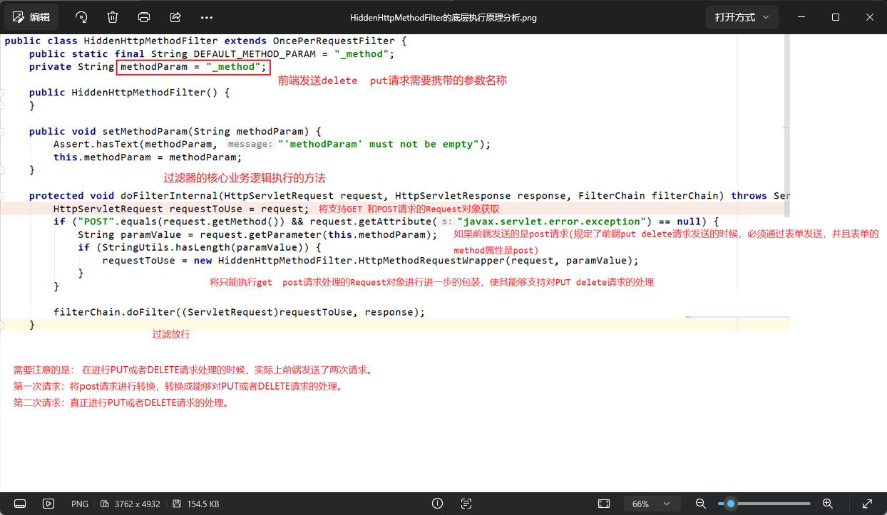
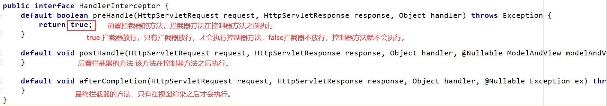
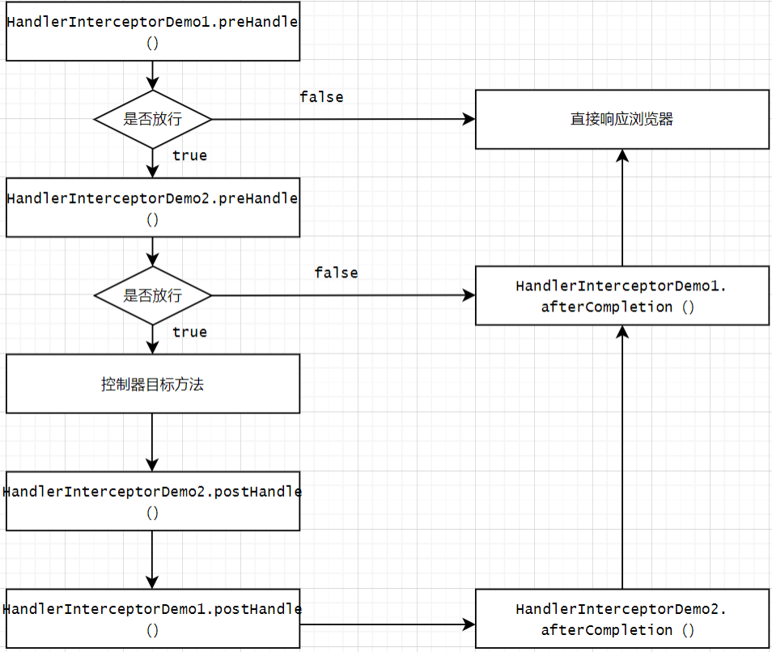
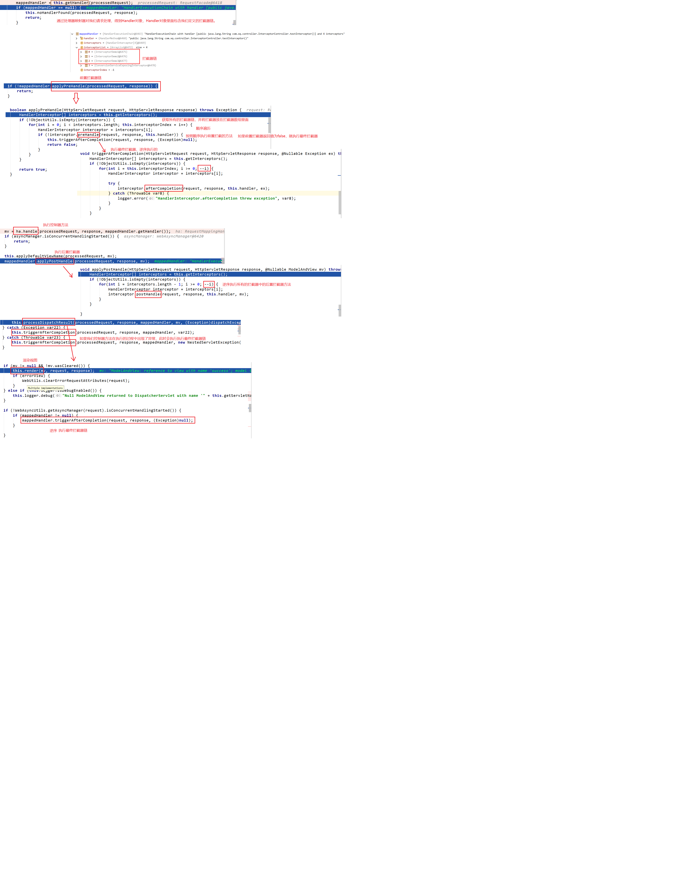

# 03_SpringMVC

## 1. SpringMVC的基本概述

### 1.1 三层架构的基本概述

```tex
我们的开发架构一般都是基于两种形式，一种是c/s架构，也就是客户端/服务器。另一种是b/s架构，也就是浏览器/服务器。在JavaEE开发中，几乎全部是基于b/s架构的开发。那么在b/s架构中，系统的标准三层架构包括：表现层、业务层、持久层。三层架构在我们实际开发中使用的非常多,所以我们课程中的案例也是基于三层架构设计的。

三层架构，每层架构各司其职，接下来我们说说每层架构都有哪些作用：

表现层：

也就是我们常说的web层。它负责接收客户端的请求，向客户端响应结果，通常客户端使用http协议请求web层，web需要接收http请求，完成http响应。表现层包含展示层和控制层，控制层负责接收前端请求，展示层负责结果的展示。表现层依赖业务层，接收到客户端请求一般会调用业务层进行业务处理，并将处理结果响应给客户端。表现层的设计一般都使用MVC模型。

业务层：

也就是我们常说的service层。它负责业务逻辑的处理，和我们开发项目的需求息息相关。web层依赖业务层，但是业务层不依赖web层。业务层在业务处理时可能会依赖持久层，如果要对数据持久化需要保证事务一致性(也就是我们说的事务应该放在业务层来控制)。

持久层：

也就是我们常说的dao层。负责数据持久化，包括数据层即数据库和数据访问层。数据库是对数据进行持久化的载体，数据访问层是业务层和持久层交互的接口，业务层需要通过对数据访问层将数据持久化到数据库中，通俗的讲，持久层就是和数据库交互，对数据表进行增删改查的。
```

### 1.2 MVC架构

```tex
MVC全名是Model View Controller.是模型(Model) 视图(view) 控制器(controller)的缩写。是一种用于创建web应用程序表现层的模式。MVC中每个部分各司
其职：
Model(模型):
通常指的就是我们的数据模型,用来封装数据的。
View(视图):
通常指的是我们的jsp或者html。一般用来展示数据的，通常视图是依据模型数据创建的。
Controller(控制器):
是应用程序中处理用户交互的部分。用于接收前端请求。比如获取前端请求传递的参数，并负责将请求交给业务层进行处理。业务层将业务结果处理完成以后，控制器接收业务层的业务结果，并将业务数据存储在域对象，实现页面的跳转。
```

### 1.3 什么是springMVC

```tex
SpringMVC是一种基于Java的实现MVC设计模型的请求驱动类型的轻量级web框架，属于Spring FrameWork的后续产品，已经融合在Spring Web Flow里面。Spring框架提供了构建web应用程序的全功能MVC模块。使用Spring可插入的MVC架构，从而在使用Spring进行web开发时，可以选择使用Spring的Spring MVC框架或集成其他MVC开发框
架，比如Struts2等。
SpringMVC已经成为目前最主流的MVC框架之一，并且随着Spring 3.0的发布，全面超越Struts2,成为最优秀的web框架。它通过一套注解，让一个简单的Java类成为处理请求的控制器，而无需事先任何接口，同时它还支持Restful编程风格。
```


### 1.4 SpringMVC的优势

```tex
1. 清晰的角色划分：
前端控制器(DispatcherServlet)
处理器映射器(HandlerMapping)
处理器适配器(HandlerAdpater)
视图解析器(ViewResolver)
控制器(Controller)
验证器(Validator)
命令对象(Command 请求参数绑定到的对象就叫做命令对象)
表单对象(Form Object 提供给表单展示和提交的对象就叫表单对象)
2. 分工明确，而且扩展点相当灵活，很容易进行功能扩展。
3. 由于命令对象就是一个POJO，无需继承框架特定的API,可以使用命令对象直接作为业
务对象。
4. 和Spring其他框架无缝集成，是其他web框架不具备的。
5. 可适配，通过HandlerAdapter可以支持任意的类作为处理器。
6. 可定制性，HandlerMapping ViewResolver等能够非常简单的定制。
7. 功能强大的数据验证、格式化、绑定机制。
```


## 2. SpringMVC入门

### 2.1 SpringMVC入门案例的搭建

#### 2.1.1 导入依赖

```xml
<properties>
    <spring.version>5.3.39</spring.version>
    <servlet.version>4.0.1</servlet.version>
    <jsp.version>2.3.3</jsp.version>
    <tomcat.version>9.0.123</tomcat.version>
    <cargo.version>1.10.29</cargo.version>
</properties>
<dependencies>
    <dependency>
        <groupId>org.springframework</groupId>
        <artifactId>spring-context</artifactId>
        <version>${spring.version}</version>
    </dependency>
    <dependency>
        <groupId>org.springframework</groupId>
        <artifactId>spring-web</artifactId>
        <version>${spring.version}</version>
    </dependency>
    <dependency>
        <groupId>org.springframework</groupId>
        <artifactId>spring-webmvc</artifactId>
        <version>${spring.version}</version>
    </dependency>
    <dependency>
        <groupId>javax.servlet</groupId>
        <artifactId>javax.servlet-api</artifactId>
        <version>${servlet.version}</version>
        <scope>provided</scope>
    </dependency>
    <dependency>
        <groupId>javax.servlet.jsp</groupId>
        <artifactId>javax.servlet.jsp-api</artifactId>
        <version>${jsp.version}</version>
        <scope>provided</scope>
    </dependency>
</dependencies>

<build>
    <plugins>
        <plugin>
            <groupId>org.apache.maven.plugins</groupId>
            <artifactId>maven-war-plugin</artifactId>
            <version>3.4.0</version>
        </plugin>
        <plugin>
            <groupId>org.codehaus.cargo</groupId>
            <artifactId>cargo-maven3-plugin</artifactId>
            <version>${cargo.version}</version>
            <configuration>
                <container>
                    <containerId>tomcat9x</containerId>
                    <type>installed</type>
                    <artifactInstaller>
                        <groupId>org.apache.tomcat</groupId>
                        <artifactId>tomcat</artifactId>
                        <version>${tomcat.version}</version>
                        <type>zip</type>
                    </artifactInstaller>
                </container>
                <configuration>
                    <type>standalone</type>
                    <home>${project.build.directory}/cargo/configuration</home>
                    <properties>
                        <cargo.servlet.port>8088</cargo.servlet.port>
                        <cargo.tomcat.uriencoding>UTF-8</cargo.tomcat.uriencoding>
                        <cargo.start.jvmargs>-Dfile.encoding=UTF-8 -Dstdout.encoding=UTF-8 -Dstderr.encoding=UTF-8</cargo.start.jvmargs>

                    </properties>
                </configuration>
                <deployables>
                    <deployable>
                        <groupId>${project.groupId}</groupId>
                        <artifactId>${project.artifactId}</artifactId>
                        <type>war</type>
                        <properties>
                            <context>/</context>
                        </properties>
                    </deployable>
                </deployables>
            </configuration>
        </plugin>
    </plugins>
</build>
```

#### 2.1.2 配置前端控制器

```xml
<!DOCTYPE web-app PUBLIC
 "-//Sun Microsystems, Inc.//DTD Web Application 2.3//EN"
 "http://java.sun.com/dtd/web-app_2_3.dtd" >

<web-app>
  <display-name>Archetype Created Web Application</display-name>

  <!--配置前端控制器-->
  <servlet>
    <servlet-name>dispatcherServlet</servlet-name>
    <servlet-class>org.springframework.web.servlet.DispatcherServlet</servlet-class>
    <!--加载springmvc配置文件-->
    <init-param>
      <param-name>contextConfigLocation</param-name>
      <param-value>classpath:springmvc.xml</param-value>
    </init-param>
    <!--提前DispatcherServlet前端控制器的加载时机-->
    <load-on-startup>1</load-on-startup>
  </servlet>

  <servlet-mapping>
    <servlet-name>dispatcherServlet</servlet-name>
    <url-pattern>/</url-pattern>
  </servlet-mapping>
</web-app>
```

#### 2.1.3 编写springmvc.xml配置文件

```java
<?xml version="1.0" encoding="UTF-8"?>
<beans xmlns="http://www.springframework.org/schema/beans"
       xmlns:xsi="http://www.w3.org/2001/XMLSchema-instance"
       xmlns:context="http://www.springframework.org/schema/context"
       xmlns:mvc="http://www.springframework.org/schema/mvc"
       xsi:schemaLocation="http://www.springframework.org/schema/beans http://www.springframework.org/schema/beans/spring-beans.xsd http://www.springframework.org/schema/context https://www.springframework.org/schema/context/spring-context.xsd http://www.springframework.org/schema/mvc https://www.springframework.org/schema/mvc/spring-mvc.xsd">

    <!--开启包扫描-->
    <context:component-scan base-package="com.sonnet"></context:component-scan>

    <!--配置视图解析器-->
    <bean id="viewResolver" class="org.springframework.web.servlet.view.InternalResourceViewResolver">
        <property name="prefix" value="/pages/"></property>
        <property name="suffix" value=".jsp"></property>
    </bean>

    <!--开启处理器映射器 处理器适配器的自动配置-->
    <mvc:annotation-driven></mvc:annotation-driven>
</beans>
```

#### 2.1.4 编写jsp页面

```jsp
<%--
  Created by IntelliJ IDEA.
  User: sonnet
  Date: 2026/10/22
  Time: 17:25
  To change this template use File | Settings | File Templates.
--%>
<%@ page contentType="text/html;charset=UTF-8" language="java" %>
<html>
<head>
    <title>Title</title>
</head>
<body>
    <h4>这是一个成功页面</h4>
</body>
</html>
```

#### 2.1.5 编写控制器代码

```java
package com.sonnet.controller;

import org.springframework.stereotype.Controller;
import org.springframework.web.bind.annotation.RequestMapping;

@Controller
public class HelloController {

    @RequestMapping("/hello")
    public String hello() {
        return "success";
    }
}
```

#### 2.1.6 SpringMVC入门程序分析



>   第一步：发起请求到前端控制器(DispatcherServlet)
>
>   第二步：前端控制器请求HandlerMapping查找 Handler （可以根据xml配置、注解进行查找）
>
>   第三步：处理器映射器HandlerMapping向前端控制器返回Handler，HandlerMapping会把请求映射为HandlerExecutionChain对象（包含一个Handler处理器（页面控制器）对象，多个HandlerInterceptor拦截器对象），通过这种策略模式，很容易添加新的映射策略
>
>   第四步：前端控制器调用处理器适配器去执行Handler
>
>   第五步：处理器适配器HandlerAdapter将会根据适配的结果去执行Handler
>
>   第六步：Handler执行完成给适配器返回ModelAndView
>
>   第七步：处理器适配器向前端控制器返回ModelAndView（ModelAndView是springmvc框架的一个底层对象，包括 Model和view）
>
>   第八步：前端控制器请求视图解析器去进行视图解析 （根据逻辑视图名解析成真正的视图(jsp)），通过这种策略很容易更换其他视图技术，只需要更改视图解析器即可
>
>   第九步：视图解析器向前端控制器返回View
>
>   第十步：前端控制器进行视图渲染 （视图渲染将模型数据(在ModelAndView对象中)填充到request域）
>
>   第十一步：前端控制器向用户响应结果



### 2.2 SpringMVC核心组件

*   DispatcherServlet 前端控制器

    用户请求到达前端控制器，它就相当于mvc模式中的c，dispatcherServlet是整个流程控制的中心，由它调用其它组件处理用户的请求，dispatcherServlet 的存在降低了组件之间的耦合性。

*   HandlerMapping 处理器映射器

    HandlerMapping负责根据用户请求找到 Handler 即处理器，SpringMVC提供了不同的映射器实现不同的映射方式，例如：配置文件方式，实现接口方式，注解方式等。

*   Handler 处理器

    它就是我们开发中要编写的具体业务控制器。由DispatcherServlet 把用户请求转发到 Handler。由Handler对具体的用户请求进行处理。

*   HandlAdapter 处理器适配器

    通过 HandlerAdapter 对处理器进行执行，这是适配器模式的应用，通过扩展适配器可以对更多类型的处理器进行执行。

*   View Resolver 视图解析器

    View Resolver负责将处理结果生成View 视图，View Resolver首先根据逻辑视图名解析成物理视图名即具体的页面地址，再生成 View视图对象，最后对View进行渲染将处理结果通过页面展示给用户。

*   View 视图

    SpringMVC框架提供了很多View视图类型的支持，包括：jstlView、freemarkerView、pdfView等。我们最常用的视图就是jsp。一般情况下需要通过页面标签或页面模版技术将模型数据通过页面展示给用户，需要由程序员根据业务需求开发具体的页面。


## 3. SpringMVC RequestMapping与参数

### 3.1 RequestMapping注解的使用

#### 3.1.1 使用说明

作用：用于建立请求URL和处理请求方法之间的对应关系。

出现位置：

1.   类上：

     请求 URL的第一级访问目录。此处不写的话，就相当于应用的根目录。写的话需要以/开头。它出现的目的是为了使我们的 URL 可以按照模块化管理。

     例如：

     >   账户模块：
     >
     >   **/account**/add
     >
     >   **/account**/update
     >
     >   **/account**/delete
     >
     >   订单模块：
     >
     >   **/order**/add
     >
     >   **/order**/update
     >
     >   **/order**/delete
     >
     >   加粗部分就是把RequsetMappding写在类上，使我们的URL更加精细。

2.   方法上：

     请求URL的第二级访问目录。

     注解的属性：

     >   *   value：用于指定请求的URL。它和path属性的作用是一样的。
     >
     >   *   method：用于指定请求的方式。
     >
     >   *   params：用于指定限制请求参数的条件。它支持简单的表达式。要求请求参数的key和value必须和配置的一模一样。
     >
     >       例如：
     >
     >       params = {"accountName"}，表示请求参数必须有accountName
     >
     >       params = {"moeny!100"}，表示请求参数中money不能是 100。

#### 3.1.2 使用示例

```java
package com.sonnet.controller;

import org.springframework.stereotype.Controller;
import org.springframework.web.bind.annotation.RequestMapping;
import org.springframework.web.bind.annotation.RequestMethod;

@Controller
@RequestMapping("demo1") // 一级路径
public class HelloController {

    /**
     * 二级路径
     * path/value:描述的是请求资源的url路径
     * method:描述的是指定以什么样的请求方法来进行资源的访问，如果请求方式不正确，会报错，抛出405异常
     * params:在请求当前控制器方法的时候，必须携带指定的参数，如果不携带参数，此时会报400的异常
     * @return
     */
    @RequestMapping(value = "/hello",method = RequestMethod.GET,params = {"username", "age"})
    public String hello() {
        return "success"; // pages/success.jsp
    }
}
// http://localhost:8088/demo1/hello
```

### 3.2 请求参数绑定

用户请求参数都是基于key=value的。SpringMVC绑定请求参数的过程是通过把请求提交的参数，作为控制器中的方法参数进行绑定的

Springmvc支持的参数绑定类型：

>   *   基本类型参数: 包括基本类型和String类型
>
>   *   POJO类型参数：包括实体类及其关联的实体类
>
>   *   数组和集合类型的参数：包括List和Map结构的集合(包括数组)

SpringMVC绑定请求参数是自动实现的，但是使用必须遵循器使用要求：

>   *   如果是基本类型或者String类型： 要求我们的参数名称必须和控制器方法中的形参名称保持一致，并严格区分大小写。
>
>   *   如果是POJO类型，或者其他关联对象：要求表单中的参数名称和POJO类的属性名称一模一样，并且控制器方法的参数类型是POJO类型。

#### 3.2.1 基本数据类型参数绑定

*   编写超链接

    ```jsp
    <a href="${pageContext.request.contextPath}/demo1/getBasicParam?username=zhangsan&age=10">[提交基本类型的参数]</a>
    ```

*   编写控制器

    ```java
    /**
     * 如果前端提交的参数是字面量数据（简单字符串或者数字），在控制器方法中，
     * 我们只需要声明和前端提交的参数是一致的即可
     * @param username
     * @param age
     * @return
     */
    @RequestMapping("/getBasicParam")
    public String getBasisParam(String username, Integer age) {
        System.out.println(username);
        System.out.println(age);
        return "success";
    }
    ```

#### 3.2.2 POJO类型参数的绑定

*   编写POJO实体类

    ```java
    package com.sonnet.pojo;
    
    public class Account {
    
        private Integer id;
    
        private String name;
    
        private Double money;
    
        @Override
        public String toString() {
            return "Account{" +
                    "id=" + id +
                    ", name='" + name + '\'' +
                    ", money=" + money +
                    '}';
        }
    
        public Integer getId() {
            return id;
        }
    
        public void setId(Integer id) {
            this.id = id;
        }
    
        public String getName() {
            return name;
        }
    
        public void setName(String name) {
            this.name = name;
        }
    
        public Double getMoney() {
            return money;
        }
    
        public void setMoney(Double money) {
            this.money = money;
        }
    }
    ```

*   编写表单

    ```jsp
    <form action="${pageContext.request.contextPath}/demo1/getPojoParams" method="post">
        账户编号：<input type="text" name="id"> <br>
        账户名称：<input type="text" name="name"> <br>
        账户金额：<input type="text" name="money"> <br>
        <input type="submit" value="提交">
    </form>
    ```

*   编写Controller

    ```java
    // 接收前端提交的表单数据
    @RequestMapping("/getPojoParams")
    public String getPojoParams(Account account) {
        System.out.println(account);
        return "success";
    }
    ```

#### 3.2.3 提交中文乱码的问题的解决

##### 3.2.3.1 解决POST乱码问题

在`web.xml`里配置编码过滤器

```xml
<!-- 配置编码过滤器 -->
<filter>
    <filter-name>characterEncodingFilter</filter-name>
    <filter-class>org.springframework.web.filter.CharacterEncodingFilter</filter-class>
    <!-- 设置过滤器中的属性值 -->
    <init-param>
        <param-name>encoding</param-name>
        <param-value>UTF-8</param-value>
    </init-param>
    <!-- 启动过滤器 -->
    <init-param>
        <param-name>forceEncoding</param-name>
        <param-value>true</param-value>
    </init-param>
</filter>
<!-- 过滤所有请求 -->
<filter-mapping>
    <filter-name>characterEncodingFilter</filter-name>
    <url-pattern>/*</url-pattern>
</filter-mapping>
```

但需要注意的是：

web应用里面有静态资源，比如js css image等。不能把静态资源也过滤了，否则会造成静态资源不能正常加载问题。所以在配置编码过滤器的时候，需要设置静态资源不过滤

在`springmvc.xml`中设置

```xml
<!--设置静态资源不过滤-->
<mvc:resources mapping="/css/**" location="/css/"></mvc:resources>
<mvc:resources mapping="/images/**" location="/images/"></mvc:resources>
<mvc:resources mapping="/js/**" location="/js/"></mvc:resources>
```

##### 3.2.3.2 解决GET乱码问题

tomcat对GET和POST请求处理方式是不同的，GET请求的编码问题，要改tomcat的server.xml 配置文件，如下：

```xml
<properties>
    <cargo.servlet.port>8088</cargo.servlet.port>
    <cargo.tomcat.uriencoding>UTF-8</cargo.tomcat.uriencoding>
    <cargo.start.jvmargs>-Dfile.encoding=UTF-8 -Dstdout.encoding=UTF-8 -Dstderr.encoding=UTF-8</cargo.start.jvmargs>
</properties>

```

#### 3.2.4 集合类型参数绑定

*   编写POJO类

    ```java
    package com.sonnet.pojo;
    
    import java.util.List;
    import java.util.Map;
    
    public class User {
    
        private String username;
        private String password;
        private Integer age;
    
        private List<Account> accountList;
    
        private Map<String, Account> accountMap;
    
        public User() {
        }
    
        public String getUsername() {
            return username;
        }
    
        public void setUsername(String username) {
            this.username = username;
        }
    
        public String getPassword() {
            return password;
        }
    
        public void setPassword(String password) {
            this.password = password;
        }
    
        public Integer getAge() {
            return age;
        }
    
        public void setAge(Integer age) {
            this.age = age;
        }
    
        public List<Account> getAccountList() {
            return accountList;
        }
    
        public void setAccountList(List<Account> accountList) {
            this.accountList = accountList;
        }
    
        public Map<String, Account> getAccountMap() {
            return accountMap;
        }
    
        public void setAccountMap(Map<String, Account> accountMap) {
            this.accountMap = accountMap;
        }
    
        @Override
        public String toString() {
            return "User{" +
                    "username='" + username + '\'' +
                    ", password='" + password + '\'' +
                    ", age=" + age +
                    ", accountList=" + accountList +
                    ", accountMap=" + accountMap +
                    '}';
        }
    
    }
    ```

*   编写Controller

    ```java
    @RequestMapping("findUser")
    public String findUser(User user) {
        System.out.println(user);
        return "success";
    }
    ```

*   编写jsp页面

    ```jsp
    <%--使用表单提交复杂类型数据--%>
    <form action="${pageContext.request.contextPath}/demo1/findUser" method="post">
        username:<input type="text" name="username"> <br>
        password:<input type="text" name="password"> <br>
        age:<input type="text" name="age"> <br>
    
        账户1名称：<input type="text" name="accountList[0].name"> <br>
        账户1金额：<input type="text" name="accountList[0].money"> <br>
        账户2名称：<input type="text" name="accountList[1].name"> <br>
        账户2金额：<input type="text" name="accountList[1].money"> <br>
        账户3名称：<input type="text" name="accountList[2].name"> <br>
        账户3金额：<input type="text" name="accountList[2].money"> <br>
    
        账户4名称：<input type="text" name="accountMap['one'].name"> <br>
        账户4金额：<input type="text" name="accountMap['one'].money"> <br>
        账户5名称：<input type="text" name="accountMap['two'].name"> <br>
        账户5金额：<input type="text" name="accountMap['two'].money"> <br>
    
        <input type="submit" value="提交">
    </form>
    ```

#### 3.2.5 自定义数据类型转换器

##### 3.2.5.1 使用@DateTimeFormat注解进行数据格式转换

*   编写超链接

    ```jsp
    <a href="${pageContext.request.contextPath}/demo1/getDate?date=2026-10-24">提交日期类型的数据</a>
    ```

*   编写Controller

    ```java
    // 接收前端提交的日期类型方法    @DateTimeFormat按照指定的各式将数据转换成日期类型
    @RequestMapping("/getDate")
    public String getDate(@DateTimeFormat(pattern = "yyyy-MM-dd") Date date) {
        System.out.println(date);
        return "success";
    }
    ```

##### 3.2.5.2 自定义类型转换器

*   编写超链接

    ```jsp
    <a href="${pageContext.request.contextPath}/demo1/getDate2?date=2026-10-24">提交日期类型的数据2</a>
    ```

*   编写Controller

    ```java
    @RequestMapping("/getDate2")
    public String getDate2(Date date) {
        System.out.println(date);
        return "success";
    }
    ```

*   定义一个类，实现Convert接口

    ```java
    package com.sonnet.convert;
    
    import org.springframework.core.convert.converter.Converter;
    import org.springframework.util.StringUtils;
    
    import java.text.ParseException;
    import java.text.SimpleDateFormat;
    import java.util.Date;
    
    /**
     * 自定义数据类型转换器
     */
    public class DateFormatConvert implements Converter<String, Date> {
    
        // 进行数据类型的转换
        @Override
        public Date convert(String source) {
            if (!StringUtils.hasText(source)) {
                throw new NullPointerException("前端提交的参数不能为空");
            }
            SimpleDateFormat simpleDateFormat = new SimpleDateFormat("yyyy-MM-dd");
            try {
                return simpleDateFormat.parse(source);
            } catch (ParseException e) {
                throw new RuntimeException("输入的日期格式有误", e);
            }
        }
    }
    ```

*   在`springmvc.xml`配置文件中配置类型转换器

    ```xml
    <!--配置数据类型转换器工厂-->
    <bean id="conversionServiceFactoryBean" class="org.springframework.context.support.ConversionServiceFactoryBean">
        <!--给工厂注入一个新的类型转换器-->
        <property name="converters">
            <array>
                <!--配置自定义转换器类型-->
                <bean class="com.sonnet.convert.DateFormatConvert"></bean>
            </array>
        </property>
    </bean>
    
    <!--设置静态资源不过滤-->
    <mvc:resources mapping="/css/**" location="/css/"></mvc:resources>
    <mvc:resources mapping="/images/**" location="/images/"></mvc:resources>
    <mvc:resources mapping="/js/**" location="/js/"></mvc:resources>
    
    <!--
        开启处理器映射器 处理器适配器的自动配置
        在annotation-driven标签中引用配置类型转换服务
    -->
    <mvc:annotation-driven conversion-service="conversionServiceFactoryBean"></mvc:annotation-driven>
    ```

#### 3.2.6 使用ServletAPI传递参数

SpringMVC还支持使用原始ServletAPI对象作为控制器方法的参数。支持原始ServletAPI的对象有：

>   HttpServletRequest
>
>   HttpServletResponse
>
>   HttpSession
>
>   InputStream
>
>   OutputStream
>
>   ... ...

*   编写超链接

    ```jsp
    <a href="${pageContext.request.contextPath}/demo1/testServletAPI?username=zhangsan&age=18">[测试原生servlet API]</a>
    ```

*   编写Controller

    ```java
    // 测试使用原生的servlet API
    @RequestMapping("/testServletAPI")
    public void testServletAPI(HttpServletRequest request,
                               HttpServletResponse response,
                               HttpSession httpSession) {
        try {
            String username = request.getParameter("username");
            String age = request.getParameter("age");
            System.out.println(username + " => " + age);
            // 重定向到success.jsp页面
            response.sendRedirect("/pages/success.jsp");
        } catch (IOException e) {
            throw new RuntimeException(e);
        }
    }
    ```


## 4. SpringMVC常用的注解

### 4.1 RequestParam注解

使用说明：

>   *   使用说明：把请求中指定名称的参数给控制器中的形参赋值。
>
>   *   value：请求参数中的名称
>
>   *   required: 请求参数中是否必须提供此参数，默认值为true，表示必须提供，否则会报错。

*   定义jsp代码

    ```jsp
    <a href="${pageContext.request.contextPath}/demo1/testRequestParam?username=jia&age=18">[测试RequestParam注解的使用]</a>
    ```

*   定义控制器Controller代码

    ```java
    /**
     * @RequestParam注解：如果前后参数名称不一样，我们可以使用该注解实现前后参数的绑定
     *      value/name：描述参数的名称，这个值是前端参数的名称
     *      required：默认值为true，标识当前参数是必须携带的，如果前端没有携带该参数，就会报400异常
     *      defaultValue：默认值 防止空指针异常 如果前端没有提交参数（null），就使用默认值替代
     * @param name
     * @param age
     * @return
     */
    @RequestMapping("/testRequestParam")
    public String testRequestParam(@RequestParam(value = "username", required = false, defaultValue = "zhangsan") String name,
                                   @RequestParam(value = "age", required = false, defaultValue = "33") Integer age) {
        System.out.println(name + " => " + age);
        return "success";
    }
    ```



### 4.2 RequestBody注解

使用说明：

>   *   使用说明:用于获取请求实体内容,直接使用得到的是key=value&key=value的数据。 获取请求实体内容不适用get请求。
>
>   *   属性：required描述是否有请求体，默认值为true。当取值为true时，get请求方式会报错。如果取值为false，get请求得到的是null。

*   编写jsp代码

    ```jsp
    <%--编写一个表单，获取表单提交的实体内容--%>
    <form action="${pageContext.request.contextPath}/demo1/testRequestBody" method="post">
        用户名：<input type="text" name="username"> <br>
        用户密码：<input type="text" name="password"> <br>
        用户年龄：<input type="text" name="age"> <br>
        <input type="submit" value="保存">
    </form>
    ```

*   编写控制器Controller代码

    ```java
    /**
     * 测试RequestBody注解的使用
     * @param body      username=admin&password=123&age=123
     * @return
     */
    @RequestMapping("/testRequestBody")
    public String testRequestBody(@RequestBody String body) {
        System.out.println(body); // username=admin&password=123&age=123
        return "success";
    }
    ```

### 4.3 RequestHeader注解

使用说明：

>   *   作用：用于获取请求头
>
>   *   属性：value 提供消息头名称 required 是否必须有此消息头

*   编写jsp代码

    ```jsp
    <a href="${pageContext.request.contextPath}/demo1/testRequestHeader">[测试RequestHeader注解的使用]</a>
    ```

*   编写控制器Controller代码

    ```java
    /**
     * 测试RequestHeader注解的使用
     * @param header    zh-CN,zh;q=0.9,zh-TW;q=0.8
     * @return
     */
    @RequestMapping("/testRequestHeader")
    public String testRequestHeader(@RequestHeader("accept-language") String header) {
        System.out.println(header);
        return "success";
    }
    ```

### 4.4 CookieValue注解的使用

使用说明：

>   *   作用：用于把指定cookie名称的值传入控制器方法参数
>
>   *   属性：value:指定cookie的名称 required 是否必须有此cookie

*   编写jsp代码

    ```jsp
    <a href="${pageContext.request.contextPath}/demo1/testCookieValue">[测试CookieValue注解]</a>
    ```

*   编写控制器Controller代码

    ```java
    /**
     * 测试CookieValue注解的使用
     * @param cookieValue   5075D775C264CFA362B9EE2AD3A990F8
     * @return
     */
    @RequestMapping("/testCookieValue")
    public String testCookieValue(@CookieValue("JSESSIONID") String cookieValue) {
        System.out.println(cookieValue);
        return "success";
    }
    ```

### 4.5 SessionAttributes注解

使用说明：

>   *   作用：用于多次执行控制器方法间的参数共享
>
>   *   value:用于指定存入的属性名称 type:用于指定存入的数据类型

*   编写jsp代码

    ```jsp
    <a href="${pageContext.request.contextPath}/demo1/putSession">在session域中存储数据</a> <br>
    <a href="${pageContext.request.contextPath}/demo1/getSession">向session域中获取数据</a> <br>
    <a href="${pageContext.request.contextPath}/demo1/removeSession">清除session域中的数据</a> <br>
    ```

*   编写控制器Controller代码

    ```java
    @Controller
    @RequestMapping("demo1") // 一级路径
    @SessionAttributes(value = {"username", "password", "age"}) // 指定向session作用域中存储哪些数据
    public class HelloController {
        // 存储数据
        @RequestMapping("/putSession")
        public String putSession(Model model) {
            // 通过model对象向作用域中存储数据
            model.addAttribute("username", "jia");
            model.addAttribute("password", "admin123");
            model.addAttribute("age", "18");
            return "success";
        }
    
        // 读取数据
        @RequestMapping("/getSession")
        public String getSession(ModelMap modelMap) {
            Object username = modelMap.get("username");
            Object password = modelMap.get("password");
            Object age = modelMap.get("age");
            System.out.println(username);
            System.out.println(password);
            System.out.println(age);
            return "success";
        }
    
        // 删除session中的数据
        @RequestMapping("/removeSession")
        public String removeSession(SessionStatus sessionStatus) {
            sessionStatus.setComplete(); // 清空session作用域中的数据
            return "success";
        }
    }
    ```

### 4.6 ModelAttribute注解

使用说明：

>   *   作用：该注解是在SpringMVC4.3版本后新加入的。它可以修饰方法和参数。出现在方法上，表示当前方法会在控制器的方法之前执行。它可以修饰没有返回值的方法，也可以修饰没有返回值的方法。它修饰参数，获取指定的数据给参数赋值。
>
>   *   属性：value用于获取数据的key。可以是POJO属性的名称，也可以是Map结构的key。
>
>   *   应用场景：当表单提交的不是完整的实体类型数据时，保证没有提交数据的字段使用数据库对象原来的数据。
>
>   *   例如：我们在编辑一个用户时，用户有一个创建信息的字段，该字段的值是不
>
>       允许被修改的。在提交表单数据是肯定没有此字段的内容,一旦更新会把该字段
>
>       的内容设置为null。此时就可以使用此注解解决问题。

使用示例：

1.   **放在方法上，在控制器方法前面先执行**

     *   准备jsp代码

         ```jsp
         <form action="demo1/showUser" method="post">
             姓名: <input type="text" name="username"><br>
             年龄: <input type="text" name="age"><br>
             <input type="submit" value="保存">
         </form>
         ```

     *   准备控制器Controller代码

         ```java
         @ModelAttribute
         public void showModel(){
             System.out.println("showModel方法执行了.....");
         }
         @RequestMapping("showUser")
         public String showUser(){
             System.out.println("showUser方法执行了.....");
             return "success";
         }
         ```

     *   输出结果

         ```tex
         showModel方法执行了...
         showUser方法执行了...
         ```

2.   **表单数据提交不完整，保证没有提交数据的字段使用数据表原来的数据**

     *   定义POJO

         ```java
         package com.sonnet.pojo;
         
         public class Student {
         
             private String username;
             private String password;
             private Integer age;
         
             @Override
             public String toString() {
                 return "Student{" +
                         "username='" + username + '\'' +
                         ", password='" + password + '\'' +
                         ", age=" + age +
                         '}';
             }
         
             public String getUsername() {
                 return username;
             }
         
             public void setUsername(String username) {
                 this.username = username;
             }
         
             public String getPassword() {
                 return password;
             }
         
             public void setPassword(String password) {
                 this.password = password;
             }
         
             public Integer getAge() {
                 return age;
             }
         
             public void setAge(Integer age) {
                 this.age = age;
             }
         }
         ```

     *   定义表单

         ```jsp
         <form action="${pageContext.request.contextPath}/demo1/showStudent" method="post">
             username:<input type="text" name="username"> <br>
             age:<input type="text" name="age"> <br>
             <input type="submit" value="提交">
         </form>
         ```

     *   定义控制器方法1（ModelAttribute注解修饰的方法带返回值）

         ```java
         @ModelAttribute
         public Student showModel(String username, Integer age) {
             System.out.println(username + " => " + age);
             Student student = new Student();
             student.setAge(age);
             student.setUsername(username);
             // 模拟通过查询数据库操作，将password这个字段的值补全
             student.setPassword("admin123");
             return student;
         }
         
         @RequestMapping("/showStudent")
         public String showStudent(Student student) {
             System.out.println("showStudent is running");
             System.out.println(student);
             return "success";
         }
         ```

     *   定义控制器方法2（ModelAttribute注解修饰的方法也可以不带返回值）

         ```java
         @ModelAttribute
         public void showModel(String username, Integer age, Map<String, Object> map) {
             System.out.println(username + " => " + age);
             Student student = new Student();
             student.setAge(age);
             student.setUsername(username);
             // 模拟通过查询数据库操作，将password这个字段的值补全
             student.setPassword("admin125");
             map.put("student", student);
         }
         
         
         @RequestMapping("/showStudent")
         public String showStudent(@ModelAttribute("student") Student student) {
             System.out.println("showStudent is running");
             System.out.println(student);
             return "success";
         }
         ```

### 4.7 PathVariable注解

使用说明：

>   *   作用：用于绑定url中的占位符，例如请求中的/delete/{id}，这个{id}就是url中的占位符。url支持占位符是Spring3.0之后加入的。是SpringMVC支持rest风格URL的重要标志。
>
>   *   属性：value用于指定url中占位符的名称。required:是否必须提供占位符。

*   编写jsp代码

    ```jsp
    <a href="${pageContext.request.contextPath}/demo1/testPathVariable/1001/jia">[测试PathVariable注解的使用]</a>
    ```

*   编写控制器Controller代码

    ```java
    @RequestMapping("testPathVariable/{id}/{username}")
    public String testPathVariable(@PathVariable("id") Integer id,
                                   @PathVariable("username") String username) {
        System.out.println(id + " => " + username);
        return "success";
    }
    ```

### 4.8 MatrixVariable注解

矩阵变量，在使用的时候，首先需要开启springmvc对矩阵变量的支持。

```xml
<mvc:annotation-driven conversion-service="conversionServiceFactoryBean"></mvc:annotation-driven>
```

*   在前台定义一个携带矩阵变量的url

    ```jsp
    <a href="${pageContext.request.contextPath}/demo1/testMatrixVariable/1;name=jia;ages=10,11,12">[测试矩阵变量]</a>
    ```

*   定义控制器方法，接收矩阵变量

    ```java
    @RequestMapping("/testMatrixVariable/{id}")
    public String testMatrixVariable(@PathVariable("id") Integer id,
                                     @MatrixVariable("name") String name,
                                     @MatrixVariable("ages") List<Integer> ages) {
        System.out.println(id);
        System.out.println(name);
        System.out.println(ages);
        return "success";
    }
    ```

### 4.9 mvc:view-controller

当控制器方法中，仅仅用来实现页面跳转，即只需要设置视图名称时，可以将处理器方法使用viewcontroller标签进行表示。

```xml
<!--
    path：设置请求的url
    view-name：设置视图名称
-->
<mvc:view-controller path="/hello/demo1" view-name="success"></mvc:view-controller>
```

>   注：当SpringMVC中设置任何一个view-controller时，其他控制器中的请求映射将全部失效，此时需 要在SpringMVC的核心配置文件中设置开启mvc注解驱动的标签：
>
>   <mvc:annotation-driven />


## 5. SpringMVC RUSTful

### 5.1 RESTful的基本概述

REST：Representational State Transfer，表现层资源状态转移。

#### 5.1.1 RESTful的简介

资源：

>   资源是一种看待服务器的方式，即，将服务器看作是由很多离散的资源组成。每个资源是服务器上一个 可命名的抽象概念。因为资源是一个抽象的概念，所以它不仅仅能代表服务器文件系统中的一个文件、 数据库中的一张表等等具体的东西，可以将资源设计的要多抽象有多抽象，只要想象力允许而且客户端 应用开发者能够理解。与面向对象设计类似，资源是以名词为核心来组织的，首先关注的是名词。一个 资源可以由一个或多个URI来标识。URI既是资源的名称，也是资源在Web上的地址。对某个资源感兴 趣的客户端应用，可以通过资源的URI与其进行交互。

资源的表述：

>   资源的表述是一段对于资源在某个特定时刻的状态的描述。可以在客户端-服务器端之间转移（交 换）。资源的表述可以有多种格式，例如HTML/XML/JSON/纯文本/图片/视频/音频等等。资源的表述格 式可以通过协商机制来确定。请求-响应方向的表述通常使用不同的格式。

状态转移：

>   状态转移说的是：在客户端和服务器端之间转移（transfer）代表资源状态的表述。通过转移和操作资 源的表述，来间接实现操作资源的目的。

#### 5.1.2 RESTful的实现
具体说，就是 HTTP 协议里面，四个表示操作方式的动词：GET、POST、PUT、DELETE。

它们分别对应四种基本操作：GET 用来获取资源，POST 用来新建资源，PUT 用来更新资源，DELETE 用来删除资源。

REST 风格提倡 URL 地址使用统一的风格设计，从前到后各个单词使用斜杠分开，不使用问号键值对方 式携带请求参数，而是将要发送给服务器的数据作为 URL 地址的一部分，以保证整体风格的一致性。

| 操作     | 传统方式         | REST风格                |
| -------- | ---------------- | ----------------------- |
| 查询操作 | getUserById?id=1 | user/1-->get请求方式    |
| 保存操作 | saveUser         | user-->post请求方式     |
| 删除操作 | deleteUser?id=1  | user/1-->delete请求方式 |
| 更新操作 | updateUser       | user-->put请求方式      |

#### 5.1.3 HiddenHttpMethodFilter

由于浏览器只支持发送get和post方式的请求，那么该如何发送put和delete请求呢？

SpringMVC 提供了 **HiddenHttpMethodFilter** 帮助我们**将** **POST 请求转换为DELETE或 PUT请求**。HiddenHttpMethodFilter处理put和delete请求的条件：

>   *   当前请求的方式必须为POST
>   *   当前请求必须传输请求参数_method

满足以上条件，**HiddenHttpMethodFilter** 过滤器就会将当前请求的请求方式转换为请求参数_method的值，因此请求参数_method的值才是最终的请求方式。在web.xml中注册**HiddenHttpMethodFilter**

```xml
<filter>
    <filter-name>HiddenHttpMethodFilter</filter-name>
    <filter-class>org.springframework.web.filter.HiddenHttpMethodFilter</filter-class>
</filter>
<filter-mapping>
    <filter-name>HiddenHttpMethodFilter</filter-name>
    <url-pattern>/*</url-pattern>
</filter-mapping>
```

>   注：
>
>   目前为止，SpringMVC中提供了两个过滤器：CharacterEncodingFilter和HiddenHttpMethodFilter。
>
>   在web.xml中注册时，必须先注册CharacterEncodingFilter，再注册HiddenHttpMethodFilter
>
>   原因：
>
>   *   在 CharacterEncodingFilter 中通过request.setCharacterEncoding(encoding) 方法设置字符集的。
>   *   而 HiddenHttpMethodFilter 恰恰有一个获取请求方式的操作：String paramValue = request.getParameter(this.methodParam);

### 5.2 RESTful案例

需求：和传统CRUD一样，实现对员工信息的增删改查

| 功能         | URL地址     | 请求方式 |
| ------------ | ----------- | -------- |
| 查询全部数据 | /employee   | GET      |
| 删除         | /employee/2 | DELETE   |
| 执行保存     | 执行保存    | POST     |
| 执行更新     | /employee   | PUT      |

#### 5.2.1 准备工作

*   创建web项目，引入依赖

    ```xml
    <properties>
        <spring.version>5.3.39</spring.version>
        <servlet.version>4.0.1</servlet.version>
        <jsp.version>2.3.3</jsp.version>
        <tomcat.version>9.0.123</tomcat.version>
        <cargo.version>1.10.29</cargo.version>
        <jstl.version>1.2</jstl.version>
    </properties>
    <dependencies>
        <dependency>
            <groupId>javax.annotation</groupId>
            <artifactId>javax.annotation-api</artifactId>
            <version>1.3.2</version>
        </dependency>
        <dependency>
            <groupId>org.springframework</groupId>
            <artifactId>spring-context</artifactId>
            <version>${spring.version}</version>
        </dependency>
        <dependency>
            <groupId>org.springframework</groupId>
            <artifactId>spring-web</artifactId>
            <version>${spring.version}</version>
        </dependency>
        <dependency>
            <groupId>org.springframework</groupId>
            <artifactId>spring-webmvc</artifactId>
            <version>${spring.version}</version>
        </dependency>
        <dependency>
            <groupId>javax.servlet</groupId>
            <artifactId>javax.servlet-api</artifactId>
            <version>${servlet.version}</version>
            <scope>provided</scope>
        </dependency>
        <dependency>
            <groupId>javax.servlet.jsp</groupId>
            <artifactId>javax.servlet.jsp-api</artifactId>
            <version>${jsp.version}</version>
            <scope>provided</scope>
        </dependency>
        <dependency>
            <groupId>javax.servlet</groupId>
            <artifactId>jstl</artifactId>
            <version>${jstl.version}</version>
        </dependency>
        <dependency>
            <groupId>taglibs</groupId>
            <artifactId>standard</artifactId>
            <version>1.1.2</version>
        </dependency>
    </dependencies>
    
    <build>
        <plugins>
            <plugin>
                <groupId>org.apache.maven.plugins</groupId>
                <artifactId>maven-war-plugin</artifactId>
                <version>3.4.0</version>
            </plugin>
            <plugin>
                <groupId>org.codehaus.cargo</groupId>
                <artifactId>cargo-maven3-plugin</artifactId>
                <version>${cargo.version}</version>
                <configuration>
                    <container>
                        <containerId>tomcat9x</containerId>
                        <type>installed</type>
                        <artifactInstaller>
                            <groupId>org.apache.tomcat</groupId>
                            <artifactId>tomcat</artifactId>
                            <version>${tomcat.version}</version>
                            <type>zip</type>
                        </artifactInstaller>
                    </container>
                    <configuration>
                        <type>standalone</type>
                        <home>${project.build.directory}/cargo/configuration</home>
                        <properties>
                            <cargo.servlet.port>8088</cargo.servlet.port>
                            <cargo.tomcat.uriencoding>UTF-8</cargo.tomcat.uriencoding>
                            <cargo.start.jvmargs>-Dfile.encoding=UTF-8 -Dstdout.encoding=UTF-8 -Dstderr.encoding=UTF-8</cargo.start.jvmargs>
                        </properties>
                    </configuration>
                    <deployables>
                        <deployable>
                            <groupId>${project.groupId}</groupId>
                            <artifactId>${project.artifactId}</artifactId>
                            <type>war</type>
                            <properties>
                                <context>/</context>
                            </properties>
                        </deployable>
                    </deployables>
                </configuration>
            </plugin>
        </plugins>
    </build>
    ```

*   编写web.xml

    ```xml
    <web-app>
      <display-name>Archetype Created Web Application</display-name>
    
      <filter>
        <filter-name>characterEncodingFilter</filter-name>
        <filter-class>org.springframework.web.filter.CharacterEncodingFilter</filter-class>
      </filter>
    
      <filter>
        <filter-name>hiddenHttpMethodFilter</filter-name>
        <filter-class>org.springframework.web.filter.HiddenHttpMethodFilter</filter-class>
      </filter>
    
      <filter-mapping>
        <filter-name>characterEncodingFilter</filter-name>
        <url-pattern>/*</url-pattern>
      </filter-mapping>
    
      <filter-mapping>
        <filter-name>hiddenHttpMethodFilter</filter-name>
        <url-pattern>/*</url-pattern>
      </filter-mapping>
    
      <servlet>
        <servlet-name>dispatcherServlet</servlet-name>
        <servlet-class>org.springframework.web.servlet.DispatcherServlet</servlet-class>
        <init-param>
          <param-name>contextConfigLocation</param-name>
          <param-value>classpath:springmvc.xml</param-value>
        </init-param>
      </servlet>
    
      <servlet-mapping>
        <servlet-name>dispatcherServlet</servlet-name>
        <url-pattern>/</url-pattern>
      </servlet-mapping>
    </web-app>
    ```

*   编写springmvc.xml

    ```xml
    <?xml version="1.0" encoding="UTF-8"?>
    <beans xmlns="http://www.springframework.org/schema/beans"
           xmlns:xsi="http://www.w3.org/2001/XMLSchema-instance"
           xmlns:context="http://www.springframework.org/schema/context"
           xmlns:mvc="http://www.springframework.org/schema/mvc"
           xsi:schemaLocation="http://www.springframework.org/schema/beans http://www.springframework.org/schema/beans/spring-beans.xsd http://www.springframework.org/schema/context https://www.springframework.org/schema/context/spring-context.xsd http://www.springframework.org/schema/mvc https://www.springframework.org/schema/mvc/spring-mvc.xsd">
    
        <!--开启包扫描-->
        <context:component-scan base-package="com.sonnet"></context:component-scan>
    
        <!--配置视图解析器-->
        <bean id="viewResolver" class="org.springframework.web.servlet.view.InternalResourceViewResolver">
            <property name="prefix" value="/pages/"></property>
            <property name="suffix" value=".jsp"></property>
        </bean>
    
        <!--配置数据类型转换器工厂-->
        <bean id="conversionServiceFactoryBean" class="org.springframework.context.support.ConversionServiceFactoryBean">
            <!--给工厂注入一个新的类型转换器-->
            <property name="converters">
                <array>
                    <!--配置自定义转换器类型-->
                    <bean class="com.sonnet.convert.DateFormatConvert"></bean>
                </array>
            </property>
        </bean>
    
        <!--设置静态资源不过滤-->
        <mvc:resources mapping="/css/**" location="/css/"></mvc:resources>
        <mvc:resources mapping="/images/**" location="/images/"></mvc:resources>
        <mvc:resources mapping="/js/**" location="/js/"></mvc:resources>
    
        <!--
            path：设置请求的url
            view-name：设置视图名称
        -->
        <mvc:view-controller path="/hello/demo1" view-name="success"></mvc:view-controller>
    
        <!--
            开启处理器映射器 处理器适配器的自动配置
            在annotation-driven标签中引用配置类型转换服务 conversion-service="conversionServiceFactoryBean"
            开启springMVC对矩阵变量的支持 enable-matrix-variables="true"
        -->
        <mvc:annotation-driven enable-matrix-variables="true" conversion-service="conversionServiceFactoryBean"></mvc:annotation-driven>
    </beans>
    
    ```

*   创建实体类

    ```java
    package com.sonnet.pojo;
    
    public class Employee {
    
        private Integer id;
        private String lastName;
        private String email;
        // 1 male, 0 female
        private Integer gender;
    
    
        public Employee() {
        }
    
        public Employee(Integer id, String lastName, String email, Integer gender) {
            this.id = id;
            this.lastName = lastName;
            this.email = email;
            this.gender = gender;
        }
    
        /**
         * 获取
         * @return id
         */
        public Integer getId() {
            return id;
        }
    
        /**
         * 设置
         * @param id
         */
        public void setId(Integer id) {
            this.id = id;
        }
    
        /**
         * 获取
         * @return lastName
         */
        public String getLastName() {
            return lastName;
        }
    
        /**
         * 设置
         * @param lastName
         */
        public void setLastName(String lastName) {
            this.lastName = lastName;
        }
    
        /**
         * 获取
         * @return email
         */
        public String getEmail() {
            return email;
        }
    
        /**
         * 设置
         * @param email
         */
        public void setEmail(String email) {
            this.email = email;
        }
    
        /**
         * 获取
         * @return gender
         */
        public Integer getGender() {
            return gender;
        }
    
        /**
         * 设置
         * @param gender
         */
        public void setGender(Integer gender) {
            this.gender = gender;
        }
    
        public String toString() {
            return "Employee{id = " + id + ", lastName = " + lastName + ", email = " + email + ", gender = " + gender + "}";
        }
    }
    
    ```

*   创建DAO模拟数据

    ```java
    package com.sonnet.dao;
    
    import com.sonnet.pojo.Employee;
    import org.springframework.stereotype.Repository;
    
    import java.util.Collection;
    import java.util.HashMap;
    import java.util.Map;
    
    @Repository
    public class EmployeeDao {
    
        private static Map<Integer, Employee> employees = new HashMap<>();
    
        static {
            employees.put(1001, new Employee(1001, "E-AA",
                    "aa@163.com", 1));
            employees.put(1002, new Employee(1002, "E-BB",
                    "bb@163.com", 1));
            employees.put(1003, new Employee(1003, "E-CC",
                    "cc@163.com", 0));
            employees.put(1004, new Employee(1004, "E-DD",
                    "dd@163.com", 0));
            employees.put(1005, new Employee(1005, "E-EE",
                    "ee@163.com", 1));
        }
    
        private static Integer initId = 1006;
    
        // 新增员工信息的方法
        public void save(Employee employee) {
            if (employee.getId() == null) {
                employee.setId(initId++);
            }
            employees.put(employee.getId(), employee);
        }
    
        // 查询所有员工信息的方法
        public Collection<Employee> findAll() {
            return employees.values();
        }
    
        // 根据id查询员工信息
        public Employee get(Integer id) {
            return employees.get(id);
        }
    
        // 删除员工信息的方法
        public void delete(Integer id) {
            employees.remove(id);
        }
    }
    ```

#### 5.2.2 查询所有员工信息

*   定义控制器，查询所有员工信息

    ```jsp
    <%--
      Created by IntelliJ IDEA.
      User: sonnet
      Date: 2026/10/25
      Time: 13:30
      To change this template use File | Settings | File Templates.
    --%>
    <%@ page contentType="text/html;charset=UTF-8" language="java" isELIgnored="false" %>
    <html>
    <head>
        <title>Title</title>
    </head>
    <body>
        <a href="${pageContext.request.contextPath}/employee">访问员工信息</a>
    </body>
    </html>
    
    ```

*   定义控制器，查询所有员工信息

    ```java
    package com.sonnet.controller;
    
    import com.sonnet.dao.EmployeeDao;
    import com.sonnet.pojo.Employee;
    import org.springframework.stereotype.Controller;
    import org.springframework.ui.Model;
    import org.springframework.web.bind.annotation.RequestMapping;
    import org.springframework.web.bind.annotation.RequestMethod;
    
    import javax.annotation.Resource;
    import java.util.Collection;
    
    @Controller
    public class EmployeeController {
    
        @Resource
        EmployeeDao employeeDao;
    
        @RequestMapping(value = "/employee", method = RequestMethod.GET)
        public String getEmployeeList(Model model) {
            Collection<Employee> employees = employeeDao.findAll();
            // 将员工信息保存在作用域中
            model.addAttribute("employees", employees);
            return "employee_list";
        }
    }
    ```

*   创建employee_list.jsp页面

    ```jsp
    <%--
      Created by IntelliJ IDEA.
      User: sonnet
      Date: 2026/10/25
      Time: 14:29
      To change this template use File | Settings | File Templates.
    --%>
    <%@ page contentType="text/html;charset=UTF-8" language="java" isELIgnored="false" %>
    <%@taglib prefix="c" uri="http://java.sun.com/jsp/jstl/core" %>
    <html>
    <head>
        <title>展示员工信息</title>
        <style>
            table {
                background-color: orange;
                width: 600px;
                margin: 0 auto;
                border-spacing: 1px;
            }
            table tr {
                text-align: center;
                background-color: white;
            }
            table th,
            table td {
                padding: 4px;
            }
        </style>
    </head>
    <body>
        <table>
            <tr>
                <th colspan="5">员工信息</th>
            </tr>
            <tr>
                <th>员工编号</th>
                <th>员工姓名</th>
                <th>邮箱</th>
                <th>性别</th>
                <th>操作<a href="#">新增</a></th>
            </tr>
            <c:forEach items="${employees}" var="employee">
                <tr>
                    <td>${employee.id}</td>
                    <td>${employee.lastName}</td>
                    <td>${employee.email}</td>
                    <td>${employee.gender}</td>
                    <td>
                        <input type="submit" value="删除">
                        <input type="submit" value="更新">
                    </td>
                </tr>
            </c:forEach>
        </table>
    </body>
    </html>
    ```

#### 5.2.3 删除员工信息

*   由于put和delete的请求方式必须为POST而超链接的请求方式是GET，因此需要对删除按钮进行修改

    ```jsp
    <c:forEach items="${employees}" var="employee">
        <tr>
            <td>${employee.id}</td>
            <td>${employee.lastName}</td>
            <td>${employee.email}</td>
            <td>${employee.gender}</td>
            <td>
                <form action="${pageContext.request.contextPath}/employee/${employee.id}" method="post">
                    <input type="hidden" name="_method"  value="delete">
                    <input type="submit" value="删除">
                </form>
                <input type="submit" value="更新">
            </td>
        </tr>
    </c:forEach>
    ```

*   定义删除员工的控制器代码

    ```java
    // 删除员工信息
    @RequestMapping(value = "/employee/{id}", method = RequestMethod.DELETE)
    public String deleteEmployee(@PathVariable("id") Integer id) {
        employeeDao.delete(id);
        return "redirect:/employee"; // 重定向到/employee/资源，目的就是将员工信息删除之后，重新加载一次
    }
    ```

#### 5.2.4 新增员工信息

*   修改employee_list.jsp页面，新增超链接的src路径

    ```jsp
    <th>操作(<a href="/pages/add.jsp">新增</a>)</th>
    ```

*   定义新增用户的jsp页面add.jsp

    ```jsp
    <%--
      Created by IntelliJ IDEA.
      User: sonnet
      Date: 2026/10/25
      Time: 15:52
      To change this template use File | Settings | File Templates.
    --%>
    <%@ page contentType="text/html;charset=UTF-8" language="java" isELIgnored="false" %>
    <html>
    <head>
        <title>新增员工信息</title>
    </head>
    <body>
        <form action="${pageContext.request.contextPath}/employee" method="post">
            员工姓名:<input type="text" name="lastName"><br>
            员工邮箱:<input type="text" name="email"><br>
            员工性别:<input type="radio" name="gender" value="1">男
            <input type="radio" name="gender" value="0">女<br>
            <input type="submit" value="提交"><br>
        </form>
    </body>
    </html>
    ```

*   定义新增用户的控制器方法

    ```java
    // 新增员工信息
    @RequestMapping(value = "/employee", method = RequestMethod.POST)
    public String addEmployee(Employee employee) {
        employeeDao.save(employee);
        return "redirect:/employee";
    }
    ```

#### 5.2.5 回显员工信息

*   修改employee_list.jsp页面删除按钮的src路径

    ```jsp
    <c:forEach items="${employees}" var="employee">
        <tr>
            <td>${employee.id}</td>
            <td>${employee.lastName}</td>
            <td>${employee.email}</td>
            <td>${employee.gender}</td>
            <td>
                <form action="${pageContext.request.contextPath}/employee/${employee.id}" method="post">
                    <input type="hidden" name="_method"  value="delete">
                    <input type="submit" value="删除">
                </form>
                <form action="${pageContext.request.contextPath}/employee/${employee.id}" method="get">
                    <input type="submit" value="更新">
                </form>
            </td>
        </tr>
    </c:forEach>
    ```

*   定义修改用户的jsp页面employee_update.jsp

    ```jsp
    <%--
      Created by IntelliJ IDEA.
      User: sonnet
      Date: 2026/10/25
      Time: 16:19
      To change this template use File | Settings | File Templates.
    --%>
    <%@ page contentType="text/html;charset=UTF-8" language="java" isELIgnored="false" %>
    <%@taglib prefix="c" uri="http://java.sun.com/jsp/jstl/core" %>
    <html>
    <head>
        <title>Title</title>
    </head>
    <body>
        <form method="post" action="${pageContext.request.contextPath}/employee" name="_method">
            员工姓名：<input type="text" name="lastName" value="${employee.lastName}"> <br>
            员工邮箱：<input type="text" name="email" value="${employee.email}"> <br>
            员工性别：
            <c:if test="${employee.gender==1}">
                <input type="radio" name="gender" value="1" checked>male
                <input type="radio" name="gender" value="0">female <br>
            </c:if>
            <c:if test="${employee.gender==0}">
                <input type="radio" name="gender" value="1">male
                <input type="radio" name="gender" value="0" checked>female <br>
            </c:if>
            <input type="hidden" value="put" name="_method">
            <input type="submit" value="修改"> <br>
        </form>
    </body>
    </html>
    ```

*   定义回显用户信息的控制器代码

    ```java
    // 回显员工信息
    @RequestMapping(value = "/employee/{id}", method = RequestMethod.GET)
    public String getEmployeeById(@PathVariable("id") Integer id, Model model) {
        Employee employee = employeeDao.get(id);
        model.addAttribute("employee", employee);
        return "employee_update";
    }
    ```

#### 5.2.7 修改用户信息

*   定义修改用户信息的控制器代码

    ```java
    // 更新员工信息
    @RequestMapping(value = "/employee", method = RequestMethod.PUT)
    public String updateEmployee(Employee employee) {
        employeeDao.save(employee);
        return "redirect:/employee";
    }
    ```

### 5.3 HiddenHttpMethodFilter请求原理分析




## 6. SpringMVC响应数据和结果视图

### 6.1 控制器方法返回值分类

#### 6.1.1 返回字符串

controller方法返回字符串可以指定逻辑视图名，通过视图解析器解析为物理视图地址。

*   编写jsp页面

    ```jsp
    <body>
        <a href="hello/testString">[返回值是字符串]</a> <br>
    </body>
    ```

*   编写控制器代码

    ```java
    @Controller
    @RequestMapping("hello")
    public class HelloController {
        @RequestMapping("testString")
        public String testString(){
            return "success";
        }
    }
    ```

#### 6.1.2 返回值void

Servlet原生 API 可以作为控制器中方法的参数，所以在controller方法形参上可以定义request和response，使用request或response指定响应结果：

*   编写jsp页面

    ```jsp
    <a href="${pageContext.request.contextPath}/demo1/testVoid">[返回值是void]</a>
    ```

*   编写Controller代码

    ```java
    // 测试控制器方法的返回值是void
    @RequestMapping("testVoid")
    public void testVoid(HttpServletRequest httpServletRequest, HttpServletResponse httpServletResponse) {
        try {
            System.out.println("testVoid is running");
            /*
                // 实现转发效果
                httpServletRequest.getRequestDispatcher("/pages/success.jsp").forward(httpServletRequest, httpServletResponse);
    */
    
            // 实现重定向效果
            httpServletResponse.sendRedirect("/pages/success.jsp");
        } catch (Exception e) {
            throw new RuntimeException(e);
        }
    }
    ```

#### 6.1.3 返回值ModelAndView

ModelAndView是SpringMVC 为我们提供的一个对象，该对象也可以用作控制器方法的返回值。

*   编写jsp页面

    ```jsp
    <a href="${pageContext.request.contextPath}/demo1/testModelAndView">[返回值是ModelAndView]</a>
    ```

*   编写Controller代码

    ```java
    // 测试返回值是ModelAndView
    @RequestMapping("testModelAndView")
    public ModelAndView testModelAndView() {
        ModelAndView modelAndView = new ModelAndView();
        // 向作用域中存储数据
        modelAndView.addObject("username", "jia");
        // 转发效果, 设置视图名称
        modelAndView.setViewName("success");
        return modelAndView;
    }
    
    ```

### 6.2 SpringMVC作用域传值

#### 6.2.1 使用原生的Request域对象传值

*   编写jsp代码

    ```jsp
    <a href="${pageContext.request.contextPath}/demo1/testRequest">[测试request作用域传值]</a> <br>
    ```

*   编写Cotroller代码

    ```java
    // 测试request作用域传值
    @RequestMapping("testRequest")
    public void testRequest(HttpServletRequest httpServletRequest, HttpServletResponse httpServletResponse) {
        try {
            httpServletRequest.setAttribute("username", "jia");
            httpServletRequest.getRequestDispatcher("/pages/success.jsp").forward(httpServletRequest, httpServletResponse);
        } catch (ServletException e) {
            throw new RuntimeException(e);
        } catch (IOException e) {
            throw new RuntimeException(e);
        }
    }
    ```

#### 6.2.2 使用Map集合传值

也可以使用Map集合进行值传递 将map对象作为方法的形式参数，不过控制器方法的返回值需要携带：

*   编写jsp代码

    ```jsp
    <a href="${pageContext.request.contextPath}/demo1/testMap">[使用Map对象进行域对象的传值]</a> <br>
    ```

*   编写Controller代码

    ```java
    // 使用Map集合进行作用域对象传值
    @RequestMapping("/testMap")
    public String testMap(Map<String, Object> map) {
        map.put("username", "jiayi");
        return "success";
    }
    ```

#### 6.2.3 使用Model对象传值

也可以使用Model对象作为控制器方法的形参，通过model对象将数据存放在作用域。

*   编写jsp代码

    ```jsp
    <a href="${pageContext.request.contextPath}/demo1/testModel">[使用Model对象进行域对象的传值]</a> <br>
    ```

*   编写Controller代码

    ```java
    // 使用Model对象进行域对象的传值
    @RequestMapping("/testModel")
    public String testModel(Model model) {
        model.addAttribute("username", "jiayi");
        return "success";
    }
    ```

#### 6.2.4 使用ModelAndView对象传值

使用ModelAndView对象传值要求控制器方法的返回值必须的ModelAndView类型。

```java
// 测试返回值是ModelAndView
@RequestMapping("/testModelAndView")
public ModelAndView testModelAndView() {
    ModelAndView modelAndView = new ModelAndView();
    // 向作用域中存储数据
    modelAndView.addObject("username", "jia");
    // 转发效果, 设置视图名称
    modelAndView.setViewName("success");
    return modelAndView;
}
```

### 6.3 转发和重定向

#### 6.3.1 forward转发

```java
// 使用forward关键字实现转发效果
@RequestMapping("/testForward")
public String testForward() {
    //return "forward:/pages/success.jsp";
    return "forward:/demo1/toSuccess";
}
```

使用请求转发，既可以转发到jsp，也可以转发到其他的控制器方法。

#### 6.3.2 Redirect重定向

```java
// 使用redirect关键字实现重定向
@RequestMapping("/testRedirect")
public String testRedirect() {
    //return "redirect:/pages/success.jsp";
    return "redirect:/demo1/toSuccess";

}
```

使用请求重定向，既可以转发到jsp，也可以转发到其他的控制器方法。


## 7. SpringMVC HttpMessageConverter

HttpMessageConverter，报文信息转换器，将请求报文转换为Java对象，或将Java对象转换为响应报文。HttpMessageConverter提供了两个注解和两个类型：

>   *   @RequestBody
>
>   *   @ResponseBody
>
>   *   RequestEntity
>
>   *   ResponseEntity

### 7.1 @RequestBody

在之前SpringMVC常用注解时，@RequestBody注解在同步的请求下面，可以接收表单提交的实体内容。在异步请求下面，该注解还可以接收前台提交的ajax异步请求发送的json格式的数据。

*   准备jsp代码

    ```jsp
    <%--
      Created by IntelliJ IDEA.
      User: sonnet
      Date: 2026/10/25
      Time: 20:19
      To change this template use File | Settings | File Templates.
    --%>
    <%@ page contentType="text/html;charset=UTF-8" language="java" isELIgnored="false" %>
    <html>
    <head>
        <title>Title</title>
    </head>
    <body>
        <input type="button" value="按钮" id="testJson">
    </body>
    <script src="js/jquery-1.9.1.js"></script>
    <script type="text/javascript">
        $(function () {
            $("#testJson").click(function () {
                $.ajax({
                    type:"post",
                    url:"${pageContext.request.contextPath}/demo2/testAjax",
                    contentType:"application/json;charset=utf-8",
                    data:'{"id":1, "name":"zhangsan", "money":1000.0}',
                    dataType:"json",
                    success:function (data) {
                        console.log(data);
                    }
                })
            })
        })
    </script>
    </html>
    ```

*   编写Controller代码

    ```java
    package com.sonnet.controller;
    
    import com.sonnet.pojo.Account;
    import org.springframework.stereotype.Controller;
    import org.springframework.web.bind.annotation.RequestBody;
    import org.springframework.web.bind.annotation.RequestMapping;
    
    import java.util.Map;
    
    @Controller
    @RequestMapping("/demo2")
    public class AjaxController {
    
    /*
        @RequestMapping("/testAjax")
        public void testAjax(@RequestBody Account account) {
            System.out.println(account);
        }
    */
    
        @RequestMapping("/testAjax")
        public void testAjax(@RequestBody Map<String, Object> map) {
            System.out.println(map);
        }
    }
    ```

*   导入依赖

    ```xml
    <jackson.version>2.22.4</jackson.version>
    <jackson.annotations.version>2.22</jackson.annotations.version>
    ```

    ```xml
    <!--jackson相关依赖-->
    <dependency>
        <groupId>com.fasterxml.jackson.core</groupId>
        <artifactId>jackson-databind</artifactId>
        <version>${jackson.version}</version>
    </dependency>
    <dependency>
        <groupId>com.fasterxml.jackson.core</groupId>
        <artifactId>jackson-core</artifactId>
        <version>${jackson.version}</version>
    </dependency>
    <dependency>
        <groupId>com.fasterxml.jackson.core</groupId>
        <artifactId>jackson-annotations</artifactId>
        <version>${jackson.annotations.version}</version>
    </dependency>
    ```

### 7.2 RequestEntity

在SpringMVC中，RequestEntity是一个泛型类，用于表示一个HTTP请求实体。RequestEntity包含HTTP请求的头部信息、HTTP请求的方法、URL、请求体等信息。使用RequestEntity可以精细地控制HTTP请求的所有参数，包括HTTP请求头、HTTP请求体、HTTP请求方法、HTTP请求URL等，可以灵活地适应各种HTTP请求的需求。

*   编写jsp页面

    ```jsp
    <%--定义一个表单--%>
    <form action="${pageContext.request.contextPath}/demo2/testRequestEntity" method="post">
        用户名：<input type="text" name="username"> <br>
        用户密码：<input type="password" name="password"> <br>
        用户年龄：<input type="text" name="age"> <br>
        <input type="submit" value="提交">
    </form>
    ```

*   编写Controller代码

    ```java
    // 使用RequestEntity接收请求报文数据
    @RequestMapping("/testRequestEntity")
    public String testRequestEntity(RequestEntity<String> requestEntity) {
        System.out.println(requestEntity.getBody());
        return "success";
    }
    ```

### 7.3 @ResponseBody

@ResponseBody注解用于标识一个控制器方法或者方法的返回值，可以将该方法的返回值直接作为响应报文的响应体响应到浏览器。

```java
@RequestMapping("/testAjax")
public @ResponseBody Account  testAjax(@RequestBody Account account) {
    // 模拟后端对Account对象进行了处理
    account.setName("jiayi");
    account.setMoney(10000.0);
    System.out.println(account);
    return account;
}
```

>   `//@RestController  相当于@Controller + @ResponseBody注解`

### 7.4 ResponseEntity

ResponseEntity继承了HttpEntity类，HttpEntity代表一个http请求或者响应实体，其内部有两个成员变量：header及body，代表http请求或响应的header及body，其中的body是泛化的。

ResponseEntity类，扩展了HttpEntity类，新增了status成员变量，这样，一个ResponseEntity基本可以代表完整的http的请求或响应了。这其实就是ResponseEntity类的作用。

**ResponseEntity的常见用法如下：**

1.   只响应状态码，不响应数据，如inset、update、delete操作

     ```java
     //方式一，使用ResponseEntity的静态方法
     return ResponseEntity.status(HttpStatus.BAD_REQUEST).build();
     //方式二，使用ResponseEntity的静态方法
     return ResponseEntity.status(400).build();
     //方式三，使用ResponseEntity的构造函数，通过数字状态码解析
     return new ResponseEntity<>(HttpStatus.resolve(400));
     //方式四，使用ResponseEntity的构造函数，通过枚举类型获取
     return new ResponseEntity<>(HttpStatus.BAD_REQUEST);
     ```

2.   只响应：数据

     ```java
     //使用ResponseEntity的静态方法，默认状态码200，pageinfo是分页数据
     return ResponseEntity.ok(pageInfo);
     ```

3.   响应：数据和状态码

     ```java
     //使用ResponseEntity的构造函数
     return new ResponseEntity<>(pageInfo,HttpStatus.resolve(200));
     ```

4.   响应：状态码、数据和头信息

     ```java
     //创建响应头对象，并添加头信息
     HttpHeaders headers = new HttpHeaders();
     headers.add("Custom-Header", "foo");
     //使用ResponseEntity的构造函数
     return new ResponseEntity<>
         (pageInfo,headers,HttpStatus.resolve(200));
     ```

     也可以这样：

     ```java
     //创建响应头对象，并添加头信息
     HttpHeaders headers = new HttpHeaders();
     headers.add("Custom-Header", "foo");
     //使用ResponseEntity的静态方法，默认状态码200
     return ResponseEntity.ok().header("Custom-Header",
                                       "001").body(pageInfo);
     ```

示例：

```java
// 使用ResponseEntity进行数据的响应
@RequestMapping("/findAll")
public ResponseEntity<List<User>> findAll() {
    List<Account > accountList = new ArrayList<>();
    accountList.add(new Account(1001, "zhangsan", 100.0) );
    accountList.add(new Account(1002, "jiayi", 100.0) );
    accountList.add(new Account(1003, "lisi", 100.0) );
    if (CollectionUtils.isEmpty(accountList)) {
        return ResponseEntity.status(HttpStatus.NOT_FOUND).build();
    }
    return ResponseEntity.ok(accountList);
}
```


## 8. SpringMVC 文件上传和下载

### 8.1 文件下载功能

使用ResponseEntity实现下载文件的功能。

```java
package com.sonnet.controller;

import org.springframework.http.HttpHeaders;
import org.springframework.http.HttpStatus;
import org.springframework.http.ResponseEntity;
import org.springframework.stereotype.Controller;
import org.springframework.util.MultiValueMap;
import org.springframework.web.bind.annotation.RequestMapping;

import javax.servlet.ServletContext;
import javax.servlet.http.HttpSession;
import java.io.FileInputStream;
import java.io.IOException;
import java.io.InputStream;

@Controller
public class fileController {

    @RequestMapping("/download")
    public ResponseEntity<byte[]> downloadFile(HttpSession httpSession) throws IOException {
        // 获取ServletContext对象
        ServletContext servletContext = httpSession.getServletContext();
        // 根据ServletContext对象获取文件的真实路径
        String realPath = servletContext.getRealPath("/images/rose.jpg");
        System.out.println(realPath);
        // 创建一个输入流
        InputStream inputStream = new FileInputStream(realPath);
        // 创建字节数组对象
        byte[] bytes = new byte[inputStream.available()];
        // 将流读到字节数组中
        inputStream.read(bytes);
        // 设置响应头信息
        MultiValueMap<String, String> headers = new HttpHeaders();
        headers.add("Content-Disposition", "attachment;filename=rose.jpg");
        // 设置响应状态码
        HttpStatus status = HttpStatus.OK;
        ResponseEntity<byte[]> responseEntity = new ResponseEntity<>(bytes, headers, status);
        // 关闭输入流
        inputStream.close();
        return responseEntity;
    }
}
```

### 8.2 文件上传功能

#### 8.2.1 使用传统的方式进行文件上传

*   导入文件上传的依赖

    ```xml
    <dependency>
        <groupId>commons-fileupload</groupId>
        <artifactId>commons-fileupload</artifactId>
        <version>1.6.0</version>
    </dependency>
    <dependency>
        <groupId>commons-io</groupId>
        <artifactId>commons-io</artifactId>
        <version>2.22.0</version>
    </dependency>
    ```

*   编写文件上传的jsp页面

    ```jsp
    <%--
      Created by IntelliJ IDEA.
      User: sonnet
      Date: 2026/10/26
      Time: 17:33
      To change this template use File | Settings | File Templates.
    --%>
    <%@ page contentType="text/html;charset=UTF-8" language="java" %>
    <html>
    <head>
        <title>Title</title>
    </head>
    <body>
        <form action="upload" method="post" enctype="multipart/form-data">
            文件：<input type="file" name="upload"> <br>
            <input type="submit" value="提交">
        </form>
    </body>
    </html>
    ```

*   编写文件上传的代码

    ```java
    package com.sonnet.controller;
    
    import org.apache.commons.fileupload.FileItem;
    import org.apache.commons.fileupload.disk.DiskFileItemFactory;
    import org.apache.commons.fileupload.servlet.ServletFileUpload;
    import org.springframework.http.HttpHeaders;
    import org.springframework.http.HttpStatus;
    import org.springframework.http.ResponseEntity;
    import org.springframework.stereotype.Controller;
    import org.springframework.util.MultiValueMap;
    import org.springframework.web.bind.annotation.RequestMapping;
    
    import javax.servlet.ServletContext;
    import javax.servlet.http.HttpServletRequest;
    import javax.servlet.http.HttpSession;
    import java.io.File;
    import java.io.FileInputStream;
    import java.io.IOException;
    import java.io.InputStream;
    import java.util.List;
    
    @Controller
    public class fileController {
        // 基于传统servlet技术进行文件上传
        @RequestMapping("upload")
        public String fileUpload(HttpServletRequest httpServletRequest) throws Exception {
            // 获取文件上传的目录
            String path = httpServletRequest.getSession().getServletContext().getRealPath("/upload");
            System.out.println("path:" + path);
            // 根据文件路径创建File对象，如果file对象不存在，则自动创建
            File file = new File(path);
            if (!file.exists()) {
                file.mkdirs();
            }
            // 创建磁盘文件项工厂
            DiskFileItemFactory fileItemFactory = new DiskFileItemFactory();
            // 根据磁盘文件项工厂创建文件上传对象
            ServletFileUpload fileUpload = new ServletFileUpload(fileItemFactory);
            // 根据FileUpLoad对象解析文件上传的请求，获取FileItem对象的集合
            List<FileItem> fileItems = fileUpload.parseRequest(httpServletRequest);
            /*
                表单项分为2种，一种是文件上传的表单项 type="file"
                还有一种是普通表单项 比如文本表单控件 密码表单控件 单元按钮 复选框按钮...
            */
            for (FileItem fileItem : fileItems) {
                if (fileItem.isFormField()) {
                    // 普通表单项，不做任何操作
                } else {
                    // 获取文件的名称
                    String name = fileItem.getName();
                    // 执行文件上传
                    fileItem.write(new File(path, name));
                    // 删除临时文件
                    fileItem.delete();
                }
            }
            return "success";
        }
    }
    ```

#### 8.2.2 使用SpringMVC的方式进行文件上传

和前面一样，首先需要引入文件上传的依赖和编写文件上传的jsp页面。

*   编写文件上传的控制器代码

    ```java
    /**
     * 使用SpringMVC的方式进行文件上传操作
     * @param httpServletRequest
     * @param upload
     * @return
     * @throws Exception
     */
    @RequestMapping("upload")
    public String fileUpload(HttpServletRequest httpServletRequest, MultipartFile upload) throws Exception {
        // 获取文件上传的目录
        String path = httpServletRequest.getSession().getServletContext().getRealPath("/upload");
        System.out.println("path:" + path);
        // 根据文件路径创建File对象，如果file对象不存在，则自动创建
        File file = new File(path);
        if (!file.exists()) {
            file.mkdirs();
        }
        // 获取文件上传的名称
        String originalFilename = upload.getOriginalFilename();
        // 执行文件上传操作
        upload.transferTo(new File(path, originalFilename));
        return "success";
    }
    ```

*   配置文件上传解析器

    ```xml
    <!--配置文件上传解析器-->
    <bean id="multipartResolver"
          class="org.springframework.web.multipart.commons.CommonsMultipartResolver">
        <property name="defaultEncoding" value="UTF-8"/>
        <property name="maxUploadSize" value="2097512"/>
    </bean>
    ```


## 9. SpringMVC 异常处理

Spring MVC作为Java EE开发中常用的框架之一，为开发者提供了众多便捷的操作和封装。其中异常处理机制是Spring MVC中非常重要的一部分，它可以让我们更好的处理请求返回结果中的异常信息，提升了开发效率和用户体验。

### 9.1 基于原生Servlet处理异常的方式

Springmvc默认处理异常的方式和servlet处理异常的方式是一样的。都是为web.xml里面定义错误处理代码和错误处理页面。

*   在web.xml里面定义错误的处理页面

    ```xml
    <!--异常的全局处理-->
    <error-page>
        <error-code>500</error-code>
        <location>/error/500.jsp</location>
    </error-page>
    
    <error-page>
        <error-code>404</error-code>
        <location>/error/404.jsp</location>
    </error-page>
    ```

*   编写错误处理页面

    ```jsp
    <%--
      Created by IntelliJ IDEA.
      User: sonnet
      Date: 2026/10/27
      Time: 10:13
      To change this template use File | Settings | File Templates.
    --%>
    <%@ page contentType="text/html;charset=UTF-8" language="java" %>
    <html>
    <head>
        <title>404</title>
    </head>
    <body>
    <h4>你访问的资源不存在，请检查你的访问路径</h4>
    </body>
    </html>
    ```

    ```jsp
    <%--
      Created by IntelliJ IDEA.
      User: sonnet
      Date: 2026/10/27
      Time: 10:12
      To change this template use File | Settings | File Templates.
    --%>
    <%@ page contentType="text/html;charset=UTF-8" language="java" %>
    <html>
    <head>
        <title>500</title>
    </head>
    <body>
        <h4>服务器内部资源错误，请稍后再试</h4>
    </body>
    </html>
    ```

*   编写Controller

    ```java
    package com.sonnet.controller;
    
    import org.springframework.stereotype.Controller;
    import org.springframework.web.bind.annotation.RequestMapping;
    
    @Controller
    @RequestMapping("/exception")
    public class ExceptionController {
    
        @RequestMapping("/demo1")
        public String demo1() {
            int i = 10 /0;
            return "success";
        }
    }
    ```

### 9.2 ControllerAdvice + ExceptionHandler 注解进行异常处理

*   定义一个类，专门进行异常处理

    ```java
    package com.sonnet.exception;
    
    import org.springframework.web.bind.annotation.ControllerAdvice;
    import org.springframework.web.bind.annotation.ExceptionHandler;
    import org.springframework.web.servlet.ModelAndView;
    
    /**
     * 自定义异常处理
     */
    @ControllerAdvice // @ControllerAdvice 将当前类标识为异常处理的组件
    public class MyExceptionHandler {
    
    /*
        // 定义一个专门处理除0异常的方法
        @ExceptionHandler(value = ArithmeticException.class)
        public ModelAndView arithmeticExceptionHandler(ArithmeticException exception) {
            ModelAndView modelAndView = new ModelAndView();
            // 设置异常原因
            modelAndView.addObject("msg", exception.toString());
            // 设置异常处理视图
            modelAndView.setViewName("error");
            return modelAndView;
        }
    
        // 处理空指针异常
        @ExceptionHandler(value = NullPointerException.class)
        public ModelAndView nullPointerException(NullPointerException exception) {
            ModelAndView modelAndView = new ModelAndView();
            // 设置异常原因
            modelAndView.addObject("msg", exception.toString());
            // 设置异常处理视图
            modelAndView.setViewName("error");
            return modelAndView;
        }
    
        // 处理下标越界异常
        @ExceptionHandler(value = ArrayIndexOutOfBoundsException.class)
        public ModelAndView arrayIndexOutOfBoundsException(ArrayIndexOutOfBoundsException exception) {
            ModelAndView modelAndView = new ModelAndView();
            // 设置异常原因
            modelAndView.addObject("msg", exception.toString());
            // 设置异常处理视图
            modelAndView.setViewName("error");
            return modelAndView;
        }
    */
    
        /**
         * @ExceptionHandler用于设置所标识方法处理的异常
         * 处理异常
         * @param exception 封装的是对应异常处理的信息
         * @return
         */
        @ExceptionHandler(value = Exception.class)
        public ModelAndView exceptionHandler(Exception exception) {
            ModelAndView modelAndView = new ModelAndView();
            // 设置异常原因
            modelAndView.addObject("msg", exception.toString());
            // 设置错误处理视图
            modelAndView.setViewName("error");
            return modelAndView;
        }
    }
    ```

*   定义Controller方法，模拟出现的异常

    ```java
    package com.sonnet.controller;
    
    import org.springframework.stereotype.Controller;
    import org.springframework.web.bind.annotation.RequestMapping;
    
    @Controller
    @RequestMapping("/exception")
    public class ExceptionController {
    
        // 模拟出现除0异常
        @RequestMapping("/demo1")
        public String demo1() {
            int i = 10 /0;
            return "success";
        }
    
        // 模拟出现空指针异常
        @RequestMapping("/demo2")
        public String demo2() {
            int[] arr = null;
            arr[1] = 100;
            return "success";
        }
    
        // 模拟出现下标越界异常
        @RequestMapping("/demo3")
        public String demo3() {
            int[] arr = new int[3];
            arr[100] = 100;
            return "success";
        }
    }
    ```

*   编写出现异常时的jsp页面

    ```jsp
    <%--
        Created by IntelliJ IDEA.
        User: sonnet
            Date: 2026/10/27
                Time: 10:51
                    To change this template use File | Settings | File Templates.
                    --%>
    <%@ page contentType="text/html;charset=UTF-8" language="java" isELIgnored="false" %>
    <html>
        <head>
            <title>Title</title>
        </head>
        <body>
            <h4>处理了运行时异常，错误信息是：${msg}</h4>
        </body>
    </html>
    ```

### 9.3 实现HandlerExceptionResolver接口进行异常处理

```java
package com.sonnet.exception;

import org.springframework.stereotype.Component;
import org.springframework.web.servlet.HandlerExceptionResolver;
import org.springframework.web.servlet.ModelAndView;

import javax.servlet.http.HttpServletRequest;
import javax.servlet.http.HttpServletResponse;

/**
 * 自定义异常处理器
 */
@Component
public class CustomizedExceptionHandlerResolver implements HandlerExceptionResolver {
    /**
     * 自定义异常处理的方法
     * @param request
     * @param response
     * @param handler
     * @param ex 异常处理对象
     * @return
     */
    @Override
    public ModelAndView resolveException(HttpServletRequest request, HttpServletResponse response, Object handler, Exception ex) {
        ModelAndView modelAndView = new ModelAndView();
        modelAndView.addObject("msg", ex.toString());
        modelAndView.setViewName("error");
        return modelAndView;
    }
}
```

### 9.4 使用ResponseStatus注解进行异常处理

*   自定义异常类

    ```java
    package com.sonnet.exception;
    
    import org.springframework.http.HttpStatus;
    import org.springframework.web.bind.annotation.ResponseStatus;
    
    /**
     * 自定义异常类
     */
    @ResponseStatus(code = HttpStatus.INTERNAL_SERVER_ERROR, reason = "除数不能为0")
    public class CustomizedException extends RuntimeException{
    }
    ```

*   编写Controller代码，模拟异常发生

    ```java
    // 模拟出现除0异常
    @RequestMapping("/demo1")
    public String demo1() {
        try {
            int i = 10 /0;
        } catch (Exception e) {
            throw new CustomizedException();
        }
        return "success";
    }
    ```


## 10 SpringMVC 拦截器

SpringMVC的处理器拦截器类似于Servlet中的过滤器Filter，用于对处理器进行预前和预后处理。用户可以定义一下拦截器来实现特定的功能。

拦截器链是将拦截器按一定的顺序联结成一条链。在访问被拦截的方法或字段时，拦截器链中的拦截器就会按其之前定义的顺序被调用。

>   *   过滤器是Servlet规范中的一部分，任何java web工程都可以使用
>   *   拦截器是SpringMVC框架自己的，只有使用了SpringMVC框架的过程才能使用。
>   *   过滤器是url-pattern中配置了/*之后，可以对所有要访问的资源拦截。
>   *   拦截器它是只会拦截访问的控制器方法，如果访问的是jsp、html、css、image或者js都不会进行拦截的。它也是aop思想的具体应用。
>
>   想要自定义拦截器，要求必须实现：HandlerInterceptor接口。

### 10.1 自定义拦截器

对于拦截器的设计，SpringMVC将拦截器设计成了一个接口：



也就是说，要自定义拦截器，就必须要实现HandlerInterceptor接口。

*   编写控制器Controller代码

    ```java
    package com.sonnet.controller;
    
    import org.springframework.stereotype.Controller;
    import org.springframework.web.bind.annotation.RequestMapping;
    
    @Controller
    @RequestMapping("/interceptor")
    public class InterceptorController {
    
        @RequestMapping("/testInterceptor")
        public String testInterceptor() {
            System.out.println("testInterceptor is running");
            return "success";
        }
    }
    ```

*   编写jsp页面

    ```jsp
    <%--
      Created by IntelliJ IDEA.
      User: sonnet
      Date: 2026/10/27
      Time: 17:24
      To change this template use File | Settings | File Templates.
    --%>
    <%@ page contentType="text/html;charset=UTF-8" language="java" %>
    <html>
    <head>
        <title>success</title>
    </head>
    <body>
        <h4>这是一个成功页面</h4>
    <%
        System.out.println("success.jsp is running...");
    %>
    </body>
    </html>
    ```

*   编写拦截器

    ```java
    package com.sonnet.interceptor;
    
    import org.springframework.web.servlet.HandlerInterceptor;
    import org.springframework.web.servlet.ModelAndView;
    
    import javax.servlet.http.HttpServletRequest;
    import javax.servlet.http.HttpServletResponse;
    
    /**
     * 自定义拦截器
     */
    public class InterceptorDemo1 implements HandlerInterceptor {
    
        /**
         * 前置拦截器方法，在目标方法之前执行，其返回值为布尔值，true标识拦截器放行，控制器就会得到执行，如果返回值为false，控制器方法就不会执行
         * @param request
         * @param response
         * @param handler
         * @return 其返回值为布尔值，true标识拦截器放行，控制器就会得到执行，如果返回值为false，控制器方法就不会执行
         * @throws Exception
         */
        @Override
        public boolean preHandle(HttpServletRequest request, HttpServletResponse response, Object handler) throws Exception {
            System.out.println("preHandle is running");
            return true;
        }
    
        /**
         * 后置拦截器，在控制器方法之后执行
         * @param request
         * @param response
         * @param handler
         * @param modelAndView
         * @throws Exception
         */
        @Override
        public void postHandle(HttpServletRequest request, HttpServletResponse response, Object handler, ModelAndView modelAndView) throws Exception {
            System.out.println("postHandle is running");
        }
    
        /**
         * 最终拦截器，在视图渲染之后执行
         * @param request
         * @param response
         * @param handler
         * @param ex
         * @throws Exception
         */
        @Override
        public void afterCompletion(HttpServletRequest request, HttpServletResponse response, Object handler, Exception ex) throws Exception {
            System.out.println("afterCompletion method is running");
        }
    
    }
    ```

*   在springmvc.xml中配置拦截器

    ```xml
    <!--配置拦截器-->
    <mvc:interceptors>
        <mvc:interceptor>
            <!--定义拦截器拦截指定的控制器方法-->
            <mvc:mapping path="/interceptor/testInterceptor"/>
            <!--将拦截器交给spring管理-->
            <bean class="com.sonnet.interceptor.InterceptorDemo1"></bean>
        </mvc:interceptor>
    </mvc:interceptors>
    ```

### 10.2 拦截器的执行细节

放行的含义是指，如果有下一个拦截器就执行下一个，如果该拦截器处于拦截器链的最后一个，则执行控制器中的方法。

多个拦截器是按照配置的顺序决定的



*   创建拦截器

    ```java
    package com.sonnet.interceptor;
    
    import org.springframework.web.servlet.HandlerInterceptor;
    import org.springframework.web.servlet.ModelAndView;
    
    import javax.servlet.http.HttpServletRequest;
    import javax.servlet.http.HttpServletResponse;
    
    /**
     * 自定义拦截器
     */
    public class InterceptorDemo3 implements HandlerInterceptor {
    
        /**
         * 前置拦截器方法，在目标方法之前执行，其返回值为布尔值，true标识拦截器放行，控制器就会得到执行，如果返回值为false，控制器方法就不会执行
         * @param request
         * @param response
         * @param handler
         * @return 其返回值为布尔值，true标识拦截器放行，控制器就会得到执行，如果返回值为false，控制器方法就不会执行
         * @throws Exception
         */
        @Override
        public boolean preHandle(HttpServletRequest request, HttpServletResponse response, Object handler) throws Exception {
            System.out.println("preHandle3 is running");
            return true;
        }
    
        /**
         * 后置拦截器，在控制器方法之后执行
         * @param request
         * @param response
         * @param handler
         * @param modelAndView
         * @throws Exception
         */
        @Override
        public void postHandle(HttpServletRequest request, HttpServletResponse response, Object handler, ModelAndView modelAndView) throws Exception {
            System.out.println("postHandle3 is running");
        }
    
        /**
         * 最终拦截器，在视图渲染之后执行
         * @param request
         * @param response
         * @param handler
         * @param ex
         * @throws Exception
         */
        @Override
        public void afterCompletion(HttpServletRequest request, HttpServletResponse response, Object handler, Exception ex) throws Exception {
            System.out.println("afterCompletion3 method is running");
        }
    
    }
    ```

    ```java
    package com.sonnet.interceptor;
    
    import org.springframework.web.servlet.HandlerInterceptor;
    import org.springframework.web.servlet.ModelAndView;
    
    import javax.servlet.http.HttpServletRequest;
    import javax.servlet.http.HttpServletResponse;
    
    /**
     * 自定义拦截器
     */
    public class InterceptorDemo2 implements HandlerInterceptor {
    
        /**
         * 前置拦截器方法，在目标方法之前执行，其返回值为布尔值，true标识拦截器放行，控制器就会得到执行，如果返回值为false，控制器方法就不会执行
         * @param request
         * @param response
         * @param handler
         * @return 其返回值为布尔值，true标识拦截器放行，控制器就会得到执行，如果返回值为false，控制器方法就不会执行
         * @throws Exception
         */
        @Override
        public boolean preHandle(HttpServletRequest request, HttpServletResponse response, Object handler) throws Exception {
            System.out.println("preHandle2 is running");
            return true;
        }
    
        /**
         * 后置拦截器，在控制器方法之后执行
         * @param request
         * @param response
         * @param handler
         * @param modelAndView
         * @throws Exception
         */
        @Override
        public void postHandle(HttpServletRequest request, HttpServletResponse response, Object handler, ModelAndView modelAndView) throws Exception {
            System.out.println("postHandle2 is running");
        }
    
        /**
         * 最终拦截器，在视图渲染之后执行
         * @param request
         * @param response
         * @param handler
         * @param ex
         * @throws Exception
         */
        @Override
        public void afterCompletion(HttpServletRequest request, HttpServletResponse response, Object handler, Exception ex) throws Exception {
            System.out.println("afterCompletion2 method is running");
        }
    
    }
    ```

*   配置拦截器链

    ```xml
    <!--配置拦截器-->
    <mvc:interceptors>
        <mvc:interceptor>
            <!--定义拦截器拦截指定的控制器方法-->
            <mvc:mapping path="/interceptor/testInterceptor"/>
            <!--将拦截器交给spring管理-->
            <bean class="com.sonnet.interceptor.InterceptorDemo1"></bean>
        </mvc:interceptor>
    
        <mvc:interceptor>
            <!--定义拦截器拦截指定的控制器方法-->
            <mvc:mapping path="/interceptor/testInterceptor"/>
            <!--将拦截器交给spring管理-->
            <bean class="com.sonnet.interceptor.InterceptorDemo2"></bean>
        </mvc:interceptor>
    
        <mvc:interceptor>
            <!--定义拦截器拦截指定的控制器方法-->
            <mvc:mapping path="/interceptor/testInterceptor"/>
            <!--将拦截器交给spring管理-->
            <bean class="com.sonnet.interceptor.InterceptorDemo3"></bean>
        </mvc:interceptor>
    </mvc:interceptors>
    ```

*   输出(可以发现，后置拦截器和最终拦截器是逆序的)

    ```tex
    preHandle1 is running
    preHandle2 is running
    preHandle3 is running
    testInterceptor is running
    postHandle3 is running
    postHandle2 is running
    postHandle1 is running
    success.jsp is running...
    afterCompletion3 method is running
    afterCompletion2 method is running
    afterCompletion1 method is running
    ```




## 11. SpringMVC 基于注解 + 配置类配置

在没有XML的环境下，SpringMVC还支持使用注解和配置类进行SpringMVC环境的配置。基于这种方式就可以不在配置web.xml和SpringMVC的xml配置文件

前期准备：创建一个web项目，导入SpringMVC相关的依赖。

*   创建一个类代替web.xml

    只需要定义一个类继承AbstractAnnotationConfigDispatcherServletInitializer，就可以替代web.xml的功能。

    ```java
    package com.sonnet.config;
    
    import org.springframework.web.filter.CharacterEncodingFilter;
    import org.springframework.web.filter.HiddenHttpMethodFilter;
    import org.springframework.web.servlet.support.AbstractAnnotationConfigDispatcherServletInitializer;
    
    import javax.servlet.Filter;
    
    /**
     * 这个类的作用就类似于web.xml
     */
    public class WebInit extends AbstractAnnotationConfigDispatcherServletInitializer {
        // 加载spring的核心配置文件
        @Override
        protected Class<?>[] getRootConfigClasses() {
            return new Class[0];
        }
    
        // 加载springmvc的配置文件
        @Override
        protected Class<?>[] getServletConfigClasses() {
            return new Class[]{SpringMVCConfig.class};
        }
    
        // 设置前端控制器的映射路径
        @Override
        protected String[] getServletMappings() {
            return new String[]{"/"};
        }
    
        // 定义过滤器的方法
        @Override
        protected Filter[] getServletFilters() {
            // 配置编码过滤器
            CharacterEncodingFilter characterEncodingFilter = new CharacterEncodingFilter();
            characterEncodingFilter.setEncoding("utf-8");
            characterEncodingFilter.setForceRequestEncoding(true);
            // 设置HiddenHttpMethodFilter
            HiddenHttpMethodFilter hiddenHttpMethodFilter = new HiddenHttpMethodFilter();
            return new Filter[]{characterEncodingFilter, hiddenHttpMethodFilter};
        }
    }
    ```

*   创建Spring的配置类，替代Spring的核心配置文件

    ```java
    package com.sonnet.config;
    
    import org.springframework.context.annotation.ComponentScan;
    import org.springframework.context.annotation.Configuration;
    
    // Spring的配置文件，替代Spring的核心配置文件applicationContext.xml
    @Configuration
    @ComponentScan("com.sonnet")
    public class SpringConfig {
        // 在里面定义Spring相关的配置信息
    }
    ```

*   创建SpringMVC的配置类，替代SpringMVC的核心配置文件

    ```java
    package com.sonnet.config;
    
    import com.sonnet.interceptor.MyInterceptor;
    import org.springframework.context.annotation.Bean;
    import org.springframework.context.annotation.ComponentScan;
    import org.springframework.context.annotation.Configuration;
    import org.springframework.web.multipart.commons.CommonsMultipartResolver;
    import org.springframework.web.servlet.config.annotation.EnableWebMvc;
    import org.springframework.web.servlet.config.annotation.InterceptorRegistry;
    import org.springframework.web.servlet.config.annotation.WebMvcConfigurer;
    import org.springframework.web.servlet.view.InternalResourceViewResolver;
    
    /**
     * 其作用等同于springmvc.xml
     */
    @Configuration
    @ComponentScan(basePackages = "com.sonnet") // 定义包扫描的注解
    @EnableWebMvc // 开启处理器映射器 处理器适配器的自动配置  等同于    <mvc:annotation-driven></mvc:annotation-driven>
    public class SpringMVCConfig implements WebMvcConfigurer {
    
        // 配置视图解析器
        @Bean
        public InternalResourceViewResolver viewResolver() {
            InternalResourceViewResolver internalResourceViewResolver = new InternalResourceViewResolver();
            // 设置前缀
            internalResourceViewResolver.setPrefix("/pages/");
            // 设置后缀
            internalResourceViewResolver.setSuffix(".jsp");
            return internalResourceViewResolver;
        }
    
        // 配置文件上传解析器
        @Bean
        public CommonsMultipartResolver multipartResolver() {
            return new CommonsMultipartResolver();
        }
    
        // 注册拦截器
        @Override
        public void addInterceptors(InterceptorRegistry registry) {
            MyInterceptor myInterceptor = new MyInterceptor();
            registry.addInterceptor(myInterceptor).addPathPatterns("/hello/demo1");
        }
    }
    ```

*   编写控制器

    ```java
    package com.sonnet.controller;
    
    import org.springframework.stereotype.Controller;
    import org.springframework.web.bind.annotation.RequestMapping;
    
    @Controller
    @RequestMapping("/hello")
    public class HelloController {
    
        @RequestMapping("/demo1")
        public String hello() {
            return "success";
        }
    }
    ```

*   编写拦截器

    ```java
    package com.sonnet.interceptor;
    
    import org.springframework.web.servlet.HandlerInterceptor;
    import org.springframework.web.servlet.ModelAndView;
    
    import javax.servlet.http.HttpServletRequest;
    import javax.servlet.http.HttpServletResponse;
    
    public class MyInterceptor implements HandlerInterceptor {
        @Override
        public boolean preHandle(HttpServletRequest request, HttpServletResponse response, Object handler) throws Exception {
            System.out.println("preHandle has run");
            return true;
        }
    
        @Override
        public void postHandle(HttpServletRequest request, HttpServletResponse response, Object handler, ModelAndView modelAndView) throws Exception {
            System.out.println("postHandle has run");
        }
    
        @Override
        public void afterCompletion(HttpServletRequest request, HttpServletResponse response, Object handler, Exception ex) throws Exception {
            System.out.println("afterHandle has run");
        }
    }
    ```

*   编写success的jsp页面

    ```jsp
    <%--
      Created by IntelliJ IDEA.
      User: sonnet
      Date: 2026/10/27
      Time: 19:01
      To change this template use File | Settings | File Templates.
    --%>
    <%@ page contentType="text/html;charset=UTF-8" language="java" %>
    <html>
    <head>
        <title>success</title>
    </head>
    <body>
    <h4>这是一个成功页面</h4>
    <%
        System.out.println("success.jsp has render...");
    %>
    </body>
    </html>
    ```
