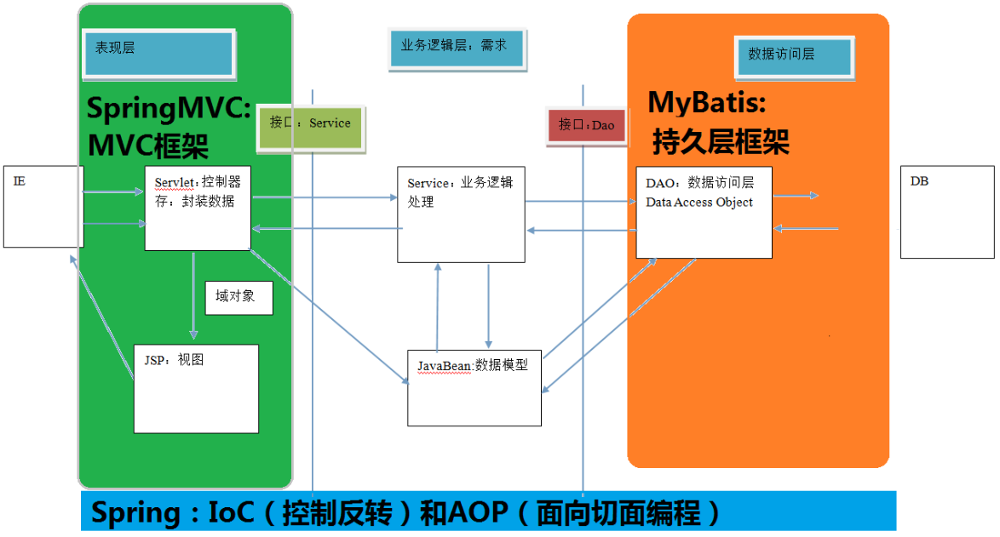

# 03_SpringMVC

## 1. SpringMVC的基本概述

### 1.1 三层架构的基本概述

```tex
我们的开发架构一般都是基于两种形式，一种是c/s架构，也就是客户端/服务器。另一种是b/s架构，也就是浏览器/服务器。在JavaEE开发中，几乎全部是基于b/s架构的开发。那么在b/s架构中，系统的标准三层架构包括：表现层、业务层、持久层。三层架构在我们实际开发中使用的非常多,所以我们课程中的案例也是基于三层架构设计的。

三层架构，每层架构各司其职，接下来我们说说每层架构都有哪些作用：

表现层：

也就是我们常说的web层。它负责接收客户端的请求，向客户端响应结果，通常客户端使用http协议请求web层，web需要接收http请求，完成http响应。表现层包含展示层和控制层，控制层负责接收前端请求，展示层负责结果的展示。表现层依赖业务层，接收到客户端请求一般会调用业务层进行业务处理，并将处理结果响应给客户端。表现层的设计一般都使用MVC模型。

业务层：

也就是我们常说的service层。它负责业务逻辑的处理，和我们开发项目的需求息息相关。web层依赖业务层，但是业务层不依赖web层。业务层在业务处理时可能会依赖持久层，如果要对数据持久化需要保证事务一致性(也就是我们说的事务应该放在业务层来控制)。

持久层：

也就是我们常说的dao层。负责数据持久化，包括数据层即数据库和数据访问层。数据库是对数据进行持久化的载体，数据访问层是业务层和持久层交互的接口，业务层需要通过对数据访问层将数据持久化到数据库中，通俗的讲，持久层就是和数据库交互，对数据表进行增删改查的。
```

### 1.2 MVC架构

```tex
MVC全名是Model View Controller.是模型(Model) 视图(view) 控制器(controller)的缩写。是一种用于创建web应用程序表现层的模式。MVC中每个部分各司
其职：
Model(模型):
通常指的就是我们的数据模型,用来封装数据的。
View(视图):
通常指的是我们的jsp或者html。一般用来展示数据的，通常视图是依据模型数据创建的。
Controller(控制器):
是应用程序中处理用户交互的部分。用于接收前端请求。比如获取前端请求传递的参数，并负责将请求交给业务层进行处理。业务层将业务结果处理完成以后，控制器接收业务层的业务结果，并将业务数据存储在域对象，实现页面的跳转。
```

### 1.3 什么是springMVC

```tex
SpringMVC是一种基于Java的实现MVC设计模型的请求驱动类型的轻量级web框架，属于Spring FrameWork的后续产品，已经融合在Spring Web Flow里面。Spring框架提供了构建web应用程序的全功能MVC模块。使用Spring可插入的MVC架构，从而在使用Spring进行web开发时，可以选择使用Spring的Spring MVC框架或集成其他MVC开发框
架，比如Struts2等。
SpringMVC已经成为目前最主流的MVC框架之一，并且随着Spring 3.0的发布，全面超越Struts2,成为最优秀的web框架。它通过一套注解，让一个简单的Java类成为处理请求的控制器，而无需事先任何接口，同时它还支持Restful编程风格。
```



### 1.4 SpringMVC的优势

```tex
1. 清晰的角色划分：
前端控制器(DispatcherServlet)
处理器映射器(HandlerMapping)
处理器适配器(HandlerAdpater)
视图解析器(ViewResolver)
控制器(Controller)
验证器(Validator)
命令对象(Command 请求参数绑定到的对象就叫做命令对象)
表单对象(Form Object 提供给表单展示和提交的对象就叫表单对象)
2. 分工明确，而且扩展点相当灵活，很容易进行功能扩展。
3. 由于命令对象就是一个POJO，无需继承框架特定的API,可以使用命令对象直接作为业
务对象。
4. 和Spring其他框架无缝集成，是其他web框架不具备的。
5. 可适配，通过HandlerAdapter可以支持任意的类作为处理器。
6. 可定制性，HandlerMapping ViewResolver等能够非常简单的定制。
7. 功能强大的数据验证、格式化、绑定机制。
```

