# Mybatis

## 1. mybatis 入门

### 1.1 框架的基本概述

#### 1.1.1 什么是框架

框架就是一套解决方案，不同的框架解决不同的问题。框架帮助我们封装了很多细节，使用开发者使用极简单的方式就可以实现功能，大大的提高了开发效率。

简而言之，框架其实就是某种应用的半成品，就是一组组件，供你选用完成你自己的系统。简单说就是使用别人搭好的舞台，你来做表演。而且，框架一般是成熟的，不断升级的软件。

#### 1.1.2 框架要解决的问题

框架要解决的最重要的一个问题是技术整合的问题，在 J2EE 的 框架中，有着各种各样的技术，不同的 软件企业需要从 J2EE 中选择不同的技术，这就使得软件企业最终的应用依赖于这些技术，技术自身的复杂性和技 术的风险性将会直接对应用造成冲击。而应用是软件企业的核心，是竞争力的关键所在，因此应该将应用自身的设计和具体的实现技术解耦。这样，软件企业的研发将集中在应用的设计上，而不是具体的技术实现，技术实现是应 用的底层支撑，它不应该直接对应用产生影响。

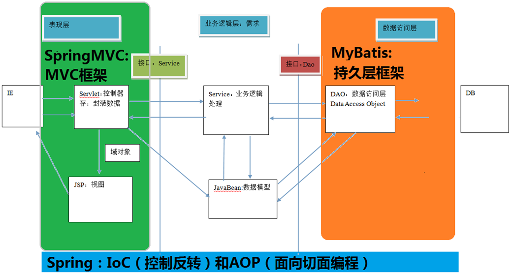

#### 1.1.3 传统JDBC代码分析

```java
public class TestJdbc {
    public static void main(String[] args) {
        try {
            //加载数据库驱动
            Class.forName("com.mysql.jdbc.Driver");
            //创建连接对象
            String url = "jdbc:mysql://192.168.10.137:3306/ssm";
            Connection connection =
                DriverManager.getConnection(url, "root", "Admin123!");
            //准备sql语句
            String sql = "select * from account";
            //准备PreparedStatement对象
            PreparedStatement pst =
                connection.prepareStatement(sql);
            //执行sql语句
            ResultSet rs = pst.executeQuery();
            //遍历结果集
            while(rs.next()){
                Integer id = rs.getInt("id");
                String name = rs.getString("name");
                Double money = rs.getDouble("money");
                System.out.println(id + " " + name + " " +
                                   money);
            }
            //关闭资源
            rs.close();
            pst.close();
            connection.close();
        } catch (Exception e) {
            e.printStackTrace();
        }
    }
}
```

问题：

1.   数据库连接创建、释放频繁造成系统资源浪费从而影响系统性能，如果使用数据库连接池可解决此问题。

2.   Sql 语句在代码中硬编码，造成代码不易维护，实际应用sql变化的可能较大，sql变动需要改变 java 代码。
3.   使用 preparedStatement 向占有位符号传参数存在硬编码，因为 sql 语句的where 条件不一定，可能多也可能少，修改 sql 还要修改代码，系统不易维护。

4.   对结果集解析存在硬编码（查询列名），sql 变化导致解析代码变化，系统不易维护，如果能将数据库记录封装成 pojo 对象解析比较方便。

#### 1.1.4 mybatis 基本概述

mybatis 是一个优秀的基于 java 的持久层框架，它内部封装了 jdbc，使开发者只需要关注 sql 语句本身， 而不需要花费精力去处理加载驱动、创建连接、创建statement 等繁杂的过程。

mybatis 通过 xml 或注解的方式将要执行的各种 statement 配置起来，并通过 java对象和 statement 中 sql 的动态参数进行映射生成最终执行的 sql 语句，最后由mybatis 框架执行 sql 并将结果映射为 java 对象并返回。

采用 ORM 思想解决了实体和数据库映射的问题，对 jdbc 进行了封装，屏蔽了 jdbc api 底层访问细节，使我们不用与 jdbc api 打交道，就可以完成对数据库的持久化操作。

### 1.2 mybatis 入门案例环境搭建

1.   导入mybatis相关依赖

2.   创建pojo，将pojo和数据表进行关联依赖  定义接口

3.   创建mybatis的核心配置文件sqlMapConfig.xml

4.   创建接口的映射文件

     ​	接口所在的目录和接口文件所在的目录保持一致

5.   编写测试代码

#### 1.2.1 创建数据库

```sql
DROP TABLE IF EXISTS `user`;
CREATE TABLE `user` (
    `id` int(11) NOT NULL auto_increment,
    `username` varchar(32) NOT NULL COMMENT '用户名称',
    `birthday` datetime default NULL COMMENT '生日',
    `sex` char(1) default NULL COMMENT '性别',
    `address` varchar(256) default NULL COMMENT '地址',
    PRIMARY KEY (`id`)
) ENGINE=InnoDB DEFAULT CHARSET=utf8;
insert into
`user`(`id`,`username`,`birthday`,`sex`,`address`) values (41,'老王','2018-02-27 17:47:08','男','上海'),(42,'小二王','2018-03-02 15:09:37','女','四川成都'),(43,'小二王','2018-03-04 11:34:34','女','中国上海'),(45,'老刘','2018-03-04  12:04:06','男','北京昌平'),(46,'王','2018-03-07 17:37:26','男','北京'),(48,'小
艾','2018-03-08 11:44:00','女','上海');
DROP TABLE IF EXISTS `account`;
CREATE TABLE `account` (
    `ID` int(11) NOT NULL COMMENT '编号',
    `UID` int(11) default NULL COMMENT '用户编号',
    `MONEY` double default NULL COMMENT '金额',
    PRIMARY KEY (`ID`),
    KEY `FK_Reference_8` (`UID`),
    CONSTRAINT `FK_Reference_8` FOREIGN KEY (`UID`) REFERENCES
    `user` (`id`)
) ENGINE=InnoDB DEFAULT CHARSET=utf8;
insert into `account`(`ID`,`UID`,`MONEY`) values
(1,41,1000),(2,45,1000),(3,41,2000);
DROP TABLE IF EXISTS `role`;
CREATE TABLE `role` (
    `ID` int(11) NOT NULL COMMENT '编号',
    `ROLE_NAME` varchar(30) default NULL COMMENT '角色名称',
    `ROLE_DESC` varchar(60) default NULL COMMENT '角色描述',
    PRIMARY KEY (`ID`)
) ENGINE=InnoDB DEFAULT CHARSET=utf8;
insert into `role`(`ID`,`ROLE_NAME`,`ROLE_DESC`) values
(1,'院长','学院领导'),(2,'总裁','公司老板'),(3,'校长','学校负责人');
DROP TABLE IF EXISTS `user_role`;
CREATE TABLE `user_role` (
    `UID` int(11) NOT NULL COMMENT '用户编号',
    `RID` int(11) NOT NULL COMMENT '角色编号',
    PRIMARY KEY (`UID`,`RID`),
    KEY `FK_Reference_10` (`RID`),
    CONSTRAINT `FK_Reference_10` FOREIGN KEY (`RID`) REFERENCES
    `role` (`ID`),
    CONSTRAINT `FK_Reference_9` FOREIGN KEY (`UID`) REFERENCES
    `user` (`id`)
) ENGINE=InnoDB DEFAULT CHARSET=utf8;
insert into `user_role`(`UID`,`RID`) values (41,1),(45,1),
(41,2);
```

#### 1.2.2 创建maven工程，添加对应坐标

```xml
<dependencyManagement>
    <dependencies>
        <dependency>
            <groupId>org.apache.logging.log4j</groupId>
            <artifactId>log4j-bom</artifactId>
            <version>2.26.1</version>
            <type>pom</type>
            <scope>import</scope>
        </dependency>
    </dependencies>
</dependencyManagement>

<dependencies>
    <dependency>
        <groupId>org.mybatis</groupId>
        <artifactId>mybatis</artifactId>
        <version>3.5.19</version>
    </dependency>

    <!--junit单元测试-->
    <dependency>
        <groupId>junit</groupId>
        <artifactId>junit</artifactId>
        <version>4.13.2</version>
        <scope>test</scope>
    </dependency>

    <!--数据库驱动-->
    <dependency>
        <groupId>com.mysql</groupId>
        <artifactId>mysql-connector-j</artifactId>
        <version>9.7.0</version>
    </dependency>

    <!--log4j-->
    <dependency>
        <groupId>org.apache.logging.log4j</groupId>
        <artifactId>log4j-api</artifactId>
    </dependency>
    <dependency>
        <groupId>org.apache.logging.log4j</groupId>
        <artifactId>log4j-core</artifactId>
        <scope>runtime</scope>
    </dependency>
</dependencies>
```

#### 1.2.3 编写实体类

```java
package com.sonnet.pojo;

import java.util.Date;

/**
 * pojo 与数据表user形成映射关系
 * 定义的规则：
 *      1. 实体类的字段和数据表中的名称保持一致
 *      2. 实体类的字段的数据类型必须和数据表中的字段的数据类型一样
 */
public class User {

    private Integer id;
    private String username;
    private Date birthday;
    private String sex;
    private String address;


    public User() {
    }

    public User(Integer id, String username, Date birthday, String sex, String address) {
        this.id = id;
        this.username = username;
        this.birthday = birthday;
        this.sex = sex;
        this.address = address;
    }

    /**
     * 获取
     * @return id
     */
    public Integer getId() {
        return id;
    }

    /**
     * 设置
     * @param id
     */
    public void setId(Integer id) {
        this.id = id;
    }

    /**
     * 获取
     * @return username
     */
    public String getUsername() {
        return username;
    }

    /**
     * 设置
     * @param username
     */
    public void setUsername(String username) {
        this.username = username;
    }

    /**
     * 获取
     * @return birthday
     */
    public Date getBirthday() {
        return birthday;
    }

    /**
     * 设置
     * @param birthday
     */
    public void setBirthday(Date birthday) {
        this.birthday = birthday;
    }

    /**
     * 获取
     * @return sex
     */
    public String getSex() {
        return sex;
    }

    /**
     * 设置
     * @param sex
     */
    public void setSex(String sex) {
        this.sex = sex;
    }

    /**
     * 获取
     * @return address
     */
    public String getAddress() {
        return address;
    }

    /**
     * 设置
     * @param address
     */
    public void setAddress(String address) {
        this.address = address;
    }

    public String toString() {
        return "User{id = " + id + ", username = " + username + ", birthday = " + birthday + ", sex = " + sex + ", address = " + address + "}";
    }
}
```

#### 1.2.4 编写持久层接口

```java
package com.sonnet.dao;

import com.sonnet.pojo.User;

import java.util.List;

public interface UserDao {

    // 查询所有的用户信息
    public List<User> findAll();
}
```

#### 1.2.5 编写mybatis的核心配置文件 sqlMapConfig.xml

```xml
<?xml version="1.0" encoding="UTF-8"?>
<!DOCTYPE configuration PUBLIC "-//mybatis.org//DTD Config3.0//EN" "http://mybatis.org/dtd/mybatis-3-config.dtd">
<configuration>

    <!--配置mybatis环境-->
    <environments default="mysql">
        <!--id需要和default保持一致，配置连接MySQL的具体信息-->
        <environment id="mysql">
            <!--配置事务类型JDBC-->
            <transactionManager type="JDBC"></transactionManager>
            <!--配置数据源 POOLED UNPOOLED-->
            <dataSource type="POOLED">
                <!--配置数据库的驱动 url 用户名 密码 -->
                <property name="driver" value="com.mysql.cj.jdbc.Driver"/>
                <property name="url" value="jdbc:mysql://localhost:3306/mybatis_lesson"/>
                <property name="username" value="root"/>
                <property name="password" value="root"/>
            </dataSource>
        </environment>
    </environments>

    <!--在核心配置文件中导入，接口的映射文件-->
    <mappers>
        <mapper resource="com/sonnet/dao/UserDao.xml"></mapper>
    </mappers>
</configuration>
```

#### 1.2.6 编写持久层接口对应的映射文件 UserDao.xml

```xml
<?xml version="1.0" encoding="UTF-8"?>
<!DOCTYPE mapper
        PUBLIC "-//mybatis.org//DTD Mapper 3.0//EN"
        "http://mybatis.org/dtd/mybatis-3-mapper.dtd">

<!--
    namespace：命名空间 值必须唯一 一般写接口的权限定名即可
-->
<mapper namespace="com.sonnet.dao.UserDao">
    <!--
        select标签 就是一个执行查询操作的标签
            id：我们要写接口的方法名称
            resultType：描述接口的返回值类型（如果接口的返回值是List Set 集合 ，那这个属性值必须定义为接口的泛型）
    -->
    <select id="findAll" resultType="com.sonnet.pojo.User">
        select * from user
    </select>
</mapper>
```

#### 1.2.7 测试

```java
package com.sonnet;

import com.sonnet.dao.UserDao;
import com.sonnet.pojo.User;
import org.apache.ibatis.io.Resources;
import org.apache.ibatis.session.SqlSession;
import org.junit.Test;
import org.apache.ibatis.session.SqlSessionFactory;
import org.apache.ibatis.session.SqlSessionFactoryBuilder;

import java.io.InputStream;
import java.util.List;

public class TestMybatis {

    @Test
    public void test() throws Exception{
        // 加载mybatis的核心配置文件
        InputStream inputStream = Resources.getResourceAsStream("sqlMapConfig.xml");
        // 创建SqlSessionFactoryBuilder对象
        SqlSessionFactoryBuilder sqlSessionFactoryBuilder = new SqlSessionFactoryBuilder();
        // 创建SqlSessionFactory对象（构建者设计模式，屏蔽了SqlSessionFactory创建的细节）
        SqlSessionFactory sqlSessionFactory = sqlSessionFactoryBuilder.build(inputStream);
        // 创建SqlSession对象（工厂模式）
        SqlSession sqlSession = sqlSessionFactory.openSession();
        // 通过SqlSession 生成接口的代理对象（动态代理）
        UserDao userDao = sqlSession.getMapper(UserDao.class);
        List<User> userList = userDao.findAll();
        userList.forEach(System.out::println);
        // 关闭资源
        sqlSession.close();
        inputStream.close();
    }
}
```

### 1.3 自定义Mybatis框架（XML）

#### 1.3.1 流程分析

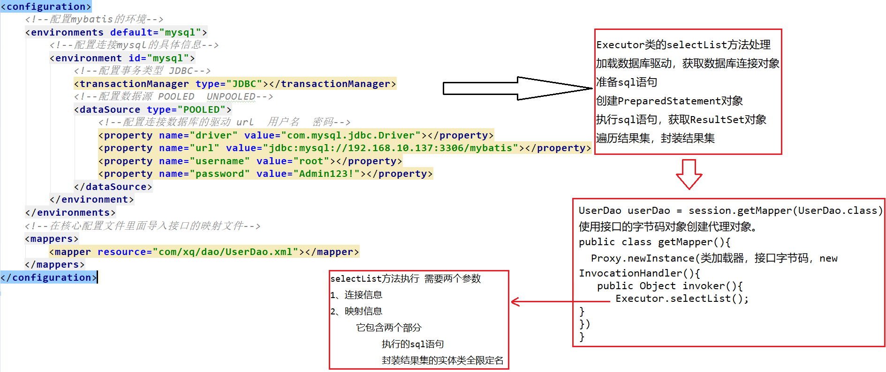

#### 1.3.2 搭建环境

```xml
<dependencyManagement>
    <dependencies>
        <dependency>
            <groupId>org.apache.logging.log4j</groupId>
            <artifactId>log4j-bom</artifactId>
            <version>2.26.1</version>
            <type>pom</type>
            <scope>import</scope>
        </dependency>
    </dependencies>
</dependencyManagement>

<dependencies>

    <!--junit单元测试-->
    <dependency>
        <groupId>junit</groupId>
        <artifactId>junit</artifactId>
        <version>4.13.2</version>
        <scope>test</scope>
    </dependency>

    <!--数据库驱动-->
    <dependency>
        <groupId>com.mysql</groupId>
        <artifactId>mysql-connector-j</artifactId>
        <version>9.7.0</version>
    </dependency>

    <!--log4j-->
    <dependency>
        <groupId>org.apache.logging.log4j</groupId>
        <artifactId>log4j-api</artifactId>
    </dependency>
    <dependency>
        <groupId>org.apache.logging.log4j</groupId>
        <artifactId>log4j-core</artifactId>
        <scope>runtime</scope>
    </dependency>

    <dependency>
        <groupId>dom4j</groupId>
        <artifactId>dom4j</artifactId>
        <version>1.6.1</version>
    </dependency>
    <dependency>
        <groupId>jaxen</groupId>
        <artifactId>jaxen</artifactId>
        <version>2.0.6</version>
    </dependency>
</dependencies>
```

#### 1.3.3 编码实现

*   编写加载类。使用类加载器加载资源

    ```java
    package com.sonnet.io;
    
    import java.io.InputStream;
    
    public class Resources {
    
        public static InputStream getResourceAsStream(String fileName) {
            // 使用类加载器记载指定的配置文件
            return Resources.class.getClassLoader().getResourceAsStream(fileName);
        }
    }
    ```

*   编写SqlSessionFactoryBuilder类

    作用：加载配置资源，并将配置资源封装成Configuration对象，并且将该资源对象传到工厂对象中。

    ```java
    package com.sonnet.builder;
    
    import com.sonnet.cfg.Configuration;
    import com.sonnet.factory.DefaultSqlSessionFactory;
    import com.sonnet.factory.SqlSessionFactory;
    import com.sonnet.utils.XMLConfigBuilder;
    
    import java.io.InputStream;
    
    public class SqlSessionFactoryBuilder {
    
        // 定义一个build方法
        public SqlSessionFactory build(InputStream in) {
            // 通过加载xml配置文件，生成一个Configuration对象
            Configuration configuration = XMLConfigBuilder.loadConfiguration(in);
            return new DefaultSqlSessionFactory(configuration);
        }
    }
    ```

*   创建Configuration配置类

    ```java
    package com.sonnet.cfg;
    
    import java.util.HashMap;
    import java.util.Map;
    
    public class Configuration {
        private String driver;
        private String url;
        private String username;
        private String password;
    
        private Map<String, Mapper> mappers = new HashMap<String, Mapper>();
    
    
        public Configuration() {
        }
    
        public Configuration(String driver, String url, String username, String password, Map<String, Mapper> mappers) {
            this.driver = driver;
            this.url = url;
            this.username = username;
            this.password = password;
            this.mappers = mappers;
        }
    
        public String getDriver() {
            return driver;
        }
    
        public void setDriver(String driver) {
            this.driver = driver;
        }
    
        public String getUrl() {
            return url;
        }
    
        public void setUrl(String url) {
            this.url = url;
        }
    
        public String getUsername() {
            return username;
        }
    
        public void setUsername(String username) {
            this.username = username;
        }
    
        public String getPassword() {
            return password;
        }
    
        public void setPassword(String password) {
            this.password = password;
        }
    
        public Map<String, Mapper> getMappers() {
            return mappers;
        }
    
        public void setMappers(Map<String, Mapper> maps) {
            mappers.putAll(maps);
        }
    }
    ```

*   创建Mapper

    ```java
    package com.sonnet.cfg;
    
    public class Mapper {
    
        private String queryString;
        private String resultType;
    
        public String getQueryString() {
            return queryString;
        }
    
        public void setQueryString(String queryString) {
            this.queryString = queryString;
        }
    
        public String getResultType() {
            return resultType;
        }
    
        public void setResultType(String resultType) {
            this.resultType = resultType;
        }
    }
    ```

*   创建SqlSessionFactory

    ```java
    package com.sonnet.factory;
    
    import com.sonnet.sqlSession.SqlSession;
    
    public interface SqlSessionFactory {
    
        // 获取SqlSession对象
        public SqlSession openSession();
    }
    ```

    ```java
    package com.sonnet.factory;
    
    import com.sonnet.cfg.Configuration;
    import com.sonnet.sqlSession.DefaultSqlSession;
    import com.sonnet.sqlSession.SqlSession;
    
    public class DefaultSqlSessionFactory implements SqlSessionFactory{
    
        private Configuration cfg;
    
        public DefaultSqlSessionFactory(Configuration cfg) {
            this.cfg = cfg;
        }
    
        public SqlSession openSession() {
            return new DefaultSqlSession(cfg);
        }
    }
    ```

*   定义SqlSession对象

    ```java
    package com.sonnet.sqlSession;
    
    public interface SqlSession {
    
        // 获取代理对象的方法
        public <T> T getMapper(Class<T> tClass);
    
        // 释放资源的方法
        public void close();
    }
    ```

    ```java
    package com.sonnet.sqlSession;
    
    import com.sonnet.cfg.Configuration;
    import com.sonnet.proxy.ProxyFactory;
    import com.sonnet.utils.DataSourceUtil;
    
    import java.lang.reflect.Proxy;
    import java.sql.Connection;
    import java.sql.SQLException;
    
    public class DefaultSqlSession implements SqlSession{
    
        private Configuration cfg;
    
        private Connection connection;
    
        public DefaultSqlSession(Configuration cfg) {
            this.cfg = cfg;
            this.connection = DataSourceUtil.getConnection(cfg);
        }
    
        @Override
        public <T> T getMapper(Class<T> tClass) {
            // 使用JDK动态代理技术
            return (T) Proxy.newProxyInstance(tClass.getClassLoader(), new Class[]{tClass}, new ProxyFactory(cfg.getMappers(), connection));
        }
    
        @Override
        public void close() {
            try {
                connection.close();
            } catch (SQLException e) {
                throw new RuntimeException(e);
            }
        }
    }
    ```

*   定义ProxyFactory类

    ```java
    package com.sonnet.proxy;
    
    import com.sonnet.cfg.Mapper;
    import com.sonnet.utils.Executor;
    
    import java.lang.reflect.InvocationHandler;
    import java.lang.reflect.Method;
    import java.sql.Connection;
    import java.util.Map;
    
    public class ProxyFactory implements InvocationHandler {
    
        private Map<String, Mapper> mappers;
        private Connection connection;
    
        public ProxyFactory(Map<String, Mapper> mappers, Connection connection) {
            this.mappers = mappers;
            this.connection = connection;
        }
    
        // 增强的方法
        @Override
        public Object invoke(Object proxy, Method method, Object[] args) throws Throwable {
            // 获取方法名称
            String methodName = method.getName();
            // 获取方法所在类的名称
            String className = method.getDeclaringClass().getName();
            // 拼接key值
            String key = className + "." + methodName;
            // 获取Map集合中的Mapper对象
            Mapper mapper = mappers.get(key);
            if (mapper == null) {
                throw new IllegalAccessException("传入的参数有误");
            }
            return new Executor().selectList(mapper, connection);
        }
    }
    ```

#### 1.3.4 总结

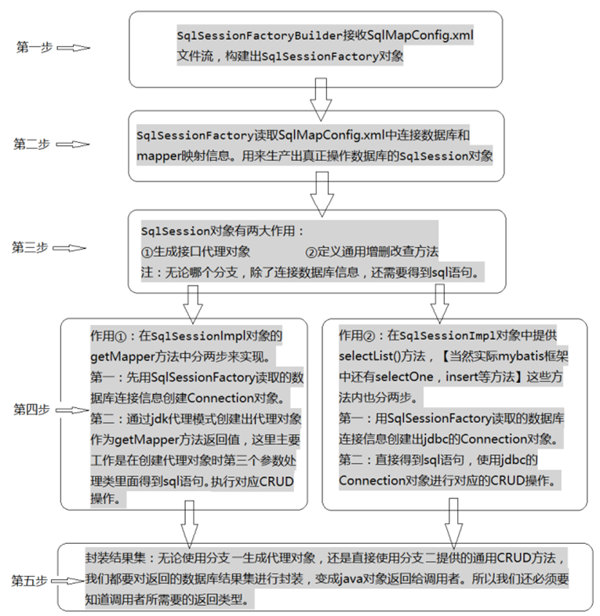


## 2. Mybatis基于代理的CRUD操作

### 2.1 搭建mybatis的基础环境

*   引入依赖

    ```xml
    <dependencyManagement>
        <dependencies>
            <dependency>
                <groupId>org.apache.logging.log4j</groupId>
                <artifactId>log4j-bom</artifactId>
                <version>2.26.1</version>
                <type>pom</type>
                <scope>import</scope>
            </dependency>
        </dependencies>
    </dependencyManagement>
    
    <dependencies>
        <dependency>
            <groupId>org.mybatis</groupId>
            <artifactId>mybatis</artifactId>
            <version>3.5.19</version>
        </dependency>
    
        <!--junit单元测试-->
        <dependency>
            <groupId>junit</groupId>
            <artifactId>junit</artifactId>
            <version>4.13.2</version>
            <scope>test</scope>
        </dependency>
    
        <!--数据库驱动-->
        <dependency>
            <groupId>com.mysql</groupId>
            <artifactId>mysql-connector-j</artifactId>
            <version>9.7.0</version>
        </dependency>
    
        <!--log4j-->
        <dependency>
            <groupId>org.apache.logging.log4j</groupId>
            <artifactId>log4j-api</artifactId>
        </dependency>
        <dependency>
            <groupId>org.apache.logging.log4j</groupId>
            <artifactId>log4j-core</artifactId>
            <scope>runtime</scope>
        </dependency>
    </dependencies>
    ```

*   定义核心配置文件

    ```xml
    <?xml version="1.0" encoding="UTF-8"?>
    <!DOCTYPE configuration PUBLIC "-//mybatis.org//DTD Config3.0//EN" "http://mybatis.org/dtd/mybatis-3-config.dtd">
    <configuration>
        <environments default="mybatis">
            <environment id="mybatis">
                <transactionManager type="JDBC"></transactionManager>
                <dataSource type="POOLED">
                    <property name="driver" value="com.mysql.cj.jdbc.Driver"/>
                    <property name="url" value="jdbc:mysql://localhost:3306/mybatis_lesson"/>
                    <property name="username" value="root"/>
                    <property name="password" value="root"/>
                </dataSource>
            </environment>
        </environments>
    
        <!--引入映射文件-->
        <mappers>
            <mapper resource="com/sonnet/dao/UserDao.xml"></mapper>
        </mappers>
    </configuration>
    ```

*   定义实体类

    ```java
    package com.sonnet.pojo;
    
    import java.util.Date;
    
    public class User {
    
        private Integer id;
        private String username;
        private Date birthday;
        private String sex;
        private String address;
    
    
        public User() {
        }
    
        public User(Integer id, String username, Date birthday, String sex, String address) {
            this.id = id;
            this.username = username;
            this.birthday = birthday;
            this.sex = sex;
            this.address = address;
        }
    
        /**
         * 获取
         * @return id
         */
        public Integer getId() {
            return id;
        }
    
        /**
         * 设置
         * @param id
         */
        public void setId(Integer id) {
            this.id = id;
        }
    
        /**
         * 获取
         * @return username
         */
        public String getUsername() {
            return username;
        }
    
        /**
         * 设置
         * @param username
         */
        public void setUsername(String username) {
            this.username = username;
        }
    
        /**
         * 获取
         * @return birthday
         */
        public Date getBirthday() {
            return birthday;
        }
    
        /**
         * 设置
         * @param birthday
         */
        public void setBirthday(Date birthday) {
            this.birthday = birthday;
        }
    
        /**
         * 获取
         * @return sex
         */
        public String getSex() {
            return sex;
        }
    
        /**
         * 设置
         * @param sex
         */
        public void setSex(String sex) {
            this.sex = sex;
        }
    
        /**
         * 获取
         * @return address
         */
        public String getAddress() {
            return address;
        }
    
        /**
         * 设置
         * @param address
         */
        public void setAddress(String address) {
            this.address = address;
        }
    
        public String toString() {
            return "User{id = " + id + ", username = " + username + ", birthday = " + birthday + ", sex = " + sex + ", address = " + address + "}";
        }
    }
    ```

*   定义接口

    ```java
    package com.sonnet.dao;
    
    import com.sonnet.pojo.User;
    
    import java.util.List;
    
    public interface UserDao {
    
        public List<User> findAll();
    }
    ```

*   定义mapper映射文件

    ```xml
    <?xml version="1.0" encoding="UTF-8"?>
    <!DOCTYPE mapper
            PUBLIC "-//mybatis.org//DTD Mapper 3.0//EN"
            "http://mybatis.org/dtd/mybatis-3-mapper.dtd">
    
    <mapper namespace="com.sonnet.dao.UserDao">
        <select id="findAll" resultType="com.sonnet.pojo.User">
            select * from user
        </select>
    </mapper>
    ```

*   测试

    ```java
    package com.sonnet;
    
    import com.sonnet.dao.UserDao;
    import com.sonnet.pojo.User;
    import org.apache.ibatis.io.Resources;
    import org.apache.ibatis.session.SqlSession;
    import org.apache.ibatis.session.SqlSessionFactory;
    import org.apache.ibatis.session.SqlSessionFactoryBuilder;
    import org.junit.Test;
    
    import java.io.InputStream;
    import java.util.List;
    
    public class TestMybatis {
    
        @Test
        public void test01() throws Exception{
            // 加载核心的配置文件
            InputStream inputStream = Resources.getResourceAsStream("sqlMapConfig.xml");
            // 构建SqlSessionFactoryBuilder对象
            SqlSessionFactoryBuilder sqlSessionFactoryBuilder = new SqlSessionFactoryBuilder();
            // 构建SqlSessionFactory对象
            SqlSessionFactory sqlSessionFactory = sqlSessionFactoryBuilder.build(inputStream);
            // 生成SqlSession对象
            SqlSession sqlSession = sqlSessionFactory.openSession();
            // 生成接口的代理对象
            UserDao userDao = sqlSession.getMapper(UserDao.class);
            List<User> userList = userDao.findAll();
            userList.forEach(System.out::println);
            sqlSession.close();
            inputStream.close();
        }
    }
    ```

### 2.2 根据id查询

*   定义接口

    ```java
    // 根据id查询用户信息
    public User findUserById(Integer id);
    ```

*   在映射文件中添加配置

    ```xml
    <!--
        根据id查询对应的用户信息
            id：定义接口的名称
            resultType：定义方法的返回值类型
            parameterType：定义接口形参的数据类型
    -->
    <select id="findUserById" resultType="com.sonnet.pojo.User" parameterType="int">
        select * from user where id = #{id}
    </select>
    ```

    >   注意：
    >
    >   sql 语句中使用#{}字符：
    >
    >   它代表占位符，相当于原来 jdbc 部分所学的?，都是用于执行语句时替换实际的数据。
    >
    >   具体的数据是由#{}里面的内容决定的。

*   在测试类中测试

    ```java
    @Test
    public void testFindUserById() throws Exception{
        InputStream in =
            Resources.getResourceAsStream("SqlMapConfig.xml");
        SqlSessionFactoryBuilder builder = new
            SqlSessionFactoryBuilder();
        SqlSessionFactory sqlSessionFactory = builder.build(in);
        SqlSession sqlSession = sqlSessionFactory.openSession();
        UserDao userDao = sqlSession.getMapper(UserDao.class);
        User user = userDao.findUserById(41);
        System.out.println(user);
        sqlSession.close();
    }
    ```

    为了避免重复代码，可以通过@After和@Before注解优化

    ```java
    package com.sonnet;
    
    import com.sonnet.dao.UserDao;
    import com.sonnet.pojo.User;
    import org.apache.ibatis.io.Resources;
    import org.apache.ibatis.session.SqlSession;
    import org.apache.ibatis.session.SqlSessionFactory;
    import org.apache.ibatis.session.SqlSessionFactoryBuilder;
    import org.junit.After;
    import org.junit.Before;
    import org.junit.Test;
    
    import java.io.InputStream;
    import java.util.List;
    
    public class TestMybatis {
    
        SqlSession sqlSession;
        UserDao userDao;
    
        @Before // 在@Test方法执行之前执行
        public void before() throws Exception{
            // 加载核心的配置文件
            InputStream inputStream = Resources.getResourceAsStream("sqlMapConfig.xml");
            // 构建SqlSessionFactoryBuilder对象
            SqlSessionFactoryBuilder sqlSessionFactoryBuilder = new SqlSessionFactoryBuilder();
            // 构建SqlSessionFactory对象
            SqlSessionFactory sqlSessionFactory = sqlSessionFactoryBuilder.build(inputStream);
            // 生成SqlSession对象
            sqlSession = sqlSessionFactory.openSession();
            // 生成接口的代理对象
            userDao = sqlSession.getMapper(UserDao.class);
    
        }
    
        @After // 在@Test方法执行之后执行
        public void after() throws Exception{
            sqlSession.close();
        }
    
        @Test
        public void test01() throws Exception{
            List<User> userList = userDao.findAll();
            userList.forEach(System.out::println);
        }
    
        @Test
        public void test02() throws Exception{
            User user = userDao.findUserById(48);
            System.out.println(user);
        }
    }
    ```

### 2.3 保存的操作

*   在接口中添加方法

    ```java
    // 保存用户
    public void addUser(User user);
    ```

*   在映射文件里添加保存配置的信息

    ```xml
    <insert id="addUser" parameterType="com.sonnet.pojo.User" useGeneratedKeys="true" keyProperty="id" keyColumn="id">
        insert into user(username, birthday, sex, address) values(#{username}, #{birthday}, #{sex}, #{address});
    </insert>
    ```

    >   细节：
    >
    >   parameterType 属性：代表参数的类型，因为我们要传入的是一个类的对象，所以类型就写类的全名称。
    >
    >   sql 语句中使用#{}字符：
    >
    >   它代表占位符，相当于原来 jdbc 部分所学的?，都是用于执行语句时替换实际的数据。具体的数据是由#{}里面的内容决定的。
    >
    >   \#{}中内容的写法： 由于我们保存方法的参数是一个 User 对象，此处要写 User 对象中的属性名称。

*   测试：

    ```java
    @Test
    public void test03() {
        User user = new User();
        user.setUsername("嫁衣");
        user.setBirthday(new Date());
        user.setAddress("zhejiang");
        user.setSex("女");
        userDao.addUser(user);
        // 获取新增数据的主键
        System.out.println("新增用户的id：" + user.getId());
        // 手动提交事务
        sqlSession.commit();
    }
    ```

*   新增用户id的返回值问题

    新增用户后，同时还要返回当前新增用户的 id 值，因为 id 是由数据库的自动增长来实现的，所以就相当于我们要在新增后将自动增长 auto_increment 的值返回。

    *   第一张方式

        ```xml
        <!--
                新增用户
                selectKey：获取自增长主键的标签
                    keyColumn：获取表中主键的字段名称
                    keyProperty：实体类中映射主键字段的属性
                    resultType：主键字段的数据类型
                    select last_insert_id()：mysql的系统函数，专门用来获取新增之后主键的值
            -->
        <insert id="addUser" parameterType="com.sonnet.pojo.User">
            <selectKey keyColumn="id" keyProperty="id" resultType="int">
                select last_insert_id()
            </selectKey>
            insert into user(username, birthday, sex, address) values(#{username}, #{birthday}, #{sex}, #{address});
        </insert>
        ```

    *   第二种方式

        ```xml
        <!--
                新增用户
                selectKey：获取自增长主键的标签
                    keyColumn：获取表中主键的字段名称
                    keyProperty：实体类中映射主键字段的属性
                    resultType：主键字段的数据类型
                    select last_insert_id()：mysql的系统函数，专门用来获取新增之后主键的值
            -->
        <insert id="addUser" parameterType="com.sonnet.pojo.User" useGeneratedKeys="true" keyProperty="id" keyColumn="id">
            <!--
                <selectKey keyColumn="id" keyProperty="id" resultType="int">
                    select last_insert_id()
                </selectKey>
        -->
            insert into user(username, birthday, sex, address) values(#{username}, #{birthday}, #{sex}, #{address});
        </insert>
        ```

### 2.4 修改的操作

*   在持久层接口中更新方法

    ```java
    // 修改用户
    public void updateUser(User user);
    ```

*   在用户的映射文件中配置

    ```xml
    <!--
        修改用户信息
    -->
    <update id="updateUser" parameterType="com.sonnet.pojo.User">
        update user set username=#{username}, birthday=#{birthday}, sex=#{sex}, address=#{address} where id=#{id};
    </update>
    ```

*   测试

    ```java
    @Test
    public void test04() {
        User user = new User();
        user.setId(52);
        user.setUsername("佳颖");
        user.setBirthday(new Date());
        user.setAddress("浙江");
        user.setSex("女");
        userDao.updateUser(user);
        sqlSession.commit();
    }
    ```

### 2.5 删除的操作

*   在接口中添加删除的方法

    ```java
    // 删除用户信息
    public void deleteUserById(Integer id);
    ```

*   在用户的配置文件中配置

    ```xml
    <!--
        通过id删除用户的信息
    -->
    <delete id="deleteUserById" parameterType="int">
        delete from user where id = #{id}
    </delete>
    ```

*   测试

    ```java
    @Test
    public void test05() {
        userDao.deleteUserById(52);
        sqlSession.commit();
    }
    ```

### 2.6 模糊查询

#### 2.6.1 方式一

*   在接口中添加模糊查询的方法

    ```java
    // 模糊查询 根据用户名进行模糊查询
    public List<User> findUserByUsername(String username);
    ```

*   在映射文件中添加模糊查询的配置

    ```xml
    <!--
        模糊查询 根据用户名进行模糊查询操作
    -->
    <select id="findUserByUsername" parameterType="string" resultType="com.sonnet.pojo.User">
        select * from user where username like #{username}
    </select>
    ```

*   测试

    ```java
    @Test
    public void test06() {
        // select * from user where username like ?
        // 查询名称中包含王的用户信息
        userDao.findUserByUsername("%王%").forEach(System.out::println);
    }
    ```

#### 2.6.2 方式二

我们在配置文件中没有加入%来作为模糊查询的条件，所以在传入字符串实参时，就需要给定模糊查询的标识%。配置文件中的#{username}也只是一个占位符，所以SQL 语句显示为“？”。

模糊查询的另一种配置方式：

*   定义一个新的模糊查询接口

    ```java
    // 模糊查询2 根据用户名进行模糊查询
    public List<User> findUserByUsername2(String username);
    ```

*   添加对应接口的映射配置文件信息

    ```xml
    <!--
        模糊查询2 根据用户名称进行查询
    -->
    <select id="findUserByUsername2" parameterType="string" resultType="com.sonnet.pojo.User">
        select * from user where username like '%${value}%'
    </select>
    ```

*   测试

    ```java
    @Test
    public void test07() {
        // select * from user where username like '%王%'		 sql参数的直接注入，有sql参数注入的风险
        // 查询名称中包含王的用户信息
        userDao.findUserByUsername2("王").forEach(System.out::println);
    }
    ```

#### 2.6.3 总结

总结:#{} 和${}的区别

\#{}表示一个占位符号 通过#{}可以实现 preparedStatement 向占位符中设置值，自动进行 java 类型和 jdbc 类型转换， #{}可以有效防止 sql 注入。 #{}可以接收简单类型值或 pojo 属性值。 如果parameterType 传输单个简单类 型值，#{}括号中可以是 value 或其它名称。

${}表示拼接 sql 串 通过${}可以将 parameterType 传入的内容拼接在 sql 中且不进行 jdbc 类型转换， ${}可以接收简单类型值或 pojo 属性值，如果parameterType传输单个简单类型值，${}括号中只能value。

### 2.7 聚合函数查询

*   添加查询接口

    ```java
    // 聚合函数查询 统计当前数据表中的数据记录
    public Integer getTotal();
    ```

*   添加聚合函数查询的mapper映射配置

    ```xml
    <!--
        聚合函数查询
    -->
    <select id="getTotal" resultType="int">
        select count(id) from user
    </select>
    ```

*   测试

    ```java
    @Test
    public void test08() {
        Integer total = userDao.getTotal();
        System.out.println("总记录数是：" + total);
    }
    ```

### 2.8 在接口中传入多个参数的问题

如果我们在接口中传入多个参数，对参数的位置不加以指定的话，那么执行结果一定会报错。所以在传递多个参数的时候，一定要指明参数对应的位置。

#### 2.8.1 方式一

*   定义接口

    ```java
    // mybatis中接口存在多个参数问题
    public List<User> findUserBySexAndAddress(String sex, String address);
    ```

*   增加接口的配置文件

    ```xml
    <!--
        解决接口中存在多个参数的问题
    -->
    <select id="findUserBySexAndAddress" resultType="com.sonnet.pojo.User">
        select * from user where sex = '${param1}' and address = '${param2}'
    </select>
    ```

    在sql语句中，使用${param1} 或者${param2} 指定参数传递的位置 也可以使用${arg0} ${arg1}

*   测试

    ```java
    @Test
    public void test09() {
        // select * from user where sex = '女' and address = 'zhejiang'      有sql注入风险
        userDao.findUserBySexAndAddress("女", "zhejiang").forEach(System.out::println);
    }
    
    ```

#### 2.8.2 方式二

*   定义接口

    ```java
    // 使用map来解决接口中多个参数的问题
    public List<User> findUserByMap(Map<String, Object> map);
    ```

*   增加接口的配置文件

    ```xml
    <!--
        使用map集合解决多个参数的问题
        #{} 里面的值定义为map集合中的key值
    -->
    <select id="findUserByMap" resultType="com.sonnet.pojo.User" parameterType="map">
        select * from user where sex = #{sex} and address = #{address}
    
    </select>
    ```

*   测试

    ```java
    @Test
    public void test010() {
        Map<String, Object> map = new HashMap<>();
        map.put("sex", "女");
        map.put("address", "zhejiang");
        // select * from user where sex = ？ and address = ？
        userDao.findUserByMap(map).forEach(System.out::println);
    }
    ```


## 3. Mybatis参数深入

### 3.1 输入参数--parameterType

```tex
根据id查询对应的用户信息
	id：定义接口的名称
    resultType：定义方法的返回值类型
    parameterType：定义接口形参的数据类型   默认的是 参数类型的权限定名
    	mybatis对这些数据类型的全限定名设置做了别名的设置 在TypeAliaRegistry里面进行了相关的别名设置
        如果输入的参数有的数据类型是string或者其他基本数据类型，占位符里面的内容可以是任意指定的
        如果输入的参数的数据类型是自定义的pojo。那么占位符里面的数据千万不能随意定义（必须要和pojo实体类的成员属性名保持一致）
```

**传递pojo对象**

*   编写接口

    ```java
    // 根据id的集合查询相关的用户信息
    public List<User> findUserByIds(QueryVo queryVo);
    ```

*   编写实体类

    ```java
    package com.sonnet.pojo;
    
    import java.util.List;
    
    public class QueryVo {
    
        private List<Integer> ids;
        
        public List<Integer> getIds() {
            return ids;
        }
        
        public void setIds(List<Integer> ids) {
            this.ids = ids;
        }
    }
    ```

*   编写映射文件

    ```xml
    <!--
        根据id的集合查询对应的用户信息
        foreach：循环遍历的标签
            collection：QueryVo里面集合类型的变量名称
            item：遍历的集合的元素的别名
            separator：用逗号对遍历的元素的值进行分割
                select * from user where id in(41,43,45,50)
            open：括号的开始部分
            close：括号的结束部分
    -->
    <select id="findUserByIds" resultType="com.sonnet.pojo.User" parameterType="com.sonnet.pojo.QueryVo">
        select * from user where id in
                           <foreach collection="ids" item="id" separator="," open="(" close=")">
                               #{id}
                           </foreach>
    </select>
    ```

*   测试

    ```java
    @Test
    public void test11() {
        QueryVo queryVo = new QueryVo();
        List<Integer> ids = new ArrayList<>();
        ids.add(41);
        ids.add(43);
        ids.add(45);
        ids.add(51);
        queryVo.setIds(ids);
        List<User> userList = userDao.findUserByIds(queryVo);
        userList.forEach(System.out::println);
    }
    ```

### 3.2 输出参数--ResultType和ResultMap

resultType 属性可以指定结果集的类型，它支持基本类型和实体类类型

需要注意的是，它和 parameterType 一样，如果注册过类型别名的，可以直接使用别名。没有注册过的必须使用全限定类名。例如：我们的实体类此时必须是全限定类名

使用实体类的全限定类名，还有一个要求，实体类中的属性名称必须和查询语句中的列名保持一致，否则无法实现封装。

#### 3.2.1 数据表字段和实体字段不一致（1）

*   修改实体类

    ```java
    package com.sonnet.pojo;
    
    import java.util.Date;
    
    /**
     * 实体 演示数据表字段和实体类字段不一致的问题
     */
    public class User {
        private Integer userId;
        private String username;
        private Date userBirthday;
        private String userSex;
        private String userAddress;
    
        @Override
        public String toString() {
            return "User{" +
                    "userId=" + userId +
                    ", username='" + username + '\'' +
                    ", userBirthday=" + userBirthday +
                    ", userSex='" + userSex + '\'' +
                    ", userAddress='" + userAddress + '\'' +
                    '}';
        }
    
        public Integer getUserId() {
            return userId;
        }
    
        public void setUserId(Integer userId) {
            this.userId = userId;
        }
    
        public String getUsername() {
            return username;
        }
    
        public void setUsername(String username) {
            this.username = username;
        }
    
        public Date getUserBirthday() {
            return userBirthday;
        }
    
        public void setUserBirthday(Date userBirthday) {
            this.userBirthday = userBirthday;
        }
    
        public String getUserSex() {
            return userSex;
        }
    
        public void setUserSex(String userSex) {
            this.userSex = userSex;
        }
    
        public String getUserAddress() {
            return userAddress;
        }
    
        public void setUserAddress(String userAddress) {
            this.userAddress = userAddress;
        }
    }
    ```

*   查询接口

    ```java
    package com.sonnet.dao;
    
    import com.sonnet.pojo.User;
    
    import java.util.List;
    
    public interface UserDao {
    
        // 查询所有用户信息
        public List<User> findAll();
    }
    ```

*   映射文件

    ```xml
    <?xml version="1.0" encoding="UTF-8"?>
    <!DOCTYPE mapper
            PUBLIC "-//mybatis.org//DTD Mapper 3.0//EN"
            "http://mybatis.org/dtd/mybatis-3-mapper.dtd">
    
    <mapper namespace="com.sonnet.dao.UserDao">
        <!--
            查询所有用户信息
            结果：目前这样写是无法封装数据结果集的。因为数据表字段名称和实体类字段不一样（忽略大小写情况除外）
                解决方案：
                1. 通过取别名的方式解决问题
                    给查询的字段取别名，别名就是实体类字段的名称
                2. 手动解决实体字段和数据表字段不一致问题
        -->
        <select id="findAll" resultType="com.sonnet.pojo.User">
            /*select * from user*/
            select id as userId, username as userName, birthday as userBirthday,
                   sex as userSex, address as userAddress from user
        </select>
    </mapper>
    ```

*   测试

    ```java
    package com.sonnet;
    
    import com.sonnet.dao.UserDao;
    import org.apache.ibatis.io.Resources;
    import org.apache.ibatis.session.SqlSession;
    import org.apache.ibatis.session.SqlSessionFactory;
    import org.apache.ibatis.session.SqlSessionFactoryBuilder;
    import org.junit.After;
    import org.junit.Before;
    import org.junit.Test;
    
    import java.io.InputStream;
    
    public class UserTest {
    
        SqlSession sqlSession;
        UserDao userDao;
    
        @Before // 在@Test方法执行之前执行
        public void before() throws Exception{
            // 加载核心的配置文件
            InputStream inputStream = Resources.getResourceAsStream("sqlMapConfig.xml");
            // 构建SqlSessionFactoryBuilder对象
            SqlSessionFactoryBuilder sqlSessionFactoryBuilder = new SqlSessionFactoryBuilder();
            // 构建SqlSessionFactory对象
            SqlSessionFactory sqlSessionFactory = sqlSessionFactoryBuilder.build(inputStream);
            // 生成SqlSession对象
            sqlSession = sqlSessionFactory.openSession();
            // 生成接口的代理对象
            userDao = sqlSession.getMapper(UserDao.class);
    
        }
    
        @After // 在@Test方法执行之后执行
        public void after() throws Exception{
            sqlSession.close();
        }
    
        @Test
        public void test01() {
            userDao.findAll().forEach(System.out::println);
        }
    }
    ```

#### 3.2.2 数据表字段和实体字段不一致（2）

如果字段查询很多，都使用别名写会很麻烦，可以使用ResultMap

```xml
<?xml version="1.0" encoding="UTF-8"?>
<!DOCTYPE mapper
        PUBLIC "-//mybatis.org//DTD Mapper 3.0//EN"
        "http://mybatis.org/dtd/mybatis-3-mapper.dtd">

<mapper namespace="com.sonnet.dao.UserDao">
    <!--
        查询所有用户信息
        结果：目前这样写是无法封装数据结果集的。因为数据表字段名称和实体类字段不一样（忽略大小写情况除外）
            解决方案：
            1. 通过取别名的方式解决问题
                给查询的字段取别名，别名就是实体类字段的名称
            2. 手动解决实体字段和数据表字段不一致问题
                resultMap标签解决字段不一致
                resultMap标签：这个标签的作用是解决实体字段和数据表字段不一致问题
                    id：值任意，需要保证值唯一
                    type：描述实体的权限定名
                id标签：用来做主键字段的映射
                    property：描述实体类的名称
                    column：描述的是数据表字段的名称
                result标签：用来描述非主键字段的映射关系
                    property：描述实体类的名称
                    column：描述的是数据表字段的名称
    -->
    <resultMap id="userMap" type="com.sonnet.pojo.User">
        <id property="userId" column="id"></id>
        <result property="username" column="username"></result>
        <result property="userBirthday" column="birthday"></result>
        <result property="userSex" column="sex"></result>
        <result property="userAddress" column="address"></result>
    </resultMap>

    <!--
        id：接口的名称
        resultMap：值引用resultMap标签id中的值
    -->
    <select id="findAll" resultMap="userMap">
        select * from user
    </select>

    <select id="findById" resultMap="userMap" parameterType="int">
        select * from user where id = #{id}
    </select>
</mapper>
```


## 4. sqlMapConfig.xml核心配置文件详解

### 4.1 SqlMapConfig.xml中配置的内容和顺序

-properties（属性）

​	--property

-settings（全局配置参数）

​	--setting

-typeAliases（类型别名）

​	--typeAliase

​	--package

-typeHandlers（类型处理器）

-objectFactory（对象工厂）

-plugins（插件）

-environments（环境集合属性对象）

​	--environment（环境子属性对象）

​	---transactionManager（事务管理）

​	---dataSource（数据源）

-mappers（映射器）

​	--mapper

​	--package

### 4.2 properties标签

*   定义db.properties

    ```properties
    jdbc.driver=com.mysql.cj.jdbc.Driver
    jdbc.url=jdbc:mysql://localhost:3306/mybatis_lesson
    jdbc.username=root
    jdbc.password=root
    ```

*   在sqlMapConfig.xml引入数据库配置信息

    ```xml
    <?xml version="1.0" encoding="UTF-8"?>
    <!DOCTYPE configuration PUBLIC "-//mybatis.org//DTD Config3.0//EN" "http://mybatis.org/dtd/mybatis-3-config.dtd">
    <configuration>
        <!--加载db.properties文件-->
        <properties resource="db.properties"></properties>
        <!--配置mybatis环境-->
        <environments default="mysql">
            <!--id需要和default保持一致，配置连接MySQL的具体信息-->
            <environment id="mysql">
                <!--配置事务类型JDBC-->
                <transactionManager type="JDBC"></transactionManager>
                <!--配置数据源 POOLED UNPOOLED-->
                <dataSource type="POOLED">
                    <!--配置数据库的驱动 url 用户名 密码 -->
                    <property name="driver" value="${jdbc.driver}"/>
                    <property name="url" value="${jdbc.url}"/>
                    <property name="username" value="${jdbc.username}"/>
                    <property name="password" value="${jdbc.password}"/>
                </dataSource>
            </environment>
        </environments>
    
        <!--在核心配置文件中导入，接口的映射文件-->
        <mappers>
            <mapper resource="com/sonnet/dao/UserDao.xml"></mapper>
        </mappers>
    </configuration>
    ```

### 4.3 typeAliases标签

可以采用自定义别名方式来开发

配置别名的方式有两种：

*   第一种

    *   修改核心配置文件

        ```xml
        <?xml version="1.0" encoding="UTF-8"?>
        <!DOCTYPE configuration PUBLIC "-//mybatis.org//DTD Config3.0//EN" "http://mybatis.org/dtd/mybatis-3-config.dtd">
        
        <configuration>
            <!--定义别名-->
            <typeAliases>
                <!--定义别名 type：定义别名的类的全限定名 alias：取的别名-->
                <typeAlias type="com.sonnet.pojo.User" alias="user"></typeAlias>
            </typeAliases>
        
            <environments default="mybatis">
                <environment id="mybatis">
                    <transactionManager type="JDBC"></transactionManager>
                    <dataSource type="POOLED">
                        <property name="driver" value="com.mysql.cj.jdbc.Driver"/>
                        <property name="url" value="jdbc:mysql://localhost:3306/mybatis_lesson"/>
                        <property name="username" value="root"/>
                        <property name="password" value="root"/>
                    </dataSource>
                </environment>
            </environments>
        
            <!--引入映射文件-->
            <mappers>
                <mapper resource="com/sonnet/dao/UserDao.xml"></mapper>
            </mappers>
        </configuration>
        ```

        注意：typeAliases标签一定要定义在environments标签的上面，注意顺序。

    *   修改映射文件，使用别名替换

        ```xml
        <!--
            查询所有用户的信息
        -->
        <select id="findAll" resultType="user">
            select * from user
        </select>
        ```

*   第二种

    ```xml
    <typeAliases>
        <!--<typeAlias type="com.xq.pojo.User" alias="user">
    </typeAlias>-->
        <package name="com.xq.pojo"></package>
    </typeAliases>
    ```

    此时别名就是制定包下面的类名小写。

### 4.4 Mappers标签

Mappers标签里面定义mapper标签。作用是用来在核心配置文件里面引入映射文件。

第一种：

```xml
<mappers>
    <mapper resource="com/xq/dao/UserDao.xml"></mapper>
</mappers>
```

第二种：

使用 mapper 接口类路径。使用注解开发的时候，需要使用这个路径

```xml
<mappers>
    <mapper class="com.xq.dao.UserDao"></mapper>
</mappers>
```

第三种：

```xml
<mappers>
    <package name="com.xq.dao"></package>
</mappers>
```

注意：此种方法要求 mapper 接口名称和 mapper 映射文件名称相同，且放在同一个目录中。


## 5. Mybatis 连接池

在 Mybatis 中也有连接池

技术，但是它采用的是自己的连接池技术。在Mybatis的SqlMapConfig.xml 配置文件中，通过来实现 Mybatis中连接池的配置。用连接池的目的主要是为了**减少获取连接所消耗的时间**

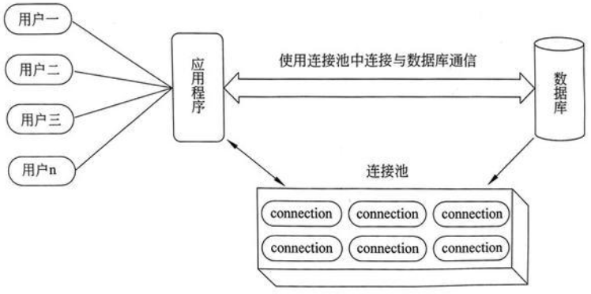

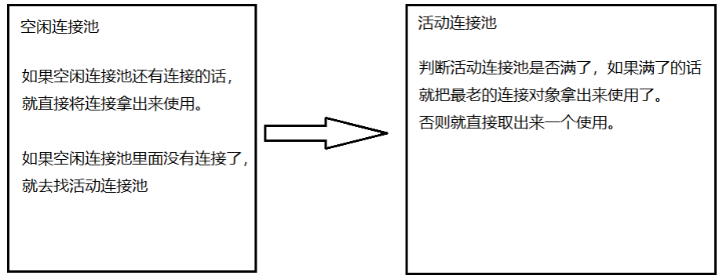


## 6. Mybatis事务控制

```tex
什么是事务？
事务就是一组逻辑操作，这些逻辑操作时最小单位，不可分割的。要么全部执行，要么全部执行失败。
事务的特性？
原子性：构成事务的逻辑操作，必须是最小单位的
一致性：事务提交前和提交后的数据是一致的
隔离性：多个事务之间必须是互相隔离，不能影响
持久性：事务提交之后，产生的数据必须持久化的保持在数据库之中
事务的隔离级别
读未提交
读已提交
可重复读
可串行化
事务不考虑隔离级别会有什么问题？
脏读
虚度
幻读
```

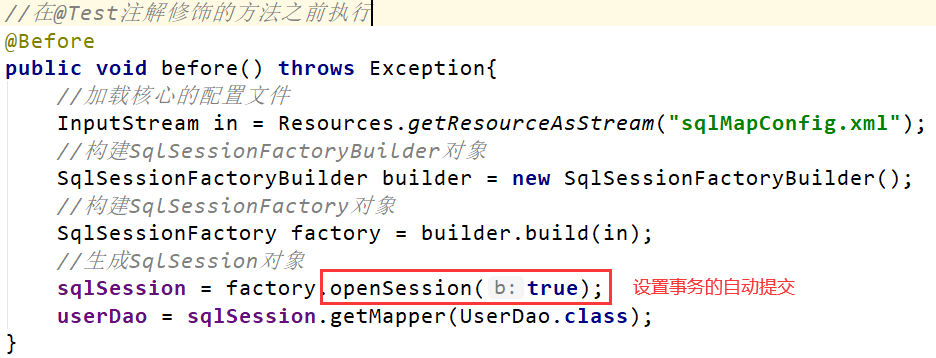

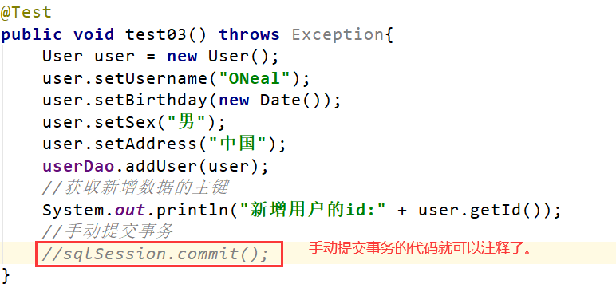


## 7. Mysql之动态sql

### 7.1 动态sql之if标签

根据实体类的不同取值，使用不同的SQL语句来进行查询。比如在id如果不为空时可以根据 id查询，如果username不空时还要加入用户名作为条件。

*   创建接口

    ```java
    // 动态查询
    public List<User> findByCondition(User user);
    ```

*   增加方法接口方法的映射文件配置

    ```xml
    <?xml version="1.0" encoding="UTF-8"?>
    <!DOCTYPE mapper
            PUBLIC "-//mybatis.org//DTD Mapper 3.0//EN"
            "http://mybatis.org/dtd/mybatis-3-mapper.dtd">
    
    <!--
        namespace：命名空间 值必须唯一 一般写接口的权限定名即可
    -->
    <mapper namespace="com.sonnet.dao.UserDao">
    
        <!--
            动态查询
            if标签：用来条件判断
                test属性：描述的是判断条件 如果为true就执行if标签里面的内容，否则不执行
        -->
        <select id="findByCondition" parameterType="user" resultType="user">
            select * from user where 1=1
            <if test="username != null and username != ''">
                and username = #{username}
            </if>
            <if test="birthday != null and birthday != ''">
                and birthday = #{birthday}
            </if>
            <if test="sex != null and sex != ''">
                and sex = #{sex}
            </if>
            <if test="address != null and address != ''">
                and address = #{address}
            </if>
        </select>
    </mapper>
    ```

*   测试

    ```java
    package com.sonnet;
    
    import com.sonnet.dao.UserDao;
    import com.sonnet.pojo.User;
    import org.apache.ibatis.io.Resources;
    import org.apache.ibatis.session.SqlSession;
    import org.apache.ibatis.session.SqlSessionFactory;
    import org.apache.ibatis.session.SqlSessionFactoryBuilder;
    import org.junit.After;
    import org.junit.Before;
    import org.junit.Test;
    
    import java.io.InputStream;
    import java.util.*;
    
    public class TestMybatis {
    
        SqlSession sqlSession;
        UserDao userDao;
    
        @Before // 在@Test方法执行之前执行
        public void before() throws Exception{
            // 加载核心的配置文件
            InputStream inputStream = Resources.getResourceAsStream("sqlMapConfig.xml");
            // 构建SqlSessionFactoryBuilder对象
            SqlSessionFactoryBuilder sqlSessionFactoryBuilder = new SqlSessionFactoryBuilder();
            // 构建SqlSessionFactory对象
            SqlSessionFactory sqlSessionFactory = sqlSessionFactoryBuilder.build(inputStream);
            // 生成SqlSession对象
            sqlSession = sqlSessionFactory.openSession(true); // 关闭事务的手动提交
            // 生成接口的代理对象
            userDao = sqlSession.getMapper(UserDao.class);
    
        }
    
        @After // 在@Test方法执行之后执行
        public void after() throws Exception{
            sqlSession.close();
        }
    
        // 动态查询
        @Test
        public void test01() {
            User user = new User();
            user.setUsername("嫁衣");
            userDao.findByCondition(user).forEach(System.out::println);
        }
    }
    ```

### 7.2 动态sql之where标签

为了简化上面where 1=1的条件拼装，可以采用标签来简化开发

使用where标签将if标签代码块包起来，将1=1去掉

*   创建接口

    ```java
    // 动态查询2
    public List<User> findByCondition2(User user);
    ```

*   创建映射文件

    ```xml
    <!--
        where标签
            where标签本身解析成sql语句种的where关键字
            替换了1=1，并且在底层解析sql的时候，满足条件的第一个if标签，会将if里面的and自动去除
    -->
    <select id="findByCondition2" resultType="user" parameterType="user">
        select * from user
        <where>
            <if test="username != null and username != ''">
                and username = #{username}
            </if>
            <if test="birthday != null and birthday != ''">
                and birthday = #{birthday}
            </if>
            <if test="sex != null and sex != ''">
                and sex = #{sex}
            </if>
            <if test="address != null and address != ''">
                and address = #{address}
            </if>
        </where>
    </select>
    ```

*   测试

    ```java
    // 动态查询
    @Test
    public void test02() {
        User user = new User();
        user.setUsername("嫁衣");
        userDao.findByCondition2(user).forEach(System.out::println);
    }
    ```

### 7.3 动态sql之set标签

可以通过set标签来实现动态修改。

*   定义接口

    ```JAVA
    // 动态修改
    public void updateUserByCondition(User user);
    ```

*   定义接口的映射文件

    ```XML
    <!--
        动态修改
        set标签：封装动态修改的字段
            底层在解析sql的时候，会将set标签动态的解析成set关键字
            并且在拼接sql的时候，会将满足最后一个if标签里面的内容的逗号，给去除，保证update语法的正确性
    -->
    <update id="updateUserByCondition" parameterType="user">
        update user
        <set>
            <if test="username != null and username != ''">
                username = #{username},
            </if>
            <if test="birthday != null and birthday != ''">
                birthday = #{birthday},
            </if>
            <if test="sex != null and sex != ''">
                sex = #{sex},
            </if>
            <if test="address != null and address != ''">
                address = #{address},
            </if>
        </set>
        where id = #{id}
    </update>
    ```

*   测试

    ```java
    // 动态修改
    @Test
    public void test03() {
        User user = new User();
        user.setUsername("夹心饼干");
        user.setAddress("中国");
        userDao.updateUserByCondition(user);
    }
    ```

### 7.4动态sql之添加

*   定义接口

    ```java
    // 动态新增
    public void addUserSelective(User user);
    ```

*   定义接口的映射文件

    ```xml
    <!--
        描述sql片段
        id：定义sql片段的名称 自定义 唯一即可
    -->
    <sql id="key">
        /*trim标签：去除满足条件的if之中的内容的最有一个逗号*/
        <trim suffixOverrides=",">
            <if test="username != null and username != ''">
                username,
            </if>
            <if test="birthday != null and birthday != ''">
                birthday,
            </if>
            <if test="sex != null and sex != ''">
                sex,
            </if>
            <if test="address != null and address != ''">
                address,
            </if>
        </trim>
    </sql>
    
    <sql id="value">
        <trim suffixOverrides=",">
            <if test="username != null and username != ''">
                #{username},
            </if>
            <if test="birthday != null and birthday != ''">
                #{birthday},
            </if>
            <if test="sex != null and sex != ''">
                #{sex},
            </if>
            <if test="address != null and address != ''">
                #{address},
            </if>
        </trim>
    </sql>
    <!--
        动态新增
        include标签：引入sql片段的标签
            refid：引用sql片段的id值
    -->
    <insert id="addUserSelective" parameterType="user">
        insert into user(<include refid="key"/>) values (<include refid="value"></include>)
    </insert>
    ```

*   测试

    ```java
    // 动态新增
    @Test
    public void test04() {
        User user = new User();
        user.setUsername("夹心饼干");
        user.setSex("女");
        userDao.addUserSelective(user);
    }
    ```

### 7.5 动态sql之choose when otherwise标签

choose when otherwise相当于if elseif else语句。

*   定义接口

    ```java
    // 动态新增2
    public List<User> findByCondition3(User user);
    ```

*   定义接口的映射文件

    ```xml
    <!--
        choose when otherwise
        这种标签类似于if elseif else 分支
        如果有一个when满足条件，即使后面的when也满足条件，那么都不会执行
        如果不满足所有的when分支，那么就执行otherwise分支
    -->
    <select id="findByCondition3" parameterType="user" resultType="user">
        select * from user
        <where>
            <choose>
                <when test="username != null and username != ''">
                    username = #{username}
                </when>
                <when test="birthday != null and birthday != ''">
                    birthday = #{birthday}
                </when>
                <when test="sex != null and sex != ''">
                    sex = #{sex}
                </when>
                <when test="address != null and address != ''">
                    address = #{address}
                </when>
                <otherwise>
                    id = #{id}
                </otherwise>
            </choose>
        </where>
    </select>
    ```

*   测试

    ```JAVA
    // 动态查询，测试choose when otherwise
    @Test
    public void test05() {
        User user = new User();
        user.setUsername("嫁衣");
        user.setSex("女");
        user.setAddress("zhejiang");
        userDao.findByCondition3(user).forEach(System.out::println);
    }
    ```

### 7.6 动态sql之foreach标签

#### 7.6.1 方式一 将批量id封装到一个数组里

*   定义一个接口

    ```java
    // 批量删除 将id存在在数组里
    public void deleteUserByIds(Integer[] ids);
    ```

*   编写映射文件

    ```xml
    <!--
        批量删除用户根据id
        当我们将数组或者list集合作为参数传递给mybatis，那么mybatis会自动将其包装在一个map集合中，
        用其名称作为key，value就是数组或者集合的本身。所以在获取这个数组或者集合的时候，需要通过key来获取
        {"array", ids}
        {"List", list}
    -->
    <delete id="deleteUserByIds">
        delete from user where id in(
            <foreach collection="array" item="id" separator=",">
                #{id}
            </foreach>
            )
    </delete>
    ```

*   测试

    ```java
    // 批量删除 传递的是数组对象
    @Test
    public void test06() {
        Integer[] ids = {1,2,3,4,5};
        userDao.deleteUserByIds(ids);
    }
    ```

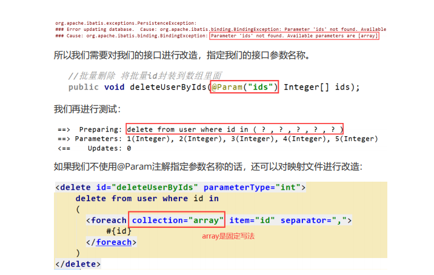

#### 7.6.2 方式二 将批量id封装在一个List集合里

*   定义一个接口

    ```java
    // 批量删除 将id存在在集合里
    public void deleteUserByIds2(List<Integer> list);
    ```

*   定义接口的映射文件

    ```xml
    <!--
        根据id进行批量删除，传递集合作为参数
    -->
    <delete id="deleteUserByIds2">
        delete from user where id in
           (
            <foreach collection="list" separator="," item="id">
                #{id}
            </foreach>
            )
    </delete>
    ```

*   测试

    ```java
    // 批量删除 传递的是数组对象
    @Test
    public void test07() {
        List<Integer> list = new ArrayList<>();
        list.add(1);
        list.add(2);
        list.add(3);
        list.add(4);
        userDao.deleteUserByIds2(list);
    }
    ```

#### 7.6.3 总结

当我们传递一个 List 实例或者数组作为参数对象传给 MyBatis。当你这么做的时候,MyBatis 会自动将它包装在一个 Map 中,用名称在作为键。List 实例将会以“list”作为键,而数组实例将会以“array”作为键。所以，当我们传递的是一个List集合时，mybatis会自动把我们的list集合包装成以list为Key值的map。

### 7.7 mybatis之批处理

需求：批量新增一批数据。

解决问题的方案有两种:

**第一种：将批量的数据放在List集合里面，遍历集合循环新增数据即可**

*   定义接口

    ```java
    // 新增
    public void addUser(User user);
    ```

*   定义接口的映射文件

    ```xml
    <!--
        新增
    -->
    <insert id="addUser" parameterType="user">
        insert into user(username, birthday, sex, address) values(#{username}, #{birthday}, #{sex}, #{address})
    </insert>
    ```

*   测试

    ```                                                                                                                                                                                                                               java
    // 批量新增
    @Test
    public void test08() {
        List<User> list = new ArrayList<>();
        User user1 = new User();
        user1.setUsername("数据1");
        user1.setSex("男");
        user1.setBirthday(new Date());
        user1.setAddress("数据1");
        User user2 = new User();
        user2.setUsername("数据2");
        user2.setSex("男");
        user2.setBirthday(new Date());
        user2.setAddress("数据2");
        User user3 = new User();
        user3.setUsername("数据3");
        user3.setSex("男");
        user3.setBirthday(new Date());
        user3.setAddress("数据3");
        list.add(user1);
        list.add(user2);
        list.add(user3);
        for (User user : list) {
            userDao.addUser(user);
        }
    }
    ```

**第二种：开启批处理指令，使用批处理的方式进行数据的新增**

第一种方式：在mybatis的核心配置文件上开启

```xml
<settings>
    <setting name="defaultExecutorType" value="BATCH"/>
</settings>
```

第二种方式：在创建SqlSession对象的时候，指定开启批处理

```java
sqlSession = sessionFactory.openSession(ExecutorType.BATCH,false);
```


## 8. mybatis之多表查询

本次案例主要以最为简单的用户和账户的模型来分析 Mybatis多表关系。用户为 User表，账户为Account表。一个用户（User）可以有多个账户（Account）。具体关系如下：

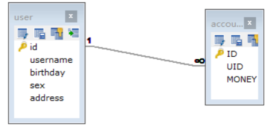

### 8.1 多表查询之1对1

需求：

查询所有的账户信息，并将其关联的用户信息也查询出来。

注意：

因为一个账户信息只能供某个用户使用，所以从查询账户信息出发关联查询用户信息为一对一查询。如果从用户信息出发查询用户的账户信息则为一对多查询，因为一个用户可以有多个账户。

```sql
SELECT account.*, user.username, `user`.address FROM account ,`user` WHERE account.UID = `user`.id;
```

#### 8.1.1 方式一

*   定义账户信息的实体类

    ```java
    package com.sonnet.pojo;
    
    public class Account {
        private Integer id;
        private Integer uid;
        private Double money;
    
        public Integer getId() {
            return id;
        }
    
        public void setId(Integer id) {
            this.id = id;
        }
    
        public Integer getUid() {
            return uid;
        }
    
        public void setUid(Integer uid) {
            this.uid = uid;
        }
    
        public Double getMoney() {
            return money;
        }
    
        public void setMoney(Double money) {
            this.money = money;
        }
    
        @Override
        public String toString() {
            return "Account{" +
                    "id=" + id +
                    ", uid=" + uid +
                    ", money=" + money +
                    '}';
        }
    }
    ```

*   编写sql语句

    ```sql
    SELECT account.*, user.username, `user`.address FROM account ,`user` WHERE account.UID = `user`.id;
    ```

*   定义AccountUser类

    为了能够封装上面SQL语句的查询结果，定义AccountCustomer 类中要包含账户信息同时还要包含用户信息，所以我们要在定义AccountUser 类时可以继承User类。

    ```java
    package com.sonnet.pojo;
    
    public class AccountUser extends Account{
    
        private String username;
    
        private String address;
    
        public String getUsername() {
            return username;
        }
    
        public void setUsername(String username) {
            this.username = username;
        }
    
        public String getAddress() {
            return address;
        }
    
        public void setAddress(String address) {
            this.address = address;
        }
    
        @Override
        public String toString() {
            return "AccountUser{" +
                    "username='" + username + '\'' +
                    ", address='" + address + '\'' +
                    '}';
        }
    }
    ```

*   定义账户的持久层dao接口

    ```java
    package com.sonnet.dao;
    
    import com.sonnet.pojo.AccountUser;
    
    import java.util.List;
    
    public interface AccountDao {
    
        List<AccountUser> findAll();
    }
    ```

*   定义AccountDao.xml文件中的查询配置信息

    ```xml
    <?xml version="1.0" encoding="UTF-8"?>
    <!DOCTYPE mapper
            PUBLIC "-//mybatis.org//DTD Mapper 3.0//EN"
            "http://mybatis.org/dtd/mybatis-3-mapper.dtd">
    
    <mapper namespace="com.sonnet.dao.AccountDao">
    
        <!--
            查询所有账户信息及其对应的用户信息
        -->
        <select id="findAll" resultType="com.sonnet.pojo.AccountUser">
            SELECT account.*, user.username, `user`.address FROM account ,`user` WHERE account.UID = `user`.id;
        </select>
    </mapper>
    ```

*   测试

    ```java
    package com.sonnet;
    
    import com.sonnet.dao.AccountDao;
    import com.sonnet.pojo.AccountUser;
    import org.apache.ibatis.io.Resources;
    import org.apache.ibatis.session.SqlSession;
    import org.apache.ibatis.session.SqlSessionFactory;
    import org.apache.ibatis.session.SqlSessionFactoryBuilder;
    import org.junit.After;
    import org.junit.Before;
    import org.junit.Test;
    
    import java.io.InputStream;
    import java.util.List;
    
    public class TestMybatis {
    
        SqlSession sqlSession;
        AccountDao accountDao;
    
        @Before // 在@Test方法执行之前执行
        public void before() throws Exception{
            // 加载核心的配置文件
            InputStream inputStream = Resources.getResourceAsStream("sqlMapConfig.xml");
            // 构建SqlSessionFactoryBuilder对象
            SqlSessionFactoryBuilder sqlSessionFactoryBuilder = new SqlSessionFactoryBuilder();
            // 构建SqlSessionFactory对象
            SqlSessionFactory sqlSessionFactory = sqlSessionFactoryBuilder.build(inputStream);
            // 生成SqlSession对象
            sqlSession = sqlSessionFactory.openSession(true); // 关闭事务的手动提交
            // 生成接口的代理对象
            accountDao = sqlSession.getMapper(AccountDao.class);
        }
    
        @After // 在@Test方法执行之后执行
        public void after() throws Exception{
            sqlSession.close();
        }
    
        @Test
        public void test01() {
            List<AccountUser> accountUserList = accountDao.findAll();
            for (AccountUser accountUser : accountUserList) {
                System.out.println("账户ID：" + accountUser.getId() + " 账户用户ID:" + accountUser.getUid() +
                        " 账户金额：" + accountUser.getMoney() + " 用户名：" + accountUser.getUsername() + " 地址：" + accountUser.getAddress());
            }
        }
    }
    ```

#### 8.1.2 方式二

使用resultMap，定义专门的resultMap 用于映射一对一查询结果。通过面向对象的(has a)关系可以得知，我们可以在Account 类中加入一个User类的对象来代表这个账户是哪个用户的。

*   在Account类中加入User类的对象作为Account类的一个属性

    ```java
    package com.sonnet.pojo;
    
    public class Account {
        private Integer id;
        private Integer uid;
        private Double money;
    
        // User的实体（一个账户对应一个用户）
        private User user;
    
        public User getUser() {
            return user;
        }
    
        public void setUser(User user) {
            this.user = user;
        }
    
        public Integer getId() {
            return id;
        }
    
        public void setId(Integer id) {
            this.id = id;
        }
    
        public Integer getUid() {
            return uid;
        }
    
        public void setUid(Integer uid) {
            this.uid = uid;
        }
    
        public Double getMoney() {
            return money;
        }
    
        public void setMoney(Double money) {
            this.money = money;
        }
    
        @Override
        public String toString() {
            return "Account{" +
                    "id=" + id +
                    ", uid=" + uid +
                    ", money=" + money +
                    ", user=" + user +
                    '}';
        }
    }
    ```

*   定义接口

    ```java
    package com.sonnet.dao;
    
    import com.sonnet.pojo.Account;
    import com.sonnet.pojo.AccountUser;
    
    import java.util.List;
    
    public interface AccountDao {
    
        List<Account> findAll();
    }
    ```

*   定义配置文件

    ```xml
    <?xml version="1.0" encoding="UTF-8"?>
    <!DOCTYPE mapper
            PUBLIC "-//mybatis.org//DTD Mapper 3.0//EN"
            "http://mybatis.org/dtd/mybatis-3-mapper.dtd">
    
    <mapper namespace="com.sonnet.dao.AccountDao">
    
        <!--
            使用resultMap标签 将数据表字段和实体字段进行关联映射
        -->
        <resultMap id="accountMap" type="account">
            <id column="id" property="id"></id>
            <result column="uid" property="uid"></result>
            <result column="money" property="money"></result>
            <!--
                association:进行1对1关联查询的时候 进行字段映射
                javaType:user对应的数据类型
            -->
            <association property="user" javaType="user">
                <id column="id" property="id"></id>
                <result column="username" property="username"></result>
                <result column="birthday" property="birthday"></result>
                <result column="sex" property="sex"></result>
                <result column="address" property="address"></result>
            </association>
        </resultMap>
        <!--
            查询所有账户信息及其对应的用户信息
        -->
        <select id="findAll" resultMap="accountMap">
            SELECT account.*, user.username, `user`.address FROM account ,`user` WHERE account.UID = `user`.id;
        </select>
    </mapper>
    ```

*   测试

    ```java
    package com.sonnet;
    
    import com.sonnet.dao.AccountDao;
    import com.sonnet.pojo.Account;
    import com.sonnet.pojo.AccountUser;
    import org.apache.ibatis.io.Resources;
    import org.apache.ibatis.session.SqlSession;
    import org.apache.ibatis.session.SqlSessionFactory;
    import org.apache.ibatis.session.SqlSessionFactoryBuilder;
    import org.junit.After;
    import org.junit.Before;
    import org.junit.Test;
    
    import java.io.InputStream;
    import java.util.List;
    
    public class TestMybatis {
    
        SqlSession sqlSession;
        AccountDao accountDao;
    
        @Before // 在@Test方法执行之前执行
        public void before() throws Exception{
            // 加载核心的配置文件
            InputStream inputStream = Resources.getResourceAsStream("sqlMapConfig.xml");
            // 构建SqlSessionFactoryBuilder对象
            SqlSessionFactoryBuilder sqlSessionFactoryBuilder = new SqlSessionFactoryBuilder();
            // 构建SqlSessionFactory对象
            SqlSessionFactory sqlSessionFactory = sqlSessionFactoryBuilder.build(inputStream);
            // 生成SqlSession对象
            sqlSession = sqlSessionFactory.openSession(true); // 关闭事务的手动提交
            // 生成接口的代理对象
            accountDao = sqlSession.getMapper(AccountDao.class);
        }
    
        @After // 在@Test方法执行之后执行
        public void after() throws Exception{
            sqlSession.close();
        }
    
        @Test
        public void test01() {
            List<Account> accountUserList = accountDao.findAll();
            for(Account account : accountUserList) {
                System.out.println(account);
            }
        }
    }
    ```

### 8.2 多表操作之1对多

需求：查询所有用户信息及其关联的账户信息

*   User类加入List

    ```java
    package com.sonnet.pojo;
    
    import java.util.Date;
    import java.util.List;
    
    /**
     * pojo 与数据表user形成映射关系
     * 定义的规则：
     *      1. 实体类的字段和数据表中的名称保持一致
     *      2. 实体类的字段的数据类型必须和数据表中的字段的数据类型一样
     */
    public class User {
    
        private Integer id;
        private String username;
        private Date birthday;
        private String sex;
        private String address;
    
        // 一个用户对应有多个账户
        private List<Account> accounts;
    
        public User() {
        }
    
        public User(Integer id, String username, Date birthday, String sex, String address) {
            this.id = id;
            this.username = username;
            this.birthday = birthday;
            this.sex = sex;
            this.address = address;
        }
    
        /**
         * 获取
         * @return id
         */
        public Integer getId() {
            return id;
        }
    
        /**
         * 设置
         * @param id
         */
        public void setId(Integer id) {
            this.id = id;
        }
    
        /**
         * 获取
         * @return username
         */
        public String getUsername() {
            return username;
        }
    
        /**
         * 设置
         * @param username
         */
        public void setUsername(String username) {
            this.username = username;
        }
    
        /**
         * 获取
         * @return birthday
         */
        public Date getBirthday() {
            return birthday;
        }
    
        /**
         * 设置
         * @param birthday
         */
        public void setBirthday(Date birthday) {
            this.birthday = birthday;
        }
    
        /**
         * 获取
         * @return sex
         */
        public String getSex() {
            return sex;
        }
    
        /**
         * 设置
         * @param sex
         */
        public void setSex(String sex) {
            this.sex = sex;
        }
    
        /**
         * 获取
         * @return address
         */
        public String getAddress() {
            return address;
        }
    
        /**
         * 设置
         * @param address
         */
        public void setAddress(String address) {
            this.address = address;
        }
    
        public List<Account> getAccounts() {
            return accounts;
        }
    
        public void setAccounts(List<Account> accounts) {
            this.accounts = accounts;
        }
    
    /*
        public String toString() {
            return "User{id = " + id + ", username = " + username + ", birthday = " + birthday + ", sex = " + sex + ", address = " + address + "}";
        }
    */
    
        @Override
        public String toString() {
            return "User{" +
                    "id=" + id +
                    ", username='" + username + '\'' +
                    ", birthday=" + birthday +
                    ", sex='" + sex + '\'' +
                    ", address='" + address + '\'' +
                    ", accounts=" + accounts +
                    '}';
        }
    }
    ```

*   用户持久层UserDao接口中加入查询方法

    ```java
    List<User> findAll();
    ```

*   编写配置文件

    ```xml
    <?xml version="1.0" encoding="UTF-8"?>
    <!DOCTYPE mapper
            PUBLIC "-//mybatis.org//DTD Mapper 3.0//EN"
            "http://mybatis.org/dtd/mybatis-3-mapper.dtd">
    
    <mapper namespace="com.sonnet.dao.UserDao">
    
        <resultMap id="userMap" type="user">
            <id column="id" property="id"></id>
            <result column="username" property="username"></result>
            <result column="birthday" property="birthday"></result>
            <result column="sex" property="sex"></result>
            <result column="address" property="address"></result>
            <!--
                collection：用于一对多关联查询的时候，需要指定字段的映射关系
                    property：实体中的属性的字段名称
            -->
            <collection property="accounts" ofType="account">
                <id property="id" column="id"></id>
                <result property="uid" column="uid"></result>
                <result property="money" column="money"></result>
            </collection>
        </resultMap>
        <!--
            查询所有的用户信息，及其关联的账户信息
        -->
        <select id="findAll" resultMap="userMap">
            SELECT user.*, account.uid, account.money FROM account ,`user` WHERE account.UID = `user`.id;
        </select>
    </mapper>
    ```

*   测试

    ```java
    package com.sonnet;
    
    import com.sonnet.dao.AccountDao;
    import com.sonnet.dao.UserDao;
    import com.sonnet.pojo.Account;
    import com.sonnet.pojo.AccountUser;
    import com.sonnet.pojo.User;
    import org.apache.ibatis.io.Resources;
    import org.apache.ibatis.session.SqlSession;
    import org.apache.ibatis.session.SqlSessionFactory;
    import org.apache.ibatis.session.SqlSessionFactoryBuilder;
    import org.junit.After;
    import org.junit.Before;
    import org.junit.Test;
    
    import java.io.InputStream;
    import java.util.List;
    
    public class TestMybatis {
    
        SqlSession sqlSession;
        //AccountDao accountDao;
        UserDao userDao;
    
        @Before // 在@Test方法执行之前执行
        public void before() throws Exception{
            // 加载核心的配置文件
            InputStream inputStream = Resources.getResourceAsStream("sqlMapConfig.xml");
            // 构建SqlSessionFactoryBuilder对象
            SqlSessionFactoryBuilder sqlSessionFactoryBuilder = new SqlSessionFactoryBuilder();
            // 构建SqlSessionFactory对象
            SqlSessionFactory sqlSessionFactory = sqlSessionFactoryBuilder.build(inputStream);
            // 生成SqlSession对象
            sqlSession = sqlSessionFactory.openSession(true); // 关闭事务的手动提交
            // 生成接口的代理对象
            userDao = sqlSession.getMapper(UserDao.class);
        }
    
        @After // 在@Test方法执行之后执行
        public void after() throws Exception{
            sqlSession.close();
        }
    
    /*
        @Test
        public void test01() {
            List<Account> accountUserList = accountDao.findAll();
            for(Account account : accountUserList) {
                System.out.println(account);
            }
        }
    */
    
        @Test
        public void test02() {
            List<User> userList = userDao.findAll();
            for (User user : userList) {
                System.out.println(user);
            }
        }
    }
    ```

### 8.3 多表操作之多对多

需求：实现Role到User多对多

用户与角色之间的多对多关系模型如下：

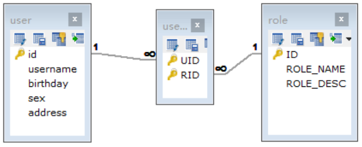

```sql
SELECT
  r.*,
  u.username,
  u.address
FROM
  `user` AS u,
  role AS r,
  user_role AS ur
WHERE
  u.id = ur.UID
  AND r.id = ur.RID
```

*   编写实体类

    ```java
    package com.sonnet.pojo;
    
    import java.util.List;
    
    public class Role {
    
        private Integer roleId;
        private String roleName;
        private String roleDesc;
    
        private List<User> users;
    
        public Integer getRoleId() {
            return roleId;
        }
    
        public void setRoleId(Integer roleId) {
            this.roleId = roleId;
        }
    
        public String getRoleName() {
            return roleName;
        }
    
        public void setRoleName(String roleName) {
            this.roleName = roleName;
        }
    
        public String getRoleDesc() {
            return roleDesc;
        }
    
        public void setRoleDesc(String roleDesc) {
            this.roleDesc = roleDesc;
        }
    
        public List<User> getUsers() {
            return users;
        }
    
        public void setUsers(List<User> users) {
            this.users = users;
        }
    
        @Override
        public String toString() {
            return "Role{" +
                    "roleId=" + roleId +
                    ", roleName='" + roleName + '\'' +
                    ", roleDesc='" + roleDesc + '\'' +
                    ", users=" + users +
                    '}';
        }
    }
    ```

*   编写接口

    ```java
    package com.sonnet.dao;
    
    import com.sonnet.pojo.Role;
    
    import java.util.List;
    
    public interface RoleDao {
    
        // 查询所有角色信息及其对应的用户信息
        public List<Role> findAll();
    }
    ```

*   编写配置文件

    ```xml
    <?xml version="1.0" encoding="UTF-8"?>
    <!DOCTYPE mapper
            PUBLIC "-//mybatis.org//DTD Mapper 3.0//EN"
            "http://mybatis.org/dtd/mybatis-3-mapper.dtd">
    
    <mapper namespace="com.sonnet.dao.RoleDao">
    
        <resultMap id="roleMap" type="role">
            <id column="id" property="roleId"></id>
            <result column="role_name" property="roleName"></result>
            <result column="role_desc" property="roleDesc"></result>
            <collection property="users" ofType="user">
                <id property="id" column="id"></id>
                <result property="username" column="username"></result>
                <result property="birthday" column="birthday"></result>
                <result property="sex" column="sex"></result>
                <result property="address" column="address"></result>
            </collection>
        </resultMap>
        <select id="findAll" resultMap="roleMap">
            SELECT
                r.*,
                u.username,
                u.address
            FROM
                `user` AS u,
                role AS r,
                user_role AS ur
            WHERE
                u.id = ur.UID
              AND r.id = ur.RID
        </select>
    </mapper>
    ```

*   测试

    ```java
    @Test
    public void Test03() {
        List<Role> roleList = roleDao.findAll();
        for (Role role : roleList) {
            System.out.println(role);
        }
    
    }
    ```


## 9. Myabtis延时加载策略

问题: 在一对多中，当我们一个用户，它有100个账户。

在查询用户的时候，要不要把关联的账户查询出来?

在查询账户的时候，要不要把关联的用户查询出来?

答案：

在查询用户时，用户下的账户信息应该是什么时候用，什么时候查询。在查询账户时，账户所属的用户信息应该是随着账户信息一起查询出来的。

什么是延迟加载：在真正使用数据的时候才发起查询，不用的时候不查询。按需加载(延迟加载)

什么是立即加载：不管用不用，只要一调用方法，立马查询出来。

### 9.1 使用 assocation 实现延时加载

需求：查询账户时，延时加载用户信息。

*   创建实体

    ```java
    package com.sonnet.pojo;
    
    import java.util.Date;
    
    public class User {
    
        private Integer id;
        private String username;
        private Date birthday;
        private String sex;
        private String address;
    
        public Integer getId() {
            return id;
        }
    
        public void setId(Integer id) {
            this.id = id;
        }
    
        public String getUsername() {
            return username;
        }
    
        public void setUsername(String username) {
            this.username = username;
        }
    
        public Date getBirthday() {
            return birthday;
        }
    
        public void setBirthday(Date birthday) {
            this.birthday = birthday;
        }
    
        public String getSex() {
            return sex;
        }
    
        public void setSex(String sex) {
            this.sex = sex;
        }
    
        public String getAddress() {
            return address;
        }
    
        public void setAddress(String address) {
            this.address = address;
        }
    
        @Override
        public String toString() {
            return "User{" +
                    "id=" + id +
                    ", username='" + username + '\'' +
                    ", birthday=" + birthday +
                    ", sex='" + sex + '\'' +
                    ", address='" + address + '\'' +
                    '}';
        }
    }
    ```

    ```java
    package com.sonnet.pojo;
    
    public class Account {
    
        private Integer id;
        private Integer uid;
        private Double money;
        private User user;
    
        public Integer getId() {
            return id;
        }
    
        public void setId(Integer id) {
            this.id = id;
        }
    
        public Integer getUid() {
            return uid;
        }
    
        public void setUid(Integer uid) {
            this.uid = uid;
        }
    
        public Double getMoney() {
            return money;
        }
    
        public void setMoney(Double money) {
            this.money = money;
        }
    
        public User getUser() {
            return user;
        }
    
        public void setUser(User user) {
            this.user = user;
        }
    
        @Override
        public String toString() {
            return "Account{" +
                    "id=" + id +
                    ", uid=" + uid +
                    ", money=" + money +
                    ", user=" + user +
                    '}';
        }
    }
    ```

*   创建AccountDao接口

    ```java
    package com.sonnet.dao;
    
    import com.sonnet.pojo.Account;
    
    import java.util.List;
    
    public interface AccountDao {
    
        // 加载账户信息及其对应的用户信息
        public List<Account> findAll();
    }
    ```

*   创建AccountDao.xml映射文件

    ```xml
    <?xml version="1.0" encoding="UTF-8"?>
    <!DOCTYPE mapper
            PUBLIC "-//mybatis.org//DTD Mapper 3.0//EN"
            "http://mybatis.org/dtd/mybatis-3-mapper.dtd">
    
    <mapper namespace="com.sonnet.dao.AccountDao">
    
        <resultMap id="accountMap" type="account">
            <id column="id" property="id"></id>
            <result column="uid" property="uid"></result>
            <result column="money" property="money"></result>
            <!--
                要根据已有的账户信息，去查询对应的用户信息
                column：要传递给select映射的参数
                select：要进行关联查询的方法（接口的权限定名 + “.” + 方法名称）
                fetchType="lazy"：配置懒加载策略(也可以在mybatis的核心配置文件中配置)
            -->
            <association property="user" column="uid" select="com.sonnet.dao.UserDao.findUserById" fetchType="lazy"></association>
        </resultMap>
    
        <select id="findAll" resultMap="accountMap">
            select * from account
        </select>
    </mapper>
    ```

*   定义UserDao接口里面的方法

    ```java
    package com.sonnet.dao;
    
    import com.sonnet.pojo.User;
    
    public interface UserDao {
    
        // 根域用户id查询对应的用户信息
        public User findUserById(Integer id);
    }
    ```

*   定义UserDao.xml配置

    ```xml
    <?xml version="1.0" encoding="UTF-8"?>
    <!DOCTYPE mapper
            PUBLIC "-//mybatis.org//DTD Mapper 3.0//EN"
            "http://mybatis.org/dtd/mybatis-3-mapper.dtd">
    
    <mapper namespace="com.sonnet.dao.UserDao">
    
        <select id="findUserById" parameterType="int" resultType="user">
            select * from user where id = #{id}
        </select>
    </mapper>
    ```

*   测试

    ```java
    package com.sonnet;
    
    import com.sonnet.dao.AccountDao;
    import com.sonnet.dao.UserDao;
    import com.sonnet.pojo.Account;
    import org.apache.ibatis.io.Resources;
    import org.apache.ibatis.session.SqlSession;
    import org.apache.ibatis.session.SqlSessionFactory;
    import org.apache.ibatis.session.SqlSessionFactoryBuilder;
    import org.junit.After;
    import org.junit.Before;
    import org.junit.Test;
    
    import java.io.InputStream;
    import java.util.List;
    
    public class TestMybatis {
    
        SqlSession sqlSession;
        AccountDao accountDao;
        UserDao userDao;
    
        @Before // 在@Test方法执行之前执行
        public void before() throws Exception{
            // 加载核心的配置文件
            InputStream inputStream = Resources.getResourceAsStream("sqlMapConfig.xml");
            // 构建SqlSessionFactoryBuilder对象
            SqlSessionFactoryBuilder sqlSessionFactoryBuilder = new SqlSessionFactoryBuilder();
            // 构建SqlSessionFactory对象
            SqlSessionFactory sqlSessionFactory = sqlSessionFactoryBuilder.build(inputStream);
            // 生成SqlSession对象
            sqlSession = sqlSessionFactory.openSession(true); // 关闭事务的手动提交
            // 生成接口的代理对象
            accountDao = sqlSession.getMapper(AccountDao.class);
        }
    
        @After // 在@Test方法执行之后执行
        public void after() throws Exception{
            sqlSession.close();
        }
    
    
        @Test
        public void test01() {
            List<Account> accountList = accountDao.findAll();
    /*
            for (Account account : accountList) {
                System.out.println(account);
            }
    */
    
        }
    }
    ```

### 9.2 使用Collection实现延迟加载

#### 9.2.1 一对多

同样也可以在一对多关系配置的结点中配置延迟加载策略。 节点中也有select属性，column属性。

需求：完成加载用户对象时，查询该用户所拥有的账户信息。

*   定义实体类

    ```java
    package com.sonnet.pojo;
    
    public class Account {
    
        private Integer id;
        private Integer uid;
        private Double money;
        //private User user;
    
        public Integer getId() {
            return id;
        }
    
        public void setId(Integer id) {
            this.id = id;
        }
    
        public Integer getUid() {
            return uid;
        }
    
        public void setUid(Integer uid) {
            this.uid = uid;
        }
    
        public Double getMoney() {
            return money;
        }
    
        public void setMoney(Double money) {
            this.money = money;
        }
    
        @Override
        public String toString() {
            return "Account{" +
                    "id=" + id +
                    ", uid=" + uid +
                    ", money=" + money +
                    '}';
        }
    }
    ```

    ```java
    package com.sonnet.pojo;
    
    import java.util.Date;
    import java.util.List;
    
    public class User {
    
        private Integer id;
        private String username;
        private Date birthday;
        private String sex;
        private String address;
    
        private List<Account> accountList;
    
        public Integer getId() {
            return id;
        }
    
        public void setId(Integer id) {
            this.id = id;
        }
    
        public String getUsername() {
            return username;
        }
    
        public void setUsername(String username) {
            this.username = username;
        }
    
        public Date getBirthday() {
            return birthday;
        }
    
        public void setBirthday(Date birthday) {
            this.birthday = birthday;
        }
    
        public String getSex() {
            return sex;
        }
    
        public void setSex(String sex) {
            this.sex = sex;
        }
    
        public String getAddress() {
            return address;
        }
    
        public void setAddress(String address) {
            this.address = address;
        }
    
        public List<Account> getAccountList() {
            return accountList;
        }
    
        public void setAccountList(List<Account> accountList) {
            this.accountList = accountList;
        }
    
        @Override
        public String toString() {
            return "User{" +
                    "id=" + id +
                    ", username='" + username + '\'' +
                    ", birthday=" + birthday +
                    ", sex='" + sex + '\'' +
                    ", address='" + address + '\'' +
                    ", accountList=" + accountList +
                    '}';
        }
    }
    ```

*   定义UserDao接口

    ```java
    package com.sonnet.dao;
    
    import com.sonnet.pojo.User;
    
    import java.util.List;
    
    public interface UserDao {
    
        // 查询用户信息及其对应的账户信息
        public List<User> findAll();
    
    }
    ```

*   定义UserDao.xml配置文件

    ```xml
    <?xml version="1.0" encoding="UTF-8"?>
    <!DOCTYPE mapper
            PUBLIC "-//mybatis.org//DTD Mapper 3.0//EN"
            "http://mybatis.org/dtd/mybatis-3-mapper.dtd">
    
    <mapper namespace="com.sonnet.dao.UserDao">
    
        <resultMap id="userMap" type="user">
            <id column="id" property="id"></id>
            <result column="username" property="username"></result>
            <result column="birthday" property="birthday"></result>
            <result column="sex" property="sex"></result>
            <result column="address" property="address"></result>
            <!--
                select：用户关联信息的查询接口方法
                column：进行select中方法查询需要携带的条件
            -->
            <collection property="accountList" column="id" select="com.sonnet.dao.AccountDao.findAccountByUid"></collection>
        </resultMap>
    
        <select id="findAll" resultMap="userMap">
            select * from user
        </select>
    </mapper>
    ```

*   定义AccountDao接口

    ```java
    package com.sonnet.dao;
    
    import com.sonnet.pojo.Account;
    
    import java.util.List;
    
    public interface AccountDao {
    
        // 根据用户id查询对应的账户信息
        public List<Account> findAccountByUid(Integer uid);
    }
    ```

*   定义AccountDao.xml配置文件

    ```xml
    <?xml version="1.0" encoding="UTF-8"?>
    <!DOCTYPE mapper
            PUBLIC "-//mybatis.org//DTD Mapper 3.0//EN"
            "http://mybatis.org/dtd/mybatis-3-mapper.dtd">
    
    <mapper namespace="com.sonnet.dao.AccountDao">
    
        <select id="findAccountByUid" parameterType="int" resultType="account">
            select * from account where uid = #{uid}
        </select>
    </mapper>
    ```

*   编写mybatis核心配置文件

    ```xml
    <?xml version="1.0" encoding="UTF-8"?>
    <!DOCTYPE configuration PUBLIC "-//mybatis.org//DTD Config3.0//EN" "http://mybatis.org/dtd/mybatis-3-config.dtd">
    <configuration>
        <!--加载db.properties文件-->
        <properties resource="db.properties"></properties>
        <settings>
            <!--开启懒加载策略-->
            <setting name="lazyLoadingEnabled" value="true"/>
    
            <!--开启mybatis的批处理-->
            <!--<setting name="defaultExecutorType" value="BATCH"/>-->
        </settings>
        <!--定义别名-->
        <typeAliases>
            <package name="com.sonnet.pojo"/>
        </typeAliases>
        <!--配置mybatis环境-->
        <environments default="mysql">
            <!--id需要和default保持一致，配置连接MySQL的具体信息-->
            <environment id="mysql">
                <!--配置事务类型JDBC-->
                <transactionManager type="JDBC"></transactionManager>
                <!--配置数据源 POOLED UNPOOLED-->
                <dataSource type="POOLED">
                    <!--配置数据库的驱动 url 用户名 密码 -->
                    <property name="driver" value="${jdbc.driver}"/>
                    <property name="url" value="${jdbc.url}"/>
                    <property name="username" value="${jdbc.username}"/>
                    <property name="password" value="${jdbc.password}"/>
                </dataSource>
            </environment>
        </environments>
    
        <!--在核心配置文件中导入，接口的映射文件-->
        <mappers>
            <package name="com.sonnet.dao"/>
        </mappers>
    </configuration>
    ```

    ```properties
    jdbc.driver=com.mysql.cj.jdbc.Driver
    jdbc.url=jdbc:mysql://localhost:3306/mybatis_lesson
    jdbc.username=root
    jdbc.password=root
    ```

*   测试

    ```java
    package com.sonnet;
    
    import com.sonnet.dao.AccountDao;
    import com.sonnet.dao.UserDao;
    import com.sonnet.pojo.Account;
    import com.sonnet.pojo.User;
    import org.apache.ibatis.io.Resources;
    import org.apache.ibatis.session.SqlSession;
    import org.apache.ibatis.session.SqlSessionFactory;
    import org.apache.ibatis.session.SqlSessionFactoryBuilder;
    import org.junit.After;
    import org.junit.Before;
    import org.junit.Test;
    
    import java.io.InputStream;
    import java.util.List;
    
    public class TestMybatis {
    
        SqlSession sqlSession;
        AccountDao accountDao;
        UserDao userDao;
    
        @Before // 在@Test方法执行之前执行
        public void before() throws Exception{
            // 加载核心的配置文件
            InputStream inputStream = Resources.getResourceAsStream("sqlMapConfig.xml");
            // 构建SqlSessionFactoryBuilder对象
            SqlSessionFactoryBuilder sqlSessionFactoryBuilder = new SqlSessionFactoryBuilder();
            // 构建SqlSessionFactory对象
            SqlSessionFactory sqlSessionFactory = sqlSessionFactoryBuilder.build(inputStream);
            // 生成SqlSession对象
            sqlSession = sqlSessionFactory.openSession(true); // 关闭事务的手动提交
            // 生成接口的代理对象
            userDao = sqlSession.getMapper(UserDao.class);
        }
    
        @After // 在@Test方法执行之后执行
        public void after() throws Exception{
            sqlSession.close();
        }
    
        @Test
        public void test01() {
            List<User> userList = userDao.findAll();
            for (User user : userList) {
                System.out.println(user);
            }
        }
    }
    ```

#### 9.2.2 多对多

需求：根据用户id查询对应的角色信息

*   定义实体类

    ```java
    package com.sonnet.pojo;
    
    import java.util.Date;
    import java.util.List;
    
    public class User {
    
        private Integer id;
        private String username;
        private Date birthday;
        private String sex;
        private String address;
    
        private List<Role> roleList;
    
        public Integer getId() {
            return id;
        }
    
        public void setId(Integer id) {
            this.id = id;
        }
    
        public String getUsername() {
            return username;
        }
    
        public void setUsername(String username) {
            this.username = username;
        }
    
        public Date getBirthday() {
            return birthday;
        }
    
        public void setBirthday(Date birthday) {
            this.birthday = birthday;
        }
    
        public String getSex() {
            return sex;
        }
    
        public void setSex(String sex) {
            this.sex = sex;
        }
    
        public String getAddress() {
            return address;
        }
    
        public void setAddress(String address) {
            this.address = address;
        }
    
        public List<Role> getRoleList() {
            return roleList;
        }
    
        public void setRoleList(List<Role> roleList) {
            this.roleList = roleList;
        }
    
        @Override
        public String toString() {
            return "User{" +
                    "id=" + id +
                    ", username='" + username + '\'' +
                    ", birthday=" + birthday +
                    ", sex='" + sex + '\'' +
                    ", address='" + address + '\'' +
                    ", roleList=" + roleList +
                    '}';
        }
    }
    ```

    ```java
    package com.sonnet.pojo;
    
    public class Role {
    
        private Integer id;
        private String roleName;
        private String roleDesc;
    
        public Integer getId() {
            return id;
        }
    
        public void setId(Integer id) {
            this.id = id;
        }
    
        public String getRoleName() {
            return roleName;
        }
    
        public void setRoleName(String roleName) {
            this.roleName = roleName;
        }
    
        public String getRoleDesc() {
            return roleDesc;
        }
    
        public void setRoleDesc(String roleDesc) {
            this.roleDesc = roleDesc;
        }
    
        @Override
        public String toString() {
            return "Role{" +
                    "id=" + id +
                    ", roleName='" + roleName + '\'' +
                    ", roleDesc='" + roleDesc + '\'' +
                    '}';
        }
    }
    ```

*   定义UserDao接口

    ```java
    package com.sonnet.dao;
    
    import com.sonnet.pojo.User;
    
    import java.util.List;
    
    public interface UserDao {
    
        // 查询用户信息及其对应的角色信息
        public List<User> findAll();
    
    }
    ```

*   定义UserDao.xml配置文件

    ```xml
    <?xml version="1.0" encoding="UTF-8"?>
    <!DOCTYPE mapper
            PUBLIC "-//mybatis.org//DTD Mapper 3.0//EN"
            "http://mybatis.org/dtd/mybatis-3-mapper.dtd">
    
    <mapper namespace="com.sonnet.dao.UserDao">
    
        <resultMap id="userMap" type="user">
            <id column="id" property="id"></id>
            <result column="username" property="username"></result>
            <result column="birthday" property="birthday"></result>
            <result column="sex" property="sex"></result>
            <result column="address" property="address"></result>
            <collection property="roleList" column="id" select="com.sonnet.dao.RoleDao.findRolesByUid"></collection>
        </resultMap>
    
        <select id="findAll" resultMap="userMap">
            select * from user
        </select>
    </mapper>
    ```

*   定义RoleDao接口

    ```java
    package com.sonnet.dao;
    
    import com.sonnet.pojo.Role;
    
    import java.util.List;
    
    public interface RoleDao {
    
        public List<Role> findRolesByUid(Integer id);
    }
    ```

*   定义RoleDao.xml配置文件

    ```xml
    <?xml version="1.0" encoding="UTF-8"?>
    <!DOCTYPE mapper
            PUBLIC "-//mybatis.org//DTD Mapper 3.0//EN"
            "http://mybatis.org/dtd/mybatis-3-mapper.dtd">
    
    <mapper namespace="com.sonnet.dao.RoleDao">
        <!--
            根据用户id查询对应的角色信息
        -->
        <select id="findRolesByUid" resultType="role" parameterType="int">
            SELECT * FROM role WHERE id IN(
                SELECT rid FROM user_role WHERE uid = #{id}
            )
        </select>
    </mapper>
    ```

*   测试

    ```java
    package com.sonnet;
    
    import com.sonnet.dao.UserDao;
    import com.sonnet.pojo.User;
    import org.apache.ibatis.io.Resources;
    import org.apache.ibatis.session.SqlSession;
    import org.apache.ibatis.session.SqlSessionFactory;
    import org.apache.ibatis.session.SqlSessionFactoryBuilder;
    import org.junit.After;
    import org.junit.Before;
    import org.junit.Test;
    
    import java.io.InputStream;
    import java.util.List;
    
    public class TestMybatis {
    
        SqlSession sqlSession;
        UserDao userDao;
    
        @Before // 在@Test方法执行之前执行
        public void before() throws Exception{
            // 加载核心的配置文件
            InputStream inputStream = Resources.getResourceAsStream("sqlMapConfig.xml");
            // 构建SqlSessionFactoryBuilder对象
            SqlSessionFactoryBuilder sqlSessionFactoryBuilder = new SqlSessionFactoryBuilder();
            // 构建SqlSessionFactory对象
            SqlSessionFactory sqlSessionFactory = sqlSessionFactoryBuilder.build(inputStream);
            // 生成SqlSession对象
            sqlSession = sqlSessionFactory.openSession(true); // 关闭事务的手动提交
            // 生成接口的代理对象
            userDao = sqlSession.getMapper(UserDao.class);
        }
    
        @After // 在@Test方法执行之后执行
        public void after() throws Exception{
            sqlSession.close();
        }
    
        @Test
        public void test01() {
            List<User> userList = userDao.findAll();
            for (User user : userList) {
                System.out.println(user);
            }
        }
    }
    ```

## 10. Mybatis缓存

*   什么是缓存?

    缓存就是存在内存中的数据。

*   为什么使用缓存

    减少和数据库交互的次数，提高执行效率

*   什么样的数据能使用缓存，什么样的数据不适合使用缓存?

    *   适用于缓存：

        经常查询，且不经常改变的数据

        数据的正确与否对最终结果影响不大的。

    *   不适用与缓存的：

        经常改变的，数据的正确与否对结果影响很大的。比如：商品的库存、银行的汇率、股市的股价等。

*   mybatis中的一级缓存和二级缓存：

    *   一级缓存

        它指的是mybatis中的SqlSession对象的缓存。当我们执行完查询之后，查询的结果会同时存在在SqlSession为我们提供的一块区域中。该区域的结构是一个Map。

        当我们再次查询同样的数据，mybatis会先去SqlSession中查询是否有，有的话直接拿出来使用。当SqlSession对象消失时，Mybatis的一级缓存也就消失了。

    *   二级缓存

        它指的是Mybatis中SqlSessionFactory对象的缓存，由同一个SqlSessioFactory对象创建的，SqlSession共享其缓存。

### 10.1 一级缓存

#### 10.1.1 证明一级缓存存在

```java
@Test
public void test02() throws Exception{
    User user1 = userDao.findUserById(48);
    System.out.println(user1);
    User user2 = userDao.findUserById(48);
    System.out.println(user2);
}
```

```tex
2026-10-31 16:07:39.654 [main] DEBUG com.sonnet.dao.UserDao.findUserById:135 - ==>  Preparing: select * from user where id = ?
2026-10-31 16:07:39.672 [main] DEBUG com.sonnet.dao.UserDao.findUserById:135 - ==> Parameters: 48(Integer)
2026-10-31 16:07:39.704 [main] DEBUG com.sonnet.dao.UserDao.findUserById:135 - <==      Total: 1
User{id = 48, username = 小艾, birthday = Thu Mar 08 11:44:00 CST 2018, sex = 女, address = 上海}
User{id = 48, username = 小艾, birthday = Thu Mar 08 11:44:00 CST 2018, sex = 女, address = 上海}

```

>   只执行了一次sql语句

```java
@Test
public void test02() throws Exception{
    User user1 = userDao.findUserById(48);
    System.out.println("第一次查询" + user1);
    // 关闭sqlSession
    sqlSession.close();
    SqlSession sqlSession = sqlSessionFactory.openSession();
    userDao = sqlSession.getMapper(UserDao.class);
    User user2 = userDao.findUserById(48);
    System.out.println("第二次查询" + user2);
}
```

```tex
2026-10-31 16:14:26.079 [main] DEBUG com.sonnet.dao.UserDao.findUserById:135 - ==>  Preparing: select * from user where id = ?
2026-10-31 16:14:26.100 [main] DEBUG com.sonnet.dao.UserDao.findUserById:135 - ==> Parameters: 48(Integer)
2026-10-31 16:14:26.135 [main] DEBUG com.sonnet.dao.UserDao.findUserById:135 - <==      Total: 1
第一次查询User{id = 48, username = 小艾, birthday = Thu Mar 08 11:44:00 CST 2018, sex = 女, address = 上海}
2026-10-31 16:14:26.143 [main] DEBUG com.sonnet.dao.UserDao.findUserById:135 - ==>  Preparing: select * from user where id = ?
2026-10-31 16:14:26.144 [main] DEBUG com.sonnet.dao.UserDao.findUserById:135 - ==> Parameters: 48(Integer)
2026-10-31 16:14:26.145 [main] DEBUG com.sonnet.dao.UserDao.findUserById:135 - <==      Total: 1
第二次查询User{id = 48, username = 小艾, birthday = Thu Mar 08 11:44:00 CST 2018, sex = 女, address = 上海}

```

>   执行了两次sql语句

#### 10.1.2 一级缓存的分析

一级缓存是SqlSession范围的缓存，当调用SqlSession的修改，添加，删除，commit()，close()等方法时，就会清空一级缓存。

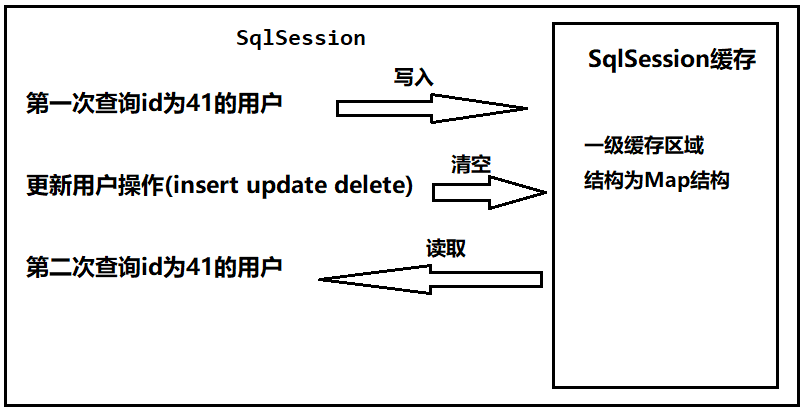

第一次发起查询用户id为 1 的用户信息，先去找缓存中是否有id为 1 的用户信息，如果没有，从数据库查询用户信息。

得到用户信息，将用户信息存储到一级缓存中。

如果sqlSession去执行 commit操作（执行插入、更新、删除），清空 SqlSession中的一级缓存，这样做的目的为了让缓存中存储的是最新的信息，**避免脏读**。

第二次发起查询用户id为1的用户信息，先去找缓存中是否有id为1的用户信息，缓存中有，直接从缓存中获取用户信息。

### 10.2 二级缓存

二级缓存是mapper映射级别的缓存，多个SqlSession去操作同一个Mapper映射的sql语句，多个SqlSession可以共用二级缓存，二级缓存是跨SqlSession的。

二级缓存结构图：

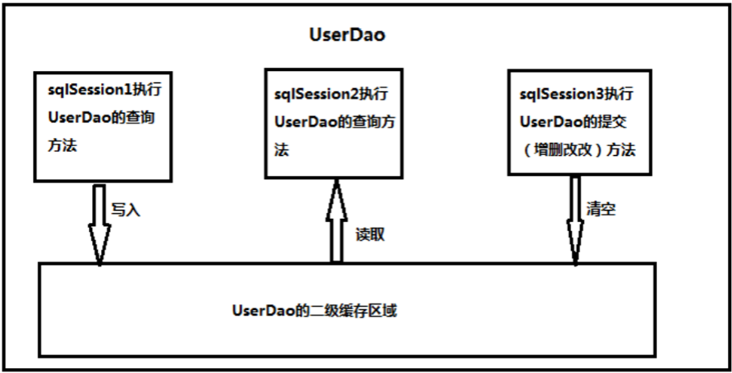

解读：

第一次调用mapper下的SQL去查询用户信息。查询到的信息会存到该mapper对应的二级缓存区域内。

第二次调用相同namespace下的mapper映射文件中相同的SQL去查询用户信息。会去对应的二级缓存内取结果。

如果调用相同namespace下的mapper映射文件中的增删改SQL，并执行了commit操作。此时会清空该namespace下的二级缓存。

总结：

*   先查询二级缓存，因为二级缓存中可能会有其他程序已经查出来的数据，可以拿来直接使用
*   如果二级缓存没有命中，再查询一级缓存
*   如果一级缓存也没有命中，则查询数据库
*   SqlSession关闭之后，一级缓存中的数据会写入二级缓存


## 11. Mybatis注解开发

mybatis的常用注解说明

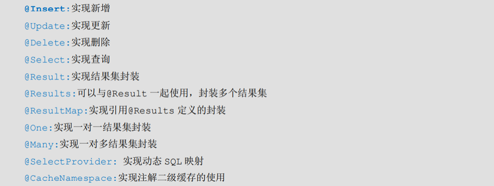

### 11.1 使用Mybatis注解实现基本CRUD

*   定义接口

    ```java
    package com.sonnet.dao;
    
    import com.sonnet.pojo.User;
    import org.apache.ibatis.annotations.*;
    
    import java.util.List;
    
    public interface UserDao {
    
        // 查询所有用户信息
        @Select("select * from user")
        public List<User> findAll();
    
        // 根据id查询用户信息
        @Select("select * from user where id = #{id}")
        public User findUserById(Integer id);
    
        /**
         * 新增用户
         * @param user
         * @SelectKey 注解 用来描述新增之后主键字段回显
         *      keyProperty 主键对应的实体字段名称
         *      keyColumn 主键字段名称
         *      resultType 主键实体类型
         *      before 生成主键的时机 false 在新增之后，生成主键
         *      statement 查询主键的sql
         */
        @Insert("insert into user(username, birthday, sex, address) values(#{username}, #{birthday}, #{sex}, #{address})")
        @SelectKey(keyProperty = "id", keyColumn = "id", resultType = Integer.class, before = false, statement = {"select last_insert_id()"})
        public void addUser(User user);
    
        // 修改操作
        @Update("update user set username=#{username}, birthday=#{birthday}, sex=#{sex}, address=#{address} where id = #{id}")
        public void updateUser(User user);
    
        // 删除操作
        @Delete("delete from user where id = #{id}")
        public void deleteUserById(Integer id);
    
        // 聚合统计
        @Select("select count(id) from user")
        public Integer getCount();
    }
    ```

*   定义实体类

    ```java
    package com.sonnet.dao;
    
    import com.sonnet.pojo.User;
    import org.apache.ibatis.annotations.*;
    
    import java.util.List;
    
    public interface UserDao {
    
        // 查询所有用户信息
        @Select("select * from user")
        public List<User> findAll();
    
        // 根据id查询用户信息
        @Select("select * from user where id = #{id}")
        public User findUserById(Integer id);
    
        /**
         * 新增用户
         * @param user
         * @SelectKey 注解 用来描述新增之后主键字段回显
         *      keyProperty 主键对应的实体字段名称
         *      keyColumn 主键字段名称
         *      resultType 主键实体类型
         *      before 生成主键的时机 false 在新增之后，生成主键
         *      statement 查询主键的sql
         */
        @Insert("insert into user(username, birthday, sex, address) values(#{username}, #{birthday}, #{sex}, #{address})")
        @SelectKey(keyProperty = "id", keyColumn = "id", resultType = Integer.class, before = false, statement = {"select last_insert_id()"})
        public void addUser(User user);
    
        // 修改操作
        @Update("update user set username=#{username}, birthday=#{birthday}, sex=#{sex}, address=#{address} where id = #{id}")
        public void updateUser(User user);
    
        // 删除操作
        @Delete("delete from user where id = #{id}")
        public void deleteUserById(Integer id);
    
        // 聚合统计
        @Select("select count(id) from user")
        public Integer getCount();
    }
    ```

*   测试

    ```java
    package com.sonnet;
    
    import com.sonnet.dao.UserDao;
    import com.sonnet.pojo.User;
    import org.apache.ibatis.io.Resources;
    import org.apache.ibatis.session.SqlSession;
    import org.apache.ibatis.session.SqlSessionFactory;
    import org.apache.ibatis.session.SqlSessionFactoryBuilder;
    import org.junit.After;
    import org.junit.Before;
    import org.junit.Test;
    
    import java.io.InputStream;
    import java.util.Date;
    import java.util.List;
    
    public class TestMybatis {
    
        SqlSession sqlSession;
        UserDao userDao;
    
        @Before // 在@Test方法执行之前执行
        public void before() throws Exception{
            // 加载核心的配置文件
            InputStream inputStream = Resources.getResourceAsStream("sqlMapConfig.xml");
            // 构建SqlSessionFactoryBuilder对象
            SqlSessionFactoryBuilder sqlSessionFactoryBuilder = new SqlSessionFactoryBuilder();
            // 构建SqlSessionFactory对象
            SqlSessionFactory sqlSessionFactory = sqlSessionFactoryBuilder.build(inputStream);
            // 生成SqlSession对象
            sqlSession = sqlSessionFactory.openSession(true); // 关闭事务的手动提交
            // 生成接口的代理对象
            userDao = sqlSession.getMapper(UserDao.class);
        }
    
        @After // 在@Test方法执行之后执行
        public void after() throws Exception{
            sqlSession.close();
        }
    
        @Test
        public void test01() {
            List<User> userList = userDao.findAll();
            for (User user : userList) {
                System.out.println(user);
            }
        }
    
        @Test
        public void test02() {
            User user = userDao.findUserById(41);
            System.out.println(user);
        }
    
        @Test
        public void test03() {
            User user = new User();
            user.setUsername("jiayi");
            user.setAddress("浙江");
            user.setSex("女");
            user.setBirthday(new Date());
            userDao.addUser(user);
            System.out.println("新增的主键是：" + user.getId());
        }
    
        @Test
        public void test04() {
            User user = new User();
            user.setId(67);
            user.setAddress("中国");
            user.setUsername("嫁衣");
            userDao.updateUser(user);
        }
    
        @Test
        public void test05() {
            userDao.deleteUserById(67);
        }
    
        @Test
        public void test06() {
            Integer i = userDao.getCount();
            System.out.println(i);
        }
    }
    ```

*   前后字段不一致

    ```java
    package com.sonnet.pojo;
    
    import java.util.Date;
    
    public class User {
    
        private Integer userId;
        private String userName;
        private Date userBirthday;
        private String userSex;
        private String userAddress;
    
        public Integer getUserId() {
            return userId;
        }
    
        public void setUserId(Integer userId) {
            this.userId = userId;
        }
    
        public String getUserName() {
            return userName;
        }
    
        public void setUserName(String userName) {
            this.userName = userName;
        }
    
        public Date getUserBirthday() {
            return userBirthday;
        }
    
        public void setUserBirthday(Date userBirthday) {
            this.userBirthday = userBirthday;
        }
    
        public String getUserSex() {
            return userSex;
        }
    
        public void setUserSex(String userSex) {
            this.userSex = userSex;
        }
    
        public String getUserAddress() {
            return userAddress;
        }
    
        public void setUserAddress(String userAddress) {
            this.userAddress = userAddress;
        }
    
        @Override
        public String toString() {
            return "User{" +
                    "userId=" + userId +
                    ", userName='" + userName + '\'' +
                    ", userBirthday=" + userBirthday +
                    ", userSex='" + userSex + '\'' +
                    ", userAddress='" + userAddress + '\'' +
                    '}';
        }
    }
    ```

    ```java
    package com.sonnet.dao;
    
    import com.sonnet.pojo.User;
    import org.apache.ibatis.annotations.*;
    
    import java.util.List;
    
    public interface UserDao {
    
        /**
         * 基于前后字段不一致情形
         * @return
         */
        @Results(id = "userMap", value = {
                @Result(id = true, column = "id", property = "userId"),
                @Result(column = "username", property = "userName"),
                @Result(column = "sex", property = "userSex"),
                @Result(column = "address", property = "userAddress")
        })
        @Select("select * from user")
        public List<User> findAll();
    
        /**
         * 根据id查询用户
         * @param id
         * @return
         */
        @ResultMap("userMap")
        @Select("select * from user where id = #{id}")
        public User findUserById(Integer id);
    }
    ```

### 11.2 使用注解实现复杂关系映射（1对1）

复杂关系映射的注解说明：

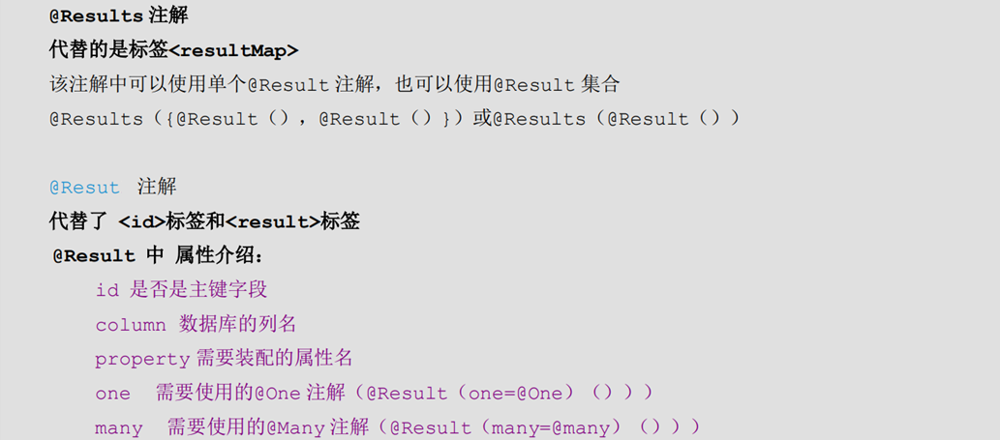

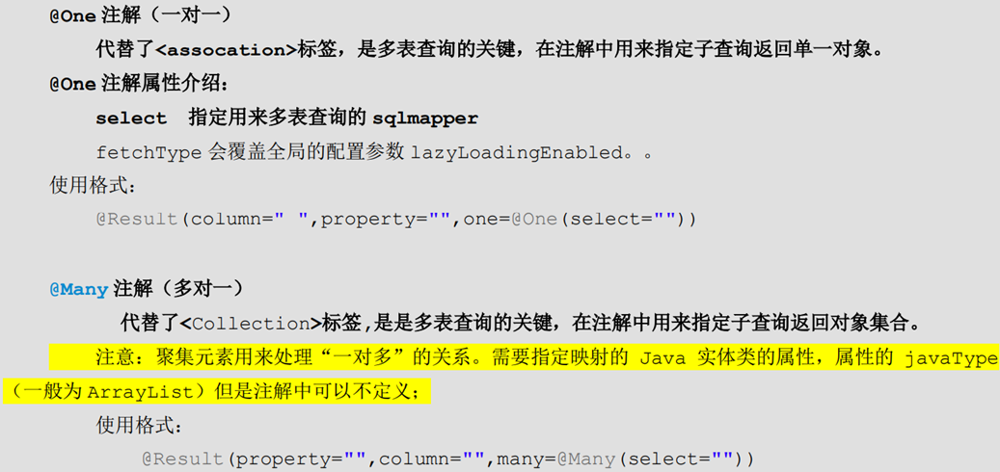

需求：加载账户信息时并且加载该账户的用户信息，根据情况可实现延迟加载。（注解方式实现）

*   添加实体类

    ```java
    package com.sonnet.pojo;
    
    public class Account {
        private Integer id;
        private Integer uid;
        private Double money;
        //多对一关系映射：从表方应该包含一个主表方的对象引用
        private User user;
    
        public Integer getId() {
            return id;
        }
    
        public void setId(Integer id) {
            this.id = id;
        }
    
        public Integer getUid() {
            return uid;
        }
    
        public void setUid(Integer uid) {
            this.uid = uid;
        }
    
        public Double getMoney() {
            return money;
        }
    
        public void setMoney(Double money) {
            this.money = money;
        }
    
        public User getUser() {
            return user;
        }
    
        public void setUser(User user) {
            this.user = user;
        }
    
        @Override
        public String toString() {
            return "Account{" +
                    "id=" + id +
                    ", uid=" + uid +
                    ", money=" + money +
                    ", user=" + user +
                    '}';
        }
    }
    ```

    ```java
    package com.sonnet.pojo;
    
    import java.util.Date;
    
    public class User {
    
        private Integer userId;
        private String userName;
        private Date userBirthday;
        private String userSex;
        private String userAddress;
    
        public Integer getUserId() {
            return userId;
        }
    
        public void setUserId(Integer userId) {
            this.userId = userId;
        }
    
        public String getUserName() {
            return userName;
        }
    
        public void setUserName(String userName) {
            this.userName = userName;
        }
    
        public Date getUserBirthday() {
            return userBirthday;
        }
    
        public void setUserBirthday(Date userBirthday) {
            this.userBirthday = userBirthday;
        }
    
        public String getUserSex() {
            return userSex;
        }
    
        public void setUserSex(String userSex) {
            this.userSex = userSex;
        }
    
        public String getUserAddress() {
            return userAddress;
        }
    
        public void setUserAddress(String userAddress) {
            this.userAddress = userAddress;
        }
    
        @Override
        public String toString() {
            return "User{" +
                    "userId=" + userId +
                    ", userName='" + userName + '\'' +
                    ", userBirthday=" + userBirthday +
                    ", userSex='" + userSex + '\'' +
                    ", userAddress='" + userAddress + '\'' +
                    '}';
        }
    }
    ```

*   添加账户、用户的持久层接口并使用注释配置

    ```java
    package com.sonnet.dao;
    
    import com.sonnet.pojo.Account;
    import org.apache.ibatis.annotations.One;
    import org.apache.ibatis.annotations.Result;
    import org.apache.ibatis.annotations.Results;
    import org.apache.ibatis.annotations.Select;
    import org.apache.ibatis.mapping.FetchType;
    
    import java.util.List;
    
    public interface AccountDao {
    
        // 查询所有的账户信息及其关联的用户信息
        @Results(id = "accountMap", value = {
                @Result(id = true, column = "id", property = "id"),
                @Result(column = "uid", property = "uid"),
                @Result(column = "money", property = "money"),
                @Result(column = "uid", property = "user",
                        one = @One(select = "com.sonnet.dao.UserDao.findUserById",
                        fetchType = FetchType.LAZY))
        })
        @Select("select * from account")
        public List<Account> findAll();
    }
    ```

    ```java
    package com.sonnet.dao;
    
    import com.sonnet.pojo.User;
    import org.apache.ibatis.annotations.Result;
    import org.apache.ibatis.annotations.Results;
    import org.apache.ibatis.annotations.Select;
    
    public interface UserDao {
    
        @Results(id = "userMap", value = {
                @Result(id = true, property = "userId", column = "id"),
                @Result(property = "userName", column = "username"),
                @Result(property = "userBirthday", column = "birthday"),
                @Result(property = "userSex", column = "sex"),
                @Result(property = "userAddress", column = "address")
        })
        @Select("select * from user where id = #{id}")
        public User findUserById(Integer id);
    }
    ```

*   测试

    ```java
    package com.sonnet;
    
    import com.sonnet.dao.AccountDao;
    import com.sonnet.dao.UserDao;
    import com.sonnet.pojo.Account;
    import com.sonnet.pojo.User;
    import org.apache.ibatis.io.Resources;
    import org.apache.ibatis.session.SqlSession;
    import org.apache.ibatis.session.SqlSessionFactory;
    import org.apache.ibatis.session.SqlSessionFactoryBuilder;
    import org.junit.After;
    import org.junit.Before;
    import org.junit.Test;
    
    import java.io.InputStream;
    import java.util.List;
    
    public class TestMybatis {
    
        SqlSession sqlSession;
        AccountDao accountDao;
    
        @Before // 在@Test方法执行之前执行
        public void before() throws Exception{
            // 加载核心的配置文件
            InputStream inputStream = Resources.getResourceAsStream("sqlMapConfig.xml");
            // 构建SqlSessionFactoryBuilder对象
            SqlSessionFactoryBuilder sqlSessionFactoryBuilder = new SqlSessionFactoryBuilder();
            // 构建SqlSessionFactory对象
            SqlSessionFactory sqlSessionFactory = sqlSessionFactoryBuilder.build(inputStream);
            // 生成SqlSession对象
            sqlSession = sqlSessionFactory.openSession(true); // 关闭事务的手动提交
            // 生成接口的代理对象
            accountDao = sqlSession.getMapper(AccountDao.class);
        }
    
        @After // 在@Test方法执行之后执行
        public void after() throws Exception{
            sqlSession.close();
        }
    
        @Test
        public void test01() {
            List<Account> accountList = accountDao.findAll();
            for (Account account : accountList) {
                System.out.println(account);
            }
        }
    }
    ```

### 11.3 使用注释实现一对多复杂关系映射

需求：查询用户信息时，也要查询他的账户列表。使用注解方式实现。

分析：一个用户具有多个账户信息，所以形成了用户(User)与账户(Account)之间的一对多关系。

*   添加实体类

    ```java
    package com.sonnet.pojo;
    
    public class Account {
        private Integer id;
        private Integer uid;
        private Double money;
    
        public Integer getId() {
            return id;
        }
    
        public void setId(Integer id) {
            this.id = id;
        }
    
        public Integer getUid() {
            return uid;
        }
    
        public void setUid(Integer uid) {
            this.uid = uid;
        }
    
        public Double getMoney() {
            return money;
        }
    
        public void setMoney(Double money) {
            this.money = money;
        }
    
        @Override
        public String toString() {
            return "Account{" +
                    "id=" + id +
                    ", uid=" + uid +
                    ", money=" + money +
                    '}';
        }
    }
    ```

    ```java
    package com.sonnet.pojo;
    
    import java.util.Date;
    import java.util.List;
    
    public class User {
    
        private Integer userId;
        private String userName;
        private Date userBirthday;
        private String userSex;
        private String userAddress;
    
        private List<Account> accountList;
    
        public Integer getUserId() {
            return userId;
        }
    
        public void setUserId(Integer userId) {
            this.userId = userId;
        }
    
        public String getUserName() {
            return userName;
        }
    
        public void setUserName(String userName) {
            this.userName = userName;
        }
    
        public Date getUserBirthday() {
            return userBirthday;
        }
    
        public void setUserBirthday(Date userBirthday) {
            this.userBirthday = userBirthday;
        }
    
        public String getUserSex() {
            return userSex;
        }
    
        public void setUserSex(String userSex) {
            this.userSex = userSex;
        }
    
        public String getUserAddress() {
            return userAddress;
        }
    
        public void setUserAddress(String userAddress) {
            this.userAddress = userAddress;
        }
    
        public List<Account> getAccountList() {
            return accountList;
        }
    
        public void setAccountList(List<Account> accountList) {
            this.accountList = accountList;
        }
    
        @Override
        public String toString() {
            return "User{" +
                    "userId=" + userId +
                    ", userName='" + userName + '\'' +
                    ", userBirthday=" + userBirthday +
                    ", userSex='" + userSex + '\'' +
                    ", userAddress='" + userAddress + '\'' +
                    ", accountList=" + accountList +
                    '}';
        }
    }
    ```

*   添加账户、用户的持久层接口并使用注释配置

    ```java
    package com.sonnet.dao;
    
    import com.sonnet.pojo.User;
    import org.apache.ibatis.annotations.Many;
    import org.apache.ibatis.annotations.Result;
    import org.apache.ibatis.annotations.Results;
    import org.apache.ibatis.annotations.Select;
    import org.apache.ibatis.mapping.FetchType;
    
    import java.util.List;
    
    public interface UserDao {
    
        // 查询用户信息及其关联的账户信息
        @Results(id = "userMap", value = {
                @Result(id = true, property = "userId", column = "id"),
                @Result(property = "userName", column = "username"),
                @Result(property = "userBirthday", column = "birthday"),
                @Result(property = "userSex", column = "sex"),
                @Result(property = "userAddress", column = "address"),
                @Result(property = "accountList", column = "id",
                        many = @Many(select = "com.sonnet.dao.AccountDao.findAccountByUId",
                                fetchType = FetchType.LAZY))
        })
        @Select("select * from user")
        public List<User> findAll();
    }
    ```

    ```java
    package com.sonnet.dao;
    
    import com.sonnet.pojo.Account;
    import org.apache.ibatis.annotations.One;
    import org.apache.ibatis.annotations.Result;
    import org.apache.ibatis.annotations.Results;
    import org.apache.ibatis.annotations.Select;
    import org.apache.ibatis.mapping.FetchType;
    
    import java.util.List;
    
    public interface AccountDao {
    
        // 根据用户id查询账户信息
        @Select("select * from account where uid = #{id}")
        public List<Account> findAccountByUId(Integer id);
    }
    ```

*   测试

    ```java
    package com.sonnet;
    
    import com.sonnet.dao.UserDao;
    import com.sonnet.pojo.User;
    import org.apache.ibatis.io.Resources;
    import org.apache.ibatis.session.SqlSession;
    import org.apache.ibatis.session.SqlSessionFactory;
    import org.apache.ibatis.session.SqlSessionFactoryBuilder;
    import org.junit.After;
    import org.junit.Before;
    import org.junit.Test;
    
    import java.io.InputStream;
    import java.util.List;
    
    public class TestMybatis {
    
        SqlSession sqlSession;
        UserDao userDao;
    
        @Before // 在@Test方法执行之前执行
        public void before() throws Exception{
            // 加载核心的配置文件
            InputStream inputStream = Resources.getResourceAsStream("sqlMapConfig.xml");
            // 构建SqlSessionFactoryBuilder对象
            SqlSessionFactoryBuilder sqlSessionFactoryBuilder = new SqlSessionFactoryBuilder();
            // 构建SqlSessionFactory对象
            SqlSessionFactory sqlSessionFactory = sqlSessionFactoryBuilder.build(inputStream);
            // 生成SqlSession对象
            sqlSession = sqlSessionFactory.openSession(true); // 关闭事务的手动提交
            // 生成接口的代理对象
            userDao = sqlSession.getMapper(UserDao.class);
        }
    
        @After // 在@Test方法执行之后执行
        public void after() throws Exception{
            sqlSession.close();
        }
    
        @Test
        public void test01() {
            List<User> userList = userDao.findAll();
            for (User user : userList) {
                System.out.println(user);
            }
        }
    }
    ```


## 12. Mybatis逆向工程

逆向工程其实就是代码生成器，根据已经提供的数据表，mybatis框架反向生成java实体类，接口以及接口对应的映射文件。

### 12.1 逆向工程的创建步骤

*   添加依赖和插件

    ```xml
    <dependencyManagement>
        <dependencies>
            <dependency>
                <groupId>org.apache.logging.log4j</groupId>
                <artifactId>log4j-bom</artifactId>
                <version>2.26.1</version>
                <type>pom</type>
                <scope>import</scope>
            </dependency>
        </dependencies>
    </dependencyManagement>
    
    <dependencies>
        <dependency>
            <groupId>org.mybatis</groupId>
            <artifactId>mybatis</artifactId>
            <version>3.5.19</version>
        </dependency>
    
        <!--junit单元测试-->
        <dependency>
            <groupId>junit</groupId>
            <artifactId>junit</artifactId>
            <version>4.13.2</version>
            <scope>test</scope>
        </dependency>
    
        <!--数据库驱动-->
        <dependency>
            <groupId>com.mysql</groupId>
            <artifactId>mysql-connector-j</artifactId>
            <version>9.7.0</version>
        </dependency>
    
        <!--log4j-->
        <dependency>
            <groupId>org.apache.logging.log4j</groupId>
            <artifactId>log4j-api</artifactId>
        </dependency>
        <dependency>
            <groupId>org.apache.logging.log4j</groupId>
            <artifactId>log4j-core</artifactId>
            <scope>runtime</scope>
        </dependency>
    </dependencies>
    
    <!-- 控制Maven在构建过程中相关配置 -->
    <build>
        <!-- 构建过程中用到的插件 -->
        <plugins>
            <!-- 具体插件，逆向工程的操作是以构建过程中插件形式出现的 -->
            <plugin>
                <groupId>org.mybatis.generator</groupId>
                <artifactId>mybatis-generator-maven-plugin</artifactId>
                <version>1.3.0</version>
                <!-- 插件的依赖 -->
                <dependencies>
                    <!-- 逆向工程的核心依赖 -->
                    <dependency>
                        <groupId>org.mybatis.generator</groupId>
                        <artifactId>mybatis-generator-core</artifactId>
                        <version>1.3.2</version>
                    </dependency>
                    <!-- 数据库连接池 -->
                    <dependency>
                        <groupId>com.mchange</groupId>
                        <artifactId>c3p0</artifactId>
                        <version>0.9.2</version>
                    </dependency>
                    <!-- MySQL驱动 -->
                    <dependency>
                        <groupId>com.mysql</groupId>
                        <artifactId>mysql-connector-j</artifactId>
                        <version>9.7.0</version>
                    </dependency>
                </dependencies>
            </plugin>
        </plugins>
    </build>
    ```

*   创建mybatis核心配置文件

    ```xml
    <?xml version="1.0" encoding="UTF-8"?>
    <!DOCTYPE configuration PUBLIC "-//mybatis.org//DTD Config 3.0//EN" "http://mybatis.org/dtd/mybatis-3-config.dtd">
    <configuration>
        <!--加载db.properties文件-->
        <properties resource="db.properties"></properties>
        <!--配置mybatis的环境-->
        <environments default="mysql">
            <!--配置连接mysql的具体信息-->
            <environment id="mysql">
                <!--配置事务类型 JDBC-->
                <transactionManager type="JDBC"></transactionManager>
                <!--配置数据源 POOLED UNPOOLED-->
                <dataSource type="POOLED">
                    <!--配置连接数据库的驱动 url 用户名 密码-->
                    <property name="driver" value="${jdbc.driver}"></property>
                    <property name="url" value="${jdbc.url}"></property>
                    <property name="username" value="${jdbc.username}"></property>
                    <property name="password" value="${jdbc.password}"></property>
                </dataSource>
            </environment>
        </environments>
        <!--在核心配置文件里面导入接口的映射文件-->
        <mappers>
            <mapper resource="com/sonnnet/dao/UserDao.xml"></mapper>
        </mappers>
    </configuration>
    ```

*   创建逆向工程的配置文件

    注意：逆向工程的文件名必须是：`generatorConfig.xml`

    ```xml
    <?xml version="1.0" encoding="UTF-8"?>
    <!DOCTYPE generatorConfiguration
            PUBLIC "-//mybatis.org//DTD MyBatis Generator
    Configuration 1.0//EN" "http://mybatis.org/dtd/mybatis-generator-config_1_0.dtd">
    <generatorConfiguration>
        <!--
            targetRuntime: 执行生成的逆向工程的版本
            MyBatis3Simple: 生成基本的CRUD
            MyBatis3: 生成带条件的CRUD
        -->
        <context id="DB2Tables" targetRuntime="MyBatis3Simple">
            <!-- 数据库的连接信息 -->
            <jdbcConnection driverClass="com.mysql.cj.jdbc.Driver" connectionURL="jdbc:mysql://localhost:3306/mybatis_lesson" userId="root" password="root">
                <property name="nullDatabaseMeansCurrent" value="true"/>
            </jdbcConnection>
            <!-- javaBean的生成策略-->
            <javaModelGenerator targetPackage="com.sonnet.pojo" targetProject=".\src\main\java">
                <!--
                    是否生成子包。如果为true com.xq.pojo生成的保姆那个带有层级目录false com.xq.pojo就是一个包名
                -->
                <property name="enableSubPackages" value="true" />
                <!--
                    通过数据表字段生成pojo。如果字段名称带空格，会去掉空格
                -->
                <property name="trimStrings" value="true" />
            </javaModelGenerator>
            <!-- SQL映射文件的生成策略 -->
            <sqlMapGenerator targetPackage="com.sonnet.mapper" targetProject=".\src\main\resources">
                <property name="enableSubPackages" value="true" />
            </sqlMapGenerator>
            <!-- Mapper接口的生成策略 -->
            <javaClientGenerator type="XMLMAPPER" targetPackage="com.sonnet.mapper" targetProject=".\src\main\java">
                <property name="enableSubPackages" value="true" />
            </javaClientGenerator>
            <!-- 逆向分析的表 -->
            <!-- tableName设置为*号，可以对应所有表，此时不写
            domainObjectName -->
            <!-- domainObjectName属性指定生成出来的实体类的类名 -->
            <table tableName="user" domainObjectName="User"/>
        </context>
    </generatorConfiguration>
    ```

### 12.2 生成逆向工程复杂版本

只需要修改mybatis逆向工程配置文件就可以了。

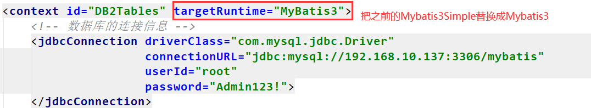

### 12.3 使用逆向工程

*   搭建测试环境

    ```java
    package com.sonnet;
    
    import com.sonnet.mapper.UserMapper;
    import com.sonnet.pojo.User;
    import com.sonnet.pojo.UserExample;
    import org.apache.ibatis.io.Resources;
    import org.apache.ibatis.session.SqlSession;
    import org.apache.ibatis.session.SqlSessionFactory;
    import org.apache.ibatis.session.SqlSessionFactoryBuilder;
    import org.junit.After;
    import org.junit.Before;
    import org.junit.Test;
    
    import java.io.InputStream;
    import java.util.List;
    
    public class TestMybatis {
        SqlSession sqlSession;
        UserMapper userMapper;
        //在@Test注解修饰的方法之前执行
        @Before
        public void init() throws Exception{
            InputStream in =
                    Resources.getResourceAsStream("SqlMapConfig.xml");
            SqlSessionFactoryBuilder builder = new
                    SqlSessionFactoryBuilder();
            SqlSessionFactory sqlSessionFactory = builder.build(in);
            sqlSession = sqlSessionFactory.openSession();
            userMapper = sqlSession.getMapper(UserMapper.class);
        }
        //在@Test注解修饰的方法之后执行
        @After
        public void after(){
            sqlSession.close();
        }
    }
    ```

*   查询操作

    ```java
        @Test
        public void test01() {
            List<User> userList = userMapper.selectByExample(null);
            for (User user : userList) {
                System.out.println(user);
            }
        }
    
        @Test
        public void test02() {
            UserExample userExample = new UserExample();
    /*
            userExample.createCriteria().andIdEqualTo(41).andSexEqualTo("男");
            userExample.or().andAddressEqualTo("美国");
    */
            userExample.createCriteria().andUsernameLike("%男%");
            List<User> userList = userMapper.selectByExample(userExample);
            for (User user : userList) {
                System.out.println(user);
            }
    ```

*   更新操作

    ```java
    @Test
    public void test03() {
        User user = new User();
        user.setId(68);
        user.setUsername("jiayi");
        user.setSex("女");
        //userMapper.updateByPrimaryKey(user);
        userMapper.updateByPrimaryKeySelective(user);
        sqlSession.commit();
    }
    ```


## 13. mybatis分页插件

*   添加分页查询相关依赖

    ```xml
    <!--分页插件-->
    <dependency>
        <groupId>com.github.pagehelper</groupId>
        <artifactId>pagehelper</artifactId>
        <version>5.2.0</version>
    </dependency>
    ```

*   配置分页插件

    在mybatis的核心配置文件里面配置分页插件。

    ```xml
    <!--配置分页插件-->
    <plugins>
        <plugin interceptor="com.github.pagehelper.PageInterceptor"></plugin>
    </plugins>
    ```

*   使用分页插件

    ```java
    @Test
    public void test03() throws Exception{
        //开启分页操作
        PageHelper.startPage(2,4);
        List<User> userList = userMapper.selectByExample(null);
        userList.forEach(System.out::println);
    }
    ```

如果我们前端需要渲染分页数据之外，还需要动态显示总页数，总记录数等等要素，这种直接输出分页数据的方式肯定不可行。那么分页插件里面有没有给我们提供分页模型，答案是有的，就是PageInfo。

```java
@Test
public void test04() throws Exception{
    //开启分页操作
    PageHelper.startPage(2,4);
    List<User> userList = userMapper.selectByExample(null);
    // mybatis分页插件帮我们分装好的分页模型
    PageInfo<User> userPageInfo = new PageInfo<>(userList);
    System.out.println(userPageInfo);
}
```

```tex
PageInfo{pageNum=2, pageSize=4, size=3, startRow=5, endRow=7, total=7, pages=2, list=Page{count=true, pageNum=2, pageSize=4, startRow=4, endRow=8, total=7, pages=2, reasonable=false, pageSizeZero=false}[User{id=46, username='王', birthday=Wed Mar 07 17:37:26 CST 2018, sex='男', address='北京'}, User{id=48, username='小艾', birthday=Thu Mar 08 11:44:00 CST 2018, sex='女', address='上海'}, User{id=68, username='jiayi', birthday=Fri Oct 30 20:06:42 CST 2026, sex='女', address='浙江'}], prePage=1, nextPage=0, isFirstPage=false, isLastPage=true, hasPreviousPage=true, hasNextPage=false, navigatePages=8, navigateFirstPage=1, navigateLastPage=2, navigatepageNums=[1, 2]}
```

PageInfo模型对象为我们封装了丰富的分页要素

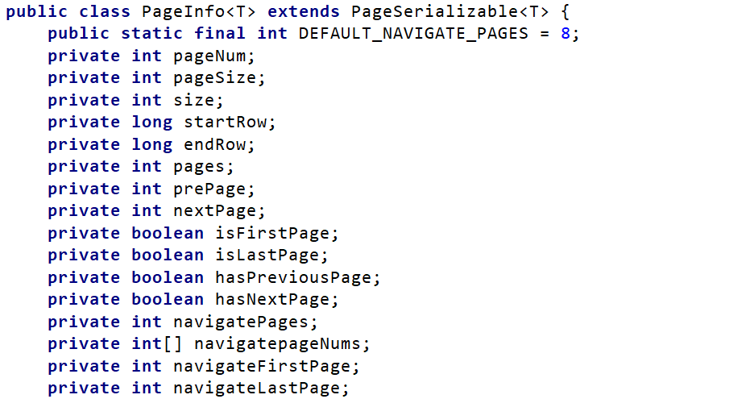

**属性解读：**

*   pageNum：当前页的页码
*   pageSize：每页显示的条数
*   size：当前页显示的真实条数
*   total：总记录数
*   pages：总页数 

*   prePage：上一页的页码 

*   nextPage：下一页的页码

*   isFirstPage/isLastPage：是否为第一页/最后一页 

*   hasPreviousPage/hasNextPage：是否存在上一页/下一页 

*   navigatePages：导航分页的页码数 

*   navigatepageNums：导航分页的页码，[1,2,3,4,5]

