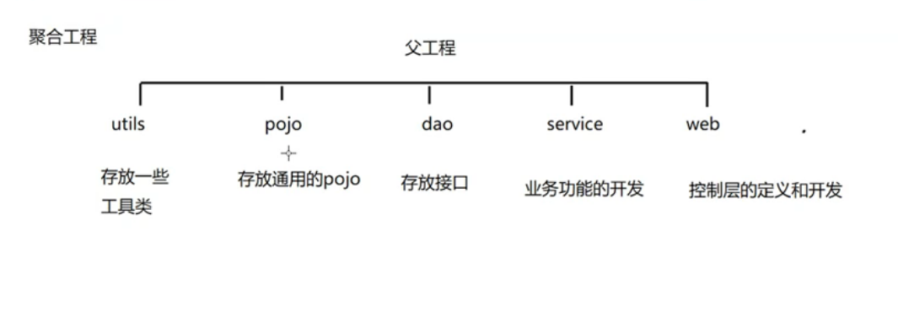

# SSM整合

## 1. 环境准备



### 1.1 使用maven搭建项目

```xml
<project xmlns="http://maven.apache.org/POM/4.0.0" xmlns:xsi="http://www.w3.org/2001/XMLSchema-instance"
         xsi:schemaLocation="http://maven.apache.org/POM/4.0.0 http://maven.apache.org/xsd/maven-4.0.0.xsd">
    <modelVersion>4.0.0</modelVersion>

    <groupId>com.sonnet.parent</groupId>
    <artifactId>ssm-project</artifactId>
    <version>1.0-SNAPSHOT</version>
    <packaging>pom</packaging>

    <name>ssm-project</name>
    <url>http://maven.apache.org</url>
    <modules>
        <module>ssm-project-pojo</module>
        <module>ssm-project-dao</module>
        <module>ssm-project-utils</module>
        <module>ssm-project-service</module>
        <module>ssm-project-web</module>
    </modules>

    <dependencyManagement>
        <dependencies>
            <dependency>
                <groupId>org.apache.logging.log4j</groupId>
                <artifactId>log4j-bom</artifactId>
                <version>2.26.1</version>
                <type>pom</type>
                <scope>import</scope>
            </dependency>
        </dependencies>
    </dependencyManagement>

    <!--定义依赖的版本号-->
    <properties>
        <project.build.sourceEncoding>UTF-8</project.build.sourceEncoding>
        <maven.compiler.release>17</maven.compiler.release>
        <spring.version>5.3.39</spring.version>
        <slf4j.version>2.0.20</slf4j.version>
        <mybatis.version>3.5.19</mybatis.version>
        <mybatis.spring.version>2.1.2</mybatis.spring.version>
        <spring.security.version>5.8.16</spring.security.version>
        <mysql.version>9.7.0</mysql.version>
        <tomcat.version>9.0.123</tomcat.version>
        <cargo.version>1.10.29</cargo.version>
    </properties>

    <dependencies>
        <!--spring-->
        <dependency>
            <groupId>org.aspectj</groupId>
            <artifactId>aspectjweaver</artifactId>
            <version>1.9.25.1</version>
        </dependency>
        <dependency>
            <groupId>org.springframework</groupId>
            <artifactId>spring-aop</artifactId>
            <version>${spring.version}</version>
        </dependency>
        <dependency>
            <groupId>org.springframework</groupId>
            <artifactId>spring-context</artifactId>
            <version>${spring.version}</version>
        </dependency>
        <dependency>
            <groupId>org.springframework</groupId>
            <artifactId>spring-context-support</artifactId>
            <version>${spring.version}</version>
        </dependency>
        <dependency>
            <groupId>org.springframework</groupId>
            <artifactId>spring-core</artifactId>
            <version>${spring.version}</version>
        </dependency>
        <dependency>
            <groupId>org.springframework</groupId>
            <artifactId>spring-beans</artifactId>
            <version>${spring.version}</version>
        </dependency>
        <dependency>
            <groupId>org.springframework</groupId>
            <artifactId>spring-test</artifactId>
            <version>${spring.version}</version>
            <scope>test</scope>
        </dependency>
        <dependency>
            <groupId>org.springframework</groupId>
            <artifactId>spring-webmvc</artifactId>
            <version>${spring.version}</version>
        </dependency>
        <dependency>
            <groupId>org.springframework</groupId>
            <artifactId>spring-tx</artifactId>
            <version>${spring.version}</version>
        </dependency>
        <dependency>
            <groupId>org.springframework</groupId>
            <artifactId>spring-jdbc</artifactId>
            <version>${spring.version}</version>
        </dependency>
        <dependency>
            <groupId>junit</groupId>
            <artifactId>junit</artifactId>
            <version>4.13.2</version>
            <scope>test</scope>
        </dependency>

        <dependency>
            <groupId>javax.servlet</groupId>
            <artifactId>javax.servlet-api</artifactId>
            <version>4.0.1</version>
            <scope>provided</scope>
        </dependency>
        <dependency>
            <groupId>javax.servlet</groupId>
            <artifactId>jstl</artifactId>
            <version>1.2</version>
        </dependency>
        <!--log start-->
        <!--log4j-->
        <dependency>
            <groupId>org.apache.logging.log4j</groupId>
            <artifactId>log4j-api</artifactId>
        </dependency>
        <dependency>
            <groupId>org.apache.logging.log4j</groupId>
            <artifactId>log4j-core</artifactId>
            <scope>runtime</scope>
        </dependency>
        <dependency>
            <groupId>org.slf4j</groupId>
            <artifactId>slf4j-api</artifactId>
            <version>${slf4j.version}</version>
        </dependency>
        <dependency>
            <groupId>org.apache.logging.log4j</groupId>
            <artifactId>log4j-slf4j2-impl</artifactId>
            <scope>runtime</scope>
        </dependency>
        <!--log end-->

        <!--mybatis-->
        <dependency>
            <groupId>org.mybatis</groupId>
            <artifactId>mybatis</artifactId>
            <version>${mybatis.version}</version>
        </dependency>
        <dependency>
            <groupId>org.mybatis</groupId>
            <artifactId>mybatis-spring</artifactId>
            <version>${mybatis.spring.version}</version>
        </dependency>
        <!--数据源-->
        <dependency>
            <groupId>com.mchange</groupId>
            <artifactId>c3p0</artifactId>
            <version>0.14.2</version>
            <type>jar</type>
            <scope>compile</scope>
        </dependency>
        <!--分页插件-->
        <dependency>
            <groupId>com.github.pagehelper</groupId>
            <artifactId>pagehelper</artifactId>
            <version>5.2.0</version>
        </dependency>
        <!--springSecurity-->
        <dependency>
            <groupId>org.springframework.security</groupId>
            <artifactId>spring-security-web</artifactId>
            <version>${spring.security.version}</version>
        </dependency>
        <dependency>
            <groupId>org.springframework.security</groupId>
            <artifactId>spring-security-config</artifactId>
            <version>${spring.security.version}</version>
        </dependency>
        <dependency>
            <groupId>org.springframework.security</groupId>
            <artifactId>spring-security-core</artifactId>
            <version>${spring.security.version}</version>
        </dependency>
        <dependency>
            <groupId>org.springframework.security</groupId>
            <artifactId>spring-security-taglibs</artifactId>
            <version>${spring.security.version}</version>
        </dependency>

        <!--数据库驱动-->
        <dependency>
            <groupId>com.mysql</groupId>
            <artifactId>mysql-connector-j</artifactId>
            <version>${mysql.version}</version>
        </dependency>

        <dependency>
            <groupId>javax.annotation</groupId>
            <artifactId>jsr250-api</artifactId>
            <version>1.0</version>
        </dependency>
    </dependencies>

    <build>
        <plugins>
            <plugin>
                <groupId>org.apache.maven.plugins</groupId>
                <artifactId>maven-compiler-plugin</artifactId>
                <version>3.14.1</version>
            </plugin>
            <plugin>
                <groupId>org.apache.maven.plugins</groupId>
                <artifactId>maven-war-plugin</artifactId>
                <version>3.4.0</version>
                <configuration>
                    <failOnMissingWebXml>false</failOnMissingWebXml>
                </configuration>
            </plugin>
            <plugin>
                <groupId>org.codehaus.cargo</groupId>
                <artifactId>cargo-maven3-plugin</artifactId>
                <version>${cargo.version}</version>
                <configuration>
                    <container>
                        <containerId>tomcat9x</containerId>
                        <type>installed</type>
                        <artifactInstaller>
                            <groupId>org.apache.tomcat</groupId>
                            <artifactId>tomcat</artifactId>
                            <version>${tomcat.version}</version>
                            <type>zip</type>
                        </artifactInstaller>
                    </container>
                    <configuration>
                        <type>standalone</type>
                        <home>${project.build.directory}/cargo/configuration</home>
                        <properties>
                            <cargo.servlet.port>8088</cargo.servlet.port>
                            <cargo.tomcat.uriencoding>UTF-8</cargo.tomcat.uriencoding>
                            <cargo.start.jvmargs>-Dfile.encoding=UTF-8 -Dstdout.encoding=UTF-8 -Dstderr.encoding=UTF-8</cargo.start.jvmargs>
                        </properties>
                    </configuration>
                    <deployables>
                        <deployable>
                            <groupId>${project.groupId}</groupId>
                            <artifactId>${project.artifactId}</artifactId>
                            <type>war</type>
                            <properties>
                                <context>/</context>
                            </properties>
                        </deployable>
                    </deployables>
                </configuration>
            </plugin>
        </plugins>
    </build>
</project>

```

### 1.2 整合SSM环境

#### 1.2.1 spring环境整合

1.   开启包扫描
2.   定义数据源
3.   定义事务管理器
4.   相关事务的配置（编程式事务的控制、声明式事务的控制、注解式事务的控制）
5.   在`web.xml`配置文件里面，使用监听器加载spring的配置文件

##### 1.2.1.1 编写spring配置文件

`applicationContext.xml`

```xml
<?xml version="1.0" encoding="UTF-8"?>
<beans xmlns="http://www.springframework.org/schema/beans"
       xmlns:xsi="http://www.w3.org/2001/XMLSchema-instance"
       xmlns:context="http://www.springframework.org/schema/context" xmlns:tx="http://www.springframework.org/schema/tx"
       xsi:schemaLocation="http://www.springframework.org/schema/beans http://www.springframework.org/schema/beans/spring-beans.xsd http://www.springframework.org/schema/context https://www.springframework.org/schema/context/spring-context.xsd http://www.springframework.org/schema/cache http://www.springframework.org/schema/cache/spring-cache.xsd http://www.springframework.org/schema/tx http://www.springframework.org/schema/tx/spring-tx.xsd">

    <!--
        开启包扫描：主要扫描service dao
    -->
    <context:component-scan base-package="com.sonnet.dao"></context:component-scan>
    <context:component-scan base-package="com.sonnet.service"></context:component-scan>

    <!--
        读取properties配置文件
    -->
    <context:property-placeholder location="classpath:dp.properties"></context:property-placeholder>
    <!--
        定义数据源
    -->
    <bean id="dataSource" class="com.mchange.v2.c3p0.ComboPooledDataSource">
        <!--注入mysql数据库相关信息，使用set方式注入-->
        <property name="driverClass" value="${jdbc.driver}"></property>
        <property name="jdbcUrl" value="${jdbc.url}"></property>
        <property name="user" value="${jdbc.username}"></property>
        <property name="password" value="${jdbc.password}"></property>
    </bean>

    <!--
        定义事务管理器
    -->
    <bean id="transactionManager" class="org.springframework.jdbc.datasource.DataSourceTransactionManager">
        <property name="dataSource" ref="dataSource"></property>
    </bean>

    <!--使用注解来控制事务-->
    <tx:annotation-driven transaction-manager="transactionManager"></tx:annotation-driven>
</beans>
```

`dp.properties`

```xml
jdbc.driver=com.mysql.cj.jdbc.Driver
jdbc.url=jdbc:mysql://localhost:3306/hotel
jdbc.username=root
jdbc.password=root
```

##### 1.2.1.2 配置web.xml

在web.xml配置applicationContext.xml的加载方式。

```xml
<!DOCTYPE web-app PUBLIC
        "-//Sun Microsystems, Inc.//DTD Web Application 2.3//EN"
        "http://java.sun.com/dtd/web-app_2_3.dtd" >

<web-app>
    <display-name>Archetype Created Web Application</display-name>

    <!--
        配置spring配置文件的路径
    -->
    <context-param>
        <param-name>contextConfigLocation</param-name>
        <param-value>classpath:applicationContext.xml</param-value>
    </context-param>
    
    <!--
        配置监听器
    -->
    <listener>
        <listener-class>org.springframework.web.context.ContextLoaderListener</listener-class>
    </listener>
</web-app>
```

#### 1.2.2 整合springmvc环境

1.   包扫描 扫描controller
2.   配置视图解析器
3.   设置静态资源不过滤
4.   开启对处理器适配器 处理器映射器的支持
5.   配置前端控制器，编码过滤器，在web.xml中配置

##### 1.2.2.1 编写springmvc配置文件

编写springmvc.xml配置文件。

```xml
<?xml version="1.0" encoding="UTF-8"?>
<beans xmlns="http://www.springframework.org/schema/beans"
       xmlns:xsi="http://www.w3.org/2001/XMLSchema-instance"
       xmlns:context="http://www.springframework.org/schema/context"
       xmlns:mvc="http://www.springframework.org/schema/mvc"
       xsi:schemaLocation="http://www.springframework.org/schema/beans http://www.springframework.org/schema/beans/spring-beans.xsd http://www.springframework.org/schema/context https://www.springframework.org/schema/context/spring-context.xsd http://www.springframework.org/schema/mvc https://www.springframework.org/schema/mvc/spring-mvc.xsd">

    <!--包扫描-->
    <context:component-scan base-package="com.sonnet.controller"></context:component-scan>

    <!--配置始于解析器-->
    <bean id="internalResourceViewResolver" class="org.springframework.web.servlet.view.InternalResourceViewResolver">
        <!--视图解析规则-->
        <property name="prefix" value="/pages/"></property>
        <property name="suffix" value=".jsp"></property>
    </bean>

    <!--设置静态资源不过滤-->
    <mvc:resources mapping="/css/**" location="/css/"></mvc:resources>
    <mvc:resources mapping="/img/**" location="/img/"></mvc:resources>
    <mvc:resources mapping="/js/**" location="/js/"></mvc:resources>
    <mvc:resources mapping="/plugins/**" location="/plugins/"></mvc:resources>

    <!--开启对处理器适配器 处理器映射器的支持-->
    <mvc:annotation-driven></mvc:annotation-driven>
</beans>
```

##### 1.2.2.2 编写web.xml

```xml
<!DOCTYPE web-app PUBLIC
        "-//Sun Microsystems, Inc.//DTD Web Application 2.3//EN"
        "http://java.sun.com/dtd/web-app_2_3.dtd" >

<web-app>
    <display-name>Archetype Created Web Application</display-name>

    <!--配置spring配置文件的路径-->
    <context-param>
        <param-name>contextConfigLocation</param-name>
        <param-value>classpath:applicationContext.xml</param-value>
    </context-param>

    <!--配置编码过滤器-->
    <filter>
        <filter-name>characterEncodingFilter</filter-name>
        <filter-class>org.springframework.web.filter.CharacterEncodingFilter</filter-class>
        <!--设置编码过滤器格式-->
        <init-param>
            <param-name>encoding</param-name>
            <param-value>UTF-8</param-value>
        </init-param>
    </filter>
    <filter-mapping>
        <filter-name>characterEncodingFilter</filter-name>
        <url-pattern>/*</url-pattern>
    </filter-mapping>

    <!--配置监听器-->
    <listener>
        <listener-class>org.springframework.web.context.ContextLoaderListener</listener-class>
    </listener>

    <!--配置前端控制器-->
    <servlet>
        <servlet-name>dispatcherServlet</servlet-name>
        <servlet-class>org.springframework.web.servlet.DispatcherServlet</servlet-class>
        <!--加载springmvc配置文件-->
        <init-param>
            <param-name>contextConfigLocation</param-name>
            <param-value>classpath:springmvc.xml</param-value>
        </init-param>
    </servlet>

    <servlet-mapping>
        <servlet-name>dispatcherServlet</servlet-name>
        <url-pattern>*.do</url-pattern>
    </servlet-mapping>
</web-app>
```

#### 1.2.3 整合mybatis环境

1.   将SqlSessionFactory交给spring容器管理
2.   MapperScannerConfig 扫描接口，获取接口的代理对象

在spring的配置文件applicationContext.xml进行mybatis的相关配置。

```xml
<!--
        将SqlSessionFactory这个bean交给Spring容器管理
    -->
<bean id="sqlSessionFactory" class="org.mybatis.spring.SqlSessionFactoryBean">
    <!--注入数据源-->
    <property name="dataSource" ref="dataSource"></property>
    <!--PageHelper插件-->
    <property name="plugins">
        <array>
            <!-- 传入插件的对象 -->
            <bean class="com.github.pagehelper.PageInterceptor">
                <property name="properties">
                    <props>
                        <!--使用mysql的分页语句-->
                        <prop key="helperDialect">mysql</prop>
                        <prop key="reasonable">true</prop>
                    </props>
                </property>
            </bean>
        </array>
    </property>
</bean>

<!-- 扫描dao接口 -->
<bean id="mapperScanner"
      class="org.mybatis.spring.mapper.MapperScannerConfigurer">
    <property name="basePackage" value="com.sonnet.dao"/>
</bean>
```


## 2. 实现基础数据之产品管理

### 2.1 查询商品

在ssm-project-pojo里定义实体类Product

```java
package com.sonnet.pojo;

import com.sonnet.utils.DateUtils;
import org.springframework.format.annotation.DateTimeFormat;

import java.util.Date;

public class Product {

    private String id; //主键
    private String productNum; //编号 唯一
    private String productName; //名称
    private String cityName; //出发城市

    @DateTimeFormat(pattern = "yyyy-MM-dd HH:mm")
    private Date departureTime; //出发时间
    private String departureTimeStr;
    private double productPrice; //产品价格
    private String productDesc; //产品描述
    private Integer productStatus; //状态 0关闭 1开启
    private String productStatusStr;

    public String getId() {
        return id;
    }

    public void setId(String id) {
        this.id = id;
    }

    public String getProductNum() {
        return productNum;
    }

    public void setProductNum(String productNum) {
        this.productNum = productNum;
    }

    public String getProductName() {
        return productName;
    }

    public void setProductName(String productName) {
        this.productName = productName;
    }

    public String getCityName() {
        return cityName;
    }

    public void setCityName(String cityName) {
        this.cityName = cityName;
    }

    public Date getDepartureTime() {
        return departureTime;
    }

    public void setDepartureTime(Date departureTime) {
        this.departureTime = departureTime;
    }

    public String getDepartureTimeStr() {
        if (departureTimeStr != null) {
            departureTimeStr = DateUtils.date2String(departureTime, "yyyy-MM-dd HH:mm:ss");
        }
        return departureTimeStr;
    }

    public void setDepartureTimeStr(String departureTimeStr) {
        this.departureTimeStr = departureTimeStr;
    }

    public double getProductPrice() {
        return productPrice;
    }

    public void setProductPrice(double productPrice) {
        this.productPrice = productPrice;
    }

    public String getProductDesc() {
        return productDesc;
    }

    public void setProductDesc(String productDesc) {
        this.productDesc = productDesc;
    }

    public Integer getProductStatus() {
        return productStatus;
    }

    public void setProductStatus(Integer productStatus) {
        this.productStatus = productStatus;
    }

    public String getProductStatusStr() {
        if (productStatus != null) {
            if (productStatus == 0) {
                productStatusStr = "关闭";
            } else if (productStatus == 1) {
                productStatusStr = "开启";
            }
        }
        return productStatusStr;
    }

    public void setProductStatusStr(String productStatusStr) {
        this.productStatusStr = productStatusStr;
    }

    @Override
    public String toString() {
        return "Product{" +
                "id='" + id + '\'' +
                ", productNum='" + productNum + '\'' +
                ", productName='" + productName + '\'' +
                ", cityName='" + cityName + '\'' +
                ", departureTime=" + departureTime +
                ", departureTimeStr='" + departureTimeStr + '\'' +
                ", productPrice=" + productPrice +
                ", productDesc='" + productDesc + '\'' +
                ", productStatus=" + productStatus +
                ", productStatusStr='" + productStatusStr + '\'' +
                '}';
    }
}
```

#### 2.1.1 编写Controller

```java
package com.sonnet.controller;

import com.sonnet.pojo.Product;
import com.sonnet.service.ProductService;
import org.springframework.beans.factory.annotation.Autowired;
import org.springframework.stereotype.Controller;
import org.springframework.ui.Model;
import org.springframework.web.bind.annotation.RequestMapping;

import java.util.List;

@Controller
@RequestMapping("/product")
public class ProductController {

    @Autowired
    ProductService productService;

    // 查询商品信息
    @RequestMapping("/findAll.do")
    public String findAll(Model model){
        List<Product> productList = productService.findAll();
        model.addAttribute("productList", productList);
        return "product-list";
    }
}
```

#### 2.1.2 编写Service

```java
package com.sonnet.service;

import com.sonnet.pojo.Product;

import java.util.List;

public interface ProductService{

    public List<Product> findAll();
}
```

```java
package com.sonnet.service.impl;

import com.sonnet.dao.ProductDao;
import com.sonnet.pojo.Product;
import com.sonnet.service.ProductService;
import org.springframework.beans.factory.annotation.Autowired;
import org.springframework.stereotype.Service;
import org.springframework.transaction.annotation.Transactional;

import java.util.List;

@Service
@Transactional // 声明事务管理核心注解
public class ProductServiceImpl implements ProductService {

    @Autowired
    private ProductDao productDao;

    @Override
    public List<Product> findAll() {
        return productDao.findAll();
    }
}
```

#### 2.1.3 编写Dao

```java
package com.sonnet.dao;

import com.sonnet.pojo.Product;
import org.apache.ibatis.annotations.Select;

import java.util.List;

public interface ProductDao {

    @Select("select * from product")
    List<Product> findAll();
}
```

### 2.2 新增商品

#### 2.2.1 编写Controller

```java
// 新增商品信息
@RequestMapping("/save.do")
public String save(Product product){
    productService.save(product);
    // 重新加载展示product数据列表
    // 必须使用重定向来进行跳转（使用转发会导致表单的重复提交）
    return "redirect:/product/findAll.do";
}
```

#### 2.2.2 编写Service

```java
// 新增物品
public void save(Product product);
```

```java
/**
 * 新增product
 * @param product
 */
@Override
public void save(Product product) {
    productDao.save(product);
}
```

#### 2.2.3 编写Dao

```java
// 新增商品
@Insert("INSERT INTO `hotel`.`product` (`id`, `productNum`, `productName`, `cityName`, `DepartureTime`, `productPrice`, `productDesc`, `productStatus`) " +
        "VALUES (#{id}, #{productNum}, #{productName}, #{cityName}, #{departureTime}, #{productPrice}, #{productDesc}, #{productStatus});")
void save(Product product);
```


## 3. 实现基础数据之订单管理

### 3.1 订单信息分页查询

#### 3.1.1 编写实体类

```java
package com.sonnet.pojo;
import com.sonnet.utils.DateUtils;

import java.util.Date;
import java.util.List;

/**
 * 订单
 */
public class Orders {
    private String id;
    private String orderNum;
    private Date orderTime;
    private String orderTimeStr;
    private int orderStatus;
    private String orderStatusStr;
    private int peopleCount;
    private Product product;
    private List<Traveller> travellers;
    private Member member;
    private Integer payType;
    private String payTypeStr;
    private String orderDesc;

    public String getOrderStatusStr() {
        //订单状态（0未支付  1已支付）
        if(orderStatus == 0){
            orderStatusStr = "未支付";
        }else if(orderStatus == 1){
            orderStatusStr = "已支付";
        }
        return orderStatusStr;
    }

    public void setOrderStatusStr(String orderStatusStr) {
        this.orderStatusStr = orderStatusStr;
    }

    public String getId() {
        return id;
    }

    public void setId(String id) {
        this.id = id;
    }

    public String getOrderNum() {
        return orderNum;
    }

    public void setOrderNum(String orderNum) {
        this.orderNum = orderNum;
    }

    public Date getOrderTime() {
        return orderTime;
    }

    public void setOrderTime(Date orderTime) {
        this.orderTime = orderTime;
    }

    public String getOrderTimeStr() {
        if(orderTime != null){
            orderTimeStr = DateUtils.date2String(orderTime, "yyyy-MM-dd HH:mm");
        }
        return orderTimeStr;
    }

    public void setOrderTimeStr(String orderTimeStr) {
        this.orderTimeStr = orderTimeStr;
    }

    public int getOrderStatus() {
        return orderStatus;
    }

    public void setOrderStatus(int orderStatus) {
        this.orderStatus = orderStatus;
    }

    public int getPeopleCount() {
        return peopleCount;
    }

    public void setPeopleCount(int peopleCount) {
        this.peopleCount = peopleCount;
    }

    public Product getProduct() {
        return product;
    }

    public void setProduct(Product product) {
        this.product = product;
    }

    public List<Traveller> getTravellers() {
        return travellers;
    }

    public void setTravellers(List<Traveller> travellers) {
        this.travellers = travellers;
    }

    public Member getMember() {
        return member;
    }

    public void setMember(Member member) {
        this.member = member;
    }

    public Integer getPayType() {
        return payType;
    }

    public void setPayType(Integer payType) {
        this.payType = payType;
    }

    public String getPayTypeStr() {
        //支付方式（0 支付宝  1微信  2其他）
        if(payType == 0){
            payTypeStr = "支付宝";
        }else if(payType == 1){
            payTypeStr = "微信";
        }else if(payType == 2){
            payTypeStr = "其他";
        }
        return payTypeStr;
    }

    public void setPayTypeStr(String payTypeStr) {
        this.payTypeStr = payTypeStr;
    }

    public String getOrderDesc() {
        return orderDesc;
    }

    public void setOrderDesc(String orderDesc) {
        this.orderDesc = orderDesc;
    }
}
```

#### 3.1.2 编写Controller

```java
package com.sonnet.controller;

import com.github.pagehelper.PageHelper;
import com.github.pagehelper.PageInfo;
import com.sonnet.pojo.Orders;
import com.sonnet.service.OrdersService;
import org.springframework.beans.factory.annotation.Autowired;
import org.springframework.stereotype.Controller;
import org.springframework.ui.Model;
import org.springframework.web.bind.annotation.RequestMapping;
import org.springframework.web.bind.annotation.RequestParam;

import java.util.List;

@Controller
@RequestMapping("/orders")
public class OrdersController {

    @Autowired
    OrdersService ordersService;

    // 分页展示订单信息
    @RequestMapping("/findAll.do")
    public String findAll(@RequestParam(value = "page", required = false, defaultValue = "1") Integer page,
                          @RequestParam(value = "page", required = false, defaultValue = "4")Integer size,
                          Model model) {
        PageHelper.startPage(page, size);
        List<Orders> ordersList = ordersService.findAll();
        PageInfo<Orders> ordersPageInfo = new PageInfo<>(ordersList);
        model.addAttribute("pageInfo", ordersPageInfo);
        return "orders-list";
    }
}
```

####  3.1.3 编写Service

```java
package com.sonnet.service;

import com.sonnet.pojo.Orders;

import java.util.List;

public interface OrdersService {

    List<Orders> findAll();
}
```

```java
package com.sonnet.service.impl;

import com.sonnet.dao.OrdersDao;
import com.sonnet.pojo.Orders;
import com.sonnet.service.OrdersService;
import org.springframework.beans.factory.annotation.Autowired;
import org.springframework.stereotype.Service;
import org.springframework.transaction.annotation.Transactional;

import java.util.List;

@Service
@Transactional
public class OrdersServiceImpl implements OrdersService {

    @Autowired
    OrdersDao ordersDao;

    // 查询所有订单
    @Override
    public List<Orders> findAll() {
        return ordersDao.findAll();
    }
}
```

#### 3.1.4 编写Dao

```java
package com.sonnet.dao;

import com.sonnet.pojo.Orders;
import org.apache.ibatis.annotations.One;
import org.apache.ibatis.annotations.Result;
import org.apache.ibatis.annotations.Results;
import org.apache.ibatis.annotations.Select;

import java.util.List;

public interface OrdersDao {

    @Results(
            id = "orderMap",
            value = {
                    @Result(id = true, column = "id", property = "id"),
                    @Result(column = "orderNum", property = "orderNum"),
                    @Result(column = "orderTime", property = "orderTime"),
                    @Result(column = "orderStatus", property = "orderStatus"),
                    @Result(column = "productId", property = "product",
                            one = @One(select = "com.sonnet.dao.ProductDao.findProductById"))
            })
    @Select("select * from orders")
    List<Orders> findAll();
}
```

```java
// 根据id查询商品
@Select("select * from product where id = #{id}")
public Product findProductById(Integer id);
```

#### 3.1.5 前台分页条渲染

```jsp
<ul class="pagination">
    <li>
       <a href="${pageContext.request.contextPath}/orders/findAll.do?page=1&pageSize=${pageInfo.pageSize}" aria-label="Previous">首页</a>
    </li>
    <li>
       <a href="${pageContext.request.contextPath}/orders/findAll.do?page=${pageInfo.pageNum-1}&pageSize=${pageInfo.pageSize}">上一页</a></li>
    <c:forEach begin="1" end="${pageInfo.pages}" var="pageNum">
       <li>
          <a href="${pageContext.request.contextPath}/orders/findAll.do?page=${pageNum}&pageSize=${pageInfo.pageSize}">${pageNum}</a>
       </li>
    </c:forEach>
    <li><a href="${pageContext.request.contextPath}/orders/findAll.do?page=${pageInfo.pageNum+1}&pageSize=${pageInfo.pageSize}">下一页</a></li>
    <li>
       <a href="${pageContext.request.contextPath}/orders/findAll.do?page=${pageInfo.pages}&pageSize=${pageInfo.pageSize}" aria-label="Next">尾页</a>
    </li>
</ul>
```

### 3.2 订单详情查询

注意：这里的订单详情，包含订单本身，也包含订单对应的Product，还包含订单对应的Member。还包含Traveller集合

#### 3.2.1 编写Controlelr

```java
// 展示订单详情
@RequestMapping("/findById.do")
public String findById(@RequestParam("id") Integer id,Model model) {
    Orders orders = ordersService.findById(id);
    model.addAttribute("orders", orders);
    return "orders-show";
}
```

#### 3.2.2 编写Service

```java
Orders findById(int id);
```

```java
@Override
public Orders findById(int id) {
    return ordersDao.findById(id);
}
```

#### 3.2.3 编写Dao

`OrdersDao`

```java
@Results(value = {
        @Result(id = true, column = "id", property = "id"),
        @Result(column = "orderNum", property = "orderNum"),
        @Result(column = "orderTime", property = "orderTime"),
        @Result(column = "orderStatus", property = "orderStatus"),
        @Result(column = "peopleCount", property = "peopleCount"),
        @Result(column = "orderDesc", property = "orderDesc"),
        @Result(column = "payType", property = "payType"),
        @Result(column = "productId", property = "product",
                one = @One(select = "com.sonnet.dao.ProductDao.findProductById")),
        @Result(column = "memberId", property = "member",
                one = @One(select = "com.sonnet.dao.MemberDao.findMemberById")),
        @Result(column = "id", property = "travellers",
                many = @Many(select = "com.sonnet.dao.TravellerDao.findTravellerByOrderId"))
})
@Select("SELECT * from orders where id = #{id}")
Orders findById(int id);
```

`ProductDao`

```java
// 根据id查询商品
@Select("select * from product where id = #{id}")
public Product findProductById(Integer id);
```

`MemberDao`

```java
package com.sonnet.dao;

import com.sonnet.pojo.Member;
import org.apache.ibatis.annotations.Select;

public interface MemberDao {

    @Select("select * from member where id = #{id}")
    Member findMemberById(Integer id);
}
```

`TravellerDao`

```java
package com.sonnet.dao;

import com.sonnet.pojo.Traveller;
import org.apache.ibatis.annotations.Select;

import java.util.List;

public interface TravellerDao {

    @Select("select * from traveller where id in (select travellerid from order_traveller where orderid = #{orderId})")
    List<Traveller> findTravellerByOrderId(Integer orderId);
}
```


## 4. 实现系统管理之用户管理

### 4.1 查询用户

#### 4.1.1 编写Controller

```java
package com.sonnet.controller;

import com.sonnet.pojo.UserInfo;
import com.sonnet.service.UserService;
import org.springframework.beans.factory.annotation.Autowired;
import org.springframework.stereotype.Controller;
import org.springframework.ui.Model;
import org.springframework.web.bind.annotation.RequestMapping;

import java.util.List;

@Controller
@RequestMapping("/user")
public class UserController {

    @Autowired
    UserService userService;

    @RequestMapping("/findAll.do")
    public String findAll(Model model) {
        List<UserInfo> userList = userService.findAll();
        model.addAttribute("userList", userList);
        return "user-list";
    }
}
```

#### 4.1.2 编写Service

```java
package com.sonnet.service;

import com.sonnet.pojo.UserInfo;

import java.util.List;

public interface UserService {

    List<UserInfo> findAll();
}
```

```java
package com.sonnet.service.impl;

import com.sonnet.dao.UserDao;
import com.sonnet.pojo.UserInfo;
import com.sonnet.service.UserService;
import org.springframework.beans.factory.annotation.Autowired;
import org.springframework.stereotype.Service;

import java.util.List;

@Service
public class UserServiceImpl implements UserService {

    @Autowired
    UserDao userDao;

    @Override
    public List<UserInfo> findAll() {
        return userDao.findAll();
    }
}
```

#### 4.1.3 编写Dao

```java
package com.sonnet.dao;

import com.sonnet.pojo.UserInfo;
import org.apache.ibatis.annotations.Select;

import java.util.List;

public interface UserDao {

    @Select("select * from users")
    List<UserInfo> findAll();
}
```

### 4.2 添加用户

#### 4.2.1 编写Controller

```java
// 新增用户信息
@RequestMapping("save.do")
public String save(UserInfo userInfo) {
    userService.save(userInfo);
    return "redirect:/user/findAll.do";
}
```

#### 4.2.2 编写Service

```java
void save(UserInfo userInfo);
```

```java
@Override
public void save(UserInfo userInfo) {
    userDao.save(userInfo);
}
```

#### 4.2.3 编写Dao

```java
@Insert("INSERT INTO `hotel`.`users` (`email`, `username`, `password`, `phoneNum`, `status`) VALUES (#{email}, #{username}, #{password}, #{phoneNum}, #{status});")
void save(UserInfo userInfo);
```

### 4.3 展示用户详情

#### 4.3.1 编写Controller

```java
// 展示用户详情
@RequestMapping("findById.do")
public String findById(@RequestParam("id") Integer id, Model model) {
    UserInfo userInfo = userService.findById(id);
    model.addAttribute("user", userInfo);
    return "user-show";
}
```

#### 4.3.2 编写service

```java
UserInfo findById(Integer id);
```

```java
@Override
public UserInfo findById(Integer id) {
    return userDao.findById(id);
}
```

#### 4.3.3 编写Dao

`UserDao`

```java
@Results(
        value = {
                @Result(id = true, column = "id", property = "id"),
                @Result(column = "username", property = "username"),
                @Result(column = "password", property = "password"),
                @Result(column = "email", property = "email"),
                @Result(column = "phoneNum", property = "phoneNum"),
                @Result(column = "status", property = "status"),
                @Result(column = "id", property = "roles",
                        many = @Many(select = "com.sonnet.dao.RoleDao.findRolesByUserId"))
        }
)
@Select("select * from users where id = #{id}")
UserInfo findById(Integer id);
```

`RoleDao`

```java
package com.sonnet.dao;

import com.sonnet.pojo.Role;
import org.apache.ibatis.annotations.Many;
import org.apache.ibatis.annotations.Result;
import org.apache.ibatis.annotations.Results;
import org.apache.ibatis.annotations.Select;

import java.util.List;

public interface RoleDao {

    @Results(
            value = {
                    @Result(id = true, column = "id", property = "id"),
                    @Result(column = "roleName", property = "roleName"),
                    @Result(column = "roleDesc", property = "roleDesc"),
                    @Result(column = "id", property = "permissions",
                            many = @Many(select = "com.sonnet.dao.PermissionDao.findPermissionByRoleId"))
            }
    )
    @Select("select * from role where id in (select roleId from users_role where userId = #{userId})")
    public List<Role> findRolesByUserId(Integer id);
}
```

`PermissionDao`

```java
package com.sonnet.dao;

import com.sonnet.pojo.Permission;
import org.apache.ibatis.annotations.Select;

import java.util.List;

public interface PermissionDao {

    @Select("select * from permission where id in (select permissionId from role_permission where roleId = #{id})")
    List<Permission> findPermissionByRoleId(Integer id);
}
```


## 5. 实现系统管理之角色管理

### 5.1 查询角色

#### 5.1.1 编写Controller

```java
package com.sonnet.controller;

import com.sonnet.pojo.Role;
import com.sonnet.service.RoleService;
import org.springframework.beans.factory.annotation.Autowired;
import org.springframework.stereotype.Controller;
import org.springframework.ui.Model;
import org.springframework.web.bind.annotation.RequestMapping;

import java.util.List;

@Controller
@RequestMapping("/role")
public class RoleController {

    @Autowired
    RoleService roleService;

    @RequestMapping("/findAll.do")
    public String findAll(Model model) {
        List<Role> roleList = roleService.findAll();
        model.addAttribute("roleList", roleList);
        return "role-list";
    }
}
```

#### 5.1.2 编写Service

```java
package com.sonnet.service;

import com.sonnet.pojo.Role;

import java.util.List;

public interface RoleService {

    List<Role> findAll();
}
```

```java
package com.sonnet.service.impl;

import com.sonnet.dao.RoleDao;
import com.sonnet.pojo.Role;
import com.sonnet.service.RoleService;
import org.springframework.beans.factory.annotation.Autowired;
import org.springframework.stereotype.Service;

import java.util.List;

@Service
public class RoleServiceImpl implements RoleService {

    @Autowired
    RoleDao roleDao;

    @Override
    public List<Role> findAll() {
        return roleDao.findAll();
    }
}
```

#### 5.1.3 编写Dao

```java
@Select("select * from role")
public List<Role> findAll();
```

### 5.2 添加角色

#### 5.2.1 编写Controller

```java
// 新增角色信息
@RequestMapping("/save.do")
public String save(Role role) {
    roleService.save(role);
    return "redirect:/role/findAll.do";
}
```

#### 5.2.2 编写Service

```java
void save(Role role);
```

```java
@Override
public void save(Role role) {
    roleDao.save(role);
}
```

#### 5.2.3 编写Dao

```java
@Insert("insert into role(roleName, roleDesc) values (#{roleName}, #{roleDesc})")
public void save(Role role);
```


## 6. 实现系统管理系统之权限资源管理

### 6.1 查询资源权限

#### 6.1.1 编写Controller

```java
// 查询所有资源权限信息
@RequestMapping("/findAll.do")
public String findAll(Model model) {
    List<Permission> permissionList = permissionService.findAll();
    model.addAttribute("permissionList", permissionList);
    return "permission-list";
}
```

#### 6.1.2 编写Service

```java
public List<Permission> findAll();
```

```java
@Override
public List<Permission> findAll() {
    return permissionDao.findAll();
}
```

#### 6.1.3 编写Dao

```java
@Select("select * from permission")
public List<Permission> findAll();
```

### 6.2 添加资源权限

#### 6.2.1 编写Controller

```java
// 新增资源权限信息
@RequestMapping("save.do")
public String save(Permission permission) {
    permissionService.save(permission);
    return "redirect:/permission/findAll.do";
}
```

#### 6.2.2 编写Service

```java
public void save(Permission permission);
```

```java
@Override
public void save(Permission permission) {
    permissionDao.save(permission);
}
```

#### 6.2.3 编写Dao

```java
@Insert("insert into permission (permissionName, url) values (#{permissionName}, #{url})")
public void save(Permission permission);
```


## 7. 实现权限关联与控制

### 7. 1 用户关联角色操作

第一步：查询指定用户的用户信息和没有关联的角色信息

*   编写Controller

    ```java
    // 将当前用户没有关联的角色信息查询出来
    @RequestMapping("/findUserByIdAndAllRole.do")
    public String findUserByIdAndAllRole(@RequestParam("id") Integer id, Model model) {
        UserInfo userInfo = userService.findById(id);
        model.addAttribute("user", userInfo);
        List<Role> roleList = userService.findUserByIdAndAllRole(id);
        model.addAttribute("roleList", roleList);
        return "user-role-add";
    }
    ```

*   编写Service

    ```java
    List<Role> findUserByIdAndAllRole(Integer id);
    ```

    ```java
    @Override
    public List<Role> findUserByIdAndAllRole(Integer id) {
        return userDao.findUserByIdAndAllRole(id);
    }
    ```

*   编写Dao

    ```java
    @Select("select * FROM role where id not in (SELECT roleId from users_role where userId = #{id})")
    List<Role> findUserByIdAndAllRole(Integer id);
    ```

第二步：在user-role-add.jsp上页面上将用户信息和选择的角色信息进行添加

*   编写Controller

    ```java
    // 将用户信息和角色信息进行关联
    @RequestMapping("addRoleToUser.do")
    public String addRoleToUser(@RequestParam("userId") Integer userId, Integer[] ids) {
        userService.addRoleToUser(userId, ids);
        return "redirect:/user/findAll.do";
    }
    ```

*   编写Service

    ```java
    void addRoleToUser(Integer userId, Integer[] ids);
    ```

    ```java
    @Override
    public void addRoleToUser(Integer userId, Integer[] ids) {
        for (Integer id : ids) {
            userDao.addRoleToUser(userId, id);
        }
    }
    ```

*   编写Dao

    ```java
    @Insert("insert into users_role(userId, roleId) values (#{userId}, #{roleId})")
    void addRoleToUser(@Param("userId") Integer userId, @Param("roleId") Integer id);
    ```

### 7.2 角色关联权限操作

第一步：查询指定角色信息和没有关联的权限信息

*   编写Controller

    ```java
    // 查询指定角色没有关联的权限信息
    @RequestMapping("/findRoleByIdAndPermission.do")
    public String findRoleByIdAndPermission(@RequestParam("id") Integer id, Model model) {
        Role role = roleService.findById(id);
        List<Permission> permissionList = roleService.findRoleByIdAndPermission(id);
        model.addAttribute("role", role);
        model.addAttribute("permissionList", permissionList);
        return "role-permission-add";
    }
    ```

*   编写Service

    ```java
    Role findById(Integer id);
    
    List<Permission> findRoleByIdAndPermission(Integer id);
    ```

    ```java
    @Override
    public Role findById(Integer id) {
        return roleDao.findById(id);
    }
    
    @Override
    public List<Permission> findRoleByIdAndPermission(Integer id) {
        return roleDao.findRoleByIdAndPermission(id);
    }
    ```

*   编写Dao

    ```java
    @Select("select * from role where id = #{id}")
    Role findById(Integer id);
    
    @Select("select * from permission where id not in (select permissionId from role_permission where roleId = #{id})")
    List<Permission> findRoleByIdAndPermission(Integer id);
    ```

第二步：在role-permission-add.jsp页面上将用户信息和选择的角色信息进行添加

*   编写Controller

    ```java
    // 将角色和权限进行关联
    @RequestMapping("addPermissionToRole.do")
    public String addPermissionToRole(@RequestParam("roleId") Integer roleId, Integer[] ids) {
        roleService.addPermissionToRole(roleId, ids);
        return "redirect:/role/findAll.do";
    }
    ```

*   编写Service

    ```java
    void addPermissionToRole(Integer roleId, Integer[] ids);
    ```

    ```java
    @Override
    public void addPermissionToRole(Integer roleId, Integer[] ids) {
        for (Integer id : ids) {
            roleDao.addPermissionToRole(roleId, id);
        }
    }
    ```

*   编写Dao

    ```java
    @Insert("insert into role_permission (permissionId, roleId) values (#{permissionId}, #{roleId})")
    void addPermissionToRole(@Param("roleId") Integer roleId, @Param("permissionId") Integer id);
    ```


## 8. 使用拦截器实现登录验证

### 8.1 编写登录验证逻辑

*   编写Controller

    ```java
    package com.sonnet.controller;
    
    import com.sonnet.pojo.UserInfo;
    import com.sonnet.service.UserService;
    import org.springframework.beans.factory.annotation.Autowired;
    import org.springframework.stereotype.Controller;
    import org.springframework.util.StringUtils;
    import org.springframework.web.bind.annotation.RequestMapping;
    
    import javax.servlet.http.HttpServletRequest;
    import javax.servlet.http.HttpSession;
    
    @Controller
    @RequestMapping("/login")
    public class LoginController {
    
        @Autowired
        UserService userService;
    
        @RequestMapping("/login.do")
        public String login(String username, String password, HttpServletRequest request) {
            UserInfo user = userService.findUser(username, password);
            if (!StringUtils.isEmpty(user)) {
                // 成功登录 把用户信息存入session
                HttpSession session = request.getSession();
                session.setAttribute("user", user);
                return "redirect:/index.jsp";
            } else {
                return "redirect:/login.jsp";
            }
        }
    }
    ```

*   编写Service

    ```java
    UserInfo findUser(String username, String password);
    ```

    ```java
    @Override
    public UserInfo findUser(String username, String password) {
        return userDao.findUser(username, password);
    }
    ```

*   编写Dao

    ```java
    @Select("select * from users where username = #{username} and password = #{password}")
    UserInfo findUser(@Param("username") String username, @Param("password") String password);
    ```

### 8.2 定义并配置拦截器

*   定义拦截器

    ```java
    package com.sonnet.interceptor;
    
    import com.sonnet.pojo.UserInfo;
    import org.springframework.util.StringUtils;
    import org.springframework.web.servlet.HandlerInterceptor;
    
    import javax.servlet.http.HttpServletRequest;
    import javax.servlet.http.HttpServletResponse;
    import javax.servlet.http.HttpSession;
    
    public class LoginInterceptor implements HandlerInterceptor {
    
        @Override
        public boolean preHandle(HttpServletRequest request, HttpServletResponse response, Object handler) throws Exception {
            HttpSession session = request.getSession();
            // 获取session中的用户信息
            UserInfo user = (UserInfo) session.getAttribute("user");
            if (StringUtils.isEmpty(user)) {
                // 没有登录
                response.sendRedirect("/login.jsp");
            }
            return true;
    
        }
    }
    ```

*   配置拦截器

    ```xml
    <!--配置拦截器-->
    <mvc:interceptors>
        <mvc:interceptor>
            <!--拦截所有资源信息-->
            <mvc:mapping path="/**"/>
            <!--配置不拦截的资源-->
            <mvc:exclude-mapping path="/login/login.do"/>
            <!--将拦截器交给IOC容器管理-->
            <bean class="com.sonnet.interceptor.LoginInterceptor"></bean>
        </mvc:interceptor>
    </mvc:interceptors>
    ```