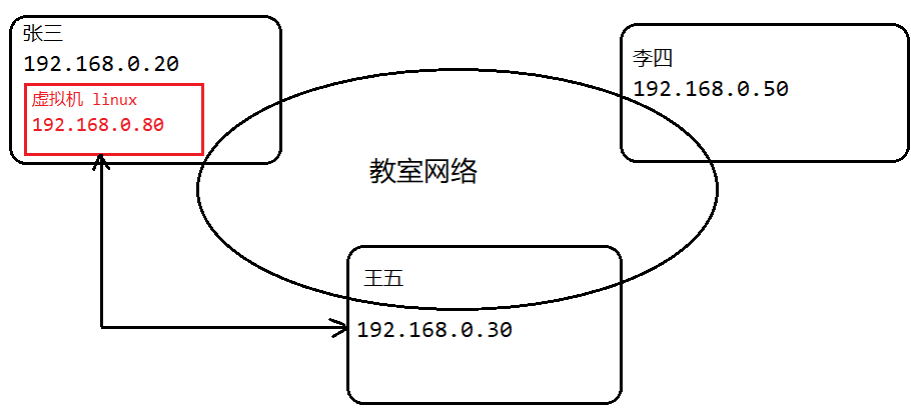
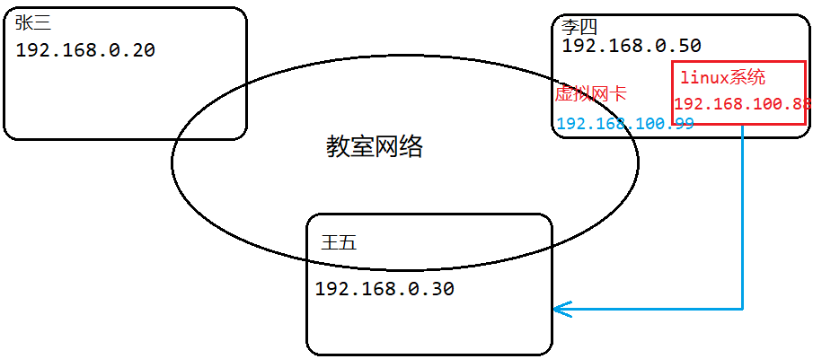

# linux概述

## 1. 磁盘分区

Linux磁盘分区：（20G）

* /boot：Linux的启动需要用到的引导程序和文件都在这个分区里面（1G）
* swap分区：交换区。如果Linux的内存不够用。swap分区会临时充当内存（2G）
* /：（17G）

## 2. linux网络连接三种方式

### 2.1 桥接模式

在桥接模式下，虚拟机里面的网络地址必须和外部的网络地址保持在同一网段(也就是前三组数字必须是一样的)。这样linux操作系统才可以和外部的机器进行通信。但是如果用户人数太多，容易造成IP冲突。

### 2.2 NAT模式（网络地址转换）

在NAT模式下，虚拟机里面的网络可以不再和主机里面的网络保持在同一网段。但是主机里面会存在虚拟网卡(192.168.100.99)，这个虚拟网卡的ip地址必须和linux里面的IP地址(192.168.100.88)在同一网段。这样linux就可以通过虚拟网卡和主机之间进行通信了。同时也可以通过主机的真实地址(192.168.0.50)和外部网络进行通信。这样的好处是可以避免造成IP冲突

### 2.3 主机模式

这个很简单，就是linux系统的ip地址和主机的ip地址必须保持一致。

## 3. 虚拟机的克隆

如果你已经安装了一台linux操作系统，你还想要更多的linux操作系统，这里我们就没有必要再重新安装linux操作系统了，因为会非常的耗时、麻烦。你只需要在原来linux操作系统上克隆就可以实现。

注意：克隆的时候，需要先关闭linux操作系统

在选择克隆类型的时候，有两种。

第一种：创建链接克隆。这种克隆的方式占用的磁盘空间较小，克隆时间更快。本质上还是使用原来的linux操作系统，只是克隆了原linux操作系统的引用。

第二种：创建完整克隆。这种克隆的方式占用是磁盘空间较大，克隆时间比较慢，相当于把原来的linux操作系统复制了一份。一般我们选择完整克隆。

## 4. 虚拟机的快照

如果你在使用linux操作系统的时候，你想回到原来的某一个状态(也就是可能出现在误操作上造成的系统异常)，需要回到原先某个正常运行的状态，vmware提供了这样的功能，就叫快照管理。

## 5. 虚拟机的迁移和删除

当linux操作系统安装完成之后，它的本质是以文件的形式保存在文件目录里面的。因此虚拟系统的前移也十分简单，我们只需要把安装好虚拟系统所在的文件夹直接剪切或拷贝至指定的目录即可。删除也很简单，我们可以使用vmware自带的删除功能进行删除。

首先我们关闭linux操作系统，然后右键-->管理-->从磁盘中清除即可。

## 6. 安装vmtools

vmtools安装完成之后，可以让我们在windows下更好的管理vm虚拟机。可以设置windows和centos的共享文件夹。