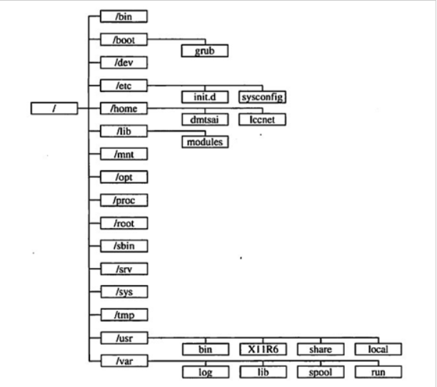

# linux目录结构

## 1. Linux目录结构简介

linux的文件系统和windows的文件不一样。windows文件系统中会有很多盘符，在盘符下面又有很多的文件目录。但是linux文件目录不是这样的。linux文件系统采用的是层级式的树状目录结构，其中最上层的根目录是"/"，然后在此目录下面再创建其他的目录。linux的树状目录结构非常重要，它的树状图如下所示

*   /bin

    是Binary的缩写, 这个目录存放着最经常使用的命令。比如我们常用的cd命令 cp命令都是存放在bin目录里面。

*   /sbin

    s就是Super User的意思，这里存放的是系统管理员使用的系统管理程序。

*   /home

    存放普通用户的主目录，在Linux中每个用户都有一个自己的目录，一般该目录名是以用户的账号命名的。

*   /root

    该目录为系统管理员（root），也称作超级权限者的用户主目录。如果我们使用root账户登录，默认所处的目录位置就是在/root下面。

*   /lib

    系统开机所需要最基本的动态连接共享库，其作用类似于Windows里的DLL文件。几乎所有的应用程序都需要用到这些共享库。如果这个目录里面的文件被删除了，linux操作系统也就不能正常运行了。

*   /etc

    所有的系统管理所需要的配置文件和子目录。linux系统本身所需要用到的配置文件也是存放在etc目录。如果我们自己安装一些系统服务，比如mysql数据库服务，那么和数据库相关的配置文件(my.cnf)也是存放在/etc目录里面

*   /user

    这是一个非常重要的目录，用户的很多应用程序和文件都放在这个目录下，类似与windows下的program files目录。

*   /boot

    存放的是启动Linux时使用的一些核心文件，包括一些连接文件以及镜像文件。如果这个目录里面的文件被删除了，linux操作系统也就不能正常运行了。

*   /dev

    类似于windows的设备管理器，把所有的硬件用文件的形式存储。

*   /proc

    这个目录是一个虚拟的目录，它是系统内存的映射，访问这个目录来获取系统的信息。**这个目录我们不要动，否则可能造成系统的崩溃。**

*   /srv

    service的缩写，该目录存放的一些服务服务启动之后需要提取的数据。**这个目录我们不要动，否则可能造成系统的崩溃。**

*   /sys

    这个目录存放了linux内核相关的文件信息。**这个目录我们不要动，否则可能造成系统的崩溃。**

*   /tmp

    这个目录是用来存放一下临时文件的。

*   /media

    linux系统会自动识别一些设备，例如U盘、光驱等等，当识别后，linux会把识别的设备挂载到这个目录下。比如我们插入的U盘 光驱都会被映射成对应的文件存放在media目录。

*   /mnt

    系统提供该目录是为了让用户临时挂载别的文件系统的，我们可以将外部的存储挂载在/mnt/上，然后进入该目录就可以查看里的内容了。比如我们上节内容设置的共享目录myshare。

*   /opt

    这是主机给安装软件所存放的目录，如果安装JDK可放到改目录下默认为空。VMwareTools-10.0.0-2977863.tar.gz。这个压缩文件就存放在opt目录的。

*   /user/local

    简单的说就是应用程序安装之后，安装程序所存放的目录。一般是通过编译源码方式安装的程序。

*   /var

    这个目录中存放着在不断变化，扩充着的东西，最常用的就是包括各种日志文件。