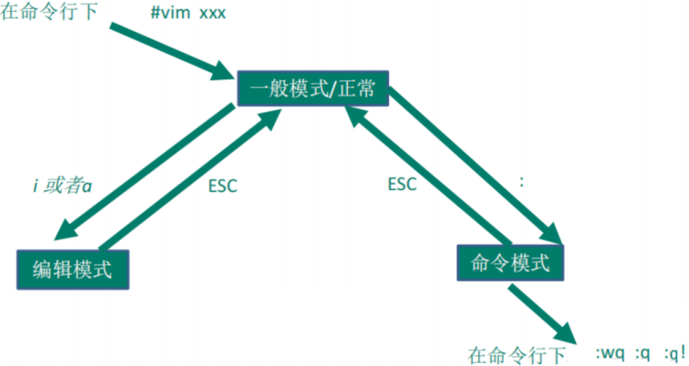

# Linux基本实操

## 1. linux vi/vim编辑器

所有的 Linux 系统都会内置 vi 文本编辑器。Vim 具有程序编辑的能力，可以看做是Vi的增强版本，可以主动的以字体颜色辨别语法的正确性，方便程序设计。代码补完、编译及错误跳转等方便编程的功能特别丰富，在程序员中被广泛使用。

### 1.1 vi/vim的三种模式

*   正常模式

    以vim打开一个档案就是直接进入了一般默认（这是正常的模式），在这个模式中，可以通过上下左右来移动光标，你也可以使用【删除字符】【删除整行】来编辑档案中的内容，也可以使用【复制】【贴上】来处理你的文件数据。

*   插入模式

    按下i，l，o，O，a等任意一个字母之后才会进入编辑模式，一般情况按下i即可。可以从普通模式转变为插入模式。此时可以在文本内容输入内容

*   命令行模式（底行模式）

    按esc，再按SHIFT + ：我们可以从插入模式切换到底行模式。在这个模式当中，可以提供你相关指令，完成读取，存盘，替换vim，显示行号等操作是在此模式下完成的。

    q 直接退出

    q! 不保存退出

    wq 保存并退出

    

### 1.2 vim编辑快捷键的使用

```vim
yyp 复制粘贴当前行
2yyp 复制粘贴当前光标开始的向下2行

dd 删除当前行
2dd 删除当前光标开始的向下2行

u 撤销

查找指定的内容（命令行模式）
:/指定的内容 

设置行号
:set nu
取消行号
:set nonu

G 快速将光标定位到文件末尾处
gg 快速将文件定位到起始
行号 shift + g  5shift+g

:s/World/shijie/ 搜索当前行中的world，将首次出现的world替换为shijie
:s/World/shijie/g 搜索当前行中的world，将其全部替换为shijie
:%s/World/shijie/g 将所有world替换为shijie
```

## 2. linux 的关机与重启

*   shutdown

    shutdown -h now 表示立即关机

    shutdown -h 1 表示1分钟后关机

    shutdown -r now 立即重启

*   halt 关机

    就是直接使用，效果等同于关机

*   sync 同步

    把内存的数据同步到磁盘

*   reboot 重启系统

    就是重启系统

细节：

1.   不管是重启系统还是关闭系统，首先要运行sync命令，把内存中的数据写入到磁盘中。

2.   目前的shutdown、reboot、halt命令在关机前都进行了sync。

## 3. 用户登录和注销

*   切换用户  su root 切换到root用户
*   exit 退出 注销
*   whoami 获取当前系统的登录用户名称

注意：在切换用户的时候，如果从低级别的用户切换到高级别的用户，需要输入密码的(wen --> root)。如果从高级别的用户切换到低级别的用户(root --> wen)，那么是不需要输入密码的。
