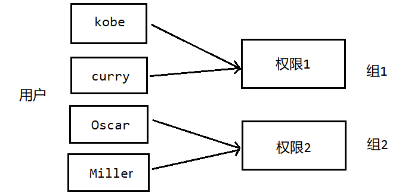

# linux 用户管理

linux系统是一个多用户多任务的操作系统，任何一个要使用系统资源的用户，都必须首先向系统管理员申请一个账号，然后以这个账号的身份进入系统。

## 1. 添加用户

在root用户下，我们可以创建很多其它的用户，并且这些用户都会生成对应的目录，这些目录位于/home/用户名的目录下面。如果我们使用自己创建的用户登录，默认的情况下，用户所在的目录就是/home/用户目录所在的位置。

注意，创建用户的权限只要管理员才有，一般在root用户下面创建用户

`useradd sonnet `创建一个名为sonnet 的用户

细节：

*   当用户创建成功后，会自动的创建和用户同名的目录。这个目录位于/home下面

*   也可以通过 `useradd -d`来指定目录新的用户名，给新的用户名指定目录

*   `useradd -g 组名 用户名`创建用户的时候指定组名

    

## 2. 给用户添加密码

创建密码的命令：`passwd 用户名`


## 3. 删除用户

删除用户有两种情况，一种是删除用户，保存用户对应的目录。还有一种是删除用户，连用户对应的目录也删除掉。

*   删除用户，保存用户对应的目录（一般不用）

    `userdel 用户名`

*   删除用户，对应的用目录也删除掉

    `userdel -r 用户名`


## 4. 查询用户信息

*   查询用户的详细信息

    `id 用户名`

    ```shell
    [root@lullaby101 home]# id sonnet
    uid=1001(sonnet) gid=1001(sonnet) 组=1001(sonnet)
    [root@lullaby101 home]# id lullaby
    uid=1000(lullaby) gid=1000(lullaby) 组=1000(lullaby)
    [root@lullaby101 home]# id root
    uid=0(root) gid=0(root) 组=0(root)
    ```

    uid：用户id  gid：用户组id  groups：组名

*   查看当前用户的信息

    `whoami/who am i`

*   切换用户

    `su 用户名`


## 5. 用户组

用户组类似于角色，系统可以对有共性(权限)的多个用户进行统一管理。我们可以通过下面一幅图来理解组的概念。



*   创建用户组

    `groupadd 组名`

*   删除用户组

    `groupdel 组名`

*   创建用户的时候指定组名

    `useradd -g 组名 用户名`

*   修改用户所在组

    `usermod -g 组名 用户名`