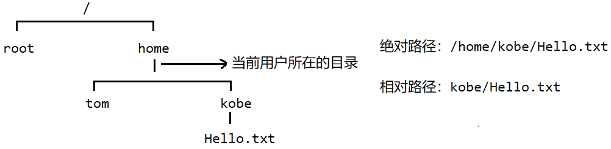

# linux常用命令

## 1. Linux文件（目录）相关的指令

### 1.1 文件（目录）操作

在linux操作系统里面，获取文件的方式有两种，一种是通过绝对路径的方式获取文件，一种是相对路径获取文件。

假设我们在当前指定的目录下面，想要获取指定的文件，我们可以通过相对路径和绝对路径的方式来获取。



*   `ls`指令，显示当前目录下面的所有文件（目录）
    *   `ls -a` 显示当前目录下面的所有文件和目录，包括隐藏的
    *   `ls -l` 以列表的方式显示文件（目录）信息
*   `cd`命令 切换到指定目录
    *   `cd ~` 回到当前用户的home目录（如果是root用户，那么回到的就是root目录下面，如果是非root用户，那么就回到home/用户目录 下面）
    *   `cd /`回到系统根目录
    *   `cd ..` 回到当前目录的上一级目录
    *   `cd ../../root` 比如现在所在的目录是/home/sonnet目录，该命令可以回到/root目录下面去。
    *   `cd -`回到上一条命令所在的目录
*   `mkdir` 用于创建目录
    *   `mkdir dog`在当前目录下创建dog文件夹
    *   `mkdir -p aaa/bbb` 在当前文件夹下创建嵌套文件
*   `rmdir` 指令删除空目录
    *   `rmdir dog` 删除空目录dog
    *   `rm -rf 文件名`删除非空目录（r 递归删除 f不询问删除）。
*   `touch` 创建文件
    *   `touch demo1.txt` 创建一个空文件demo1.txt

*   `cp` 拷贝文件到指定目录
    *   `cp demo1.txt dog/` 将demo1.txt拷贝到dog文件夹中，也可以用绝对路径
    *   `cp -r dog animal/`将dog目录递归拷贝到animal目录中

*   `rm`移除文件或者目录
    *   `rm test1.txt` 删除test1.txt
    *   `rm -f test1.txt` 不询问删除test1.txt
    *   `rm -r demo1`递归删除demo文件夹，一般删除一个非空的文件夹
    *   `rm -rf demo1` 不询问递归删除demo1文件夹

*   `mv`移动文件（剪贴）或重命名（在同一目录里操作就是重命名）
    *   `mv demo1.txt demo2.txt`将demo1.txt 重命名为 demo2.txt
    *   `mv dog /home/sonnet/cat`将dog文件夹移动到/home/sonnet/中，并重命名为cat

### 1.2 查看操作

*   `cat` 查看文件内容 cat[选项] 要查看的文件

    *   `cat /etc/profile` 查看profile文件
    *   `cat -n /etc/profile` 显示行号查看profile文件
    *   `cat -n /etc/profile | more` 浏览文件，并显示行号

*   `more`more指令是一个基于vi编辑器的文本过滤器，他以全屏的方式显示文本文件的内容, 内置了若干快捷键。

    *   `more /etc/profile`

        | 操作     | 功能说明                       |
        | -------- | ------------------------------ |
        | 空格键   | 向下翻页                       |
        | q        | 代表立刻more，不再显示文件内容 |
        | enter    | 向下翻一行                     |
        | Ctrl + B | 向下滚到下一屏幕               |
        | Ctrl + F | 返回上一屏                     |
        | =        | 输出当前行                     |
        | :f       | 输出文件名和当前行号           |

*   `less`  less指令用于来分屏查看文件内容，他的功能与more类似，但是比more更加强大，支持各种显示终端。less指令在显示文件内容时，并不是一次将整个文件加载后才显示的，而是根据要加载的内容，对显示大型文件具有高效率

    | 操作        | 功能说明                           |
    | ----------- | ---------------------------------- |
    | 空格键      | 向下翻动一页                       |
    | 上箭头      | 向上翻动一行                       |
    | 下箭头      | 向下翻动一行                       |
    | /字符串内容 | 搜索字符串 n：向下搜索 N：向上搜索 |
    | q           | 立刻less，不再显示文件内容         |

*   `echo` 将输入内容到控制台
    *   `echo "hello world"` 输出内容
    *   `echo $PATH` 输出PATH环境变量
*   `head` head用于显示文件开头部分内容，默认情况下head希纳是文件前10行的内容
    *   `head /etc/profile` 默认显示前1条内容
    *   `head -n 5 /etc/profile` 默认显示前5行内容
*   `tail`  用于输出文件中尾部的内容，默认情况下tail指令显示文件的前10行内容
    *   `tail /etc/profile` 显示最后10行的数据
    *   `tail -n 5 /etc/profile` 显示最后5行的数据
    *   `tail -f test.txt` 实时监控这个文件的变化

*   软连接，软连接也称为符号链接，类似中windows里面的快捷方式，主要是存放了链接文件的路径。
    *   `ln -s /root /home/sonnet/linkToRoot` 在sonnt目录下面创建软连接linkToRoot。这个软连接指向root目录
    *   `rm -f /linkToRoot` 删除软连接
*   `history` 查看用户已经执行过的历史指令
    *   `history`查看当前用户的历史指令
    *   `history 10` 查看当前用户的最近10条指令


## 2. linux时间指令

*   `date` 指令

    *   `date` 显示当前时间

    *   `date +%Y` 显示当前年份

    *   `date +%m` 显示当前月份

    *   `date +%d` 显示当前是哪一天

    *   `date +%H` 显示当前时间小时部分

    *   `date +%M` 显示当前分钟部分

    *   `date +%S` 显示当前秒部分

    *   `date "+%Y-%m-%d %H:%M:%S"` 显示年月日时分秒

        ```shell
        [root@lullaby101 etc]# date
        2026年 11月 25日 星期三 19:48:16 CST
        [root@lullaby101 etc]# date +%y
        26
        [root@lullaby101 etc]# date +%m
        11
        [root@lullaby101 etc]# date +%d
        25
        [root@lullaby101 etc]# date +%h
        11月
        [root@lullaby101 etc]# date "+%Y-%m-%d %H:%M:%S"
        2026-11-25 19:51:02
        [root@lullaby101 etc]# date +%H
        19
        ```

    *   `date -s 字符串时间` 设置日期

*   `cal` 日历指令

    *   `cal` 展示当前月份的日历
    *   `cal 2026` 展示当前年份的日历


## 3. 搜索查找

**find**

将从指定目录下递归遍历各个目录，将所有满足条件的目录显示在控制台

find [搜索范围] [选项]

| 选项  | 功能                   |
| ----- | ---------------------- |
| -name | 暗中文件的名称查找文件 |
| -user | 查找指定用户所属的文件 |
| -size | 按照指定的大小查找文件 |

```shell
[root@lullaby101 ~]# find / -name 'hello.txt'
find: ‘/run/user/1000/gvfs’: 权限不够
/home/sonnet/hello.txt
[root@lullaby101 ~]# su root
[root@lullaby101 ~]# find /home -name 'hello.txt'
/home/sonnet/hello.txt
```

```shell
[root@lullaby101 home]# find /home -user 'sonnet'
/home/sonnet
/home/sonnet/.mozilla
/home/sonnet/.mozilla/extensions
/home/sonnet/.mozilla/plugins
```

```shell
[root@lullaby101 home]# find / -size +200M
/proc/kcore
find: ‘/proc/8186/task/8186/fd/5’: 没有那个文件或目录
find: ‘/proc/8186/task/8186/fdinfo/5’: 没有那个文件或目录
find: ‘/proc/8186/fd/6’: 没有那个文件或目录
find: ‘/proc/8186/fdinfo/6’: 没有那个文件或目录
find: ‘/run/user/1000/gvfs’: 权限不够
/run/media/lullaby/CentOS 7 x86_64/LiveOS/squashfs.img
```


**locate**

locate指令可以快速定位文件路径。locate指令利用事先建立好的系统中所有文件名称及路径的locate数据库实现快速定位给定的文件。

locate指令无需遍历整个文件系统，查询速度比较快

特别说明：由于locate指令基于数据库进行查询。所以第一次查询前，必须使用updatedb指令创建locate数据库

```shell
[root@lullaby101 ~]# updatedb
[root@lullaby101 ~]# locate hello.txt
/home/sonnet/hello.txt
```


**which**

which指令可以查看某个指令在哪个目录下

查看ls指令在哪个目录下 which ls

查看reboot指令在哪个目录下 which ls

```shell
[root@lullaby101 ~]# which ls
alias ls='ls --color=auto'
	/usr/bin/ls
[root@lullaby101 ~]# which reboot
/usr/sbin/reboot
```


**grep**

grep过滤查找，管道符，”|“,表示前一个指令的处理结果输出传递给后面的指令处理。一般我们将 | 和grep一起结合起来使用。

`grep [选项]` 查找内容 源文件

| 选项 | 功能           |
| ---- | -------------- |
| -n   | 显示行号       |
| -i   | 忽略自动大小写 |

```shell
[root@lullaby101 ~]# cat /root/hello.java | grep -ni 'Hello'
1:public class Hello {
3:		System.out.println("Hello world");
4:		System.out.println("Hello world");
5:		System.out.println("Hello world");
```


## 4. 压缩和解压

**gzip/gunzip**

gzip用于压缩文件；gunzip用于解压缩文件

gzip会将文件压缩为*.gz的文件，源文件被压缩后不存在

```shell
[root@lullaby101 sonnet]# gzip hello.txt
[root@lullaby101 sonnet]# ll
总用量 4
drwxr-xr-x. 2 root root  6 11月 25 17:31 animal
-rw-r--r--. 1 root root 30 11月 25 17:18 hello.txt.gz
[root@lullaby101 sonnet]# gunzip hello.txt.gz
[root@lullaby101 sonnet]# ll
总用量 0
drwxr-xr-x. 2 root root 6 11月 25 17:31 animal
-rw-r--r--. 1 root root 0 11月 25 17:18 hello.txt
```


**zip/unzip**

zip用于压缩文件，unzip用于解压缩文件，这个功能在打包发布中很有用

zip [选项] XXX.zip 将要压缩的内容 （压缩文件和目录的命令）

-r: 递归压缩，即压缩目录

-d: 指定解压后文件存放方目录

```shell
zip -r animal.zip animal/
unzip -d /home/lullaby/ animal.zip
```


**tar**

tar指令是打包指令，最后打包后的文件是.tar.gz的文件。

tar既可以压缩文件也可以解压文件

语法格式：tar [选项] XXX.tar.gz 打包的内容 （功能描述：打包目录，压缩后的文件格式.tar,gz）

| 选项 | 功能                   |
| ---- | ---------------------- |
| -c   | 产生tar打包文件        |
| -v   | 显示详细信息           |
| -f   | 指定压缩文件后的文件名 |
| -z   | 打包同时解压           |
| -x   | 解压tar包文件          |

需求1：将home目录下面的kobe目录压缩成myFile.tar.gz

```shell
[root@xq100 home]# tar -zcvf MyFile.tar.gz /kobe/
[root@xq100 home]# ll
total 4
drwx------. 4 guojing taohuadao 158 Aug 28 15:26 guojing
drwx------. 6 kobe kobe 194 Aug 28 16:36 kobe
-rw-r--r--. 1 root root 1001 Aug 28 16:57 MyFile.tar.gz
drwxr-xr-x. 3 root root 18 Aug 28 16:48 tmp
drwx------. 5 xq xq 147 Aug 27 16:02 xq
```

需求2：将myFile.tar.gz文件解压到当前目录

```shell
[root@xq100 home]# tar -zxvf MyFile.tar.gz
```

需求3：将myFile.tar.gz文件解压到/home/tmp目录下面

需要使用-C参数指定解压的位置。

```shell
[root@xq100 home]# tar -zxvf myFile.tar.gz -C /home/tmp
[root@xq100 home]# cd tmp
[root@xq100 tmp]# ll
total 0
drwx------. 7 kobe kobe 194 Aug 28 16:36 kobe
```

