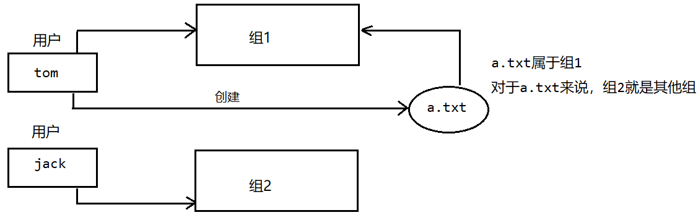
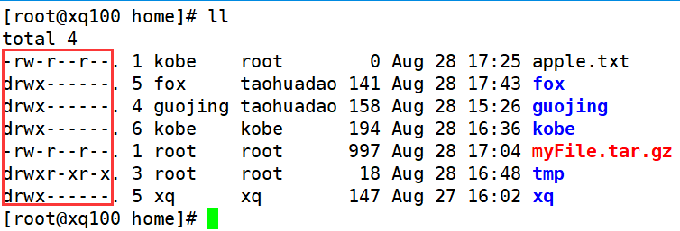
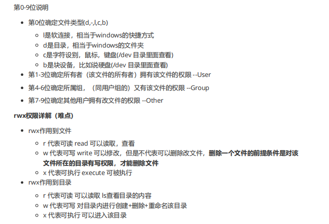
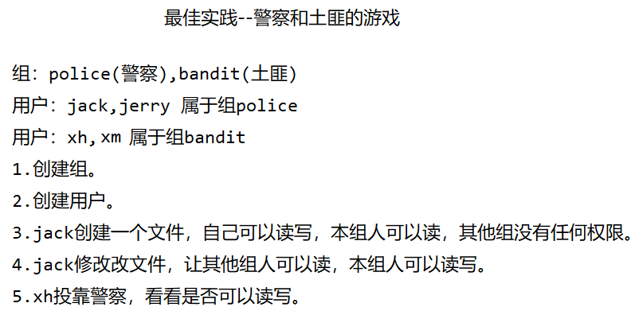

# linux组管理和权限管理

## 1. linux组介绍

在linux中每个用户都必须属于一个组，不能独立于组外，在linux中每个文件有所有者，所在组，其他组的概念。下面我们用一幅图来解释用户、组、其他组的概念。




**修改文件的所属用户**

```shell
[root@lullaby101 sonnet]# chown sonnet hello.txt
```


**修改文件所在的组**

```shell
chgrp groupA fox.txt
```


**修改用户所在的组**

```shell
usermod -g userA fox
```


## 2. linux 权限的介绍

### 2.1 Linux权限的基本概述





### 2.2 文件及目录的案例

```shell
-rw-r--r--. 1 root root 0 Aug 28 15:59 Demo1.java
```

*   第一个字符表示文件类型 - 指的是文件。
*   rw- 文件所有者对当前文件是可读可写不可执行的权限
*   r-- 与文件拥有者同一组的用户的权限是可读不可写不可执行。
*   r-- 当前文件的其他用户的权限是可读不可写不可执行。
*   1：文件：硬连接数或 目录：子目录数
*   root：当前文件所属的用户
*   root：当前用户所属的组
*   0： 文件大小单位是字节
*   Aug 28 15:59：文件最后修改时间
*   Demo1.java：文件的名称

### 2.3 文件的修改

**chmod**

#### 2.3.1 方式一

使用 + - = 变更权限

u：所有者；g：所属者；o：其他人；a：所有人

案例演示

1.   给/home/Hello.java所有者读写执行的权限，给所在组执行读执行的权限，给其他组读执行的权限

     ```she
     [root@xq100 kobe]# chmod u=rwx,g=rx,o=rx Hello.java
     ```

2.   给/home/Hello.java文件的所有者去除执行的权限，增加组写的权限

     ```shell
     [root@xq100 kobe]# chmod u-x,g+w Hello.java
     ```

3.   给/home/Hello.java文件的所有用户添加读的权限

     ```shell
     [root@xq100 kobe]# chmod a+r Hello.java
     ```

#### 2.3.2 方式二

通过数字变更权限

r=4;w=2;x=1 rwx=4+2+!=7

`chmod u=rwx,g=rx,o=x 文件目录名`等价于`chmod 751 文件目录名`

### 2.4 实践



第一二步：

```shell
[root@xq100 ~]# groupadd police # 创建组police
[root@xq100 ~]# groupadd bandit # 创建组bandit
[root@xq100 ~]# useradd -g police jack # 创建用户jack，并将其设置在police组里面
[root@xq100 ~]# useradd -g police jerry # 创建用户jerry，并将其设置在police组里面
[root@xq100 ~]# useradd -g bandit xh # 创建用户xh,并将其设置在bandit组里面
[root@xq100 ~]# useradd -g bandit xm # 创建用户xm,并将其设置在bandit组里面
```

第三步

```shell
[root@xq100 ~]# passwd jack
Changing password for user jack.
New password:
BAD PASSWORD: The password is shorter than 8 characters
Retype new password:
passwd: all authentication tokens updated successfully.
[root@xq100 ~]# passwd jerry
Changing password for user jerry.
New password:
BAD PASSWORD: The password is shorter than 8 characters
Retype new password:
passwd: all authentication tokens updated successfully.
[root@xq100 ~]# passwd xh
Changing password for user xh.
New password:
BAD PASSWORD: The password is shorter than 8 characters
Retype new password:
passwd: all authentication tokens updated successfully.
[root@xq100 ~]# passwd xm
Changing password for user xm.
New password:
BAD PASSWORD: The password is shorter than 8 characters
Retype new password:
passwd: all authentication tokens updated successfully.
```

第四步

```shell
[jack@xq100 ~]$ vim jack.txt # 创建jack.txt文件 并在里面编辑内容Hello
[jack@xq100 ~]$ cat jack.txt
Hello
[jack@xq100 ~]$ ll
total 4
-rw-r--r--. 1 jack police 6 Aug 28 19:06 jack.txt
[jack@xq100 ~]$ chmod 640 jack.txt # 修改权限
[jack@xq100 ~]$ ll
total 4
-rw-r-----. 1 jack police 6 Aug 28 19:06 jack.txt
```

第五步

```shell
[jack@xq100 ~]$ chmod 664 jack.txt
[jack@xq100 ~]$ ll
total 4
-rw-r--r--. 1 jack police 6 Aug 28 19:06 jack.txt
```

