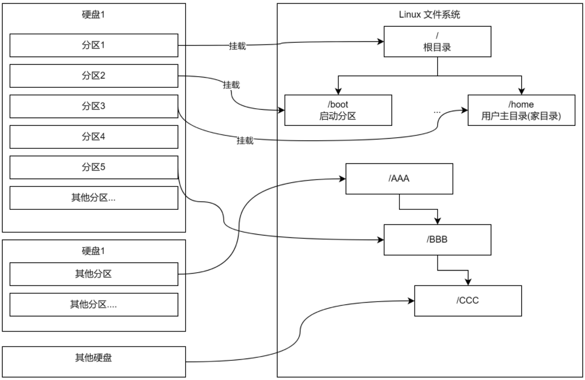
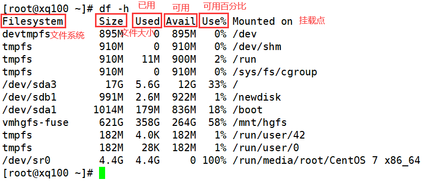

# linux磁盘分区

## 1. linux磁盘分区机制

### 1.1 磁盘分区和linux文件系统的关系

1.   Linux 系统中的文件系统的总体结构是一定的：只有一个根目录，根目录下的目录结构独立且唯一（如 /boot、/dev、/bin、/etc 目录等都是唯一的），Linux 中的磁盘分区都是文件系统中的一部分。

2.   计算机的硬盘可以有多个、磁盘上的分区也可以有多个。

     但每个磁盘要想连接到 Linux 系统中，需要将分区“映射”到文件系统的某一个目录下，这样访问目录即可访问对应硬盘分区，这种映射称为“挂载”。

3.   任何目录或其父目录都要挂载到硬盘的某个分区下。如需要将某一分区挂载到根目录下，Linux 系统才能正常工作。
4.   某个分区所挂载的目录，称为此分区的挂载点。
5.   磁盘的不同分区可以挂载到 Linux 文件系统的不同分区下，但不能同时挂载到一个相同的目录。



可以去查看一下具体的磁盘分区信息吗?我们可以使用lsblk命令来查看详细的磁盘分区信息：

```shell
[root@lullaby101 ~]# lsblk
```

### 1.2 硬盘标识

Linux硬盘有两种：IDE 硬盘 和 SCSI 硬盘

*   对于IDE硬盘，驱动标识为：`hdx~`

    *   `hd`表示分区所在设备的类型，这里 hd = IDE 硬盘

    *   `x`为盘号，区分不同硬盘间的功能

        | 标识 | 功能       |
        | ---- | ---------- |
        | a    | 基本盘     |
        | b    | 基本从属盘 |
        | c    | 辅助主盘   |
        | d    | 辅助从属盘 |

    *   `~`为分区号，区分同一硬盘上不同分区的功能

        | 标识 | 功能               |
        | ---- | ------------------ |
        | 1-4  | 主分区 或 扩展分区 |
        | 5    | 逻辑分区           |

*   对于 SCSI 硬盘：驱动标识为`sdx~`

    *   `sd`表示分区所在设备的类型，这里 sd = SCSI 硬盘

    *   `x`

    *   为盘号，区分不同硬盘间的功能（盘号功能标识同 IDE 硬盘 a代表第一块硬盘 b代表第二块硬盘c代表第三块硬盘 d代表第四块硬盘）

    *   `~`为分区号，区分同一硬盘上不同分区的功能（分区号功能标识同 IDE 硬盘）

        也可以查看分区的详细信息：

        ```shell
        [root@lullaby101 ~]# lsblk -f
        NAME   FSTYPE  LABEL           UUID                                 MOUNTPOINT
        sda                                                                 
        ├─sda1 xfs                     a21c32f2-7d15-44cc-9c1b-56bd5e843921 /boot
        ├─sda2 swap                    89c0bd05-2e9c-45ed-b081-19ebc2e55af8 [SWAP]
        └─sda3 xfs                     6b22037f-03d9-46b7-841f-41a23755e3fa /
        sr0    iso9660 CentOS 7 x86_64 2020-11-04-11-36-43-00               
        ```

        `NAME`：驱动器标识

        `FSTYPE`：文件系统类型

        `LABLE`：文件系统 LABLE

        `UUID`：分区唯一标识符，格式化磁盘后，会给分区分配一个32位的唯一的字符串

        `MOUNTPOINT`：挂载点


## 2. 磁盘挂载的案例

需求：下面我们以增加一块硬盘来熟悉磁盘的相关指令，深入理解磁盘分区、卸载、挂载的概念。

见pdf


## 3. 磁盘情况查询指令

*   查询整个磁盘占用的情况

    ```shell
    [root@lullaby101 ~]# df -h
    ```

    

*   查询指定目录的磁盘占用情况

    比如想要查看/opt/目录情况

    语法： du -h [目录]

    | -s            | 指定目录大小汇总           |
    | ------------- | -------------------------- |
    | -h            | 带计量单位                 |
    | -a            | 含文件                     |
    | --max-depth=1 | 子目录深度                 |
    | -c            | 列出明细的同时，增加汇总值 |

    ```shell
    [root@lullaby101 ~]# du -h --max-depth=1 /opt
    0	/opt/rh
    327M	/opt
    ```

    汇总和含文件查询：

    ```shell
    [root@lullaby101 ~]# du -hac --max-depth=1 /opt
    0	/opt/rh
    11M	/opt/apache-tomcat-8.5.93.tar.gz
    181M	/opt/jdk-8u161-linux-x64.tar.gz
    136M	/opt/jdk-8u401-linux-x64.tar.gz
    12K	/opt/.hello.java.swp
    327M	/opt
    327M	总用量
    ```

    

## 4. 磁盘操作实用指令

*   统计/opt文件夹下文件的个数

    ```shell
    [root@xq100 opt]# ll
    total 69852
    drwxr-xr-x. 2 root root 6 Oct 31 2018 rh
    -rw-r--r--. 1 root root 71524872 Aug 12 2015 VMwareTools-10.0.0-2977863.tar.gz
    drwxr-xr-x. 9 root root 175 Aug 12 2015 vmware-tools-distrib
    [root@xq100 opt]# ls -l /opt | grep "^-" | wc -l # "^-" 以文件开头 wc -l 统计个数
    1
    ```

*   统计/opt文件夹下目录的个数

    ```shell
    [root@xq100 opt]# ls -l /opt | grep "^d" | wc -l # "^d" 以文件目录开头 wc -l 统计个数
    2
    ```

*   统计/opt文件下的文件的个数，包括子文件夹下的

    ```shell
    [root@xq100 opt]# ls -lR /opt | grep "^-" | wc -l # R 代表递归
    3148
    ```

*   统计/opt文件夹下的目录的个数，包括子文件夹下的

    ```shell
    [root@xq100 opt]# ls -lR /opt | grep "^d" | wc -l
    853
    ```

*   以树状结构显示目录结构（如果没有tree，则使用 yum install tree 安装）

    ```shell
    [root@xq100 opt]# tree /home
    ```

    
