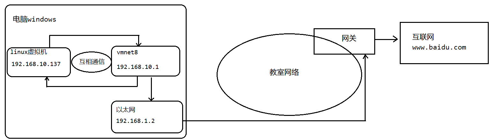

# Linux NAT 网络配置

## 1. Linux NAT网络原理

## 2. linux网络配置的指令

*   ipaddr 在linux查看ip地址
*   ifconfig 在linux查看ip地址
*   ping 是否ping通指定的ip地址
*   ipconfig 在windows操作系统里面查看网络的ip地址

## 3. Linux 网络环境配置（固定ip的方式）

见pdf

## 4. 设置主机名和host映射

见pdf