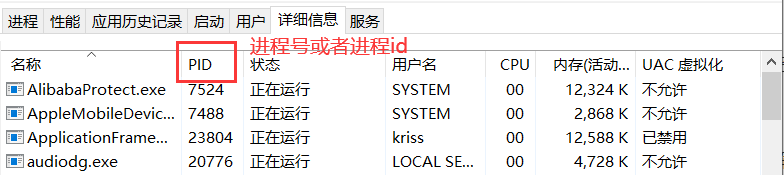
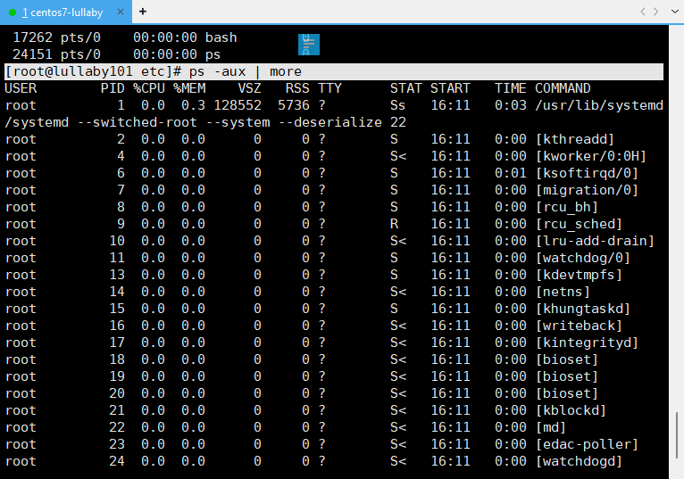

# linux 进程管理

## 1. 进程管理基本介绍

在linux中，每个执行的程序都为一个进程，每个进程都分配了一个id号（pid，进程号）



每个进程都可能以两种形式存在，前台和后台。所谓前台就剩及用户在目录上可以进行操作的（占用屏幕 比如top指令），后台是无法在屏幕上操作的进程

一般系统的进程服务都是以后台进程的形式存在，而且会常驻在系统中直到关机才结束


## 2. 查看系统运行的进程

ps命令是用来查看系统中哪些正在运行，以及他们的运行的状况，可以不加任何参数。

```shell
[root@lullaby101 etc]# ps
   PID TTY          TIME CMD
 17262 pts/0    00:00:00 bash
 24151 pts/0    00:00:00 ps
```

| 字段 | 说明                 |
| ---- | -------------------- |
| PID  | 进程识别号           |
| TTV  | 终端机号             |
| TIME | 此进程所消耗cpu时间  |
| CMD  | 正在执行命令或进程名 |

也可以加上下面的参数，来查看进程的信息

ps -a:显示终端所用的进程信息

ps -u:以用户的格式显示进程的信息

ps -x:显示后台程序运行的参数

ps -ef:使用使用全格式查看所有的进程信息

ps -e:所有的进程

ps -f:全格式显示进程信息

ps -ef | grep 进程名称：查看指定的进程进行

```shell
[root@lullaby101 etc]# ps -aux | more #分页展示进程信息
```



USER: 进程所属的用户名称。

%CPU:进程占用CPU的百分比。

%MEM:进程占用物理内存的百分比。

VSZ:进程占用虚拟内存的大小(KB)。

RSS:进程占用物理内存的大小(KB)。

STAT:进程状态，S-代表睡眠 R-正在运行 D-短期等待 Z-僵死进程 T-被停止的线程。

START:进程启动的时间。

TIME:进程使用CPU的时间。

COMMAND:进程启动所需要的命令和参数。


## 3. 进程的应用实例

需求：以全格式显示当前的所有进程，查看进行的父进程。查看sshd的父进程信息。

```shell
ps -ef | grep sshd
```


## 4. 终止进程

若是某个进程执行一半需要停止时候，或是已经消耗了很大的系统资源时候,可以考虑停止该线程。

基本语法：

kill [选项] 进程号 ：通过进程号杀死/终止进程。

killall：会杀死当前进程和其子进程。

常用选项：

-9 表示强迫进程立即停止


需求1：强制让登陆用户kobe下线

```shell
[root@lullaby101 ~]# ps -ef | grep sshd
root       1149      1  0 12:24 ?        00:00:00 /usr/sbin/sshd -D
root       2274   1149  0 12:38 ?        00:00:00 sshd: root@pts/1
root       2341   1149  0 12:39 ?        00:00:00 sshd: sonnet [priv]
sonnet     2360   2341  0 12:40 ?        00:00:00 sshd: sonnet@pts/0
root       2407   2281  0 12:40 pts/1    00:00:00 grep --color=auto sshd
[root@lullaby101 ~]# kill 2341
```

需求2：终止远程登录服务sshd。不允许远程登录。然后重启sshd服务，允许远程登录。

```shell
[root@lullaby101 ~]# ps -ef | grep sshd
root       1149      1  0 12:24 ?        00:00:00 /usr/sbin/sshd -D
root       3175   3114  0 12:44 pts/0    00:00:00 grep --color=auto sshd
[root@lullaby101 ~]# kill 1149
[root@lullaby101 ~]# /bin/systemctl start sshd.service
[root@lullaby101 ~]# ps -ef | grep sshd
root       3237      1  0 12:46 ?        00:00:00 /usr/sbin/sshd -D
root       3259   3114  0 12:47 pts/0    00:00:00 grep --color=auto sshd
```

需求3：终止多个gedit（记事本打开文件的进程），演示killall。

```shell
[root@lullaby101 ~]# killall gedit
```

需求4：强制杀掉一个终端

```shell
[root@lullaby101 ~]# ps -ef | grep bash
root        764      1  0 12:23 ?        00:00:00 /bin/bash /usr/sbin/ksmtuned
root       2623   2495  0 12:44 ?        00:00:00 /usr/bin/ssh-agent /bin/sh -c exec -l /bin/bash -c "env GNOME_SHELL_SESSION_MODE=classic gnome-session --session gnome-classic"
root       3612   3605  0 12:55 pts/0    00:00:00 bash
root       3652   3605  0 12:55 pts/1    00:00:00 bash
root       3687   3652  0 12:55 pts/1    00:00:00 grep --color=auto bash
[root@lullaby101 ~]# kill 3612
[root@lullaby101 ~]# kill -9 3612
[root@lullaby101 ~]# kill -9 3652
```


## 5. 查看进程树

pstree [选项]，可以更加直观的来查看进程信息。

-p:显示进程的PID。

-u:显示进程的所属用户

*   案例1：以树状的形式显示进程的pid

    ```shell
    [root@lullaby101 ~]# pstree -p
    ```

*   案例2：以树状的形式展示进程的用户信息

    ```shell
    [root@lullaby101 ~]# pstree -u
    ```

    