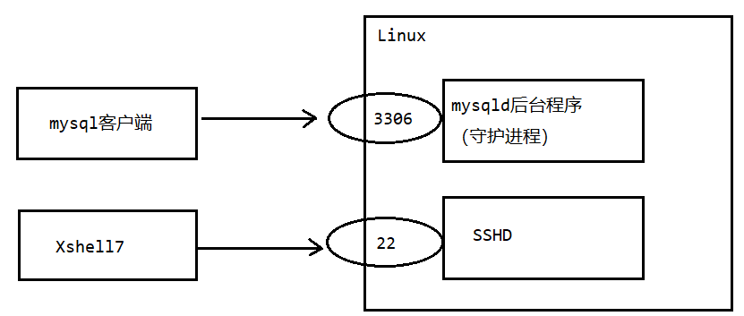
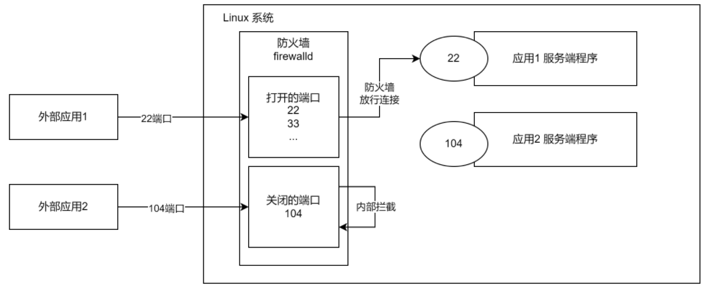

# linux服务管理

service(本质)就是进程，但是是运行在后台的，通常都会监听某个端口，等待其他程序的请求，比如说（mysql3306，sshd222，redis6379)，因为我们又称为守护进程，在Linux中是重要的知识点。




## 1. service管理指令

*   service 服务名 [start|stop,reload,status]
*   在centos7后，很多服务不再使用service而是systemctl
*   service指令管理的服务在/etc/init.d查看

查看network服务的状态

```shell
[root@xq100 init.d]# service network status
Configured devices:
lo ens33
Currently active devices:
lo ens33 virbr0
```

使用service指令，查看，关闭启动network（注意在虚拟系统演示时，因为网络连接会关闭）

```shell
[root@xq100 ~]# service network stop # 此时Xshell连接linux会连接不上
[root@xq100 ~]# service network start #重启网络服务 此时Xshell会连接上linux
```

*   很多的系统服务，可以通过setup指令查看

    ```shell
    [root@xq100 init.d]# setup
    ```


## 2. chkconfig指令

通过chkconfig可以给服务的各个运行级别设置自启动/关闭。

chkconfig指令管理的服务在 /etc/init.d查看。

注意：在Centos 7.0以后，很多服务使用systemctl管理。

基本语法：

*   查看服务 chkconfig --list[|grep “”]
*   设置服务在指定级别启动/关闭 chkconfig --level network on/of

罗列使用chkconfig指令管理的服务信息

```shell
[root@lullaby101 ~]# chkconfig --list

注：该输出结果只显示 SysV 服务，并不包含
原生 systemd 服务。SysV 配置数据
可能被原生 systemd 配置覆盖。 

      要列出 systemd 服务，请执行 'systemctl list-unit-files'。
      查看在具体 target 启用的服务请执行
      'systemctl list-dependencies [target]'。

netconsole     	0:关	1:关	2:关	3:关	4:关	5:关	6:关
network        	0:关	1:关	2:开	3:开	4:开	5:开	
```

上面的数字代表linux的运行级别


案例：对于network服务，进行各种操作，把network在3运行级别，关闭自启动。

```shell
[root@xq100 ~]# chkconfig --level 3 network off 关闭
[root@xq100 ~]# chkconfig --level 5 network on 打开
```

注意：chkconfig重新设置服务自动或者关闭，需要重启机器reboot生效


## 3. systemctl服务管理指令

systemctl 指令管理的服务在/usr/lib/systemd/system中查看。

*   服务启动/停止/重启/重载/查看状态： systemctl [start | stop | restart | status] 服务名
*   查看所有服务的自启动状态

```shell
[root@xq100 system]# systemctl list-unit-files | grep firewall
firewalld.service enabled
[root@xq100 system]# systemctl status firewalld.service # 查看防火墙状态
[root@xq100 system]# systemctl stop firewalld.service # 停止防火墙状态
[root@xq100 system]# systemctl restart firewalld.service # 重启防火墙
```

服务的状态如下：

masked 此服务禁止自启动

static 该服务无法自启动，只能作为其他文件的依赖

enabled 已配置为自启动

disabled 未配置为自启动

*   查看某一服务是否自启动

    ```shell
    [root@xq100 system]# systemctl is-enabled firewalld.service # 知道完整服务名
    enabled
    ```

*   设置服务禁用自启动 (服务运行级别 3、5)

    ```shell
    [root@xq100 system]# systemctl disable firewalld.service
    ```

    

## 4. firewall防火墙指令

防火墙的核心功能：打开或关闭对应端口。关闭端口，则外部的数据请求不能通过对应的端口，与服务器上的程序进行通信

在真正的生产环境，为保证安全，需要启动防火墙并配置打开和关闭的端口。



基本语法：

*   打开端口/允许协议

    firewall-cmd --permanent --add-port=端口号/协议

*   关闭端口/禁用协议

    firewall-cmd --permanent --remove-port=端口号/协议

*   查询端口/协议是否开启

    firewall-cmd --query-port=端口/协议

*   查询防火墙所有开放的端口/协议配置

    firewall-cmd --list-ports

*   重载防火墙

    firewall-cmd --reload

```shell
[root@xq100 system]# firewall-cmd --query-port=3306/tcp # 查询防火墙是否开启3306端口
no
[root@xq100 system]# firewall-cmd --list-ports # 查看防火墙开放的端口有哪些
[root@xq100 system]# firewall-cmd --permanent --add-port=3306/tcp # 开放防火墙对3306端口的访问权限
success
[root@xq100 system]# firewall-cmd --reload # 重载防火墙
success
[root@xq100 system]# firewall-cmd --list-ports
3306/tcp
```

