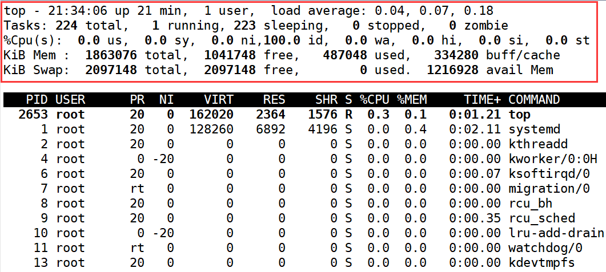
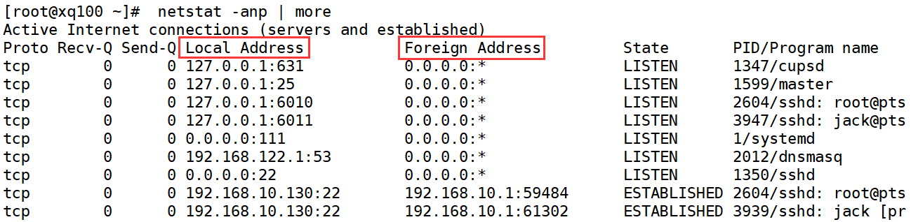
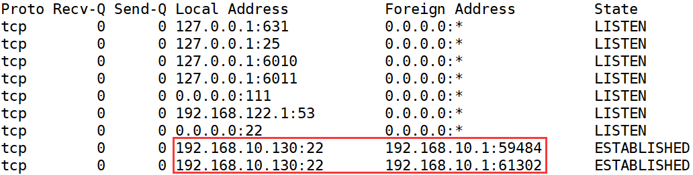
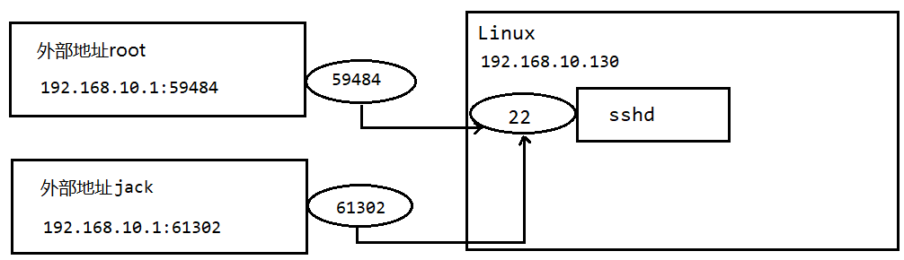

# 动态监控

top与ps命令一样，它们都用来显示正在执行的进程。top与ps最大的不同之处，在于top在执行一段时间可以更新正在运行的进程。

基本语法：

top [选项]

| 选项   | 功能                                   |
| ------ | -------------------------------------- |
| -d秒数 | 指定top命令每隔几秒刷新，默认3秒       |
| -i     | 使用top不显示任何闲置或者僵死的进程    |
| -p     | 通过指定监控ID来仅仅监控某个进程的状态 |


## 1. top指令详解



top -21:34:06: top命令刷新进程的时间

up:系统运行的时长

 user:当前linux系统上面的用户数

load average: 负载值（三个数字相加(0.04+0.07+0.18)除以3 的值>0.7说明负载值很大）

Tasks:总进程数

ruuning: 正在运行的进程数

sleeping:休眠的进程数

stopped:停止的进程数

zombie:僵死的进程数

%(CPU): CPU负载百分比 us:用户占用cpu百分比 sy:系统占用cpu百分比 id:空闲cpu百分比

Mem:描述内存占用情况 total:总共内存 free 空余内存 used：使用了的内存 buff/cache：缓存

Swap:描述交换区内存占用情况


## 2. top指令的交互操作

当我们输入top命令之后，我们可以按下面的字符来进行对应的交互操作。

| 操作 | 功能                            |
| ---- | ------------------------------- |
| P    | 以CPU使用率来排序，默认就是此项 |
| M    | 以内存使用来排序                |
| N    | 以PID排序                       |
| q    | 退出top                         |


## 3. 监控网络状态

基本语法： netstat [选项]

选项说明 -an 按照一定的属性排列输出 -p 显示哪个进程在调用

```she
[root@xq100 ~]# netstat -anp | more
```



Local Address:本机linux的ip地址

Foreign Address:外部的网络地址

tcp:网络协议

127.0.0.1 / 0.0.0.0: 当前linux机器的本地地址

631/25/6060....:应用程序监听的端口号

State: LISTEN 监听状态 ESTABLISHED：建立连接的状态

PID:应用程序的进程号 Program name: 应用程序的名称

如何理解Foreign Address呢?





应用案例:

查看服务名称为sshd的服务信息。

```shell
[root@xq100 ~]# netstat -anp | grep sshd
```

