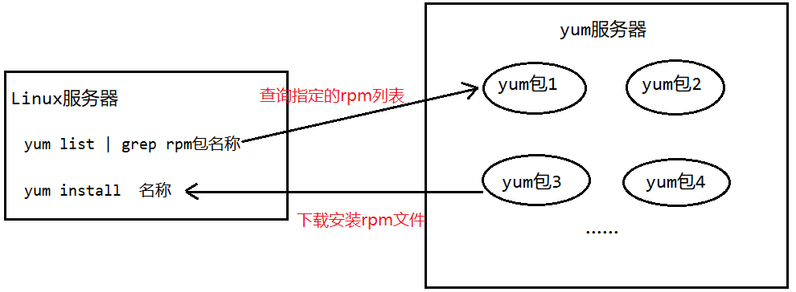

# rpm与yum

## 1. rpm

rpm是互联网下载包和打包和安装工具，他包含在某些linux分版中，他具有生产.rpm扩展名的文件，RPM是redhat package manage（软件包管理工具的缩写），类似于stetup.exe

*   查询所有安装的rpm列表

    ```shell
    [root@xq100 ~]# rpm -qa
    [root@xq100 ~]# rpm -qa | more # 分页展示所有的rpm列表
    ```

*   查询当前系统中是否安装了指定的软件

    ```shell
    [root@xq100 ~]# rpm -qa | grep firefox # 查询linux系统中是否已经安装了火狐浏览器
    firefox-60.8.0-1.el7.centos.x86_64
    ```

一个rpm包的名称命名规则：

firefox：rpm包名

60.8.0-1.el7：rpm包的版本号

centos：rpm包适用于的操作系统

x86_64：适用于64位的操作系统。(如果是i686或者i386说明适用于32位操作系统，noarch表示通用。)

*   查看软件包是否安装

```shell
[root@xq100 opt]# rpm -q firefox # 查看火狐浏览器是否存在rpm包(安装)
firefox-60.8.0-1.el7.centos.x86_64
```

*   查询软件安装的详细信息

    ```shell
    [root@xq100 opt]# rpm -qi firefox # 查询火狐浏览器的详细安装信息
    Name : firefox
    Version : 60.8.0
    Release : 1.el7.centos
    Architecture: x86_64
    Install Date: Thu 18 Aug 2022 02:50:39 PM CST
    Group : Unspecified
    Size : 218777805
    License : MPLv1.1 or GPLv2+ or LGPLv2+
    Signature : RSA/SHA256, Fri 12 Jul 2019 11:01:23 PM CST, Key ID
    24c6a8a7f4a80eb5
    Source RPM : firefox-60.8.0-1.el7.centos.src.rpm
    Build Date : Fri 12 Jul 2019 02:04:42 AM CST
    Build Host : x86-01.bsys.centos.org
    Relocations : (not relocatable)
    Packager : CentOS BuildSystem <http://bugs.centos.org>
    Vendor : CentOS
    URL : https://www.mozilla.org/firefox/
    Summary : Mozilla Firefox Web browser
    Description :
    Mozilla Firefox is an open-source web browser, designed for standards
    compliance, performance and portability.
    ```

*   查看rpm包安装之后的文件

    ```shell
    [root@xq100 opt]# rpm -ql mariadb-libs-5.5.64-1.el7.x86_64
    ```

*   查看指定的文件所属的rpm包

    ```shell
    [root@xq100 opt]# rpm -qf /etc/my.cnf # 查询/etc目录下面的my.cnf文件所属的rpm包
    mariadb-libs-5.5.64-1.el7.x86_64
    ```

*   如果某一个rpm包我们不想要了，我们也可以卸载

    ```shell
    [root@xq100 opt]# rpm -e firefox #删除firefox
    ```

*   注意：如果其它的软件包依赖于要删除的软件包，卸载时则会产生错误。此时如果我们想强制删除，可以添加另外的参数--nodeps。

    ```shell
    [root@xq100 opt]# rpm -e --nodeps firefox #删除firefox
    ```

*   安装rpm包

    基本语法： rpm -ivh RPM包全路径名称

    i=install 安装

    v=verbose 提示

    h=hash 进度条

    案例：使用rpm命令安装firefox

    ```shell
    [root@xq100 ~]# rpm -e firefox # 删除firefox
    [root@xq100 ~]# rpm -q firefox # 查询firefox是否删除成功
    package firefox is not installed
    ```

    (其他步骤见pdf)


## 2. yum

Yum是一个Shell前端软件包管理器，基于RPM包管理，能够从指定的服务器自动下载RPM包并安装，并且可以自动处理依赖性关系，并且一次安装所有的依赖软件包。下面我们用一副图来理解yum命令：



基本指令

查询yum服务器上是否有需要安装的软件：

yum install | grep xxx软件列表

下载并安转指定的yum包：

yum install xxx 的rpm包名


案例：使用yum命令安装firefox

```shell
[root@xq100 opt]# rpm -e firefox #删除firefox 此时我们发现linux服务器里面的火狐浏览器不存在了
[root@xq100 opt]# rpm list | grep firefox # 查看服务器上是否存在指定的rpm包
firefox.x86_64 60.8.0-1.el7.centos @anaconda
firefox.i686 91.12.0-2.el7.centos updates
firefox.x86_64 91.12.0-2.el7.centos updates
[root@xq100 opt]# yum install firefox.x86_64 # 下载并安装firefox，我们再查看linux服务器里面的火狐浏览器，发现又有了
```

